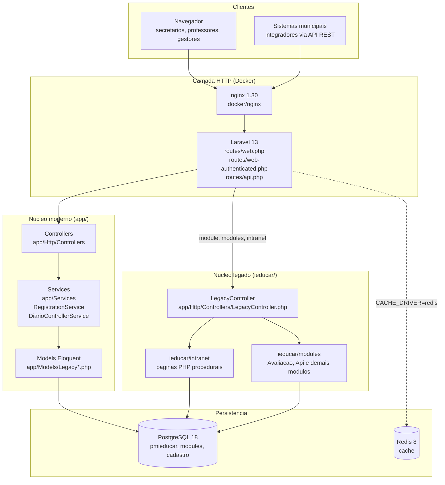

# Arquitetura e Contextualização Técnica do i-Educar

**Issue:** #02 — Levantamento Arquitetural e Contextualização do i-Educar (Milestone M1, Fase 1 da ISO/IEC 25040:2024)

**Objeto:** i-Educar, repositório oficial `portabilis/i-educar`, branch `2.12` (branch padrão do repositório), commit `7903a3efc7689942ee700007f86ed581023aad27` (data do commit: 2026-10-14).

**Data da verificação:** 2026-10-19. Todas as afirmações técnicas abaixo foram conferidas nos arquivos desse commit, salvo quando marcadas como não verificadas na Seção 7.

---

## 1. Síntese

O i-Educar é um **monólito híbrido**. Um núcleo moderno em **Laravel 13** (diretório `app/`) convive com um núcleo **legado em PHP procedural** (diretório `ieducar/`), que ainda atende telas de matrícula, diário e notas (Seção 5). A ponte entre os dois mundos é o controlador `LegacyController`, que recebe as rotas `module`, `modules` e `intranet` e executa os arquivos PHP legados dentro do ciclo de requisição do Laravel.

Os dados ficam em **PostgreSQL**, organizados em esquemas (`pmieducar`, `modules`, `cadastro`), e os dois núcleos acessam as mesmas tabelas. Esse compartilhamento de banco torna necessário analisar os dois lados nas avaliações de Compatibilidade e de Manutenibilidade.

---

## 2. Versões e Componentes Confirmados

Os valores abaixo foram lidos diretamente dos arquivos do branch `2.12`.

| Componente | Versão confirmada | Evidência no repositório oficial | Situação |
| :--- | :--- | :--- | :--- |
| Versão do produto | `2.12.0` (versão declarada) | `composer.json`, campo `version` | Confirmado. A última tag publicada é `2.11.0` (commit `898d2da77ce7fcd0fa8a3bb0bec629defcac1842`, 2026-06-02). A tag `2.12.0` ainda não existe. |
| PHP | `^8.5` (requisito) e imagem `php:8.5-ieducar` | `composer.json`, `require.php`; `docker/php/Dockerfile` (`PHP_VERSION` 8.5); `docker-compose.yml` | Confirmado |
| Laravel | `^13.0` (`laravel/framework`) | `composer.json`, `require.laravel/framework` | Confirmado |
| PostgreSQL | `18` (imagem `postgres:18-alpine`) e cliente `postgresql18-client` | `docker-compose.yml` (serviço `postgres`); `docker/php/Dockerfile` | Confirmado para a stack Docker oficial. A versão mínima suportada não está documentada nas fontes consultadas (ver Seção 7). |
| Driver de banco | `pgsql` (extensões `ext-pgsql` e `pdo_pgsql`) | `composer.json`, `require.ext-pgsql`; `config/database.php` (conexão `pgsql`, `search_path` = `public`) | Confirmado |
| Redis | `8` (imagem `redis:8-alpine`) com `CACHE_DRIVER: redis` | `docker-compose.yml` | Confirmado |
| Nginx | `1.30` (imagem `nginx:1.30-alpine`) | `docker-compose.yml`, serviço `nginx` | Confirmado |
| Filas | Laravel Horizon (`laravel/horizon ^5.15`) em serviço próprio | `composer.json`; serviço `horizon` em `docker-compose.yml` | Confirmado |
| Testes | Pest `^5.0` (com plugin de browser) e PHPUnit via Pest | `composer.json`, `require-dev` | Confirmado |
| Licença | GPL-2.0-or-later | `composer.json`, campo `license` | Confirmado |

A release `2.11.0` (publicada em 2026-06-02) registra a mesma stack como "transição" para o 2.12: Laravel 13, PHP 8.5, PostgreSQL 18 e Nginx 1.30.

---

## 3. Arquitetura Híbrida

O diagrama abaixo mostra os blocos arquiteturais e o sentido das chamadas entre eles.

*Fonte: elaborado pelos autores a partir de `routes/web.php`, `routes/web-authenticated.php`, `app/Http/Controllers/LegacyController.php`, `config/legacy.php` e `docker-compose.yml`.*

### 3.1 Transição de `ieducar/intranet` para `app/Services`

O código legado é organizado em páginas PHP executadas diretamente, muitas delas instanciando classes com prefixo `cls` (por exemplo, `clsPmieducarTurma`). Esse padrão está sendo substituído por código Laravel:

- **Controllers e rotas** ficam em `app/Http/Controllers` e são declarados em `routes/`.
- **Regras de negócio** são encapsuladas em serviços de `app/Services`. Exemplo verificado: `RegistrationService::cancelRegistration` executa o cancelamento de matrícula dentro de `DB::transaction(...)`, desativando enturmações, re-sinalizando a matrícula da série de origem e reordenando as turmas.
- **Acesso a dados** é feito por modelos Eloquent em `app/Models`, como `LegacyRegistration` (tabela `pmieducar.matricula`) e `LegacyEnrollment` (tabela `pmieducar.matricula_turma`).

A release `2.11.0` declara que as classes `cls*` estão depreciadas e serão removidas na próxima versão, em favor dos modelos do framework. Ou seja, a transição é um processo em andamento, não uma condição já concluída: o diretório `ieducar/intranet` continua existindo no branch `2.12`.

---

## 4. O Papel do `LegacyController`

O `LegacyController` (`app/Http/Controllers/LegacyController.php`) é o ponto de entrada que permite ao Laravel executar código legado sem reescrevê-lo. Pelo código do branch `2.12`:

1. **Rotas que o acionam.** Em `routes/web-authenticated.php`, as rotas `module/{uri}`, `modules/{uri}` e `intranet/{uri}` apontam para `LegacyController` (métodos `module`, `modules` e `intranet`). Em `routes/web.php`, `module/Api/{uri}` aponta para o método `api`. Em `routes/web-authenticated.php`, a rota `intranet/educar_matricula_turma_lst.php` também é atendida pelo método `intranet`, com o nome `enrollments.index`.
2. **Localização do código legado.** O caminho é lido de `config('legacy.path')`, que vale `ieducar` por padrão (`config/legacy.php`). Um resolvedor estático (`LegacyController::resolver`) permite que outros módulos reescrevam o caminho do arquivo antes da inclusão.
3. **Execução isolada.** O método `requireFileFromLegacy` troca o diretório de trabalho para `ieducar/intranet`, reconfigura exibição de erros, sincroniza as superglobais (`$_GET`, `$_POST`, `$_FILES`, `$_COOKIE`) com a requisição do Laravel, captura a saída em um buffer e a devolve como `Response` do Laravel, com o código HTTP e os cabeçalhos definidos pelo código legado.
4. **Tratamento de erros.** Se o arquivo legado não existir, lança `NotFoundHttpException`. Exceções de arquivo não encontrado no módulo legado também viram 404, e não 500.

Implicação para a avaliação: o caminho do código legado (`LEGACY_PATH`) e a exibição de erros legados (`LEGACY_DISPLAY_ERRORS`) são configurados em `config/legacy.php` e aplicados pelo `LegacyController`. Por isso, essas variáveis entram no inventário de recursos de ambiente da métrica M1 (Compatibilidade) do GQM.

---

## 5. Módulos Avaliados

### 5.1 Matrícula de Alunos

| Camada | Artefato verificado | Papel |
| :--- | :--- | :--- |
| Modelo | `app/Models/LegacyRegistration.php` (`pmieducar.matricula`) | Vínculo formal do aluno com a escola, a série e o ano letivo. |
| Modelo | `app/Models/LegacyEnrollment.php` (`pmieducar.matricula_turma`) | Enturmação do aluno em turma, com sequencial e data de enturmação. |
| Enum | `app/Models/RegistrationStatus.php` | 14 situações escolares (constantes `APPROVED`, `REPROVED`, `ONGOING`, `TRANSFERRED`, `RECLASSIFIED`, `ABANDONED`, `IN_EXAM`, `APPROVED_PAST_EXAM`, `APPROVED_WITHOUT_EXAM`, `PRE_REGISTRATION`, `APPROVED_WITH_DEPENDENCY`, `APPROVED_BY_BOARD`, `REPROVED_BY_ABSENCE`, `DECEASED`). |
| Serviço | `app/Services/RegistrationService.php` | Mudança de situação, cancelamento atômico e reordenação das turmas. |
| Serviço | `app/Services/EnrollmentService.php` | Operações de enturmação, citadas pelo `RegistrationService`. |
| Controlador | `app/Http/Controllers/EnrollmentController.php` | Rotas de enturmar e remanejar (`routes/web-authenticated.php`). |
| Legado | `ieducar/intranet/educar_matricula_turma_lst.php` | Listagem de enturmações, servida pelo `LegacyController`. |

### 5.2 Lançamento de Notas e Menções

| Camada | Artefato verificado | Papel |
| :--- | :--- | :--- |
| Regra | `app/Models/LegacyEvaluationRule.php` (`modules.regra_avaliacao`) | Regra pedagógica configurável por série e ano. |
| Arredondamento | `app/Models/LegacyRoundingTable.php` (`modules.tabela_arredondamento`) e `app/Models/LegacyValueRoundingTable.php` (`modules.tabela_arredondamento_valor`) | Tabelas de arredondamento e de conversão de valores e menções. |
| Notas | `app/Models/LegacyDisciplineScore.php` (`modules.nota_componente_curricular`), `app/Models/LegacyStudentScore.php` e `app/Models/LegacyRegistrationScore.php` (ambos sobre `modules.nota_aluno`) | Notas por componente curricular e por aluno. |
| Diário moderno | `app/Http/Controllers/DiarioController.php` e `app/Services/DiarioControllerService.php` | Diário eletrônico no núcleo Laravel. |
| Diário legado (tela) | `ieducar/modules/Avaliacao/Views/DiarioController.php` | Controlador legado do diário, servido pelo `LegacyController`. |
| Diário legado (API) | `ieducar/modules/Avaliacao/Views/DiarioApiController.php` | Lançamento de notas, exame e cálculo, com tabelas `modules.nota_exame` e `modules.tabela_arredondamento_valor`. |
| Motor de boletim | `ieducar/modules/Avaliacao/Service/Boletim.php` (`Avaliacao_Service_Boletim`) | Cálculo de médias e situações; grava `modules.nota_componente_curricular_media`. |

---

## 6. Esquemas PostgreSQL

Os nomes de tabela abaixo estão declarados nos modelos e no código legado. Como `config/database.php` define `search_path` como `public`, as tabelas são acessadas por nome qualificado com o esquema.

| Esquema | Tabelas verificadas | Conteúdo |
| :--- | :--- | :--- |
| `pmieducar` | `matricula`, `matricula_turma`, `turma`, `escola_serie_disciplina` | Escolas, turmas, matrículas e enturmações. |
| `modules` | `regra_avaliacao`, `tabela_arredondamento`, `tabela_arredondamento_valor`, `nota_aluno`, `nota_componente_curricular`, `nota_componente_curricular_media`, `nota_exame` | Regras de avaliação, arredondamento e notas. |
| `cadastro` | `pessoa` | Cadastro de pessoas. |

A definição DDL dos esquemas está nas migrações de `database/migrations/` (há subpastas como `legacy`, `data`, `table` e `view`). Não inspecionei essas migrações linha a linha, portanto a criação exata dos esquemas não é afirmada aqui.

---

## 7. Itens Não Verificáveis e Limitações

- **Versão mínima de PostgreSQL.** As fontes consultadas declaram apenas a versão 18 da stack Docker. A afirmação "PostgreSQL 14+", presente na versão anterior do framework GQM, não foi confirmada e foi removida.
- **Status formal de Bem Público Digital.** A equipe classifica o i-Educar como Bem Público Digital. As fontes consultadas confirmam que é software livre (GPL-2.0-or-later) mantido pela Portabilis, mas não encontrei o registro formal de Bem Público Digital. A classificação permanece como afirmação da equipe, não verificada.
- **Análise de código por execução.** Não executei a aplicação nem a suíte de testes do repositório oficial. As afirmações são estáticas, feitas pela leitura dos arquivos do commit indicado.
- **Migrações e DDL.** Não foram lidas as migrações que criam os esquemas e as tabelas.
- **Pacotes externos.** `i-educar-educacenso-package` e `i-educar-reports-package` existem como repositórios oficiais da organização `portabilis`, mas seu código está fora do escopo desta verificação, conforme o GQM.

---

## 8. Correções Feitas nos Documentos Anteriores

A verificação identificou afirmações que não correspondem ao repositório oficial. Elas foram corrigidas nos documentos listados abaixo.

| Afirmação anterior | Onde estava | Verificação no repositório oficial | Correção |
| :--- | :--- | :--- | :--- |
| "PHP >= 8.3" | `docs/gqm_evaluation_framework.md`, Seção 1 | `composer.json` exige `^8.5` | Substituída por PHP 8.5 (`^8.5`) |
| "PostgreSQL 14+" | `docs/gqm_evaluation_framework.md`, Seção 1 | Stack oficial usa PostgreSQL 18; versão mínima não documentada | Substituída por PostgreSQL 18 da stack oficial |
| `DiarioController.php` em `ieducar/modules/Api/Views/` | `docs/gqm_evaluation_framework.md`, M4 | O arquivo não existe nesse diretório; existe em `ieducar/modules/Avaliacao/Views/` | Caminho corrigido |
| Tag estável "v2.12" | `docs/relatorio_de_planejamento_ponto_de_controle_1_i_educar.md`, Seção 2.3 | Não há tag `2.12.0`; a última tag é `2.11.0`; o branch `2.12` declara `2.12.0` | Referência alterada para o branch `2.12` e a tag existente |
| Meta 4.a como "melhorar a gestão dos ambientes escolares" | `docs/relatorio_de_planejamento_ponto_de_controle_1_i_educar.md`, Seção 2.1.6 | Texto oficial da ONU trata de instalações e ambientes de aprendizagem seguros e inclusivos | Texto substituído pelo oficial |

---

## 9. Referências

- Repositório oficial: <https://github.com/portabilis/i-educar>, branch `2.12`, commit `7903a3efc7689942ee700007f86ed581023aad27`.
- Release `2.11.0`: <https://github.com/portabilis/i-educar/releases/tag/2.11.0>, commit `898d2da77ce7fcd0fa8a3bb0bec629defcac1842`.
- Arquivos citados (branch `2.12`): `composer.json`, `config/legacy.php`, `config/database.php`, `docker-compose.yml`, `docker/php/Dockerfile`, `routes/web.php`, `routes/web-authenticated.php`, `app/Http/Controllers/LegacyController.php`, `app/Services/RegistrationService.php`, `app/Models/RegistrationStatus.php`, `app/Models/LegacyRegistration.php`, `app/Models/LegacyEnrollment.php`, `app/Models/LegacyEvaluationRule.php`, `ieducar/modules/Avaliacao/Service/Boletim.php` e `ieducar/modules/Avaliacao/Views/DiarioApiController.php`.
- Pacotes externos oficiais: <https://github.com/portabilis/i-educar-educacenso-package> e <https://github.com/portabilis/i-educar-reports-package>.
- Documentos do projeto: [Visão do Produto](project_overview.md), [Framework GQM](../gqm_evaluation_framework.md) e [Relatório PC1](../relatorio_de_planejamento_ponto_de_controle_1_i_educar.md).
