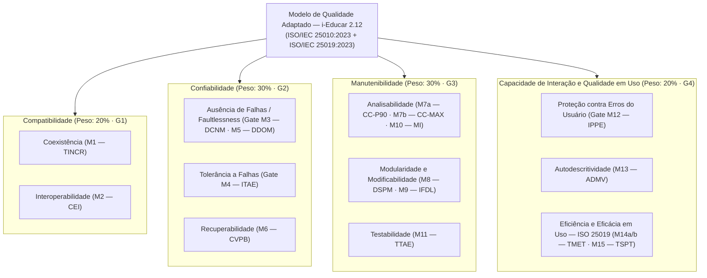

# Modelo de Qualidade e Priorização de Características

A avaliação adota o modelo de qualidade de produto da **ISO/IEC 25010:2023** (*Product Quality Model*), articulado de forma complementar com o modelo de qualidade em uso da **ISO/IEC 25019:2023** (*Quality-in-Use Model*).

---

## 1. Critério Sistemático de Seleção e Priorização ($C = I \times R$)

Para selecionar as características avaliadas de modo objetivo, todas as nove características de produto da **ISO/IEC 25010:2023** foram pontuadas de `1` (muito baixo) a `5` (muito alto) em três dimensões:

- **Impacto no Domínio ($I$):** Gravidade das consequências pedagógicas, legais ou operacionais caso a característica falhe nos módulos de Matrícula e Notas.
- **Risco Arquitetural ($R$):** Probabilidade de problemas técnicos decorrentes da arquitetura híbrida (Laravel + legado PHP) do i-Educar.
- **Viabilidade de Coleta ($V$):** Possibilidade de medir a característica de forma objetiva e reprodutível em laboratório local durante o semestre (requisito de corte: $V \ge 3$).
- **Criticidade ($C = I \times R$):** Produto entre Impacto e Risco, usado para ordenar e selecionar as 4 características prioritárias.

**Tabela 1 — Matriz de priorização das características da ISO/IEC 25010:2023 para o i-Educar**

| Característica (ISO/IEC 25010:2023) | Impacto ($I$) | Risco ($R$) | Criticidade ($C = I \times R$) | Viabilidade ($V$) | Decisão | Peso no $\text{IQM}$ | Justificativa Técnica e de Domínio |
| :--- | :---: | :---: | :---: | :---: | :---: | :---: | :--- |
| **Confiabilidade** (*Reliability*) | `5` | `5` | **`25`** | `5` | **Incluída** | **30%** | Erros em cálculo de notas ou gravações parciais corrompem históricos escolares oficiais. |
| **Manutenibilidade** (*Maintainability*) | `5` | `5` | **`25`** | `5` | **Incluída** | **30%** | A coexistência entre `ieducar/` (legado) e `app/` (Laravel) eleva a complexidade e o atrito de dados. |
| **Capacidade de Interação** (*Interaction Capability*) + **Qualidade em Uso** (ISO 25019) | `5` | `4` | **`20`** | `4` | **Incluída** | **20%** | Interfaces complexas de matrícula e diário exigem bloqueio de erros de digitação e baixo tempo de tarefa. |
| **Compatibilidade** (*Compatibility*) | `4` | `4` | **`16`** | `5` | **Incluída** | **20%** | Prefeituras hospedam múltiplos serviços no mesmo host e integram dados via API REST. |
| **Adequação Funcional** (*Functional Suitability*) | `5` | `3` | `15` | `4` | Excluída *(coberta em G2)* | — | A exatidão funcional crítica do cálculo de notas já é coberta pelo Gate Binário `M3` em Confiabilidade. |
| **Segurança** (*Security*) | `5` | `3` | `15` | `2` | Excluída | — | Testes de intrusão profundos fogem ao escopo pedagógico de matrícula/notas e à infraestrutura local. |
| **Eficiência de Desempenho** (*Performance Efficiency*) | `3` | `3` | `9` | `2` | Excluída | — | Benchmarks realistas para milhares de escolas simultâneas exigiriam cluster de produção indisponível. |
| **Flexibilidade** (*Flexibility*) | `2` | `2` | `4` | `3` | Excluída | — | A implantação padronizada via Docker Compose reduz a necessidade de adaptação a múltiplos SOs. |
| **Ausência de Risco** (*Safety*) | `1` | `1` | `1` | `1` | Excluída | — | Sistema administrativo de gestão escolar sem risco físico direto à vida ou ao meio ambiente. |

*Fonte: Elaborado pelos autores com base na ISO/IEC 25010:2023 e ISO/IEC 25040:2024.*

---

## 2. Representação do Modelo de Qualidade Adaptado

A Figura 1 apresenta o recorte exato das características e subcaracterísticas mantidas no estudo e seu vínculo direto com os quatro objetivos GQM (`G1` a `G4`).

**Figura 1 — Modelo de qualidade adaptado para a avaliação do i-Educar 2.12. Fonte: elaborado pelos autores com base na ISO/IEC 25010:2023 e ISO/IEC 25019:2023.**
