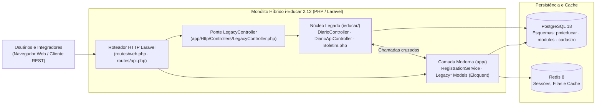

# Produto e Componentes Avaliados (i-Educar 2.12)

## 1. Identificação do Objeto de Avaliação

- **Nome do Produto:** **i-Educar** (*Educational Management Information System*)
- **Repositório Oficial:** [`portabilis/i-educar`](https://github.com/portabilis/i-educar) · **Licença:** `GPL-2.0-or-later`
- **Versão / Branch Alvo:** `2.12.0` (`branch 2.12`)
- **Commit Congelado para Avaliação:** `7903a3efc7689942ee700007f86ed581023aad27`
- **Stack Tecnológica Declarada:** PHP `^8.5`, Laravel `^13.0`, PostgreSQL `18`, Redis `8`, Nginx `1.30`, PHPUnit / Pest `^5.0`.

O **i-Educar** é a maior plataforma livre de gestão escolar municipal do Brasil, catalogada pelo Banco Interamericano de Desenvolvimento (BID) como Bem Público Digital para a administração de redes de ensino básico.

---

## 2. Arquitetura de Monólito Híbrido

O sistema opera como um **monólito híbrido** que articula duas gerações arquiteturais sobre a mesma base de dados relacional PostgreSQL:

1. **Camada Moderna (`app/`, `routes/`, `database/`):** Implementada em Laravel 13, concentra serviços de domínio (`app/Services/`), modelos Eloquent (`app/Models/Legacy*.php`) que mapeiam tabelas históricas e rotas modernas de API REST (`routes/api.php`).
2. **Núcleo Legado (`ieducar/intranet/`, `ieducar/modules/`):** Escrito em PHP procedural/orientado a objetos de geração anterior, contém controladores clássicos de tela (`clsCadastro`), lógica pedagógica complexa (`Avaliacao_Service_Boletim`) e endpoints internos de diário (`DiarioController`, `DiarioApiController`).
3. **Ponte de Integração (`LegacyController`):** As requisições para rotas legadas (`intranet/`, `module/`, `modules/`) passam pelo `app/Http/Controllers/LegacyController.php`, que altera o diretório de execução e encapsula a resposta gerada pelos scripts legados dentro do ciclo HTTP do Laravel.

**Figura 1 — Arquitetura de contexto e interação entre a camada Laravel e o núcleo legado do i-Educar. Fonte: elaboração própria.**

---

## 3. Componentes Críticos Selecionados para Avaliação

A avaliação concentra-se nos dois módulos de maior criticidade operacional e pedagógica da plataforma, detalhados na Tabela 1.

**Tabela 1 — Módulos, classes, controladores e tabelas PostgreSQL sob avaliação**

| Módulo Funcional | Esquemas e Tabelas PostgreSQL | Classes, Serviços e Controladores em Escopo | Responsabilidade no Domínio Escolar | Métricas GQM Associadas |
| :--- | :--- | :--- | :--- | :---: |
| **1. Matrícula de Alunos** | `pmieducar.matricula` `pmieducar.matricula_turma` `cadastro.pessoa` | `app/Services/RegistrationService.php` `app/Models/LegacyRegistration.php` `app/Models/LegacyEnrollment.php` `app/Models/RegistrationStatus.php` | Vínculo formal do estudante no ano letivo, enturmação, remanejamento, transferência e controle de 14 situações cadastrais. | `M1`, `M2`, `M4`, `M5`, `M6`, `M7`–`M13`, `M14a`, `M15` |
| **2. Lançamento de Notas e Menções** | `modules.regra_avaliacao` `modules.tabela_arredondamento_valor` `modules.nota_aluno` `modules.nota_componente_curricular` | `ieducar/modules/Avaliacao/Service/Boletim.php` `ieducar/modules/Avaliacao/Views/DiarioController.php` `ieducar/modules/Avaliacao/Views/DiarioApiController.php` `app/Models/LegacyEvaluationRule.php` `app/Models/LegacyValueRoundingTable.php` | Parametrização de regras pedagógicas, cálculo de médias ponderadas/aritméticas, recuperação, arredondamento e fechamento de boletim. | `M1`, `M2`, `M3`, `M4`, `M5`, `M6`, `M7`–`M13`, `M14b`, `M15` |

*Fonte: Elaborado pelos autores a partir da inspeção do repositório `portabilis/i-educar`.*

Para detalhes adicionais sobre a estrutura de pastas e dependências, consulte também a documentação técnica de [Visão do Produto](../agents/project_overview.md) e [Arquitetura Detalhada](../agents/architecture.md).
