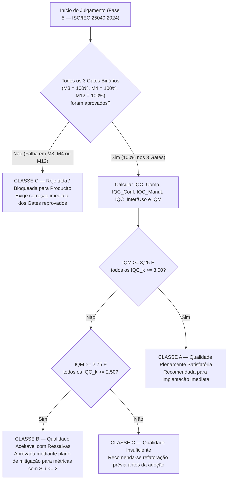

# Níveis de Pontuação e Critérios de Julgamento

Esta página descreve como os valores brutos medidos na Fase 4 são convertidos em pontuações discretas ($S_i \in \{1, 2, 3, 4\}$) e agregados nos Índices de Qualidade por Característica ($\text{IQC}_k$) e no Índice Global de Qualidade dos Módulos ($\text{IQM}$) para a decisão da Fase 5 (**ISO/IEC 25040:2024**).

---

## 1. Escala Ordinal de Pontuação e Limiares Operacionais

As métricas graduais são avaliadas em quatro níveis de qualidade:

- **Nível 4 (Excelente):** Atende plenamente às melhores práticas normativas sem ressalvas.
- **Nível 3 (Bom / Aceitável):** Atende ao limiar da hipótese operacional, permitindo operação segura.
- **Nível 2 (Regular / Alerta):** Abaixo do desejável; requer plano de refatoração ou mitigação de curto prazo.
- **Nível 1 (Crítico / Inaceitável):** Risco elevado à integridade, manutenção ou operação escolar.

**Tabela 1 — Limiares de pontuação e pesos locais das 17 linhas operacionais**

| Linha | Sigla | Tipo / Peso Local ($w_i$) | Nível 4 (Excelente) | Nível 3 (Bom) | Nível 2 (Regular) | Nível 1 (Crítico) |
| :---: | :---: | :---: | :---: | :---: | :---: | :---: |
| **`M1`** | `TINCR` | Gradual ($0{,}50$ em `G1`) | $= 100\%$ | $[85\%, 100\%)$ | $[70\%, 85\%)$ | $< 70\%$ |
| **`M2`** | `CEI` | Gradual ($0{,}50$ em `G1`) | $= 100\%$ | $[85\%, 100\%)$ | $[70\%, 85\%)$ | $< 70\%$ |
| **`M3`** | `DCNM` | **Gate Binário Eliminatório** | $= 100\%$ *(Aprovado)* | — | — | $< 100\%$ *(Bloqueado)* |
| **`M4`** | `ITAE` | **Gate Binário Eliminatório** | $= 100\%$ *(Aprovado)* | — | — | $< 100\%$ *(Bloqueado)* |
| **`M5`** | `DDOM` | Gradual ($0{,}50$ em `G2` ou renormalizada) | $\le 0{,}5$ | $(0{,}5,\; 2{,}0]$ | $(2{,}0,\; 5{,}0]$ | $> 5{,}0$ |
| **`M6`** | `CVPB` | Gradual ($0{,}50$ em `G2` ou $1{,}00$ se `M5` n/m) | $= 100\%$ | $[95\%, 100\%)$ | $[85\%, 95\%)$ | $< 85\%$ |
| **`M7a`** | `CC-P90` | Gradual ($0{,}10$ em `G3`) | $\le 5$ | $[6, 10]$ | $[11, 15]$ | $> 15$ |
| **`M7b`** | `CC-MAX` | Gradual ($0{,}10$ em `G3`) | $\le 10$ | $[11, 20]$ | $[21, 30]$ | $> 30$ |
| **`M8`** | `DSPM` | Gradual ($0{,}20$ em `G3`) | $\le 0{,}15$ | $(0{,}15,\; 0{,}30]$ | $(0{,}30,\; 0{,}45]$ | $> 0{,}45$ |
| **`M9`** | `IFDL` | Gradual ($0{,}20$ em `G3`) | $\le 0{,}10$ | $(0{,}10,\; 0{,}25]$ | $(0{,}25,\; 0{,}40]$ | $> 0{,}40$ |
| **`M10`** | `MI` | Gradual ($0{,}20$ em `G3`) | $\ge 80$ | $[65,\; 80)$ | $[50,\; 65)$ | $< 50$ |
| **`M11`** | `TTAE` | Gradual ($0{,}20$ em `G3`) | $\ge 90\%$ | $[80\%, 90\%)$ | $[60\%, 80\%)$ | $< 60\%$ |
| **`M12`** | `IPPE` | **Gate Binário Eliminatório** | $= 100\%$ *(Aprovado)* | — | — | $< 100\%$ *(Bloqueado)* |
| **`M13`** | `ADMV` | Gradual ($0{,}30$ em `G4`) | $\ge 90\%$ | $[80\%, 90\%)$ | $[60\%, 80\%)$ | $< 60\%$ |
| **`M14a`** | `TMET-T1` | Gradual ($0{,}20$ em `G4`) | $\le 1{,}30$ | $(1{,}30,\; 2{,}00]$ | $(2{,}00,\; 3{,}00]$ | $> 3{,}00$ |
| **`M14b`** | `TMET-T2` | Gradual ($0{,}20$ em `G4`) | $\le 1{,}30$ | $(1{,}30,\; 2{,}00]$ | $(2{,}00,\; 3{,}00]$ | $> 3{,}00$ |
| **`M15`** | `TSPT` | Gradual ($0{,}30$ em `G4`) | $\ge 85\%$ | $[70\%, 85\%)$ | $[50\%, 70\%)$ | $< 50\%$ |

*Fonte: Elaborado pelos autores. Para `M5 (DDOM)`, na ausência de logs reais de produção de 90 dias, aplica-se a política pré-declarada de exclusão com renormalização em `G2` ($\text{IQC}_{\text{Conf}} = S_{M6}$), sem atribuição de nota zero ou dado sintético.*

---

## 2. Fórmulas de Agregação ($\text{IQC}_k$ e $\text{IQM}$)

Para cada característica $k$, o **Índice de Qualidade por Característica ($\text{IQC}_k \in [1, 4]$)** é dado pela soma ponderada das pontuações discretas $S_i$ de suas métricas graduais:

$$\text{IQC}_k = \sum_{i \in \mathcal{M}_k} w_i \cdot S_i, \quad \text{com } \sum_{i \in \mathcal{M}_k} w_i = 1$$

O **Índice Global de Qualidade dos Módulos ($\text{IQM} \in [1, 4]$)** combina as quatro características segundo os pesos derivados na matriz de priorização da Fase 1:

$$\text{IQM} = 0{,}20 \cdot \text{IQC}_{\text{Comp}} + 0{,}30 \cdot \text{IQC}_{\text{Conf}} + 0{,}30 \cdot \text{IQC}_{\text{Manut}} + 0{,}20 \cdot \text{IQC}_{\text{Inter/Uso}}$$

---

## 3. Fluxograma e Regras de Classificação da Release

**Figura 1 — Árvore de decisão multicritério para classificação final dos módulos avaliados. Fonte: elaboração própria.**
