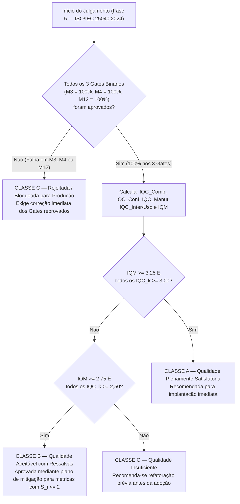

# Níveis de Pontuação e Critérios de Julgamento

Esta página descreve como os valores brutos medidos na Fase 4 são convertidos em pontuações discretas ($S_i \in \{1, 2, 3, 4\}$) e agregados nos Índices de Qualidade por Característica ($\text{IQC}_k$) e no Índice Global de Qualidade dos Módulos ($\text{IQM}$) para a decisão da Fase 5 (**ISO/IEC 25040:2024**).

---

## 1. Escala Ordinal de Pontuação e Limiares Operacionais

As métricas graduais são avaliadas em quatro níveis de qualidade:

- **Nível 4 (Excelente):** Atende plenamente às melhores práticas normativas sem ressalvas.
- **Nível 3 (Bom / Aceitável):** Atende ao limiar da hipótese operacional, permitindo operação segura.
- **Nível 2 (Regular / Alerta):** Abaixo do desejável; requer plano de refatoração ou mitigação de curto prazo.
- **Nível 1 (Crítico / Inaceitável):** Risco elevado à integridade, manutenção ou operação escolar.

**Tabela 1 — Limiares de pontuação e pesos locais das 17 linhas operacionais (calibrados conforme Seção 4 do Framework GQM)**

| Linha | Sigla | Tipo / Peso Local ($w_i$) | Nível 4 (Excelente) | Nível 3 (Bom) | Nível 2 (Regular) | Nível 1 (Crítico) |
| :---: | :---: | :---: | :---: | :---: | :---: | :---: |
| **`M1`** | `TINCR` | Gradual ($w = 1{,}0$ em `G1`) | $= 100\%$ | $[85{,}0\%, 100\%)$ | $[70{,}0\%, 85{,}0\%)$ | $< 70{,}0\%$ |
| **`M2`** | `CEI` | Gradual ($w = 1{,}0$ em `G1`) | $= 100\%$ | $[85{,}0\%, 100\%)$ | $[70{,}0\%, 85{,}0\%)$ | $< 70{,}0\%$ |
| **`M3`** | `DCNM` | **Gate Binário ($w = 2{,}0$ em `G2`)** | $= 100\%$ *(Aprovado)* | — | — | $< 100\%$ *(Bloqueado)* |
| **`M4`** | `ITAE` | **Gate Binário ($w = 2{,}0$ em `G2`)** | $= 100\%$ *(Aprovado)* | — | — | $< 100\%$ *(Bloqueado)* |
| **`M5`** | `DDOM` | Gradual ($w = 1{,}2$ em `G2` ou excluída) | $\le 0{,}5$ | $(0{,}5,\; 2{,}0]$ | $(2{,}0,\; 5{,}0]$ | $> 5{,}0$ |
| **`M6`** | `CVPB` | Gradual ($w = 1{,}0$ em `G2`) | $= 100\%$ | $[95{,}0\%, 100\%)$ | $[90{,}0\%, 95{,}0\%)$ | $< 90{,}0\%$ |
| **`M7a`** | `CC-P90` | Gradual ($w = 1{,}0$ em `G3`) | $\le 10$ | $(10, 15]$ | $(15, 20]$ | $> 20$ |
| **`M7b`** | `CC-MAX` | Gradual ($w = 1{,}2$ em `G3`) | $\le 15$ | $(15, 30]$ | $(30, 50]$ | $> 50$ |
| **`M8`** | `DSPM` | Gradual ($w = 0{,}8$ em `G3`) | $\le 0{,}20$ | $(0{,}20,\; 0{,}35]$ | $(0{,}35,\; 0{,}50]$ | $> 0{,}50$ |
| **`M9`** | `IFDL` | Gradual ($w = 0{,}6$ em `G3`) | $\le 1{,}0$ | $(1{,}0,\; 2{,}5]$ | $(2{,}5,\; 4{,}0]$ | $> 4{,}0$ |
| **`M10`** | `MI` | Gradual ($w = 1{,}0$ em `G3`) | $\ge 80$ | $[60,\; 80)$ | $[40,\; 60)$ | $< 40$ |
| **`M11`** | `TTAE` | Gradual ($w = 1{,}4$ em `G3`) | $\ge 95{,}0\%$ | $[85{,}0\%, 95{,}0\%)$ | $[70{,}0\%, 85{,}0\%)$ | $< 70{,}0\%$ |
| **`M12`** | `IPPE` | **Gate Binário ($w = 2{,}0$ em `G4`)** | $= 100\%$ *(Aprovado)* | — | — | $< 100\%$ *(Bloqueado)* |
| **`M13`** | `ADMV` | Gradual ($w = 0{,}8$ em `G4`) | $\ge 98{,}0\%$ | $[90{,}0\%, 98{,}0\%)$ | $[80{,}0\%, 90{,}0\%)$ | $< 80{,}0\%$ |
| **`M14a`** | `TMET-T1` | Gradual ($w = 0{,}8$ em `G4` ou excluída) | $\le 1{,}50$ | $(1{,}50,\; 2{,}00]$ | $(2{,}00,\; 3{,}00]$ | $> 3{,}00$ |
| **`M14b`** | `TMET-T2` | Gradual ($w = 1{,}0$ em `G4` ou excluída) | $\le 1{,}50$ | $(1{,}50,\; 2{,}00]$ | $(2{,}00,\; 3{,}00]$ | $> 3{,}00$ |
| **`M15`** | `TSPT` | Gradual ($w = 1{,}0$ em `G4` ou excluída) | $\ge 90{,}0\%$ | $[70{,}0\%, 90{,}0\%)$ | $[50{,}0\%, 70{,}0\%)$ | $< 50{,}0\%$ |

*Fonte: Elaborado pelos autores conforme Tabela 4 do [Framework GQM](../gqm_evaluation_framework.md). Para `M5 (DDOM)` e `M14a/M14b/M15`, aplicam-se as regras pré-declaradas de exclusão e renormalização das Seções 3.1 e 3.4 do [Plano Operacional de Medição e Testes](../plano_medicao_testes.md).*

---

## 2. Fórmulas de Agregação ($\text{IQC}_k$ e $\text{IQM}$)

Para cada característica $k$, o **Índice de Qualidade por Característica ($\text{IQC}_k \in [1, 4]$)** é dado pela média ponderada das pontuações discretas $S_i$ de suas métricas válidas:

$$\text{IQC}_k = \frac{\sum_{i \in \mathcal{M}_k} w_i \cdot S_i}{\sum_{i \in \mathcal{M}_k} w_i}$$

O **Índice Global de Qualidade dos Módulos ($\text{IQM} \in [1, 4]$)** combina as quatro características segundo os pesos derivados na matriz de priorização da Fase 1:

$$\text{IQM} = 0{,}20 \cdot \text{IQC}_{\text{Comp}} + 0{,}30 \cdot \text{IQC}_{\text{Conf}} + 0{,}30 \cdot \text{IQC}_{\text{Manut}} + 0{,}20 \cdot \text{IQC}_{\text{Inter/Uso}}$$

> **Resultados Executados na Fase 5:** Consulte a memória de cálculo completa ($\text{IQC}_{\text{Comp}} = 3{,}50$, $\text{IQC}_{\text{Conf, parcial}} = 4{,}00$, $\text{IQC}_{\text{Manut}} = 2{,}20 \to 2{,}60$, $\text{IQC}_{\text{Interação}} = 3{,}14$ e $\text{IQM} = 3{,}19 \to 3{,}31$) na [Seção 9 do Plano Operacional de Medição e Testes](../plano_medicao_testes.md#9-conclusao-da-avaliacao-agregacao-multicriterio-julgamento-dos-gates-e-parecer-tecnico-fase-5-isoiec-250402024).

---

## 3. Fluxograma e Regras de Classificação da Release

**Figura 1 — Árvore de decisão multicritério para classificação final dos módulos avaliados. Fonte: elaboração própria.**
