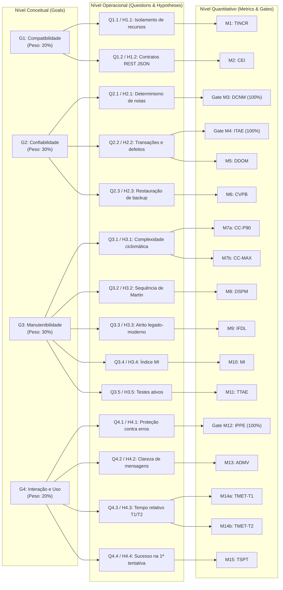

# Diagrama GQM e Matriz de Rastreabilidade

## 1. Árvore GQM Completa (3 Níveis: Conceitual, Operacional e Quantitativo)

A Figura 1 ilustra o encadeamento entre os **4 Objetivos (`G1`–`G4`)**, as **14 Questões (`Q1.1`–`Q4.4`)** e as **17 Linhas Operacionais (`M1`–`M15`)**.

**Figura 1 — Árvore GQM completa com os 4 objetivos, 14 questões e 17 linhas operacionais. Fonte: elaboração própria.**

---

## 2. Matriz de Rastreabilidade (Fase 1 → Fase 2 → Fase 3 → Fase 4)

A Tabela 1 garante que nenhuma métrica seja órfã de requisito e que todas as questões possuam procedimento de coleta e issue responsável na Entrega 2.

**Tabela 1 — Rastreabilidade ponta a ponta entre Stakeholders, Normas, GQM e Issues de Execução**

| Stakeholder Principal (Fase 1) | Norma e Subcaracterística | ODS | Objetivo / Questão / Hipótese | Linha Operacional (Fase 2) | Procedimento no Plano de Testes (Fase 3) | Issue de Coleta na Entrega 2 (Fase 4) |
| :--- | :--- | :---: | :---: | :---: | :--- | :---: |
| Equipes de TI Municipais | ISO 25010 · Coexistência | ODS 16 (`16.6`) | `G1` · `Q1.1` · `H1.1` | **`M1` (`TINCR`)** | Subida simultânea de 2ª instância via `.env` | [#38](https://github.com/FCTE-Qualidade-de-Software-1/2026-2_T02_GRACE_HOPPER/issues/38) |
| Equipes de TI / Integradores | ISO 25010 · Interoperabilidade | ODS 16 (`16.6`) | `G1` · `Q1.2` · `H1.2` | **`M2` (`CEI`)** | Validação de JSON Schema na API REST | [#39](https://github.com/FCTE-Qualidade-de-Software-1/2026-2_T02_GRACE_HOPPER/issues/39) |
| Professores e Secretarias | ISO 25010 · Ausência de Falhas | ODS 4 (`4.1`) | `G2` · `Q2.1` · `H2.1` | **`Gate M3` (`DCNM`)** | Oráculo determinístico sobre `Boletim.php` | [#40](https://github.com/FCTE-Qualidade-de-Software-1/2026-2_T02_GRACE_HOPPER/issues/40) |
| Secretarias Municipais | ISO 25010 · Tolerância a Falhas | ODS 4 (`4.1`) | `G2` · `Q2.2` · `H2.2` | **`Gate M4` (`ITAE`)** | Injeção de exceção e auditoria de *rollback* SQL | [#41](https://github.com/FCTE-Qualidade-de-Software-1/2026-2_T02_GRACE_HOPPER/issues/41) |
| Secretarias Municipais | ISO 25010 · Ausência de Falhas | ODS 4 (`4.1`) | `G2` · `Q2.2` · `H2.2` | **`M5` (`DDOM`)** | Triagem documental de logs operacionais (90d) | [#41](https://github.com/FCTE-Qualidade-de-Software-1/2026-2_T02_GRACE_HOPPER/issues/41) |
| Secretarias e Equipes de TI | ISO 25010 · Recuperabilidade | ODS 4 (`4.1`) | `G2` · `Q2.3` · `H2.3` | **`M6` (`CVPB`)** | `pg_dump` e `pg_restore` em instância limpa | [#42](https://github.com/FCTE-Qualidade-de-Software-1/2026-2_T02_GRACE_HOPPER/issues/42) |
| Mantenedores (Portabilis) | ISO 25010 · Analisabilidade | ODS 16 (`16.6`) | `G3` · `Q3.1` · `H3.1` | **`M7a` (`CC-P90`)** **`M7b` (`CC-MAX`)** | Extração AST/tokens via `evaluate-quality.php` | [#43](https://github.com/FCTE-Qualidade-de-Software-1/2026-2_T02_GRACE_HOPPER/issues/43) |
| Mantenedores (Portabilis) | ISO 25010 · Modularidade / Modif. | ODS 16 (`16.6`) | `G3` · `Q3.2` · `H3.2` | **`M8` (`DSPM`)** | Cálculo de $C_a, C_e, A, I, D$ por componente | [#44](https://github.com/FCTE-Qualidade-de-Software-1/2026-2_T02_GRACE_HOPPER/issues/44) |
| Mantenedores (Portabilis) | ISO 25010 · Modularidade / Modif. | ODS 16 (`16.6`) | `G3` · `Q3.3` · `H3.3` | **`M9` (`IFDL`)** | Inspeção de adaptações em `app/Models/Legacy*.php` | [#44](https://github.com/FCTE-Qualidade-de-Software-1/2026-2_T02_GRACE_HOPPER/issues/44) |
| Mantenedores (Portabilis) | ISO 25010 · Analisabilidade | ODS 16 (`16.6`) | `G3` · `Q3.4` · `H3.4` | **`M10` (`MI`)** | Cálculo de Halstead, McCabe e LOC por método | [#43](https://github.com/FCTE-Qualidade-de-Software-1/2026-2_T02_GRACE_HOPPER/issues/43) |
| Mantenedores (Portabilis) | ISO 25010 · Testabilidade | ODS 16 (`16.6`) | `G3` · `Q3.5` · `H3.5` | **`M11` (`TTAE`)** | Execução Pest/PHPUnit e contagem de *skips* | [#44](https://github.com/FCTE-Qualidade-de-Software-1/2026-2_T02_GRACE_HOPPER/issues/44) |
| Secretários e Professores | ISO 25010 · Proteção contra Erros | ODS 4 (`4.a`) | `G4` · `Q4.1` · `H4.1` | **`Gate M12` (`IPPE`)** | Submissão de $\ge 12$ cenários inválidos | [#45](https://github.com/FCTE-Qualidade-de-Software-1/2026-2_T02_GRACE_HOPPER/issues/45) |
| Secretários e Professores | ISO 25010 · Autodescritividade | ODS 4 (`4.a`) | `G4` · `Q4.2` · `H4.2` | **`M13` (`ADMV`)** | Revisão independente por pares das mensagens | [#45](https://github.com/FCTE-Qualidade-de-Software-1/2026-2_T02_GRACE_HOPPER/issues/45) |
| Secretários e Professores | ISO 25019 · Eficiência em Uso | ODS 4 (`4.a`) | `G4` · `Q4.3` · `H4.3` | **`M14a` (`TMET-T1`)** **`M14b` (`TMET-T2`)** | Sessões cronometradas (`P01`–`P05`) sob TCLE | [#46](https://github.com/FCTE-Qualidade-de-Software-1/2026-2_T02_GRACE_HOPPER/issues/46) |
| Secretários e Professores | ISO 25019 · Eficácia em Uso | ODS 4 (`4.a`) | `G4` · `Q4.4` · `H4.4` | **`M15` (`TSPT`)** | Taxa de acerto na 1ª submissão (`T1` e `T2`) | [#46](https://github.com/FCTE-Qualidade-de-Software-1/2026-2_T02_GRACE_HOPPER/issues/46) |

*Fonte: Elaborado pelos autores.*
