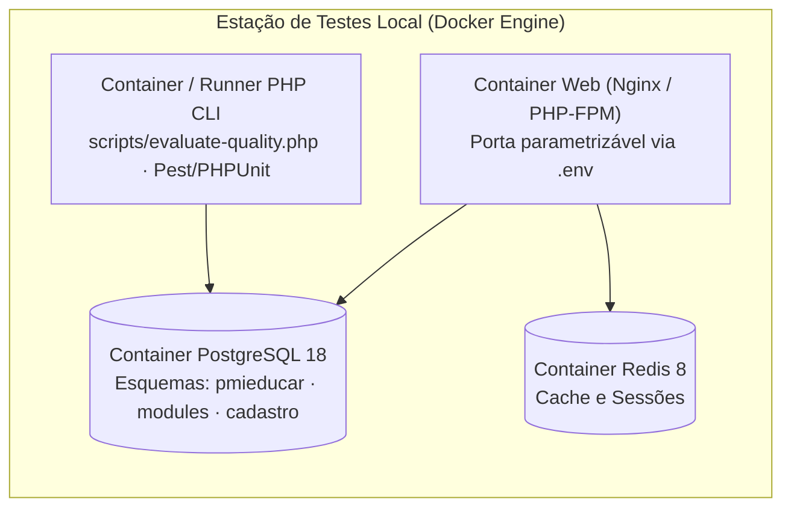

# Ambiente Conteinerizado e Instrumentos de Coleta

Para garantir **reprodutibilidade estrita** e isolamento em relação a dados escolares reais, toda a avaliação do **i-Educar 2.12** foi projetada sobre um ambiente Docker local controlado e scripts versionados neste repositório.

---

## 1. Identificação da Versão Congelada do Produto

**Tabela 1 — Parâmetros de congelamento do objeto de avaliação**

| Parâmetro | Valor Especificado | Finalidade no Plano de Avaliação |
| :--- | :--- | :--- |
| **Repositório Oficial** | `https://github.com/portabilis/i-educar` | Fonte primária do código aberto sob licença GPL-2.0-or-later |
| **Branch / Versão Declarada** | `branch 2.12` · Versão `2.12.0` | Linha estável da série 2.12 analisada pela equipe |
| **Commit Hash Fixado** | `7903a3efc7689942ee700007f86ed581023aad27` | Garante que todas as medições (`M1` a `M15`) operem sobre a mesma árvore de código |
| **Banco de Dados e Cache** | PostgreSQL `18-alpine` e Redis `8-alpine` | Persistência relacional dos esquemas `pmieducar`, `modules` e `cadastro` |
| **Runtime de Aplicação** | PHP `8.5` + Composer + Nginx `1.30` | Execução da camada Laravel 13 (`app/`) e do núcleo legado (`ieducar/`) |

*Fonte: Elaborado pelos autores.*

---

## 2. Topologia do Ambiente (`docker-compose.yml`)

O arquivo `docker-compose.yml` na raiz do repositório orquestra os serviços necessários para os testes de coexistência (`M1`), interoperabilidade (`M2`), confiabilidade (`M3`, `M4`, `M6`) e sessões de uso (`M12` a `M15`):



**Figura 1 — Topologia de containers para execução isolada dos testes. Fonte: elaboração própria.**

### Comandos de Verificação e Subida do Ambiente

```bash
# 1. Validar sintaxe e interpolação do manifesto Docker Compose
docker compose config

# 2. Subir os serviços de banco e aplicação em segundo plano
docker compose up -d

# 3. Executar o instrumento de análise estática (Fase 3 / Fase 4)
php scripts/evaluate-quality.php
```

---

## 3. Motor de Extração Estática (`scripts/evaluate-quality.php`)

Para coletar de maneira determinística e auditável as métricas de **Manutenibilidade (`G3`)** sobre a arquitetura híbrida do i-Educar, a equipe estruturou o script `scripts/evaluate-quality.php` em PHP CLI nativo (utilizando a extensão `tokenizer` / `PhpToken`):

- **Alvos de inspeção estática em escopo:**
  - `app/Services/RegistrationService.php` e modelos `app/Models/Legacy*.php` (camada moderna Laravel);
  - `ieducar/modules/Avaliacao/Service/Boletim.php`, `DiarioController.php` e `DiarioApiController.php` (núcleo legado).
- **Grandezas extraídas:**
  - Complexidade Ciclomática de McCabe $v(G_m)$ por método concreto para cálculo do **Percentil 90 (`M7a — CC-P90`)** e do **Máximo (`M7b — CC-MAX`)**;
  - Acoplamento aferente ($C_a$), acoplamento eferente ($C_e$), abstratividade ($A$) e instabilidade ($I$) para cálculo da **Distância da Sequência Principal de Martin (`M8 — DSPM`)**;
  - Contagem de adaptações defensivas nos modelos Eloquent `Legacy*` para o **Índice de Fricção de Dados (`M9 — IFDL`)**;
  - Volume de Halstead ($HV_m$), linhas de código ($LOC_m$) e **Índice de Manutenibilidade Normalizado (`M10 — MI`)**;
  - Varredura de casos de teste ativos vs. desativados com `markTestSkipped()` (`M11 — TTAE`).

Para o passo a passo operacional de cada medição, acesse o [Plano de Medição e Testes Completo](../plano_medicao_testes.md).
