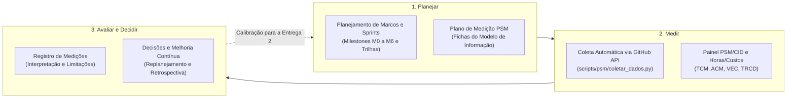

# Gestão do Projeto (PSM/CID)

A equipe **Grace Hopper** acompanha o progresso, o esforço e a qualidade de processo do projeto utilizando o framework **PSM (*Practical Software and Systems Measurement*)**, adaptado para desenvolvimento contínuo e iterativo (**PSM/CID**).

Em conformidade com as diretrizes da disciplina **Qualidade de Software 1 (FGA0315)**, a gestão cobre as **três categorias fundamentais de informação** do PSM/CID, respondendo a questões gerenciais objetivas para apoiar decisões de replanejamento entre o **Ponto de Controle 1 (Entrega 1)** e o **Ponto de Controle 2 (Entrega 2)**.

**Tabela 1 — Categorias de informação do PSM/CID e indicadores adotados pela equipe**

| Categoria de Informação (PSM) | Indicador Adotado | Origem no PSM/CID | Pergunta Gerencial que Responde |
| :--- | :--- | :--- | :--- |
| **Calendário e Progresso** | **TCM** (*Taxa de Conclusão por Milestone*) **ACM** (*Aderência ao Calendário dos Marcos*) | Parte 1, Tabela 5, linhas 1 e 3; Parte 2, seção 8.3 (*Committed vs. Completed*) | As tarefas planejadas para cada marco estão sendo concluídas dentro do cronograma previsto? |
| **Recursos e Custos** | **VEC** (*Variação de Esforço e Custo*) | Parte 1, Tabela 5, linhas 8 e 9 (*Estimate vs. Actual Effort*) | As estimativas de horas e orçamento ($R\$ 50,00/\text{h}$) refletem o esforço real dedicado pela equipe? |
| **Desempenho dos Processos** | **TRCD** (*Taxa de Revisão e Conformidade Documental*) | Parte 1, Tabela 5, linha 26 (*Process Compliance / Build & Peer Review*) | As entregas integradas à `main` passam pela validação automática estrita e por revisão de pares? |

*Fonte: Elaborado pelos autores com base em McGarry et al. (2002) e no guia PSM/CID (2021).*

---

## Ciclo do Processo de Medição

A organização desta seção reflete as três macroatividades do modelo de processo de medição do PSM: **Planejar a medição**, **Executar a medição** e **Avaliar os resultados para decidir ações de melhoria**.

**Figura 1 — Fluxo do processo de medição PSM/CID aplicado ao projeto. Fonte: adaptado de McGarry et al. (2002).**

---

## Navegação pelas Etapas de Gestão

1. Planejar

<a class="gh-item" href="planejamento/"><small>Milestones M0 a M6 · Trilhas A–F · Releases</small>Planejamento de marcos e sprints</a>
<a class="gh-item" href="plano-de-medicao/"><small>Instâncias do modelo de informação (Aula 09)</small>Plano de medição do PSM</a>

2. Medir

<a class="gh-item" href="../indicadores_psm/"><small>Gráficos SVG e CSVs gerados via GitHub Actions</small>Painel de indicadores PSM/CID</a>
<a class="gh-item" href="horas-custos/"><small>Critério AG-C5 · Memória de cálculo · 72h / R$ 3.600</small>Horas, custos e esforço</a>
<a class="gh-item" href="../painel_projeto/"><small>Consulta viva à API pública do GitHub</small>Painel em tempo real</a>

3. Avaliar e Decidir

<a class="gh-item" href="registro-de-medicoes/"><small>Valores medidos, interpretação e ações E1 → E2</small>Registro de medições e decisões</a>
<a class="gh-item" href="../sobre/retrospectiva-1/"><small>Três Porquinhos e plano Quê-Quem-Quando</small>Retrospectiva da Entrega 1</a>

---

## Rastreabilidade Direta no GitHub

- **Milestones do repositório:** [Acessar Milestones M0 a M6](https://github.com/FCTE-Qualidade-de-Software-1/2026-2_T02_GRACE_HOPPER/milestones)
- **Issues e Tarefas Atômicas:** [Acessar Issues no GitHub](https://github.com/FCTE-Qualidade-de-Software-1/2026-2_T02_GRACE_HOPPER/issues)
- **Pull Requests e Revisões:** [Acessar Pull Requests](https://github.com/FCTE-Qualidade-de-Software-1/2026-2_T02_GRACE_HOPPER/pulls)
- **Catálogo completo de especificação de issues:** [Ver documento consolidado de Issues e Releases](../gestao_projeto_releases_milestones_issues.md)
