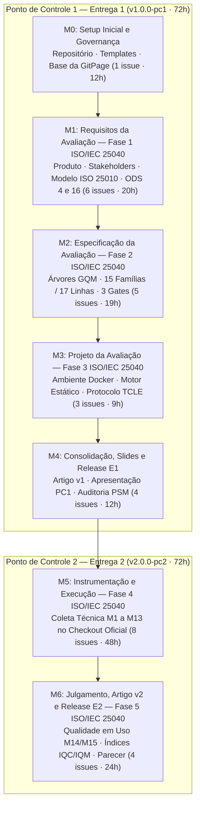

# Planejamento de Marcos, Sprints e Releases

> Este documento apresenta a **linha de base planejada** para os marcos e entregas do projeto. Os resultados apurados automaticamente estão no [Painel de Indicadores PSM/CID](../indicadores_psm.md), o detalhamento financeiro em [Horas, Custos e Esforço](horas-custos.md) e a análise de desvios no [Registro de Medições](registro-de-medicoes.md).

## 1. Visão Geral e Organização do Trabalho

- **Projeto:** Avaliação de Qualidade do Sistema de Gestão Escolar **i-Educar** (versão `2.12.0`, commit `7903a3efc7689942ee700007f86ed581023aad27`)
- **Disciplina:** Qualidade de Software 1 (FGA0315 — UnB/FGA) · Semestre 2026.2 · Turma 02
- **Metodologia de Gestão:** Ciclos orientados por marcos (*Milestones* `M0` a `M6`), alinhados às cinco atividades da **ISO/IEC 25040:2024** e monitorados com o **PSM/CID**.
- **Organização da Equipe:** 6 integrantes com alocação igualitária de esforço (`12h` por integrante em cada entrega, totalizando `72h` na Entrega 1 e `72h` na Entrega 2).

---

## 2. Fluxo de Marcos do Projeto (Milestones M0 a M6)

Os marcos conectam as fases do processo de avaliação da **ISO/IEC 25040:2024** às duas releases formais da disciplina (`v1.0.0-pc1` e `v2.0.0-pc2`).

**Figura 1 — Sequência dos Milestones M0 a M6 nos Pontos de Controle 1 e 2. Fonte: elaboração própria.**

---

## 3. Linha de Base — Entrega 1 (Milestones M0 a M4)

Na Entrega 1, o trabalho foi estruturado em **19 issues atômicas** distribuídas entre os marcos `M0` e `M4`, todas concluídas (`19/19 — 100%`).

**Tabela 1 — Resumo das issues planejadas e concluídas na Entrega 1**

| Issue | Milestone | Título Resumido e Escopo | Responsável(is) | Horas Planejadas | Status |
| :---: | :---: | :--- | :--- | :---: | :---: |
| [#01](https://github.com/FCTE-Qualidade-de-Software-1/2026-2_T02_GRACE_HOPPER/issues/1) | `M0` | Configuração do repositório, templates e base da GitPage | Arthur Soares Parente | 12h | Concluída |
| [#02](https://github.com/FCTE-Qualidade-de-Software-1/2026-2_T02_GRACE_HOPPER/issues/2) | `M1` | Levantamento arquitetural e contextualização do i-Educar | Ítalo Alves Sampaio | 4h | Concluída |
| [#03](https://github.com/FCTE-Qualidade-de-Software-1/2026-2_T02_GRACE_HOPPER/issues/3) | `M1` | Mapeamento de stakeholders e alinhamento aos ODS 4 e 16 | Ítalo Alves Sampaio | 4h | Concluída |
| [#04](https://github.com/FCTE-Qualidade-de-Software-1/2026-2_T02_GRACE_HOPPER/issues/4) | `M1` | Delimitação de escopo e adaptação do modelo ISO/IEC 25010:2023 | Gustavo Silva Rodrigues | 4h | Concluída |
| [#17](https://github.com/FCTE-Qualidade-de-Software-1/2026-2_T02_GRACE_HOPPER/issues/17) | `M1` | Propósito da avaliação, uso pretendido e matriz de priorização | Gabriel Barbaceli | 3h | Concluída |
| [#18](https://github.com/FCTE-Qualidade-de-Software-1/2026-2_T02_GRACE_HOPPER/issues/18) | `M1` | Publicação da GitPage navegável para o Ponto de Controle 1 | Arthur Soares / Fábio Araujo | 4h | Concluída |
| [#19](https://github.com/FCTE-Qualidade-de-Software-1/2026-2_T02_GRACE_HOPPER/issues/19) | `M1` | Sincronização da tabela de esforço e custos dos 6 integrantes | Gabriel Barbaceli | 1h | Concluída |
| [#05](https://github.com/FCTE-Qualidade-de-Software-1/2026-2_T02_GRACE_HOPPER/issues/5) | `M2` | Especificação GQM de Compatibilidade (`M1` e `M2`) | Gabriel Barbaceli | 4h | Concluída |
| [#06](https://github.com/FCTE-Qualidade-de-Software-1/2026-2_T02_GRACE_HOPPER/issues/6) | `M2` | Especificação GQM de Confiabilidade e Gates Binários (`M3`–`M6`) | Ítalo Alves Sampaio | 4h | Concluída |
| [#07](https://github.com/FCTE-Qualidade-de-Software-1/2026-2_T02_GRACE_HOPPER/issues/7) | `M2` | Especificação GQM de Manutenibilidade (`M7a`–`M11`) | Ítalo Alves Sampaio | 4h | Concluída |
| [#08](https://github.com/FCTE-Qualidade-de-Software-1/2026-2_T02_GRACE_HOPPER/issues/8) | `M2` | Especificação GQM de Capacidade de Interação e Uso (`M12`–`M15`) | Gabriel Barbaceli | 4h | Concluída |
| [#09](https://github.com/FCTE-Qualidade-de-Software-1/2026-2_T02_GRACE_HOPPER/issues/9) | `M2` | Formulação matemática dos limiares e regras de decisão (`IQM`) | Arthur Soares Parente | 3h | Concluída |
| [#10](https://github.com/FCTE-Qualidade-de-Software-1/2026-2_T02_GRACE_HOPPER/issues/10) | `M3` | Planejamento do ambiente de testes conteinerizado (Docker) | Arthur Soares Parente | 3h | Concluída |
| [#11](https://github.com/FCTE-Qualidade-de-Software-1/2026-2_T02_GRACE_HOPPER/issues/11) | `M3` | Planejamento das ferramentas de análise estática e motor PHP | Arthur Soares Parente | 3h | Concluída |
| [#12](https://github.com/FCTE-Qualidade-de-Software-1/2026-2_T02_GRACE_HOPPER/issues/12) | `M3` | Protocolo experimental de usabilidade e minuta do TCLE | Arthur Soares Parente | 3h | Concluída |
| [#13](https://github.com/FCTE-Qualidade-de-Software-1/2026-2_T02_GRACE_HOPPER/issues/13) | `M4` | Redação e revisão da 1ª versão do artigo científico (IEEE) | Fábio Araujo / Gustavo / Ricardo | 12h | Concluída |
| [#14](https://github.com/FCTE-Qualidade-de-Software-1/2026-2_T02_GRACE_HOPPER/issues/14) | `M4` | Elaboração da apresentação de slides para o Ponto de Controle 1 | Fábio Santos Araujo | 2h | Concluída |
| [#15](https://github.com/FCTE-Qualidade-de-Software-1/2026-2_T02_GRACE_HOPPER/issues/15) | `M4` | Auditoria de conformidade com as rubricas e tabela PSM/CID | Arthur Soares / Ricardo Branco | 2h | Concluída |
| [#16](https://github.com/FCTE-Qualidade-de-Software-1/2026-2_T02_GRACE_HOPPER/issues/16) | `M4` | Publicação da GitPage, tag `v1.0.0-pc1` e Release E1 | Arthur Soares Parente | 1h | Concluída |

*Fonte: Elaborado pelos autores a partir das issues dos milestones M0 a M4 no GitHub.*

---

## 4. Linha de Base — Entrega 2 (Milestones M5 e M6 · Trilhas A a F)

Para o Ponto de Controle 2 (Fases 4 e 5 da ISO/IEC 25040:2024), o trabalho foi organizado em **6 Trilhas de Especialidade** com **12 issues atômicas de 6 horas cada (`72h` totais)**, garantindo que cada integrante conduza 2 issues (`12h` = `16,67%` do esforço).

**Tabela 2 — Planejamento das Trilhas e Issues da Entrega 2 (Milestones M5 e M6)**

| Trilha | Responsável | Issue | Milestone | Objetivo Operacional | Horas |
| :--- | :--- | :---: | :---: | :--- | :---: |
| **Trilha A** *Infraestrutura e Persistência* | Arthur Soares Parente | [#38](https://github.com/FCTE-Qualidade-de-Software-1/2026-2_T02_GRACE_HOPPER/issues/38) | `M5` | Provisionar checkout oficial do i-Educar 2.12 e medir coexistência (`M1 — TINCR`) | 6h |
| **Trilha A** *Infraestrutura e Persistência* | Arthur Soares Parente | [#42](https://github.com/FCTE-Qualidade-de-Software-1/2026-2_T02_GRACE_HOPPER/issues/42) | `M5` | Executar bateria de backup e restauração isolada dos esquemas críticos (`M6 — CVPB`) | 6h |
| **Trilha B** *API REST e Interação* | Gabriel Barbaceli | [#39](https://github.com/FCTE-Qualidade-de-Software-1/2026-2_T02_GRACE_HOPPER/issues/39) | `M5` | Congelar contratos JSON Schema e testar interoperabilidade da API REST (`M2 — CEI`) | 6h |
| **Trilha B** *API REST e Interação* | Gabriel Barbaceli | [#45](https://github.com/FCTE-Qualidade-de-Software-1/2026-2_T02_GRACE_HOPPER/issues/45) | `M5` | Executar catálogo de entradas inválidas (`Gate M12 — IPPE`) e auditar mensagens (`M13 — ADMV`) | 6h |
| **Trilha C** *Confiabilidade e Transações* | Gustavo Silva Rodrigues | [#40](https://github.com/FCTE-Qualidade-de-Software-1/2026-2_T02_GRACE_HOPPER/issues/40) | `M5` | Executar suíte de oráculo pedagógico sobre `Avaliacao_Service_Boletim` (`Gate M3 — DCNM`) | 6h |
| **Trilha C** *Confiabilidade e Transações* | Gustavo Silva Rodrigues | [#41](https://github.com/FCTE-Qualidade-de-Software-1/2026-2_T02_GRACE_HOPPER/issues/41) | `M5` | Injetar falhas em escritas compostas (`Gate M4 — ITAE`) e documentar triagem de `M5 — DDOM` | 6h |
| **Trilha D** *Análise Estática e Testes* | Ítalo Alves Sampaio | [#43](https://github.com/FCTE-Qualidade-de-Software-1/2026-2_T02_GRACE_HOPPER/issues/43) | `M5` | Evoluir parser em `scripts/evaluate-quality.php` e extrair `M7a` (CC-P90), `M7b` (CC-MAX) e `M10` (MI) | 6h |
| **Trilha D** *Análise Estática e Testes* | Ítalo Alves Sampaio | [#44](https://github.com/FCTE-Qualidade-de-Software-1/2026-2_T02_GRACE_HOPPER/issues/44) | `M5` | Medir acoplamento de Martin (`M8 — DSPM`), atrito legado (`M9 — IFDL`) e testes ativos (`M11 — TTAE`) | 6h |
| **Trilha E** *Qualidade em Uso e Julgamento* | Ricardo Lucas Winchello | [#46](https://github.com/FCTE-Qualidade-de-Software-1/2026-2_T02_GRACE_HOPPER/issues/46) | `M6` | Conduzir sessões supervisionadas com TCLE nas tarefas `T1` e `T2` (`M14a`, `M14b` e `M15`) | 6h |
| **Trilha E** *Qualidade em Uso e Julgamento* | Ricardo Lucas Winchello | [#47](https://github.com/FCTE-Qualidade-de-Software-1/2026-2_T02_GRACE_HOPPER/issues/47) | `M6` | Calcular $\text{IQC}_k$ e $\text{IQM}$, julgar os 3 Gates Binários e emitir parecer conclusivo (Fase 5) | 6h |
| **Trilha F** *Artigo v2 e Release E2* | Fábio Santos Araujo | [#48](https://github.com/FCTE-Qualidade-de-Software-1/2026-2_T02_GRACE_HOPPER/issues/48) | `M6` | Redigir seções de Execução, Resultados, Discussão, Ameaças à Validade e Conclusão no Artigo v2 | 6h |
| **Trilha F** *Artigo v2 e Release E2* | Fábio Santos Araujo | [#49](https://github.com/FCTE-Qualidade-de-Software-1/2026-2_T02_GRACE_HOPPER/issues/49) | `M6` | Produzir slides do PC2, auditar horas finais do PSM/CID e publicar a Release E2 (`v2.0.0-pc2`) | 6h |
| **TOTAL (E2)** | **6 Integrantes** | **12 Issues** | `M5` e `M6` | **Execução e Julgamento Completo da Avaliação** | **72h** |

*Fonte: Elaborado pelos autores. Os critérios de aceitação detalhados de cada issue constam no [Catálogo Detalhado de Issues](../gestao_projeto_releases_milestones_issues.md).*

---

## 5. Especificação das Releases

-   **Release E1 — Ponto de Controle 1 (`v1.0.0-pc1`)**

    ---

    - **Escopo:** Fases 1, 2 e 3 da ISO/IEC 25040:2024 (Requisitos, Especificação GQM e Projeto da Avaliação).
    - **Artefatos entregues:** GitPage estruturada, 1ª versão do Artigo IEEE (`docs/artigo/main.pdf`), Apresentação PC1 (`docs/apresentacao_pc1.pdf`), minuta do TCLE e linha de base do PSM/CID (`72h` / `R$ 3.600,00`).
    - **Status:** Publicada no GitHub Releases.

-   **Release E2 — Ponto de Controle 2 (`v2.0.0-pc2`)**

    ---

    - **Escopo:** Fases 4 e 5 da ISO/IEC 25040:2024 (Execução das medições `M1`–`M15`, julgamento multicritério e parecer por stakeholder).
    - **Artefatos previstos:** Evidências brutas e scripts executados, parecer técnico conclusivo ($\text{IQC}_k$ e $\text{IQM}$), versão final do Artigo IEEE, slides finais e consolidação das medições do PSM/CID.
    - **Status:** Planejada para o encerramento da disciplina.

