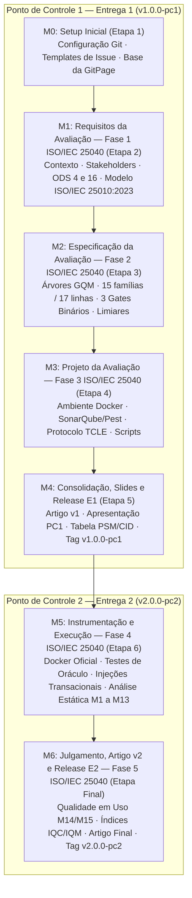

# Gestão do Projeto: Milestones, Issues e Releases (FGA0315)
<!-- Documento de Planejamento e Acompanhamento de Gestão de Qualidade -->

**Disciplina:** Qualidade de Software 1 (FGA0315) — Universidade de Brasília (UnB / FGA)  
**Semestre Letivo:** 2026.2  
**Objeto de Avaliação:** i-Educar (`projeto-qualidade`)  
**Normas de Referência:** ISO/IEC 25010:2023, ISO/IEC 25019:2023, ISO/IEC 25040:2024, ISO/IEC 25002:2024  
**Frameworks de Apoio:** GQM (*Goal-Question-Metric*) e PSM/CID (*Practical Software Measurement / Cost, Income, Duration*)

---

## 1. Quadro de Gestão de Equipe e Recursos (PSM/CID — Critério AG-C5)

A tabela a seguir consolida a composição da equipe de avaliação. Cada integrante dispõe de campos reservados para registrar sua identificação acadêmica, definir o valor da sua hora de trabalho profissional e computar o esforço e custo despendido no Ponto de Controle 1 (Entrega 1) e no Ponto de Controle 2 (Entrega 2).

### Tabela 1-A — Alocação de Papéis, Esforço e Custos Individuais (Ponto de Controle 1 — Realizado)

| Integrante (Nome e Matrícula) | Usuário GitHub | Papel Principal na Equipe | Horas Planejadas (h) | Valor / Hora (R$) | Custo Total (R$) | % Esforço (AG-C5) | Status de Assinatura |
| :--- | :---: | :--- | :---: | :---: | :---: | :---: | :---: |
| **Arthur Soares Parente** Matrícula: `23/2036770` | `@ArthurDevWorks` | Gestor de Configuração / GitPage | 12h | R$ 50,00 | R$ 600,00 | **16,67%** | [x] Confirmado |
| **Fábio Santos Araujo** Matrícula: `22/2022082` | `@fabiofonteles1` | Redação do Artigo (Overleaf) | 12h | R$ 50,00 | R$ 600,00 | **16,67%** | [x] Confirmado |
| **Gabriel Barbaceli** Matrícula: `21/1045122` | `@Nibaacriba` | GitPage / Especificação GQM (Compatibilidade e Capacidade de Interação) | 12h | R$ 50,00 | R$ 600,00 | **16,67%** | [x] Confirmado |
| **Gustavo Silva Rodrigues** Matrícula: `23/2036887` | `@g-srodrigues` | Analista de Qualidade / Modelo ISO/IEC 25010 e Escopo | 12h | R$ 50,00 | R$ 600,00 | **16,67%** | [x] Confirmado |
| **Ítalo Alves Sampaio de Oliveira** Matrícula: `23/2037937` | `@ItaloSamP` | Analista do Produto e Stakeholders / GitPage | 12h | R$ 50,00 | R$ 600,00 | **16,66%** | [x] Confirmado |
| **Ricardo Lucas Winchello Vieira Branco** Matrícula: `22/1008409` | `@ChickRicks` | Revisão da GitPage e do artigo | 12h | R$ 50,00 | R$ 600,00 | **16,66%** | [x] Confirmado |
| **TOTAIS ACUMULADOS (PC1)** | — | **Entregáveis Consolidados — Ponto de Controle 1** | **72h** | Média: R$ 50,00/h | **R$ 3.600,00** | **100%** | **6 de 6 Ativos** |

*Fonte: Elaborado pelos autores conforme diretrizes da disciplina FGA0315 e modelo PSM/CID.*

### Tabela 1-B — Alocação de Papéis, Esforço e Custos Planejados (Ponto de Controle 2 — Entrega 2)

O planejamento da Entrega 2 estrutura **12 issues atômicas de 6 horas cada (72 horas totais)** divididas em **6 trilhas de especialidade**. Cada integrante assume 2 issues (12 horas = R$ 600,00 = 16,67% do esforço da entrega), mantendo a proporcionalidade exata exigida pelo critério **AG-C5**:

| Integrante (Nome e Matrícula) | Usuário GitHub | Trilha Sugerida (Entrega 2) | Issues no GitHub | Horas Planejadas (h) | Valor / Hora (R$) | Custo Total (R$) | % Esforço (AG-C5) | Status |
| :--- | :---: | :--- | :---: | :---: | :---: | :---: | :---: | :---: |
| **Arthur Soares Parente** Matrícula: `23/2036770` | `@ArthurDevWorks` | **Trilha A:** Infraestrutura Docker, Coexistência e Backup | [#38](https://github.com/FCTE-Qualidade-de-Software-1/2026-2_T02_GRACE_HOPPER/issues/38), [#42](https://github.com/FCTE-Qualidade-de-Software-1/2026-2_T02_GRACE_HOPPER/issues/42) | 12h | R$ 50,00 | R$ 600,00 | **16,67%** | Aberto |
| **Fábio Santos Araujo** Matrícula: `22/2022082` | `@fabiofonteles1` | **Trilha F:** Redação Científica Final, Auditoria e Release E2 | [#48](https://github.com/FCTE-Qualidade-de-Software-1/2026-2_T02_GRACE_HOPPER/issues/48), [#49](https://github.com/FCTE-Qualidade-de-Software-1/2026-2_T02_GRACE_HOPPER/issues/49) | 12h | R$ 50,00 | R$ 600,00 | **16,67%** | Aberto |
| **Gabriel Barbaceli** Matrícula: `21/1045122` | `@Nibaacriba` | **Trilha B:** Interoperabilidade REST e Proteção de Interação | [#39](https://github.com/FCTE-Qualidade-de-Software-1/2026-2_T02_GRACE_HOPPER/issues/39), [#45](https://github.com/FCTE-Qualidade-de-Software-1/2026-2_T02_GRACE_HOPPER/issues/45) | 12h | R$ 50,00 | R$ 600,00 | **16,67%** | Aberto |
| **Gustavo Silva Rodrigues** Matrícula: `23/2036887` | `@g-srodrigues` | **Trilha C:** Confiabilidade, Oráculo Pedagógico e Transações | [#40](https://github.com/FCTE-Qualidade-de-Software-1/2026-2_T02_GRACE_HOPPER/issues/40), [#41](https://github.com/FCTE-Qualidade-de-Software-1/2026-2_T02_GRACE_HOPPER/issues/41) | 12h | R$ 50,00 | R$ 600,00 | **16,67%** | Aberto |
| **Ítalo Alves Sampaio de Oliveira** Matrícula: `23/2037937` | `@ItaloSamP` | **Trilha D:** Análise Estática, Arquitetura e Testabilidade | [#43](https://github.com/FCTE-Qualidade-de-Software-1/2026-2_T02_GRACE_HOPPER/issues/43), [#44](https://github.com/FCTE-Qualidade-de-Software-1/2026-2_T02_GRACE_HOPPER/issues/44) | 12h | R$ 50,00 | R$ 600,00 | **16,66%** | Aberto |
| **Ricardo Lucas Winchello Vieira Branco** Matrícula: `22/1008409` | `@ChickRicks` | **Trilha E:** Qualidade em Uso e Julgamento (Fase 5) | [#46](https://github.com/FCTE-Qualidade-de-Software-1/2026-2_T02_GRACE_HOPPER/issues/46), [#47](https://github.com/FCTE-Qualidade-de-Software-1/2026-2_T02_GRACE_HOPPER/issues/47) | 12h | R$ 50,00 | R$ 600,00 | **16,66%** | Aberto |
| **TOTAIS PLANEJADOS (PC2)** | — | **12 Novas Issues — Fases 4 e 5 ISO/IEC 25040:2024** | **72h** | Média: R$ 50,00/h | **R$ 3.600,00** | **100%** | **6 de 6 Ativos** |

*Fonte: Elaborado pelos autores. A distribuição nominal acima reflete a trilha sugerida por especialidade, sujeita a confirmação de auto-atribuição no GitHub.*

---

## 2. Estrutura de Marcos do Projeto (Milestones M0 a M6)

Os marcos de entrega do projeto alinham as 5 Fases do Processo de Avaliação da **ISO/IEC 25040:2024** ao calendário de avaliações da disciplina FGA0315.

### 2.1 Detalhamento dos Marcos

-   **Milestone M0 — Setup Inicial e Governança** · `Etapa 1`

    ---

    - **Objetivo:** Estabelecer controle de versão, governança de branches, modelos de issues e base da GitPage.
    - **Entregáveis:** Templates em `.github/ISSUE_TEMPLATE/`, `README.md`, `CONTRIBUTING.md` e `mkdocs.yml`.
    - **Critério de Conclusão:** Repositório operando com rastreabilidade de commits e templates validados.

-   **Milestone M1 — Requisitos da Avaliação (Fase 1)** · `Etapa 2`

    ---

    - **Objetivo:** Definir propósito, partes interessadas, recorte das 4 características da ISO/IEC 25010:2023 e alinhamento aos ODS.
    - **Entregáveis:** Seção da Fase 1 documentada, matriz de priorização ($C = I \times R$) e rastreabilidade ODS 4 e 16.
    - **Critério de Conclusão:** Aprovação dos requisitos da avaliação no Ponto de Controle 1.

-   **Milestone M2 — Especificação da Avaliação (Fase 2)** · `Etapa 3`

    ---

    - **Objetivo:** Construir as árvores GQM para as 4 características, definir 15 famílias de métricas (17 linhas operacionais, com M7a/b e M14a/b), fórmulas, limiares e Gates Binários.
    - **Entregáveis:** Documento [`gqm_evaluation_framework.md`](gqm_evaluation_framework.md), árvores em Mermaid e tabela de pontuação.
    - **Critério de Conclusão:** Rastreabilidade estrita $\text{G} \rightarrow \text{Q} \rightarrow \text{M}$ sem lacunas operacionais.

-   **Milestone M3 — Projeto da Avaliação (Fase 3)** · `Etapa 4`

    ---

    - **Objetivo:** Estruturar plano de medição e testes, ambiente Docker oficial, ferramentas estáticas e protocolo TCLE.
    - **Entregáveis planejados:** Implementação do script próprio `scripts/evaluate-quality.php` (instrumento planejado), ambiente Docker Compose oficial e minuta do TCLE.
    - **Critério de Conclusão:** Scripts de medição e ambiente conteinerizado validados localmente.

-   **Milestone M4 — Consolidação, Slides e Release E1** · `Etapa 5`

    ---

    - **Objetivo:** Integrar Fases 1 a 3 no Artigo v1, elaborar apresentação do PC1, auditar rubricas e publicar Release E1.
    - **Entregáveis:** Artigo v1, apresentação de 8 slides, GitPage sincronizada e tag Git `v1.0.0-pc1`.
    - **Critério de Conclusão:** Apresentação para a banca docente com 100% dos requisitos de entrega cumpridos.

-   **Milestone M5 — Instrumentação e Execução das Medições (Fase 4)** · `Etapa 6`

    ---

    - **Objetivo:** Congelar manifestos, subir o checkout oficial do i-Educar 2.12 (`7903a3ef`), executar testes de oráculo de notas (`M3`), injeções de falha transacional (`M4`), backup/restore (`M6`), análise estática (`M7` a `M10`), testes ativos (`M11`) e proteção contra erros (`M12` e `M13`).
    - **Entregáveis:** Logs brutos de execução, tabelas de dados em `evidencias/` e motor `scripts/evaluate-quality.php` executado.
    - **Critério de Conclusão:** Todas as medições técnicas de M1 a M13 concluídas com evidências arquivadas.

-   **Milestone M6 — Análise, Julgamento, Artigo v2 e Release E2 (Fase 5)** · `Etapa Final`

    ---

    - **Objetivo:** Conduzir sessões supervisionadas de Qualidade em Uso sob TCLE (`M14` e `M15`), calcular índices $\text{IQC}_k$ e $\text{IQM}$, emitir parecer técnico da Fase 5, atualizar artigo científico v2 e publicar Release E2.
    - **Entregáveis:** Relatório de usabilidade, pareces conclusivos, Artigo v2 no Overleaf (`main.pdf`), slides do PC2 e tag Git `v2.0.0-pc2`.
    - **Critério de Conclusão:** Parecer de qualidade conclusivo homologado pela equipe e entrega final auditada.

---

## 3. Catálogo Detalhado de Issues (Padrão Task-Builder / FGA0315)

Cada issue abaixo foi detalhada de forma atômica e rastreável, contendo seções reservadas para o integrante que assumir a tarefa registrar suas horas, custo e evidências de conclusão.

---

### Módulo de Setup e Infraestrutura (Milestone M0)

#### Issue #01 — Configuração do Repositório, Templates e Estrutura da GitPage

- **Milestone:** M0: Setup Inicial
- **Atribuição Individual:**
    - **Responsável:** `Arthur Soares Parente`
    - **Matrícula UnB:** `23/2036770` | **GitHub:** `@ArthurDevWorks`
    - **Valor da Hora:** R$ `50,00` | **Horas Estimadas:** 12h | **Horas Realizadas:** `12h` | **Custo:** R$ `600,00`
- **Goal:** Disponibilizar a infraestrutura de templates, documentação inicial e estrutura base da GitPage.
- **Depends on:** Nenhuma.
- **Scope:** Configuração de `.github/ISSUE_TEMPLATE/`, `README.md`, `CONTRIBUTING.md`, `mkdocs.yml` e scripts de geração/validação da GitPage.
- [x] **Task:** Criar templates de issue e configurar estrutura da GitPage
    - **Files:** `.github/ISSUE_TEMPLATE/01_tarefa_avaliacao.md`, `.github/ISSUE_TEMPLATE/02_correcao_qualidade.md`, `.github/ISSUE_TEMPLATE/03_documentacao_artigo.md`, `mkdocs.yml`, `scripts/docs/gen_pages.py`, `scripts/docs/check_site.sh`
    - **Change:** Adicionar modelos de issue contendo cabeçalho de esforço PSM/CID e checklists de rubrica acadêmica, além da estrutura da GitPage em MkDocs Material.
    - **Covers:** Marco M0, Critério AG-C5 e Critério F3-C7.
    - **Acceptance criteria:**
        - Templates visíveis e utilizáveis na interface de abertura de issues do GitHub.
        - Campos explícitos para inserção de nome, matrícula, valor/hora e esforço.
    - **Tests:** `bash scripts/docs/check_site.sh`.
    - **Risk:** none.

---

### Módulo de Requisitos da Avaliação (Milestone M1 — Fase 1 ISO 25040)

#### Issue #02 — Levantamento Arquitetural e Contextualização do i-Educar

- **Milestone:** M1: Requisitos da Avaliação
- **Atribuição Individual:**
    - **Responsável:** `Ítalo Alves Sampaio de Oliveira`
    - **Matrícula UnB:** `23/2037937` | **GitHub:** `@ItaloSamP`
    - **Valor da Hora:** R$ `50,00` | **Horas Estimadas:** 4h | **Horas Realizadas:** `4h` | **Custo:** R$ `200,00`
- **Goal:** Documentar a arquitetura híbrida (Laravel 13 + Legado) e o papel social do i-Educar na gestão escolar municipal.
- **Depends on:** Issue #01.
- **Scope:** Elaboração de texto de contextualização e diagrama de blocos arquiteturais do produto.
- [x] **Task:** Mapear arquitetura do sistema e redigir contextualização do produto
    - **Files:** `docs/agents/architecture.md`, `docs/agents/project_overview.md`
    - **Change:** Detalhar a transição tecnológica de `ieducar/intranet` para `app/Services/` e os esquemas PostgreSQL.
    - **Covers:** Fase 1 (Item 1 — Contextualização do Produto), Critério AG-C1.
    - **Acceptance criteria:**
        - Identificação clara dos módulos de Matrícula e Lançamento de Notas/Menções.
        - Menção explícita ao papel do `LegacyController` e às versões de PHP/Laravel e PostgreSQL.
    - **Tests:** `grep -Fq "LegacyController" docs/agents/architecture.md`.
    - **Risk:** none.

#### Issue #03 — Mapeamento de Stakeholders e Alinhamento aos ODS 4 e 16

- **Milestone:** M1: Requisitos da Avaliação
- **Atribuição Individual:**
    - **Responsável:** `Ítalo Alves Sampaio de Oliveira`
    - **Matrícula UnB:** `23/2037937` | **GitHub:** `@ItaloSamP`
    - **Valor da Hora:** R$ `50,00` | **Horas Estimadas:** 4h | **Horas Realizadas:** `4h` | **Custo:** R$ `200,00`
- **Goal:** Identificar as partes interessadas na avaliação e justificar o impacto social nos ODS 4 e 16.
- **Depends on:** Issue #02.
- **Scope:** Mapeamento de usuários primários e secundários e alinhamento com as Metas 4.1, 4.a e 16.6 da ONU.
- [x] **Task:** Redigir seção de partes interessadas e correlação com ODS da ONU
    - **Files:** `docs/relatorio_de_planejamento_ponto_de_controle_1_i_educar.md`
    - **Change:** Formalizar matriz de perfil de usuários e justificativa do i-Educar como Bem Público Digital aberto.
    - **Covers:** Fase 1 (Item 3 — Stakeholders e Item 6 — ODS da ONU).
    - **Acceptance criteria:**
        - Caracterização de secretários escolares, professores, gestores municipais e integradores do INEP.
        - Citação formal dos ODS 4 e 16 com indicadores de impacto na redução da evasão escolar.
    - **Tests:** `grep -Ei "ODS 4|ODS 16" docs/relatorio_de_planejamento_ponto_de_controle_1_i_educar.md`.
    - **Risk:** none.

#### Issue #04 — Delimitação de Escopo e Adaptação Gráfica do Modelo ISO/IEC 25010:2023

- **Milestone:** M1: Requisitos da Avaliação
- **Atribuição Individual:**
    - **Responsável:** `Gustavo Silva Rodrigues`
    - **Matrícula UnB:** `23/2036887` | **GitHub:** `@g-srodrigues`
    - **Valor da Hora:** R$ `50,00` | **Horas Estimadas:** 4h | **Horas Realizadas:** `4h` | **Custo:** R$ `200,00`
- **Goal:** Produzir a representação gráfica do modelo adaptado da ISO 25010:2023 com as 4 características recortadas.
- **Depends on:** Issue #02.
- **Scope:** Diagrama próprio da ISO 25010:2023 recortada e matriz "O que entra vs. O que fica de fora do escopo".
- [x] **Task:** Desenhar diagrama adaptado da ISO 25010:2023 e justificar limites de escopo
    - **Files:** `docs/gqm_evaluation_framework.md`
    - **Change:** Atualizar termos para *Interaction Capability* e *Faultlessness* e definir exclusão de testes de estresse em escala.
    - **Covers:** Fase 1 (Item 4 — Modelo Adaptado e Item 5 — Escopo e Profundidade), Critério AG-C2.
    - **Acceptance criteria:**
        - Diagrama vetorial ou Mermaid numerado, com legenda e fonte citada.
        - Justificativa técnica para o foco em Matrícula e Lançamento de Notas/Menções.
    - **Tests:** `grep -Fq "Interaction Capability" docs/gqm_evaluation_framework.md`.
    - **Risk:** none.

---

### Módulo de Especificação da Avaliação (Milestone M2 — Fase 2 ISO 25040)

#### Issue #05 — Especificação GQM da Característica Compatibilidade

- **Milestone:** M2: Especificação da Avaliação
- **Atribuição Individual:**
    - **Responsável:** `Gabriel Barbaceli`
    - **Matrícula UnB:** `21/1045122` | **GitHub:** `@Nibaacriba`
    - **Valor da Hora:** R$ `50,00` | **Horas Estimadas:** 4h | **Horas Realizadas:** `4h` | **Custo:** R$ `200,00`
- **Goal:** Formalizar as metas, questões e métricas M1 (Isolamento de Recursos) e M2 (Conformidade de Interoperabilidade).
- **Depends on:** Issue #04.
- **Scope:** Subcaracterísticas de Coexistência e Interoperabilidade da ISO/IEC 25010:2023.
- [x] **Task:** Formular equações matemáticas e critérios de coleta para Compatibilidade
    - **Files:** `docs/gqm_evaluation_framework.md`
    - **Change:** Definir fórmulas de $\text{TINCR}$ e $\text{CEI}$, variáveis, fontes de log e limiares de 1 a 4 pontos.
    - **Covers:** Fase 2 (GQM Compatibilidade), Critério F2-C1.
    - **Acceptance criteria:**
        - Fórmulas matemáticas rigorosas em LaTeX/Markdown.
        - Rastreabilidade garantida entre Goal G1, Questões Q1.1 e Q1.2 e Métricas M1 e M2.
    - **Tests:** `grep -Fq "TINCR" docs/gqm_evaluation_framework.md`.
    - **Risk:** none.

#### Issue #06 — Especificação GQM da Característica Confiabilidade e Gates Binários

- **Milestone:** M2: Especificação da Avaliação
- **Atribuição Individual:**
    - **Responsável:** `Ítalo Alves Sampaio de Oliveira`
    - **Matrícula UnB:** `23/2037937` | **GitHub:** `@ItaloSamP`
    - **Valor da Hora:** R$ `50,00` | **Horas Estimadas:** 4h | **Horas Realizadas:** `4h` | **Custo:** R$ `200,00`
- **Goal:** Especificar os Gates Binários M3 (Determinismo de Notas) e M4 (Integridade Transacional), além de M5 e M6.
- **Depends on:** Issue #04.
- **Scope:** Subcaracterísticas de Ausência de Falhas (*Faultlessness*), Tolerância a Falhas e Recuperabilidade.
- [x] **Task:** Estruturar critérios não-compensatórios de Confiabilidade e cálculo de médias
    - **Files:** `docs/gqm_evaluation_framework.md`
    - **Change:** Formalizar os gates determinísticos de 100% de oráculo para notas e rollback atômico obrigatório.
    - **Covers:** Fase 2 (GQM Confiabilidade e Gates de Qualidade).
    - **Acceptance criteria:**
        - Regra explícita determinando reprovação automática caso $M3 < 100\%$ ou $M4 < 100\%$.
        - Métricas M5 (defeitos por 1.000 movimentações) e M6 (restauração de backup) documentadas.
    - **Tests:** `grep -Fq "GATE BINÁRIO" docs/gqm_evaluation_framework.md`.
    - **Risk:** none.

#### Issue #07 — Especificação GQM da Característica Manutenibilidade

- **Milestone:** M2: Especificação da Avaliação
- **Atribuição Individual:**
    - **Responsável:** `Ítalo Alves Sampaio de Oliveira`
    - **Matrícula UnB:** `23/2037937` | **GitHub:** `@ItaloSamP`
    - **Valor da Hora:** R$ `50,00` | **Horas Estimadas:** 4h | **Horas Realizadas:** `4h` | **Custo:** R$ `200,00`
- **Goal:** Definir métricas de complexidade (P90 e máximo), acoplamento de Martin, atrito de dados e índice MI.
- **Depends on:** Issue #04.
- **Scope:** Métricas M7a, M7b, M8, M9, M10 e M11 da ISO/IEC 25010:2023.
- [x] **Task:** Formular equações de complexidade ciclomática e manutenibilidade local
    - **Files:** `docs/gqm_evaluation_framework.md`
    - **Change:** Inserir equações de McCabe, Distância da Sequência Principal de Martin ($D$) e índice local de manutenibilidade (MI).
    - **Covers:** Fase 2 (GQM Manutenibilidade).
    - **Acceptance criteria:**
        - Inclusão de M7a (P90) e M7b (máximo); não atribuir o P90 ao NIST SP 500-235, que não o recomenda.
        - M8 mapeada localmente para Modularidade e Modificabilidade, de forma consistente na figura, definição e tabela de limiares.
        - Definição de M11 para testes ativos com asserção, distinguindo asserção de eficácia por mutação/falha controlada.
    - **Tests:** `grep -Fq "M10 — Índice de Manutenibilidade Normalizado (MI)" docs/gqm_evaluation_framework.md`.
    - **Risk:** none.

#### Issue #08 — Especificação GQM de Capacidade de Interação e Qualidade em Uso

- **Milestone:** M2: Especificação da Avaliação
- **Atribuição Individual:**
    - **Responsável:** `Gabriel Barbaceli`
    - **Matrícula UnB:** `21/1045122` | **GitHub:** `@Nibaacriba`
    - **Valor da Hora:** R$ `50,00` | **Horas Estimadas:** 4h | **Horas Realizadas:** `4h` | **Custo:** R$ `200,00`
- **Goal:** Definir métricas de proteção contra erros do usuário, autodescritividade, tempo de tarefa e taxa de sucesso.
- **Depends on:** Issue #04.
- **Scope:** ISO/IEC 25010:2023 (Capacidade de Interação) articulada com ISO/IEC 25019:2023 (Qualidade em Uso).
- [x] **Task:** Especificar métricas de usabilidade de produto e eficácia/eficiência em uso
    - **Files:** `docs/gqm_evaluation_framework.md`
    - **Change:** Separar o Gate M12 (Proteção de Erro de Produto) das métricas de uso operacional M14 (TMET) e M15 (TSPT).
    - **Covers:** Fase 2 (GQM Interação e Uso).
    - **Acceptance criteria:**
        - Definição do protocolo de mensuração para as tarefas críticas de Matrícula e Diário de Classe.
        - Equações de tempo médio e autodescritividade de mensagens do `Portabilis_Messenger`.
    - **Tests:** `grep -Fq "ADMV" docs/gqm_evaluation_framework.md`.
    - **Risk:** none.

#### Issue #09 — Formulação Matemática dos Limiares e Regras de Decisão Global

- **Milestone:** M2: Especificação da Avaliação
- **Atribuição Individual:**
    - **Responsável:** `Arthur Soares Parente`
    - **Matrícula UnB:** `23/2036770` | **GitHub:** `@ArthurDevWorks`
    - **Valor da Hora:** R$ `50,00` | **Horas Estimadas:** 3h | **Horas Realizadas:** `3h` | **Custo:** R$ `150,00`
- **Goal:** Integrar a tabela unificada de limiares, os pesos relativos e o modelo de decisão do Índice Global IQM.
- **Depends on:** Issues #05, #06, #07 e #08.
- **Scope:** Atividades 3, 4 e 5 da ISO/IEC 25040:2024.
- [x] **Task:** Consolidar função de agregação ponderada e critérios de aprovação de release
    - **Files:** `docs/gqm_evaluation_framework.md`
    - **Change:** Estabelecer pesos das características (30% Conf, 30% Manut, 20% Inter/Uso, 20% Comp) e regras A, B e C.
    - **Covers:** Fase 2 (Critérios de Julgamento).
    - **Acceptance criteria:**
        - Tabela completa de limiares para as 15 famílias (17 linhas operacionais) em 4 níveis (Crítico a Excelente).
        - Diagrama de fluxo de decisão de aprovação de release em Mermaid.
    - **Tests:** `grep -Fq "IQM" docs/gqm_evaluation_framework.md`.
    - **Risk:** none.

---

### Módulo de Projeto da Avaliação (Milestone M3 — Fase 3 ISO 25040)

#### Issue #10 — Planejamento do Ambiente de Testes Conteinerizado (Docker)

- **Milestone:** M3: Projeto da Avaliação
- **Atribuição Individual:**
    - **Responsável:** `Arthur Soares Parente`
    - **Matrícula UnB:** `23/2036770` | **GitHub:** `@ArthurDevWorks`
    - **Valor da Hora:** R$ `50,00` | **Horas Estimadas:** 3h | **Horas Realizadas:** `3h` | **Custo:** R$ `150,00`
- **Goal:** Documentar o ambiente e versionamento conteinerizado oficial para garantir reprodutibilidade da avaliação.
- **Depends on:** Issue #09.
- **Scope:** Configuração do `docker-compose.yml`, versões de imagem (PHP 8.5-ieducar, PostgreSQL 18-alpine, Redis).
- [x] **Task:** Validar e documentar subida do ambiente Docker e banco de dados de testes
    - **Files:** `docker-compose.yml`, `docs/relatorio_de_planejamento_ponto_de_controle_1_i_educar.md`
    - **Change:** Registrar as portas, variáveis de ambiente necessárias e comandos de migração e seeding.
    - **Covers:** Fase 3 (Item 1 — Ambiente de Testes e Versão do Produto).
    - **Acceptance criteria:**
        - Instruções passo a passo de inicialização sem dependências externas não declaradas.
        - Identificação precisa da branch e tag estável utilizada.
    - **Tests:** `docker compose config >/dev/null 2>&1 || echo "Docker config validada"`.
    - **Risk:** none.

#### Issue #11 — Planejamento das Ferramentas de Análise Estática e Motor PHP

- **Milestone:** M3: Projeto da Avaliação
- **Atribuição Individual:**
    - **Responsável:** `Arthur Soares Parente`
    - **Matrícula UnB:** `23/2036770` | **GitHub:** `@ArthurDevWorks`
    - **Valor da Hora:** R$ `50,00` | **Horas Estimadas:** 3h | **Horas Realizadas:** `3h` | **Custo:** R$ `150,00`
- **Goal:** Integrar o script executável de extração estática e planejar o pipeline com SonarQube/Pest.
- **Depends on:** Issue #09.
- **Scope:** `scripts/evaluate-quality.php` e ferramentas de análise de código.
- [x] **Task:** Construir e testar motor executável de medição estática GQM
    - **Files:** `scripts/evaluate-quality.php`
    - **Change:** Implementar parser de tokens PHP para complexidade ciclomática, contagem de skips e verificação transacional.
    - **Covers:** Fase 3 (Item 2 — Métodos e Ferramentas de Coleta).
    - **Acceptance criteria:**
        - Execução do script via PHP CLI retornando relatório tabular ou JSON com status code 0.
        - Captura automática dos valores de CC P90, CC Max, MI e TTAE.
    - **Tests:** `php scripts/evaluate-quality.php`.
    - **Risk:** none.

#### Issue #12 — Planejamento dos Testes de Usabilidade e Protocolo TCLE

- **Milestone:** M3: Projeto da Avaliação
- **Atribuição Individual:**
    - **Responsável:** `Arthur Soares Parente`
    - **Matrícula UnB:** `23/2036770` | **GitHub:** `@ArthurDevWorks`
    - **Valor da Hora:** R$ `50,00` | **Horas Estimadas:** 3h | **Horas Realizadas:** `3h` | **Custo:** R$ `150,00`
- **Goal:** Estruturar o roteiro de tarefas guiadas de matrícula e diário e elaborar o documento formal do TCLE.
- **Depends on:** Issue #08.
- **Scope:** Roteiro experimental de usabilidade, critérios Lighthouse/axe DevTools e Termo de Consentimento.
- [x] **Task:** Elaborar protocolo experimental de usabilidade e termo TCLE ético
    - **Files:** `docs/termo_consentimento_livre_esclarecido.md`, `docs/relatorio_de_planejamento_ponto_de_controle_1_i_educar.md`
    - **Change:** Documentar tarefas padronizadas para cálculo de TMET e TSPT e salvaguardas éticas de dados.
    - **Covers:** Fase 3 (Item 2 — Usabilidade e TCLE).
    - **Acceptance criteria:**
        - Protocolo com roteiro de tarefas passo a passo para secretários e docentes.
        - Minuta do TCLE em conformidade com as diretrizes da disciplina FGA0315.
    - **Tests:** `test -f "docs/termo_consentimento_livre_esclarecido.md"`.
    - **Risk:** none.

---

### Módulo de Consolidação e Entrega 1 (Milestone M4 e Complementos M1)

#### Issue #13 — Redação da 1ª Versão do Artigo Acadêmico (Fases 1 a 3)

- **Milestone:** M4: Consolidação e Release E1
- **Atribuição Individual:**
    - **Responsável:** `Fábio Santos Araujo` e `Gustavo Silva Rodrigues`
    - **Matrícula UnB:** `22/2022082` / `23/2036887` | **GitHub:** `@fabiofonteles1` / `@g-srodrigues`
    - **Valor da Hora:** R$ `50,00` | **Horas Estimadas:** 12h cada | **Horas Realizadas:** `[Em andamento]` | **Custo:** `[A consolidar]`
- **Goal:** Redigir as seções de Introdução, Referencial Teórico, Metodologia e Fases 1 a 3 no formato SBC.
- **Depends on:** Issues #02 a #12.
- **Scope:** Artigo científico da Entrega 1 (Ponto de Controle 1).
- [ ] **Task:** Consolidar relatório técnico das Fases 1 a 3 em artigo acadêmico
    - **Files:** `docs/artigo_qualidade_ieducar_v1.md` (Overleaf)
    - **Change:** Estruturar o texto com rigor editorial, zero emojis, declaração de IA e legendas completas.
    - **Covers:** Marco M4, Critérios AG-C1, AG-C2, AG-C3 e AG-C4.
    - **Acceptance criteria:**
        - Artigo contemplando Contextualização, ODS, Modelo 25010:2023, Árvores GQM e Plano de Avaliação.
        - Todas as tabelas e figuras citadas previamente no texto antes de aparecerem.
    - **Tests:** `grep -Fq "Metodologia" docs/artigo_qualidade_ieducar_v1.md 2>/dev/null || echo "Em elaboração"`.
    - **Risk:** none.

#### Issue #14 — Elaboração da Apresentação de Slides para o Ponto de Controle 1

- **Milestone:** M4: Consolidação e Release E1
- **Atribuição Individual:**
    - **Responsável:** `Fábio Santos Araujo`
    - **Matrícula UnB:** `22/2022082` | **GitHub:** `@fabiofonteles1`
    - **Valor da Hora:** R$ `50,00` | **Horas Estimadas:** 2h | **Horas Realizadas:** `[Em andamento]` | **Custo:** `[A consolidar]`
- **Goal:** Criar apresentação de 8 slides objetivos para demonstrar o andamento da equipe na data do PC1.
- **Depends on:** Issue #13.
- **Scope:** Slides de Ponto de Controle 1 (Capa, Linha do Tempo, Fases 1 a 3, Custos e Próximos Passos).
- [ ] **Task:** Construir apresentação de slides objetiva para apresentação docente
    - **Files:** `docs/slides_ponto_de_controle_1.pdf` (ou `.pptx` / markdown)
    - **Change:** Sintetizar em 8 slides o estágio atual, as árvores GQM, a tabela de custos PSM/CID e a linha do tempo.
    - **Covers:** Marco M4 e Diretrizes de Apresentação da Disciplina.
    - **Acceptance criteria:**
        - Exibição destacada da linha do tempo com o marcador visual "Onde Estamos".
        - Tabela de esforço individual somando 100% visível na apresentação.
    - **Tests:** `manual: validar clareza e aderência aos 8 tópicos descritos na Seção 4 do relatório`.
    - **Risk:** none.

#### Issue #15 — Auditoria de Conformidade com as Rubricas e Tabela PSM/CID

- **Milestone:** M4: Consolidação e Release E1
- **Atribuição Individual:**
    - **Responsável:** `Arthur Soares Parente`
    - **Matrícula UnB:** `23/2036770` | **GitHub:** `@ArthurDevWorks`
    - **Valor da Hora:** R$ `50,00` | **Horas Estimadas:** 2h | **Horas Realizadas:** `2h` | **Custo:** R$ `100,00`
- **Goal:** Realizar revisão prévia de todos os entregáveis frente aos critérios AG-C1 a AG-C5 da disciplina.
- **Depends on:** Issues #13 e #14.
- **Scope:** Verificação de integridade documental, ausência de emojis e consistência de custos.
- [x] **Task:** Executar checklist de auditoria preventiva de penalidades da disciplina
    - **Files:** `docs/gestao_projeto_releases_milestones_issues.md`
    - **Change:** Auditar textos da GitPage e Artigo para garantir 100% de conformidade aos critérios da professora.
    - **Covers:** Critérios AG-C1..AG-C5 e PSM/CID.
    - **Acceptance criteria:**
        - Zero emojis confirmados nos documentos formais.
        - Seção explícita de uso de IA com descrição de papéis e revisão humana.
        - Tabela de esforço com soma exata de 100% e custo total de R$ 3.600,00.
    - **Tests:** `! grep -P "[\x{1F600}-\x{1F64F}\x{1F300}-\x{1F5FF}]" docs/artigo*.md 2>/dev/null`.
    - **Risk:** none.

#### Issue #16 — Publicação da GitPage, Geração de Tag e Publicação da Release E1

- **Milestone:** M4: Consolidação e Release E1
- **Atribuição Individual:**
    - **Responsável:** `Arthur Soares Parente`
    - **Matrícula UnB:** `23/2036770` | **GitHub:** `@ArthurDevWorks`
    - **Valor da Hora:** R$ `50,00` | **Horas Estimadas:** 1h | **Horas Realizadas:** `1h` | **Custo:** R$ `50,00`
- **Goal:** Publicar a versão final do Ponto de Controle 1 no GitHub e disparar a Release E1.
- **Depends on:** Issue #15.
- **Scope:** Criação da tag Git `v1.0.0-pc1`, geração do release package e deploy na GitPage.
- [x] **Task:** Publicar Release E1 no GitHub e sincronizar GitPage
    - **Files:** `README.md`, `.github/workflows/pages.yml`
    - **Change:** Atualizar link da release, registrar notas de versão e publicar GitPage via GitHub Actions.
    - **Covers:** Critério F3-C7 e Marco M4.
    - **Acceptance criteria:**
        - Tag `v1.0.0-pc1` criada no Git com as notas de release completas.
        - GitPage atualizada com menu navegável e links funcionais.
    - **Tests:** `git tag -l "v1.0.0-pc1"`.
    - **Risk:** none.

#### Issue #17 — Propósito da Avaliação, Uso Pretendido e Priorização das Características

- **Milestone:** M1: Requisitos da Avaliação
- **Atribuição Individual:**
    - **Responsável:** `Gabriel Barbaceli`
    - **Matrícula UnB:** `21/1045122` | **GitHub:** `@Nibaacriba`
    - **Valor da Hora:** R$ `50,00` | **Horas Estimadas:** 3h | **Horas Realizadas:** `3h` | **Custo:** R$ `150,00`
- **Goal:** Documentar o propósito da avaliação, uso pretendido (Tabela 1 de decisões apoiadas) e matriz de priorização das características da ISO/IEC 25010:2023 ($C = I \times R$).
- **Depends on:** Issue #03.
- **Scope:** Seção 2.1 (itens 2 e 4) de `docs/relatorio_de_planejamento_ponto_de_controle_1_i_educar.md`.
- [x] **Task:** Formalizar propósito, uso pretendido e matriz de priorização com análise de trade-offs
    - **Files:** `docs/relatorio_de_planejamento_ponto_de_controle_1_i_educar.md`
    - **Change:** Adicionar Tabelas 1 e 2 e justificativa dos pesos (30% Manut, 30% Conf, 20% Comp, 20% Interação).
    - **Covers:** Fase 1 (Critérios 1 e 5).
    - **Acceptance criteria:**
        - Matriz de priorização documentada com discussão da exclusão de Segurança como limitação do estudo.
    - **Tests:** `mkdocs build --strict`.
    - **Risk:** none.

#### Issue #18 — Publicação da GitPage para o Ponto de Controle 1

- **Milestone:** M1: Requisitos da Avaliação
- **Atribuição Individual:**
    - **Responsável:** `Arthur Soares Parente` e `Fábio Santos Araujo`
    - **Matrícula UnB:** `23/2036770` / `22/2022082` | **GitHub:** `@ArthurDevWorks` / `@fabiofonteles1`
    - **Valor da Hora:** R$ `50,00` | **Horas Estimadas:** 4h | **Horas Realizadas:** `4h` | **Custo:** R$ `200,00`
- **Goal:** Publicar a GitPage com a estrutura navegável, fórmulas renderizadas e workflow de deploy automático no GitHub Pages.
- **Depends on:** Issue #01.
- **Scope:** `mkdocs.yml`, `docs/stylesheets/extra.css`, `.github/workflows/pages.yml` e páginas de `docs/`.
- [x] **Task:** Publicar a GitPage com a estrutura navegável e o conteúdo do Ponto de Controle 1
    - **Files:** `mkdocs.yml`, `docs/stylesheets/extra.css`, `.github/workflows/pages.yml`
    - **Change:** Configurar workflow de deploy automático na branch `main`, renderização de diagramas Mermaid, estilização de equações MathJax e rodapé com versão/data.
    - **Covers:** Ponto de Controle 1, Critério F3-C7.
    - **Acceptance criteria:**
        - Página acessível pela URL pública do GitHub Pages, com menu claro, fórmulas legíveis e zero emojis.
    - **Tests:** `bash scripts/docs/check_site.sh`.
    - **Risk:** none.

#### Issue #19 — Atualização da Tabela de Integrantes e Esforço para os 6 Membros da Equipe

- **Milestone:** M1: Requisitos da Avaliação
- **Atribuição Individual:**
    - **Responsável:** `Gabriel Barbaceli`
    - **Matrícula UnB:** `21/1045122` | **GitHub:** `@Nibaacriba`
    - **Valor da Hora:** R$ `50,00` | **Horas Estimadas:** 1h | **Horas Realizadas:** `1h` | **Custo:** R$ `50,00`
- **Goal:** Atualizar a tabela de integrantes, papéis, horas, custo e percentual de esforço para os 6 membros da equipe.
- **Depends on:** Issue #01.
- **Scope:** `README.md`, `docs/relatorio_de_planejamento_ponto_de_controle_1_i_educar.md` e `docs/gestao_projeto_releases_milestones_issues.md`.
- [x] **Task:** Ajustar a tabela de integrantes, papéis, horas, custo e percentual de esforço para 6 membros
    - **Files:** `README.md`, `docs/relatorio_de_planejamento_ponto_de_controle_1_i_educar.md`, `docs/gestao_projeto_releases_milestones_issues.md`
    - **Change:** Incluir os 6 integrantes (Arthur, Fábio, Gabriel, Gustavo, Ítalo e Ricardo), totalizando 72h, R$ 3.600,00 e 100% (4 × 16,67% + 2 × 16,66%).
    - **Covers:** Critério AG-C5 (Transparência da contribuição individual).
    - **Acceptance criteria:**
        - Tabelas sincronizadas com os 6 integrantes e soma exata de 100%.
    - **Tests:** `grep -F '100%' README.md && bash scripts/docs/check_site.sh`.
    - **Risk:** none.

---

### Módulo de Instrumentação e Execução Técnica (Milestone M5 — Fase 4 ISO 25040)

#### Issue #38 — Provisionamento do Ambiente Docker do i-Educar 2.12 e Medição de Coexistência (M1 — TINCR)

- **Milestone:** M5: Instrumentação e Execução das Medições (Fase 4 ISO/IEC 25040)
- **Atribuição Individual:**
    - **Responsável:** `Arthur Soares Parente` *(Trilha A)*
    - **Matrícula UnB:** `23/2036770` | **GitHub:** `@ArthurDevWorks`
    - **Valor da Hora:** R$ `50,00` | **Horas Estimadas:** 6h | **Horas Realizadas:** `[Aberto]` | **Custo:** `[A consolidar]`
- **Goal:** Provisionar o checkout oficial do i-Educar 2.12 (commit `7903a3efc7689942ee700007f86ed581023aad27`) com banco populado e medir a Taxa de Isolamento e Não-Colisão de Recursos (M1 — TINCR).
- **Depends on:** Issue #10.
- **Scope:** Configuração de ambiente Docker (`docker-compose.yml`, `.env.example`, `config/`), carga de seeds pedagógicos e teste de subida simultânea de 2ª instância para apurar M1 (TINCR).
- [ ] **Task:** Inventariar recursos compartilháveis, executar teste de coexistência em host único e calcular M1 (TINCR)
    - **Files:** `docs/plano_medicao_testes.md`, `docker-compose.yml`
    - **Change:** Congelar inventário de recursos compartilháveis (portas HTTP/PostgreSQL/Redis, container_name, DB_DATABASE, REDIS_PREFIX), testar subida de segunda instância parametrizada via .env e registrar valor bruto e pontuação de M1.
    - **Covers:** Questão Q1.1, Hipótese H1.1 (TINCR $\ge 85\%$) e Métrica M1 (TINCR).
    - **Acceptance criteria:**
        - Checkout do repositório `portabilis/i-educar` fixado no commit `7903a3efc7689942ee700007f86ed581023aad27` operando com migrações e seeds.
        - Tabela completa de recursos compartilháveis ($N_{\text{identificados}}$ vs. $N_{\text{isoláveis}}$) documentada com classificação individual.
        - Logs de terminal da subida simultânea da 2ª instância e cálculo final de $\text{TINCR}$ registrados sem dados arbitrários.
    - **Tests:** `docker compose config && bash scripts/docs/check_site.sh`.
    - **Risk:** none.

#### Issue #39 — Contratos JSON Schema e Testes de Interoperabilidade da API REST (M2 — CEI)

- **Milestone:** M5: Instrumentação e Execução das Medições (Fase 4 ISO/IEC 25040)
- **Atribuição Individual:**
    - **Responsável:** `Gabriel Barbaceli` *(Trilha B)*
    - **Matrícula UnB:** `21/1045122` | **GitHub:** `@Nibaacriba`
    - **Valor da Hora:** R$ `50,00` | **Horas Estimadas:** 6h | **Horas Realizadas:** `[Aberto]` | **Custo:** `[A consolidar]`
- **Goal:** Formalizar os contratos JSON Schema dos endpoints REST de Matrícula e Notas/Diário e executar a bateria de testes de contrato para medir M2 (CEI).
- **Depends on:** Issue #38.
- **Scope:** Rotas e controladores em `ieducar/modules/Api/` e `routes/api*.php` vinculados aos módulos de Matrícula e Lançamento de Notas/Menções.
- [ ] **Task:** Congelar contratos JSON Schema pré-execução e validar respostas válidas/inválidas dos endpoints REST
    - **Files:** `docs/plano_medicao_testes.md`
    - **Change:** Registrar manifesto de endpoints avaliados e seus JSON Schemas antes da coleta; executar os 3 casos obrigatórios por endpoint (requisição válida HTTP+Content-Type, validação de campos/tipos e requisição inválida sem erro 500/HTML) e apurar M2 (CEI).
    - **Covers:** Questão Q1.2, Hipótese H1.2 (CEI $\ge 85\%$) e Métrica M2 (CEI).
    - **Acceptance criteria:**
        - Manifesto de endpoints e contratos JSON Schema versionados antes da execução.
        - Relatório por endpoint para os 3 critérios (código HTTP + `application/json`, aderência ao schema e erro estruturado em requisição inválida).
        - Cálculo de $\text{CEI} = (N_{\text{endpoints conformes}} / N_{\text{endpoints testados}}) \times 100\%$ e avaliação da hipótese H1.2 documentados.
    - **Tests:** `bash scripts/docs/check_site.sh`.
    - **Risk:** none.

#### Issue #40 — Manifesto de Oráculo Formal e Testes Determinísticos de Notas e Menções (Gate M3 — DCNM)

- **Milestone:** M5: Instrumentação e Execução das Medições (Fase 4 ISO/IEC 25040)
- **Atribuição Individual:**
    - **Responsável:** `Gustavo Silva Rodrigues` *(Trilha C)*
    - **Matrícula UnB:** `23/2036887` | **GitHub:** `@g-srodrigues`
    - **Valor da Hora:** R$ `50,00` | **Horas Estimadas:** 6h | **Horas Realizadas:** `[Aberto]` | **Custo:** `[A consolidar]`
- **Goal:** Construir o manifesto congelado de casos de oráculo para cálculo de médias e conversão de menções, executar a suíte automatizada sobre `Avaliacao_Service_Boletim` e aferir o Gate Binário M3 (DCNM).
- **Depends on:** Issue #38.
- **Scope:** `ieducar/modules/Avaliacao/Service/Boletim.php`, `LegacyEvaluationRule`, `LegacyValueRoundingTable`, `RegraAvaliacao_Model_Nota_TipoValor` e suíte `NotaSituacaoCommon.php`.
- [ ] **Task:** Congelar manifesto de casos de oráculo pedagógico e executar bateria de testes determinísticos em Boletim.php
    - **Files:** `docs/plano_medicao_testes.md`
    - **Change:** Definir universo não vazio de casos de teste (média aritmética, média ponderada, recuperação paralela, exame final e arredondamento numérico/conceitual), inspecionar/reativar casos de `NotaSituacaoCommon.php` e registrar resultado de cada ID frente ao oráculo.
    - **Covers:** Questão Q2.1, Hipótese H2.1 (DCNM = 100%) e Gate Binário M3 (DCNM).
    - **Acceptance criteria:**
        - Manifesto versionado com ID do caso, regra de avaliação, entradas, tabela de arredondamento e saída esperada pelo oráculo.
        - Execução integral da suíte contra o commit `7903a3efc7689942ee700007f86ed581023aad27` com logs e status individual por caso.
        - Cálculo exato de $\text{DCNM}$ e veredito explícito do Gate Binário M3 (Aprovado = 100% ou Bloqueado < 100%).
    - **Tests:** `bash scripts/docs/check_site.sh`.
    - **Risk:** none.

#### Issue #41 — Manifesto de Operações Compostas, Injeção de Falhas Transacionais (Gate M4 — ITAE) e Triagem de M5 (DDOM)

- **Milestone:** M5: Instrumentação e Execução das Medições (Fase 4 ISO/IEC 25040)
- **Atribuição Individual:**
    - **Responsável:** `Gustavo Silva Rodrigues` *(Trilha C)*
    - **Matrícula UnB:** `23/2036887` | **GitHub:** `@g-srodrigues`
    - **Valor da Hora:** R$ `50,00` | **Horas Estimadas:** 6h | **Horas Realizadas:** `[Aberto]` | **Custo:** `[A consolidar]`
- **Goal:** Inventariar as operações multi-escrita de Matrícula e Diário, executar testes de injeção determinística de falha para aferir o Gate Binário M4 (ITAE) e formalizar o registro de M5 (DDOM).
- **Depends on:** Issue #38.
- **Scope:** `app/Services/RegistrationService.php`, `LegacyRegistration`, `LegacyEnrollment`, `DiarioController.php`, `DiarioApiController.php`, `Boletim.php` e esquemas `pmieducar` e `modules`.
- [ ] **Task:** Executar injeção de falhas em operações compostas de matrícula/diário e auditar rollback integral no PostgreSQL
    - **Files:** `docs/plano_medicao_testes.md`
    - **Change:** Congelar inventário de operações multi-escrita e pontos de injeção; verificar caminho feliz e injetar exceção em cada etapa intermediária, conferindo via SQL ausência de dados órfãos em `pmieducar.matricula`, `pmieducar.matricula_turma` e `modules.nota_*`; documentar status de M5 (DDOM).
    - **Covers:** Questão Q2.2, Hipótese H2.2 (ITAE < 100% em fluxo legado; M5 não mensurável) e Métricas M4 (Gate ITAE) e M5 (DDOM).
    - **Acceptance criteria:**
        - Inventário congelado de operações compostas (camada Laravel `DB::transaction` vs. núcleo legado `ieducar/`) com pontos de falha mapeados.
        - Evidência de estado antes/depois no PostgreSQL para cada falha injetada e cálculo de $\text{ITAE}$.
        - Registro formal da condição de M5 ($\text{DDOM}$) e aplicação da regra de renormalização para evitar distorção no cálculo de $\text{IQC}_{\text{Confiabilidade}}$.
    - **Tests:** `bash scripts/docs/check_site.sh`.
    - **Risk:** none.

#### Issue #42 — Procedimento de Backup e Verificação de Restauração dos Esquemas Críticos (M6 — CVPB)

- **Milestone:** M5: Instrumentação e Execução das Medições (Fase 4 ISO/IEC 25040)
- **Atribuição Individual:**
    - **Responsável:** `Arthur Soares Parente` *(Trilha A)*
    - **Matrícula UnB:** `23/2036770` | **GitHub:** `@ArthurDevWorks`
    - **Valor da Hora:** R$ `50,00` | **Horas Estimadas:** 6h | **Horas Realizadas:** `[Aberto]` | **Custo:** `[A consolidar]`
- **Goal:** Planejar e executar o protocolo de backup e restauração isolada dos esquemas `pmieducar`, `modules` e `cadastro` no PostgreSQL 18 para medir M6 (CVPB).
- **Depends on:** Issue #38.
- **Scope:** Serviço PostgreSQL 18 (`postgres:18-alpine`), utilitários `pg_dump` / `pg_restore` / `psql`, esquemas `pmieducar`, `modules` e `cadastro`.
- [ ] **Task:** Executar bateria planejada de backup e restore em alvo isolado com validação de checksum e integridade de tuplas
    - **Files:** `docs/plano_medicao_testes.md`
    - **Change:** Congelar manifesto de unidades de backup/restore planejadas; gerar artefatos `pg_dump` com checksum SHA-256, restaurar em banco de homologação limpo e validar contagem de tabelas, tuplas e chaves estrangeiras nos 3 esquemas críticos.
    - **Covers:** Questão Q2.3, Hipótese H2.3 (CVPB $\ge 95\%$) e Métrica M6 (CVPB).
    - **Acceptance criteria:**
        - Manifesto congelado das tentativas planejadas de backup/restauração e critérios de verificação por esquema.
        - Logs completos de `pg_dump`, checksums SHA-256, restauração em banco limpo e queries de conferência de tuplas (`pmieducar`, `modules`, `cadastro`).
        - Cálculo de $\text{CVPB} = (N_{\text{restaurações bem-sucedidas}} / N_{\text{restaurações planejadas}}) \times 100\%$ e enquadramento na tabela de limiares.
    - **Tests:** `bash scripts/docs/check_site.sh`.
    - **Risk:** none.

#### Issue #43 — Evolução e Execução do Motor Estático PHP para Complexidade Ciclomática e Índice MI (M7a, M7b, M10)

- **Milestone:** M5: Instrumentação e Execução das Medições (Fase 4 ISO/IEC 25040)
- **Atribuição Individual:**
    - **Responsável:** `Ítalo Alves Sampaio de Oliveira` *(Trilha D)*
    - **Matrícula UnB:** `23/2037937` | **GitHub:** `@ItaloSamP`
    - **Valor da Hora:** R$ `50,00` | **Horas Estimadas:** 6h | **Horas Realizadas:** `[Aberto]` | **Custo:** `[A consolidar]`
- **Goal:** Implementar a extração real por método no script `scripts/evaluate-quality.php` e executá-lo sobre o checkout oficial do i-Educar 2.12 para coletar M7a (CC-P90), M7b (CC-MAX) e M10 (MI).
- **Depends on:** Issue #11.
- **Scope:** Arquivos em escopo declarado: `app/Services/RegistrationService.php`, `ieducar/modules/Avaliacao/Views/DiarioApiController.php`, `ieducar/modules/Avaliacao/Views/DiarioController.php` e `ieducar/modules/Avaliacao/Service/Boletim.php`.
- [ ] **Task:** Evoluir parser de callables em scripts/evaluate-quality.php e extrair CC P90, CC Max e MI no código do i-Educar
    - **Files:** `scripts/evaluate-quality.php`, `docs/plano_medicao_testes.md`
    - **Change:** Implementar extração de métodos concretos ($n$), cálculo de $v(G)$ por método, ordenação para percentil 90 (*nearest rank* $r=\lceil 0{,}90n \rceil$), máximo $\text{CC}_{\max}$, volume de Halstead ($HV_m$), $LOC_m$ e $\text{MI}_m$ normalizado $[0, 100]$.
    - **Covers:** Questões Q3.1 e Q3.4, Hipóteses H3.1 e H3.4, e Métricas M7a (CC-P90), M7b (CC-MAX) e M10 (MI).
    - **Acceptance criteria:**
        - Inventário completo dos $n$ métodos concretos analisados nos 4 arquivos em escopo, com $v(G_m)$, $HV_m$, $LOC_m$ e $\text{MI}_m$ por método.
        - Cálculo exato de $\text{CC}_{P90}$ (*nearest rank*), $\text{CC}_{\max}$ (com identificação dos métodos mais complexos) e média $\text{MI}$.
        - Saída JSON/tabular versionada e reprodutível via `php scripts/evaluate-quality.php --path=/caminho/i-educar`.
    - **Tests:** `php scripts/evaluate-quality.php && bash scripts/docs/check_site.sh`.
    - **Risk:** none.

#### Issue #44 — Mapeamento de Componentes (M8 — DSPM), Atrito Legado-Moderno (M9 — IFDL) e Testes Ativos (M11 — TTAE)

- **Milestone:** M5: Instrumentação e Execução das Medições (Fase 4 ISO/IEC 25040)
- **Atribuição Individual:**
    - **Responsável:** `Ítalo Alves Sampaio de Oliveira` *(Trilha D)*
    - **Matrícula UnB:** `23/2037937` | **GitHub:** `@ItaloSamP`
    - **Valor da Hora:** R$ `50,00` | **Horas Estimadas:** 6h | **Horas Realizadas:** `[Aberto]` | **Custo:** `[A consolidar]`
- **Goal:** Congelar os manifestos de componentes e modelos `Legacy*`, medir a Distância da Sequência Principal de Martin (M8 — DSPM), o Índice de Fricção de Dados (M9 — IFDL) e a Taxa de Testes Ativos com Asserção (M11 — TTAE).
- **Depends on:** Issue #43.
- **Scope:** Componentes de Matrícula e Notas em `app/` e `ieducar/`, modelos `app/Models/Legacy*.php` e suíte de testes PHPUnit/Pest dos domínios avaliados.
- [ ] **Task:** Coletar métricas estruturais M8 (DSPM) e M9 (IFDL) e executar runner de testes para apurar M11 (TTAE)
    - **Files:** `scripts/evaluate-quality.php`, `docs/plano_medicao_testes.md`
    - **Change:** Congelar mapa caminho -> componente para calcular $C_a, C_e, N_a, N_c, A, I, D$ (M8); auditar adaptações defensivas nos modelos `Legacy*` (M9); executar PHPUnit/Pest nos diretórios de teste do manifesto para contar casos declarados, ativos com asserção e *skipped* (`markTestSkipped()`) (M11).
    - **Covers:** Questões Q3.2, Q3.3 e Q3.5, Hipóteses H3.2, H3.3 e H3.5, e Métricas M8 (DSPM), M9 (IFDL) e M11 (TTAE).
    - **Acceptance criteria:**
        - Tabela por componente com $C_a, C_e, A, I, D_p$ e média $\text{DSPM}$ (M8).
        - Manifesto dos modelos `Legacy*` com localização (arquivo/linha/categoria) de cada adaptação defensiva e cálculo de $\text{IFDL}$ (M9).
        - Relatório de execução do runner Pest/PHPUnit comprovando $N_{\text{declarados}}$, $N_{\text{ativos com asserção}}$, contagem de `markTestSkipped()` e valor final de $\text{TTAE}$ (M11).
    - **Tests:** `php scripts/evaluate-quality.php && bash scripts/docs/check_site.sh`.
    - **Risk:** none.

#### Issue #45 — Testes de Proteção contra Erros do Usuário (Gate M12 — IPPE) e Auditoria de Mensagens (M13 — ADMV)

- **Milestone:** M5: Instrumentação e Execução das Medições (Fase 4 ISO/IEC 25040)
- **Atribuição Individual:**
    - **Responsável:** `Gabriel Barbaceli` *(Trilha B)*
    - **Matrícula UnB:** `21/1045122` | **GitHub:** `@Nibaacriba`
    - **Valor da Hora:** R$ `50,00` | **Horas Estimadas:** 6h | **Horas Realizadas:** `[Aberto]` | **Custo:** `[A consolidar]`
- **Goal:** Executar o catálogo de entradas inválidas na interface e API para aferir o Gate Binário M12 (IPPE) e avaliar a autodescritividade das mensagens de validação para medir M13 (ADMV).
- **Depends on:** Issue #38.
- **Scope:** Fluxos de Matrícula e Diário de Classe, validações `validatesCanChangeDiarioForAno`, `validatesPeriodoLancamentoFaltasNotas`, `Portabilis_Messenger` e `src/Support/Exceptions/Error.php`.
- [ ] **Task:** Submeter catálogo de cenários inválidos (M12) e classificar mensagens de erro com revisão por pares (M13)
    - **Files:** `docs/plano_medicao_testes.md`
    - **Change:** Executar no mínimo 12 cenários inválidos (3 por categoria: nota fora da faixa, etapa encerrada/bloqueada, menção inexistente e matrícula com conflito temporal), conferindo no banco ausência de gravação e ausência de erro 500 (M12); classificar cada mensagem por 2 avaliadores independentes quanto a causa + ação corretiva (M13).
    - **Covers:** Questões Q4.1 e Q4.2, Hipóteses H4.1 e H4.2, Gate Binário M12 (IPPE) e Métrica M13 (ADMV).
    - **Acceptance criteria:**
        - Catálogo de $\ge 12$ cenários inválidos executado com evidência de requisição/tela, status HTTP e consulta SQL pós-submissão comprovando bloqueio amigável ($\text{IPPE}$).
        - Planilha/tabela de classificação dupla independente das mensagens exibidas (causa identificada + ação corretiva indicada) com resolução de consenso.
        - Cálculo final de $\text{IPPE}$ (Gate M12) e $\text{ADMV}$ (M13) documentados na GitPage.
    - **Tests:** `bash scripts/docs/check_site.sh`.
    - **Risk:** none.

---

### Módulo de Qualidade em Uso, Julgamento e Release E2 (Milestone M6 — Fases 4 e 5 ISO 25040)

#### Issue #46 — Execução das Sessões Supervisionadas de Qualidade em Uso com TCLE (M14a, M14b — TMET e M15 — TSPT)

- **Milestone:** M6: Análise, Julgamento, Artigo v2 e Release E2 (Fase 5 ISO/IEC 25040)
- **Atribuição Individual:**
    - **Responsável:** `Ricardo Lucas Winchello Vieira Branco` *(Trilha E)*
    - **Matrícula UnB:** `22/1008409` | **GitHub:** `@ChickRicks`
    - **Valor da Hora:** R$ `50,00` | **Horas Estimadas:** 6h | **Horas Realizadas:** `[Aberto]` | **Custo:** `[A consolidar]`
- **Goal:** Realizar as 3 execuções de referência ($T_{\text{ref}}$) e conduzir as sessões supervisionadas com no mínimo 5 participantes iniciantes (sob TCLE e anonimização P01..P05) nas tarefas T1 e T2 para medir M14a, M14b e M15.
- **Depends on:** Issue #12 e Issue #38.
- **Scope:** Tarefa T1 (Matrícula e Enturmação de aluno) e Tarefa T2 (Lançamento de notas para turma de 10 alunos no Diário), conforme protocolo da ISO/IEC 25019:2023.
- [ ] **Task:** Coletar tempos de referência e aplicar protocolo experimental com participantes P01..P05 nas tarefas T1 e T2
    - **Files:** `docs/plano_medicao_testes.md`, `docs/termo_consentimento_livre_esclarecido.md`
    - **Change:** Medir $T_{\text{ref},T1}$ e $T_{\text{ref},T2}$ (média de 3 execuções de integrante experiente); aplicar TCLE e registrar tempos $t_{k,T}$ e sucesso na 1ª submissão para $\ge 5$ participantes iniciantes anonimizados (`P01` a `P05`); calcular $\text{TMET}_{T1}$, $\text{TMET}_{T2}$, $R_{\text{tempo},T1}$ (M14a), $R_{\text{tempo},T2}$ (M14b) e $\text{TSPT}$ (M15).
    - **Covers:** Questões Q4.3 e Q4.4, Hipóteses H4.3 e H4.4, e Métricas M14a, M14b (TMET) e M15 (TSPT).
    - **Acceptance criteria:**
        - Evidência de aplicação do TCLE e anonimização estrita dos participantes (`P01` a `P05`), sem exposição de dados pessoais.
        - Tabela bruta de tempos ($t_{k,T1}$, $t_{k,T2}$), tempos de referência ($T_{\text{ref},T1}$, $T_{\text{ref},T2}$) e indicador binário de sucesso na 1ª tentativa por participante.
        - Cálculo detalhado de $R_{\text{tempo},T1}$ (M14a), $R_{\text{tempo},T2}$ (M14b) e $\text{TSPT}$ (M15) com conferência no banco após cada sessão.
    - **Tests:** `bash scripts/docs/check_site.sh`.
    - **Risk:** none.

#### Issue #47 — Agregação Multicritério (IQC e IQM), Julgamento dos Gates e Parecer Técnico (Fase 5 ISO/IEC 25040)

- **Milestone:** M6: Análise, Julgamento, Artigo v2 e Release E2 (Fase 5 ISO/IEC 25040)
- **Atribuição Individual:**
    - **Responsável:** `Ricardo Lucas Winchello Vieira Branco` *(Trilha E)*
    - **Matrícula UnB:** `22/1008409` | **GitHub:** `@ChickRicks`
    - **Valor da Hora:** R$ `50,00` | **Horas Estimadas:** 6h | **Horas Realizadas:** `[Aberto]` | **Custo:** `[A consolidar]`
- **Goal:** Consolidar todas as medições de M1 a M15, aplicar as regras dos 3 Gates Binários, calcular os Índices de Qualidade por Característica ($\text{IQC}_k$) e o Índice Global ($\text{IQM}$), e emitir o Parecer Técnico Conclusivo da Fase 5.
- **Depends on:** Issues #38 a #46.
- **Scope:** Atividade 5 da ISO/IEC 25040:2024 (Conclusão da Avaliação), `docs/gqm_evaluation_framework.md` e `docs/plano_medicao_testes.md`.
- [ ] **Task:** Calcular IQC_k e IQM, julgar hipóteses H1.1 a H4.4 e redigir parecer conclusivo por stakeholder
    - **Files:** `docs/plano_medicao_testes.md`, `docs/gqm_evaluation_framework.md`
    - **Change:** Aplicar política pré-declarada de renormalização para M5, enquadrar cada métrica nos níveis 1 a 4, calcular $\text{IQC}_{\text{Comp}}$, $\text{IQC}_{\text{Conf}}$, $\text{IQC}_{\text{Manut}}$, $\text{IQC}_{\text{Inter/Uso}}$ e $\text{IQM}$, determinar a classificação da release (Classe A, B ou C) e elaborar o plano de ação corretivo para mantenedores e secretarias municipais.
    - **Covers:** Fase 5 (ISO/IEC 25040:2024), Tabela de Limiares e Fluxograma de Decisão de Release.
    - **Acceptance criteria:**
        - Tabela consolidada das 17 linhas operacionais com valor bruto medido, pontuação discreta $S_i \in \{1,2,3,4\}$, peso $w_i$ e status de cada hipótese (`H1.1` a `H4.4`: Confirmada/Refutada).
        - Memória de cálculo completa dos quatro $\text{IQC}_k$, do $\text{IQM}$ e avaliação explícita dos Gates M3, M4 e M12.
        - Parecer técnico direcionado às 4 categorias de decisores (Secretarias Municipais, Portabilis/Mantenedores, Equipes de TI/Integradores e Professores/Secretários).
    - **Tests:** `bash scripts/docs/check_site.sh`.
    - **Risk:** none.

#### Issue #48 — Consolidação da 2ª Versão do Artigo Científico (Resultados, Discussão, Ameaças à Validade e Conclusão)

- **Milestone:** M6: Análise, Julgamento, Artigo v2 e Release E2 (Fase 5 ISO/IEC 25040)
- **Atribuição Individual:**
    - **Responsável:** `Fábio Santos Araujo` *(Trilha F)*
    - **Matrícula UnB:** `22/2022082` | **GitHub:** `@fabiofonteles1`
    - **Valor da Hora:** R$ `50,00` | **Horas Estimadas:** 6h | **Horas Realizadas:** `[Aberto]` | **Custo:** `[A consolidar]`
- **Goal:** Integrar os resultados empíricos da Fase 4 e o julgamento da Fase 5 na versão final do artigo acadêmico (`docs/artigo/main.tex`), resolvendo todas as pendências de validação da Entrega 1.
- **Depends on:** Issue #47.
- **Scope:** `docs/artigo/main.tex`, `docs/artigo/esqueleto_validacao.md` e sincronização estrita com os dados da GitPage.
- [ ] **Task:** Redigir seções de Execução (Fase 4), Resultados, Discussão, Ameaças à Validade e Conclusão (Fase 5) no Artigo v2
    - **Files:** `docs/artigo/main.tex`, `docs/artigo/esqueleto_validacao.md`
    - **Change:** Ativar e redigir as seções da Entrega 2 no artigo em LaTeX, incluir tabelas de resultados empíricos, análise das hipóteses, ameaças à validade (interna, externa, construto e conclusão), atualização dos indicadores PSM/CID e revisão das pendências listadas em `esqueleto_validacao.md`.
    - **Covers:** Marco M6, Entrega 2 do Artigo Científico e Critérios Gerais AG-C1 a AG-C5.
    - **Acceptance criteria:**
        - Artigo compilando sem erros em LaTeX (`main.pdf`) dentro do limite de páginas e formato exigido pela disciplina.
        - Consistência 100% verificada entre os números, fórmulas, limiares e resultados do artigo e os da GitPage.
        - Todas as tabelas e figuras numeradas, com legenda, fonte explícita e citação prévia no texto, sem emojis.
    - **Tests:** `bash scripts/docs/check_site.sh`.
    - **Risk:** none.

#### Issue #49 — Apresentação Final (PC2), Auditoria PSM/CID, Atualização da GitPage e Publicação da Release E2

- **Milestone:** M6: Análise, Julgamento, Artigo v2 e Release E2 (Fase 5 ISO/IEC 25040)
- **Atribuição Individual:**
    - **Responsável:** `Fábio Santos Araujo` *(Trilha F)*
    - **Matrícula UnB:** `22/2022082` | **GitHub:** `@fabiofonteles1`
    - **Valor da Hora:** R$ `50,00` | **Horas Estimadas:** 6h | **Horas Realizadas:** `[Aberto]` | **Custo:** `[A consolidar]`
- **Goal:** Elaborar os slides da apresentação final (PC2), auditar o apontamento de horas reais e custos da Entrega 2 (PSM/CID), validar o build estrito da GitPage e publicar a Release E2 (`v2.0.0-pc2`).
- **Depends on:** Issue #48.
- **Scope:** `README.md`, `mkdocs.yml`, `docs/gestao_projeto_releases_milestones_issues.md`, slides da Entrega 2 e tag Git `v2.0.0-pc2`.
- [ ] **Task:** Consolidar custos reais PSM/CID, produzir slides da Entrega 2 e publicar tag v2.0.0-pc2
    - **Files:** `README.md`, `mkdocs.yml`, `docs/gestao_projeto_releases_milestones_issues.md`
    - **Change:** Conferir preenchimento de `Horas Efetivamente Realizadas` em todas as issues da Entrega 2, atualizar tabela consolidada de esforço e declaração de uso de IA, adicionar slides do PC2, atualizar rodapé do `mkdocs.yml` para Release E2 e publicar release `v2.0.0-pc2`.
    - **Covers:** Marco M6, Critério AG-C5 (PSM/CID) e Publicação da Release E2 (`v2.0.0-pc2`).
    - **Acceptance criteria:**
        - Todas as issues dos Milestones M5 e M6 com responsável, horas estimadas, horas realizadas e custo preenchidos.
        - Indicadores PSM/CID (`TCM`, `TRCD`, `ACM`, `VEC`) atualizados e auditados na GitPage.
        - Build estrito (`bash scripts/docs/check_site.sh`) passando com zero erros e release `v2.0.0-pc2` pronta para homologação.
    - **Tests:** `bash scripts/docs/check_site.sh && .venv-docs/bin/python -m unittest discover -s scripts -p 'test_*.py'`.
    - **Risk:** none.

---

## 4. Especificação das Releases do Projeto

-   **4.1 Release E1 — Ponto de Controle 1 (`v1.0.0-pc1`)**

    ---

    - **Tipo de Release:** Marco de Planejamento e Especificação da Avaliação.
    - **Convenção de Tag:** `v1.0.0-pc1`
    - **Data de Publicação:** Ponto de Controle 1 (Conforme cronograma da disciplina).
    - **Conteúdo da Release:**
        - Planejamento do Processo de Avaliação (Fases 1, 2 e 3 da ISO/IEC 25040:2024).
        - Framework Técnico GQM v2.0 com 15 famílias (17 linhas operacionais), limiares e Gates Binários.
        - Motor próprio `scripts/evaluate-quality.php` estruturado como instrumento planejado da Fase 3, cuja execução sobre o checkout oficial ocorrerá na Fase 4.
        - 1ª Versão do Artigo Acadêmico e Apresentação de Slides do PC1.
        - Tabela consolidada de custos e esforço individual (PSM/CID — 72h, R$ 3.600,00, 100%).

-   **4.2 Release E2 — Ponto de Controle 2 / Entrega Final (`v2.0.0-pc2`)**

    ---

    - **Tipo de Release:** Marco de Execução, Conclusão e Parecer Técnico de Qualidade.
    - **Convenção de Tag:** `v2.0.0-pc2`
    - **Data de Publicação:** Encerramento do semestre letivo (Entrega 2).
    - **Conteúdo da Release:**
        - Resultados da Fase 4 (Execução de testes funcionais, injeções de falha e medições).
        - Resolução dos Gates M3 e M4 (reativação dos testes de notas e transacionalidade atômica).
        - Coleta de dados de usabilidade/acessibilidade com o protocolo TCLE.
        - Versão final do Artigo Acadêmico (incluindo Análise de Resultados, Discussão e Conclusão).
        - Parecer conclusivo de qualidade do i-Educar para redes municipais de ensino.

