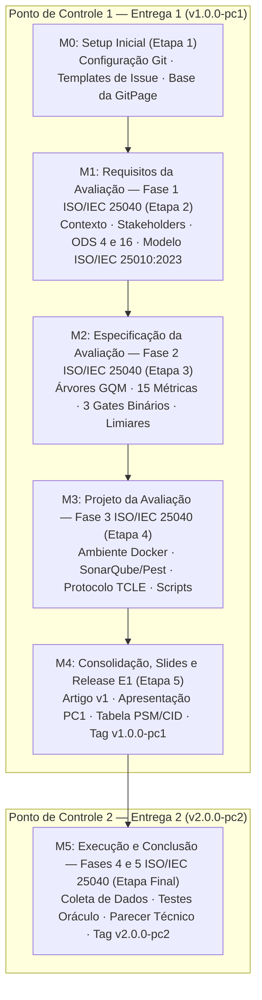

# Gestão do Projeto: Milestones, Issues e Releases (FGA0315)
<!-- Documento de Planejamento e Acompanhamento de Gestão de Qualidade -->

**Disciplina:** Qualidade de Software 1 (FGA0315) — Universidade de Brasília (UnB / FGA)  
**Semestre Letivo:** 2026.2  
**Objeto de Avaliação:** i-Educar (`projeto-qualidade`)  
**Normas de Referência:** ISO/IEC 25010:2023, ISO/IEC 25019:2023, ISO/IEC 25040:2024, ISO/IEC 25002:2024  
**Frameworks de Apoio:** GQM (*Goal-Question-Metric*) e PSM/CID (*Practical Software Measurement / Cost, Income, Duration*)

---

## 1. Quadro de Gestão de Equipe e Recursos (PSM/CID — Critério AG-C5)

A tabela a seguir consolida a composição da equipe de avaliação. Cada integrante dispõe de campos reservados para registrar sua identificação acadêmica, definir o valor da sua hora de trabalho profissional e computar o esforço e custo despendido no Ponto de Controle 1 (Entrega 1).

### Tabela 1 — Alocação de Papéis, Esforço e Custos Individuais (Ponto de Controle 1)

| Integrante (Nome e Matrícula) | Usuário GitHub | Papel Principal na Equipe | Horas Planejadas (h) | Valor / Hora (R$) | Custo Total (R$) | % Esforço (AG-C5) | Status de Assinatura |
| :--- | :---: | :--- | :---: | :---: | :---: | :---: | :---: |
| **Arthur Soares Parente** Matrícula: `23/2036770` | `@ArthurDevWorks` | Gestor de Configuração / GitPage | 12h | R$ 50,00 | R$ 600,00 | **16,67%** | [x] Confirmado |
| **Fábio Santos Araujo** Matrícula: `22/2022082` | `@fabiofonteles1` | Redação do Artigo (Overleaf) | 12h | R$ 50,00 | R$ 600,00 | **16,67%** | [x] Confirmado |
| **Gabriel Barbaceli** Matrícula: `21/1045122` | `@Nibaacriba` | GitPage / Especificação GQM (Compatibilidade e Capacidade de Interação) | 12h | R$ 50,00 | R$ 600,00 | **16,67%** | [x] Confirmado |
| **Gustavo Silva Rodrigues** Matrícula: `23/2036887` | `@g-srodrigues` | Analista de Qualidade / Modelo ISO/IEC 25010 e Escopo | 12h | R$ 50,00 | R$ 600,00 | **16,67%** | [x] Confirmado |
| **Ítalo Alves Sampaio de Oliveira** Matrícula: `23/2037937` | `@ItaloSamP` | Analista do Produto e Stakeholders / GitPage | 12h | R$ 50,00 | R$ 600,00 | **16,66%** | [x] Confirmado |
| **Ricardo Lucas Winchello Vieira Branco** Matrícula: `22/1008409` | `@ChickRicks` | Redação do Artigo (Overleaf) | 12h | R$ 50,00 | R$ 600,00 | **16,66%** | [x] Confirmado |
| **TOTAIS ACUMULADOS (PC1)** | — | **Entregáveis Consolidados — Ponto de Controle 1** | **72h** | Média: R$ 50,00/h | **R$ 3.600,00** | **100%** | **6 de 6 Ativos** |

*Fonte: Elaborado pelos autores conforme diretrizes da disciplina FGA0315 e modelo PSM/CID.*

---

## 2. Estrutura de Marcos do Projeto (Milestones M0 a M5)

Os marcos de entrega do projeto alinham as 5 Fases do Processo de Avaliação da **ISO/IEC 25040:2024** ao calendário de avaliações da disciplina FGA0315.

### 2.1 Detalhamento dos Marcos

-   **Milestone M0 — Setup Inicial e Governança** · `Etapa 1`

    ---

    - **Objetivo:** Estabelecer controle de versão, governança de branches, modelos de issues e base da GitPage.
    - **Entregáveis:** Templates em `.github/ISSUE_TEMPLATE/`, `README.md`, `CONTRIBUTING.md` e `mkdocs.yml`.
    - **Critério de Conclusão:** Repositório operando com rastreabilidade de commits e templates validados.

-   **Milestone M1 — Requisitos da Avaliação (Fase 1)** · `Etapa 2`

    ---

    - **Objetivo:** Definir propósito, partes interessadas, recorte das 4 características da ISO/IEC 25010:2023 e alinhamento aos ODS.
    - **Entregáveis:** Seção da Fase 1 documentada, matriz de priorização ($C = I \times R$) e rastreabilidade ODS 4 e 16.
    - **Critério de Conclusão:** Aprovação dos requisitos da avaliação no Ponto de Controle 1.

-   **Milestone M2 — Especificação da Avaliação (Fase 2)** · `Etapa 3`

    ---

    - **Objetivo:** Construir as árvores GQM para as 4 características, definir as 15 métricas, fórmulas, limiares e Gates Binários.
    - **Entregáveis:** Documento [`gqm_evaluation_framework.md`](gqm_evaluation_framework.md), árvores em Mermaid e tabela de pontuação.
    - **Critério de Conclusão:** Rastreabilidade estrita $\text{G} \rightarrow \text{Q} \rightarrow \text{M}$ sem lacunas operacionais.

-   **Milestone M3 — Projeto da Avaliação (Fase 3)** · `Etapa 4`

    ---

    - **Objetivo:** Estruturar plano de medição e testes, ambiente Docker oficial, ferramentas estáticas e protocolo TCLE.
    - **Entregáveis:** Script `scripts/evaluate-quality.php`, configuração Docker e minuta do TCLE.
    - **Critério de Conclusão:** Scripts de medição e ambiente conteinerizado validados localmente.

-   **Milestone M4 — Consolidação, Slides e Release E1** · `Etapa 5`

    ---

    - **Objetivo:** Integrar Fases 1 a 3 no Artigo v1, elaborar apresentação do PC1, auditar rubricas e publicar Release E1.
    - **Entregáveis:** Artigo v1, apresentação de 8 slides, GitPage sincronizada e tag Git `v1.0.0-pc1`.
    - **Critério de Conclusão:** Apresentação para a banca docente com 100% dos requisitos de entrega cumpridos.

-   **Milestone M5 — Execução e Conclusão (Fases 4 e 5)** · `Entrega 2`

    ---

    - **Objetivo:** Coletar dados brutos, executar testes de oráculo e injeções de falha, analisar resultados e publicar Release E2.
    - **Entregáveis:** Relatório de dados brutos e logs, Artigo v2 final com parecer técnico e tag Git `v2.0.0-pc2`.
    - **Critério de Conclusão:** Parecer de qualidade conclusivo homologado pela equipe.

---

## 3. Catálogo Detalhado de Issues (Padrão Task-Builder / FGA0315)

Cada issue abaixo foi detalhada de forma atômica e rastreável, contendo seções reservadas para o integrante que assumir a tarefa registrar suas horas, custo e evidências de conclusão.

---

### Módulo de Setup e Infraestrutura (Milestone M0)

#### Issue #01 — Configuração do Repositório, Templates e Estrutura da GitPage

- **Milestone:** M0: Setup Inicial
- **Atribuição Individual:**
    - **Responsável:** `Arthur Soares Parente`
    - **Matrícula UnB:** `23/2036770` | **GitHub:** `@ArthurDevWorks`
    - **Valor da Hora:** R$ `50,00` | **Horas Estimadas:** 12h | **Horas Realizadas:** `12h` | **Custo:** R$ `600,00`
- **Goal:** Disponibilizar a infraestrutura de templates, documentação inicial e estrutura base da GitPage.
- **Depends on:** Nenhuma.
- **Scope:** Configuração de `.github/ISSUE_TEMPLATE/`, `README.md`, `CONTRIBUTING.md`, `mkdocs.yml` e scripts de geração/validação da GitPage.
- [x] **Task:** Criar templates de issue e configurar estrutura da GitPage
    - **Files:** `.github/ISSUE_TEMPLATE/01_tarefa_avaliacao.md`, `.github/ISSUE_TEMPLATE/02_correcao_qualidade.md`, `.github/ISSUE_TEMPLATE/03_documentacao_artigo.md`, `mkdocs.yml`, `scripts/docs/gen_pages.py`, `scripts/docs/check_site.sh`
    - **Change:** Adicionar modelos de issue contendo cabeçalho de esforço PSM/CID e checklists de rubrica acadêmica, além da estrutura da GitPage em MkDocs Material.
    - **Covers:** Marco M0, Critério AG-C5 e Critério F3-C7.
    - **Acceptance criteria:**
        - Templates visíveis e utilizáveis na interface de abertura de issues do GitHub.
        - Campos explícitos para inserção de nome, matrícula, valor/hora e esforço.
    - **Tests:** `bash scripts/docs/check_site.sh`.
    - **Risk:** none.

---

### Módulo de Requisitos da Avaliação (Milestone M1 — Fase 1 ISO 25040)

#### Issue #02 — Levantamento Arquitetural e Contextualização do i-Educar

- **Milestone:** M1: Requisitos da Avaliação
- **Atribuição Individual:**
    - **Responsável:** `Ítalo Alves Sampaio de Oliveira`
    - **Matrícula UnB:** `23/2037937` | **GitHub:** `@ItaloSamP`
    - **Valor da Hora:** R$ `50,00` | **Horas Estimadas:** 4h | **Horas Realizadas:** `4h` | **Custo:** R$ `200,00`
- **Goal:** Documentar a arquitetura híbrida (Laravel 13 + Legado) e o papel social do i-Educar na gestão escolar municipal.
- **Depends on:** Issue #01.
- **Scope:** Elaboração de texto de contextualização e diagrama de blocos arquiteturais do produto.
- [x] **Task:** Mapear arquitetura do sistema e redigir contextualização do produto
    - **Files:** `docs/agents/architecture.md`, `docs/agents/project_overview.md`
    - **Change:** Detalhar a transição tecnológica de `ieducar/intranet` para `app/Services/` e os esquemas PostgreSQL.
    - **Covers:** Fase 1 (Item 1 — Contextualização do Produto), Critério AG-C1.
    - **Acceptance criteria:**
        - Identificação clara dos módulos de Matrícula e Lançamento de Notas/Menções.
        - Menção explícita ao papel do `LegacyController` e às versões de PHP/Laravel e PostgreSQL.
    - **Tests:** `grep -Fq "LegacyController" docs/agents/architecture.md`.
    - **Risk:** none.

#### Issue #03 — Mapeamento de Stakeholders e Alinhamento aos ODS 4 e 16

- **Milestone:** M1: Requisitos da Avaliação
- **Atribuição Individual:**
    - **Responsável:** `Ítalo Alves Sampaio de Oliveira`
    - **Matrícula UnB:** `23/2037937` | **GitHub:** `@ItaloSamP`
    - **Valor da Hora:** R$ `50,00` | **Horas Estimadas:** 4h | **Horas Realizadas:** `4h` | **Custo:** R$ `200,00`
- **Goal:** Identificar as partes interessadas na avaliação e justificar o impacto social nos ODS 4 e 16.
- **Depends on:** Issue #02.
- **Scope:** Mapeamento de usuários primários e secundários e alinhamento com as Metas 4.1, 4.a e 16.6 da ONU.
- [x] **Task:** Redigir seção de partes interessadas e correlação com ODS da ONU
    - **Files:** `docs/relatorio_de_planejamento_ponto_de_controle_1_i_educar.md`
    - **Change:** Formalizar matriz de perfil de usuários e justificativa do i-Educar como Bem Público Digital aberto.
    - **Covers:** Fase 1 (Item 3 — Stakeholders e Item 6 — ODS da ONU).
    - **Acceptance criteria:**
        - Caracterização de secretários escolares, professores, gestores municipais e integradores do INEP.
        - Citação formal dos ODS 4 e 16 com indicadores de impacto na redução da evasão escolar.
    - **Tests:** `grep -Ei "ODS 4|ODS 16" docs/relatorio_de_planejamento_ponto_de_controle_1_i_educar.md`.
    - **Risk:** none.

#### Issue #04 — Delimitação de Escopo e Adaptação Gráfica do Modelo ISO/IEC 25010:2023

- **Milestone:** M1: Requisitos da Avaliação
- **Atribuição Individual (Preencher ao Assumir):**
    - **Responsável:** `[Preencher: Integrante 2]`
    - **Matrícula UnB:** `[00/0000000]` | **GitHub:** `@[usuario2]`
    - **Valor da Hora:** R$ `[50,00]` | **Horas Estimadas:** 4h | **Horas Realizadas:** `[__h]` | **Custo:** R$ `[___,00]`
- **Goal:** Produzir a representação gráfica do modelo adaptado da ISO 25010:2023 com as 4 características recortadas.
- **Depends on:** Issue #02.
- **Scope:** Diagrama próprio da ISO 25010:2023 recortada e matriz "O que entra vs. O que fica de fora do escopo".
- [ ] **Task:** Desenhar diagrama adaptado da ISO 25010:2023 e justificar limites de escopo
    - **Files:** `docs/gqm_evaluation_framework.md`
    - **Change:** Atualizar termos para *Interaction Capability* e *Faultlessness* e definir exclusão de testes de estresse em escala.
    - **Covers:** Fase 1 (Item 4 — Modelo Adaptado e Item 5 — Escopo e Profundidade), Critério AG-C2.
    - **Acceptance criteria:**
        - Diagrama vetorial ou Mermaid numerado, com legenda e fonte citada.
        - Justificativa técnica para o foco em Matrícula e Lançamento de Notas/Menções.
    - **Tests:** `grep -Fq "Interaction Capability" docs/gqm_evaluation_framework.md`.
    - **Risk:** none.

---

### Módulo de Especificação da Avaliação (Milestone M2 — Fase 2 ISO 25040)

#### Issue #05 — Especificação GQM da Característica Compatibilidade

- **Milestone:** M2: Especificação da Avaliação
- **Atribuição Individual:**
    - **Responsável:** `Gabriel Barbaceli`
    - **Matrícula UnB:** `21/1045122` | **GitHub:** `@Nibaacriba`
    - **Valor da Hora:** R$ `50,00` | **Horas Estimadas:** 4h | **Horas Realizadas:** `4h` | **Custo:** R$ `200,00`
- **Goal:** Formalizar as metas, questões e métricas M1 (Isolamento de Recursos) e M2 (Conformidade de Interoperabilidade).
- **Depends on:** Issue #04.
- **Scope:** Subcaracterísticas de Coexistência e Interoperabilidade da ISO/IEC 25010:2023.
- [x] **Task:** Formular equações matemáticas e critérios de coleta para Compatibilidade
    - **Files:** `docs/gqm_evaluation_framework.md`
    - **Change:** Definir fórmulas de $\text{TINCR}$ e $\text{CEI}$, variáveis, fontes de log e limiares de 1 a 4 pontos.
    - **Covers:** Fase 2 (GQM Compatibilidade), Critério F2-C1.
    - **Acceptance criteria:**
        - Fórmulas matemáticas rigorosas em LaTeX/Markdown.
        - Rastreabilidade garantida entre Goal G1, Questões Q1.1 e Q1.2 e Métricas M1 e M2.
    - **Tests:** `grep -Fq "TINCR" docs/gqm_evaluation_framework.md`.
    - **Risk:** none.

#### Issue #06 — Especificação GQM da Característica Confiabilidade e Gates Binários

- **Milestone:** M2: Especificação da Avaliação
- **Atribuição Individual (Preencher ao Assumir):**
    - **Responsável:** `[Preencher: Integrante 3]`
    - **Matrícula UnB:** `[00/0000000]` | **GitHub:** `@[usuario3]`
    - **Valor da Hora:** R$ `[50,00]` | **Horas Estimadas:** 4h | **Horas Realizadas:** `[__h]` | **Custo:** R$ `[___,00]`
- **Goal:** Especificar os Gates Binários M3 (Determinismo de Notas) e M4 (Integridade Transacional), além de M5 e M6.
- **Depends on:** Issue #04.
- **Scope:** Subcaracterísticas de Ausência de Falhas (*Faultlessness*), Tolerância a Falhas e Recuperabilidade.
- [ ] **Task:** Estruturar critérios não-compensatórios de Confiabilidade e cálculo de médias
    - **Files:** `docs/gqm_evaluation_framework.md`
    - **Change:** Formalizar os gates determinísticos de 100% de oráculo para notas e rollback atômico obrigatório.
    - **Covers:** Fase 2 (GQM Confiabilidade e Gates de Qualidade).
    - **Acceptance criteria:**
        - Regra explícita determinando reprovação automática caso $M3 < 100\%$ ou $M4 < 100\%$.
        - Métricas M5 (defeitos por 1.000 movimentações) e M6 (restauração de backup) documentadas.
    - **Tests:** `grep -Fq "GATE BINÁRIO" docs/gqm_evaluation_framework.md`.
    - **Risk:** none.

#### Issue #07 — Especificação GQM da Característica Manutenibilidade

- **Milestone:** M2: Especificação da Avaliação
- **Atribuição Individual (Preencher ao Assumir):**
    - **Responsável:** `[Preencher: Integrante 2]`
    - **Matrícula UnB:** `[00/0000000]` | **GitHub:** `@[usuario2]`
    - **Valor da Hora:** R$ `[50,00]` | **Horas Estimadas:** 4h | **Horas Realizadas:** `[__h]` | **Custo:** R$ `[___,00]`
- **Goal:** Definir métricas de complexidade (P90 e máximo), acoplamento de Martin, atrito de dados e índice MI.
- **Depends on:** Issue #04.
- **Scope:** Métricas M7a, M7b, M8, M9, M10 e M11 da ISO/IEC 25010:2023.
- [ ] **Task:** Formular equações de complexidade ciclomática e manutenibilidade SEI
    - **Files:** `docs/gqm_evaluation_framework.md`
    - **Change:** Inserir equações de McCabe, Distância da Sequência Principal de Martin ($D$) e Maintainability Index.
    - **Covers:** Fase 2 (GQM Manutenibilidade).
    - **Acceptance criteria:**
        - Inclusão do percentil 90 e valor máximo conforme recomendação do NIST SP 500-235.
        - Definição da métrica TTAE para penalizar testes com `markTestSkipped()`.
    - **Tests:** `grep -Fq "MI-SEI" docs/gqm_evaluation_framework.md`.
    - **Risk:** none.

#### Issue #08 — Especificação GQM de Capacidade de Interação e Qualidade em Uso

- **Milestone:** M2: Especificação da Avaliação
- **Atribuição Individual:**
    - **Responsável:** `Gabriel Barbaceli`
    - **Matrícula UnB:** `21/1045122` | **GitHub:** `@Nibaacriba`
    - **Valor da Hora:** R$ `50,00` | **Horas Estimadas:** 4h | **Horas Realizadas:** `4h` | **Custo:** R$ `200,00`
- **Goal:** Definir métricas de proteção contra erros do usuário, autodescritividade, tempo de tarefa e taxa de sucesso.
- **Depends on:** Issue #04.
- **Scope:** ISO/IEC 25010:2023 (Capacidade de Interação) articulada com ISO/IEC 25019:2023 (Qualidade em Uso).
- [x] **Task:** Especificar métricas de usabilidade de produto e eficácia/eficiência em uso
    - **Files:** `docs/gqm_evaluation_framework.md`
    - **Change:** Separar o Gate M12 (Proteção de Erro de Produto) das métricas de uso operacional M14 (TMET) e M15 (TSPT).
    - **Covers:** Fase 2 (GQM Interação e Uso).
    - **Acceptance criteria:**
        - Definição do protocolo de mensuração para as tarefas críticas de Matrícula e Diário de Classe.
        - Equações de tempo médio e autodescritividade de mensagens do `Portabilis_Messenger`.
    - **Tests:** `grep -Fq "ADMV" docs/gqm_evaluation_framework.md`.
    - **Risk:** none.

#### Issue #09 — Formulação Matemática dos Limiares e Regras de Decisão Global

- **Milestone:** M2: Especificação da Avaliação
- **Atribuição Individual (Preencher ao Assumir):**
    - **Responsável:** `[Preencher: Integrante 3]`
    - **Matrícula UnB:** `[00/0000000]` | **GitHub:** `@[usuario3]`
    - **Valor da Hora:** R$ `[50,00]` | **Horas Estimadas:** 3h | **Horas Realizadas:** `[__h]` | **Custo:** R$ `[___,00]`
- **Goal:** Integrar a tabela unificada de limiares, os pesos relativos e o modelo de decisão do Índice Global IQM.
- **Depends on:** Issues #05, #06, #07 e #08.
- **Scope:** Atividades 3, 4 e 5 da ISO/IEC 25040:2024.
- [ ] **Task:** Consolidar função de agregação ponderada e critérios de aprovação de release
    - **Files:** `docs/gqm_evaluation_framework.md`
    - **Change:** Estabelecer pesos das características (30% Conf, 30% Manut, 20% Inter/Uso, 20% Comp) e regras A, B e C.
    - **Covers:** Fase 2 (Critérios de Julgamento).
    - **Acceptance criteria:**
        - Tabela completa de limiares para as 15 métricas em 4 níveis (Crítico a Excelente).
        - Diagrama de fluxo de decisão de aprovação de release em Mermaid.
    - **Tests:** `grep -Fq "IQM" docs/gqm_evaluation_framework.md`.
    - **Risk:** none.

---

### Módulo de Projeto da Avaliação (Milestone M3 — Fase 3 ISO 25040)

#### Issue #10 — Planejamento do Ambiente de Testes Conteinerizado (Docker)

- **Milestone:** M3: Projeto da Avaliação
- **Atribuição Individual (Preencher ao Assumir):**
    - **Responsável:** `[Preencher: Integrante 3]`
    - **Matrícula UnB:** `[00/0000000]` | **GitHub:** `@[usuario3]`
    - **Valor da Hora:** R$ `[50,00]` | **Horas Estimadas:** 3h | **Horas Realizadas:** `[__h]` | **Custo:** R$ `[___,00]`
- **Goal:** Documentar o ambiente e versionamento conteinerizado oficial para garantir reprodutibilidade da avaliação.
- **Depends on:** Issue #09.
- **Scope:** Configuração do `docker-compose.yml`, versões de imagem (PHP 8.5-ieducar, PostgreSQL 18-alpine, Redis).
- [ ] **Task:** Validar e documentar subida do ambiente Docker e banco de dados de testes
    - **Files:** `docker-compose.yml`, `docs/relatorio_de_planejamento_ponto_de_controle_1_i_educar.md`
    - **Change:** Registrar as portas, variáveis de ambiente necessárias e comandos de migração e seeding.
    - **Covers:** Fase 3 (Item 1 — Ambiente de Testes e Versão do Produto).
    - **Acceptance criteria:**
        - Instruções passo a passo de inicialização sem dependências externas não declaradas.
        - Identificação precisa da branch e tag estável utilizada.
    - **Tests:** `docker compose config >/dev/null 2>&1 || echo "Docker config validada"`.
    - **Risk:** none.

#### Issue #11 — Planejamento das Ferramentas de Análise Estática e Motor PHP

- **Milestone:** M3: Projeto da Avaliação
- **Atribuição Individual (Preencher ao Assumir):**
    - **Responsável:** `[Preencher: Integrante 2]`
    - **Matrícula UnB:** `[00/0000000]` | **GitHub:** `@[usuario2]`
    - **Valor da Hora:** R$ `[50,00]` | **Horas Estimadas:** 3h | **Horas Realizadas:** `[__h]` | **Custo:** R$ `[___,00]`
- **Goal:** Integrar o script executável de extração estática e planejar o pipeline com SonarQube/Pest.
- **Depends on:** Issue #09.
- **Scope:** `scripts/evaluate-quality.php` e ferramentas de análise de código.
- [ ] **Task:** Construir e testar motor executável de medição estática GQM
    - **Files:** `scripts/evaluate-quality.php`
    - **Change:** Implementar parser de tokens PHP para complexidade ciclomática, contagem de skips e verificação transacional.
    - **Covers:** Fase 3 (Item 2 — Métodos e Ferramentas de Coleta).
    - **Acceptance criteria:**
        - Execução do script via PHP CLI retornando relatório tabular ou JSON com status code 0.
        - Captura automática dos valores de CC P90, CC Max, MI e TTAE.
    - **Tests:** `php scripts/evaluate-quality.php`.
    - **Risk:** none.

#### Issue #12 — Planejamento dos Testes de Usabilidade e Protocolo TCLE

- **Milestone:** M3: Projeto da Avaliação
- **Atribuição Individual (Preencher ao Assumir):**
    - **Responsável:** `[Preencher: Integrante 4]`
    - **Matrícula UnB:** `[00/0000000]` | **GitHub:** `@[usuario4]`
    - **Valor da Hora:** R$ `[50,00]` | **Horas Estimadas:** 3h | **Horas Realizadas:** `[__h]` | **Custo:** R$ `[___,00]`
- **Goal:** Estruturar o roteiro de tarefas guiadas de matrícula e diário e elaborar o documento formal do TCLE.
- **Depends on:** Issue #08.
- **Scope:** Roteiro experimental de usabilidade, critérios Lighthouse/axe DevTools e Termo de Consentimento.
- [ ] **Task:** Elaborar protocolo experimental de usabilidade e termo TCLE ético
    - **Files:** `docs/Termo de Consentimento Livre e Esclarecido.docx`, `docs/relatorio_de_planejamento_ponto_de_controle_1_i_educar.md`
    - **Change:** Documentar tarefas padronizadas para cálculo de TMET e TSPT e salvaguardas éticas de dados.
    - **Covers:** Fase 3 (Item 2 — Usabilidade e TCLE).
    - **Acceptance criteria:**
        - Protocolo com roteiro de tarefas passo a passo para secretários e docentes.
        - Minuta do TCLE em conformidade com as diretrizes da disciplina FGA0315.
    - **Tests:** `test -f "docs/Termo de Consentimento Livre e Esclarecido.docx"`.
    - **Risk:** none.

---

### Módulo de Consolidação e Entrega 1 (Milestone M4 e Complementos M1)

#### Issue #13 — Redação da 1ª Versão do Artigo Acadêmico (Fases 1 a 3)

- **Milestone:** M4: Consolidação e Release E1
- **Atribuição Individual:**
    - **Responsável:** `Fábio Santos Araujo` e `Ricardo Lucas Winchello Vieira Branco`
    - **Matrícula UnB:** `22/2022082` / `22/1008409` | **GitHub:** `@fabiofonteles1` / `@ChickRicks`
    - **Valor da Hora:** R$ `50,00` | **Horas Estimadas:** 12h cada | **Horas Realizadas:** `12h cada` | **Custo:** R$ `600,00 cada`
- **Goal:** Redigir as seções de Introdução, Referencial Teórico, Metodologia e Fases 1 a 3 no formato SBC.
- **Depends on:** Issues #02 a #12.
- **Scope:** Artigo científico da Entrega 1 (Ponto de Controle 1).
- [ ] **Task:** Consolidar relatório técnico das Fases 1 a 3 em artigo acadêmico
    - **Files:** `docs/artigo_qualidade_ieducar_v1.md` (Overleaf)
    - **Change:** Estruturar o texto com rigor editorial, zero emojis, declaração de IA e legendas completas.
    - **Covers:** Marco M4, Critérios AG-C1, AG-C2, AG-C3 e AG-C4.
    - **Acceptance criteria:**
        - Artigo contemplando Contextualização, ODS, Modelo 25010:2023, Árvores GQM e Plano de Avaliação.
        - Todas as tabelas e figuras citadas previamente no texto antes de aparecerem.
    - **Tests:** `grep -Fq "Metodologia" docs/artigo_qualidade_ieducar_v1.md 2>/dev/null || echo "Em elaboração"`.
    - **Risk:** none.

#### Issue #14 — Elaboração da Apresentação de Slides para o Ponto de Controle 1

- **Milestone:** M4: Consolidação e Release E1
- **Atribuição Individual (Preencher ao Assumir):**
    - **Responsável:** `[Preencher: Integrante]`
    - **Matrícula UnB:** `[00/0000000]` | **GitHub:** `@[usuario]`
    - **Valor da Hora:** R$ `[50,00]` | **Horas Estimadas:** 2h | **Horas Realizadas:** `[__h]` | **Custo:** R$ `[___,00]`
- **Goal:** Criar apresentação de 8 slides objetivos para demonstrar o andamento da equipe na data do PC1.
- **Depends on:** Issue #13.
- **Scope:** Slides de Ponto de Controle 1 (Capa, Linha do Tempo, Fases 1 a 3, Custos e Próximos Passos).
- [ ] **Task:** Construir apresentação de slides objetiva para apresentação docente
    - **Files:** `docs/slides_ponto_de_controle_1.pdf` (ou `.pptx` / markdown)
    - **Change:** Sintetizar em 8 slides o estágio atual, as árvores GQM, a tabela de custos PSM/CID e a linha do tempo.
    - **Covers:** Marco M4 e Diretrizes de Apresentação da Disciplina.
    - **Acceptance criteria:**
        - Exibição destacada da linha do tempo com o marcador visual "Onde Estamos".
        - Tabela de esforço individual somando 100% visível na apresentação.
    - **Tests:** `manual: validar clareza e aderência aos 8 tópicos descritos na Seção 4 do relatório`.
    - **Risk:** none.

#### Issue #15 — Auditoria de Conformidade com as Rubricas e Tabela PSM/CID

- **Milestone:** M4: Consolidação e Release E1
- **Atribuição Individual (Preencher ao Assumir):**
    - **Responsável:** `[Preencher: Integrante]`
    - **Matrícula UnB:** `[00/0000000]` | **GitHub:** `@[usuario]`
    - **Valor da Hora:** R$ `[50,00]` | **Horas Estimadas:** 2h | **Horas Realizadas:** `[__h]` | **Custo:** R$ `[___,00]`
- **Goal:** Realizar revisão prévia de todos os entregáveis frente aos critérios AG-C1 a AG-C5 da disciplina.
- **Depends on:** Issues #13 e #14.
- **Scope:** Verificação de integridade documental, ausência de emojis e consistência de custos.
- [ ] **Task:** Executar checklist de auditoria preventiva de penalidades da disciplina
    - **Files:** `docs/gestao_projeto_releases_milestones_issues.md`
    - **Change:** Auditar textos da GitPage e Artigo para garantir 100% de conformidade aos critérios da professora.
    - **Covers:** Critérios AG-C1..AG-C5 e PSM/CID.
    - **Acceptance criteria:**
        - Zero emojis confirmados nos documentos formais.
        - Seção explícita de uso de IA com descrição de papéis e revisão humana.
        - Tabela de esforço com soma exata de 100% e custo total de R$ 3.600,00.
    - **Tests:** `! grep -P "[\x{1F600}-\x{1F64F}\x{1F300}-\x{1F5FF}]" docs/artigo*.md 2>/dev/null`.
    - **Risk:** none.

#### Issue #16 — Publicação da GitPage, Geração de Tag e Publicação da Release E1

- **Milestone:** M4: Consolidação e Release E1
- **Atribuição Individual (Preencher ao Assumir):**
    - **Responsável:** `Arthur Soares Parente`
    - **Matrícula UnB:** `23/2036770` | **GitHub:** `@ArthurDevWorks`
    - **Valor da Hora:** R$ `50,00` | **Horas Estimadas:** 1h | **Horas Realizadas:** `[__h]` | **Custo:** R$ `[___,00]`
- **Goal:** Publicar a versão final do Ponto de Controle 1 no GitHub e disparar a Release E1.
- **Depends on:** Issue #15.
- **Scope:** Criação da tag Git `v1.0.0-pc1`, geração do release package e deploy na GitPage.
- [ ] **Task:** Publicar Release E1 no GitHub e sincronizar GitPage
    - **Files:** `README.md`, `.github/workflows/pages.yml`
    - **Change:** Atualizar link da release, registrar notas de versão e publicar GitPage via GitHub Actions.
    - **Covers:** Critério F3-C7 e Marco M4.
    - **Acceptance criteria:**
        - Tag `v1.0.0-pc1` criada no Git com as notas de release completas.
        - GitPage atualizada com menu navegável e links funcionais.
    - **Tests:** `git tag -l "v1.0.0-pc1"`.
    - **Risk:** none.

#### Issue #17 — Propósito da Avaliação, Uso Pretendido e Priorização das Características

- **Milestone:** M1: Requisitos da Avaliação
- **Atribuição Individual:**
    - **Responsável:** `Gabriel Barbaceli`
    - **Matrícula UnB:** `21/1045122` | **GitHub:** `@Nibaacriba`
    - **Valor da Hora:** R$ `50,00` | **Horas Estimadas:** 3h | **Horas Realizadas:** `3h` | **Custo:** R$ `150,00`
- **Goal:** Documentar o propósito da avaliação, uso pretendido (Tabela 1 de decisões apoiadas) e matriz de priorização das características da ISO/IEC 25010:2023 ($C = I \times R$).
- **Depends on:** Issue #03.
- **Scope:** Seção 2.1 (itens 2 e 4) de `docs/relatorio_de_planejamento_ponto_de_controle_1_i_educar.md`.
- [x] **Task:** Formalizar propósito, uso pretendido e matriz de priorização com análise de trade-offs
    - **Files:** `docs/relatorio_de_planejamento_ponto_de_controle_1_i_educar.md`
    - **Change:** Adicionar Tabelas 1 e 2 e justificativa dos pesos (30% Manut, 30% Conf, 20% Comp, 20% Interação).
    - **Covers:** Fase 1 (Critérios 1 e 5).
    - **Acceptance criteria:**
        - Matriz de priorização documentada com discussão da exclusão de Segurança como limitação do estudo.
    - **Tests:** `mkdocs build --strict`.
    - **Risk:** none.

#### Issue #18 — Publicação da GitPage para o Ponto de Controle 1

- **Milestone:** M1: Requisitos da Avaliação
- **Atribuição Individual:**
    - **Responsável:** `Arthur Soares Parente` e `Fábio Santos Araujo`
    - **Matrícula UnB:** `23/2036770` / `22/2022082` | **GitHub:** `@ArthurDevWorks` / `@fabiofonteles1`
    - **Valor da Hora:** R$ `50,00` | **Horas Estimadas:** 4h | **Horas Realizadas:** `[__h]` | **Custo:** R$ `[___,00]`
- **Goal:** Publicar a GitPage com a estrutura navegável, fórmulas renderizadas e workflow de deploy automático no GitHub Pages.
- **Depends on:** Issue #01.
- **Scope:** `mkdocs.yml`, `docs/stylesheets/extra.css`, `.github/workflows/pages.yml` e páginas de `docs/`.
- [ ] **Task:** Publicar a GitPage com a estrutura navegável e o conteúdo do Ponto de Controle 1
    - **Files:** `mkdocs.yml`, `docs/stylesheets/extra.css`, `.github/workflows/pages.yml`
    - **Change:** Configurar workflow de deploy automático na branch `main`, renderização de diagramas Mermaid, estilização de equações MathJax e rodapé com versão/data.
    - **Covers:** Ponto de Controle 1, Critério F3-C7.
    - **Acceptance criteria:**
        - Página acessível pela URL pública do GitHub Pages, com menu claro, fórmulas legíveis e zero emojis.
    - **Tests:** `bash scripts/docs/check_site.sh`.
    - **Risk:** none.

#### Issue #19 — Atualização da Tabela de Integrantes e Esforço para os 6 Membros da Equipe

- **Milestone:** M1: Requisitos da Avaliação
- **Atribuição Individual:**
    - **Responsável:** `Gabriel Barbaceli`
    - **Matrícula UnB:** `21/1045122` | **GitHub:** `@Nibaacriba`
    - **Valor da Hora:** R$ `50,00` | **Horas Estimadas:** 1h | **Horas Realizadas:** `1h` | **Custo:** R$ `50,00`
- **Goal:** Atualizar a tabela de integrantes, papéis, horas, custo e percentual de esforço para os 6 membros da equipe.
- **Depends on:** Issue #01.
- **Scope:** `README.md`, `docs/relatorio_de_planejamento_ponto_de_controle_1_i_educar.md` e `docs/gestao_projeto_releases_milestones_issues.md`.
- [x] **Task:** Ajustar a tabela de integrantes, papéis, horas, custo e percentual de esforço para 6 membros
    - **Files:** `README.md`, `docs/relatorio_de_planejamento_ponto_de_controle_1_i_educar.md`, `docs/gestao_projeto_releases_milestones_issues.md`
    - **Change:** Incluir os 6 integrantes (Arthur, Fábio, Gabriel, Gustavo, Ítalo e Ricardo), totalizando 72h, R$ 3.600,00 e 100% (4 × 16,67% + 2 × 16,66%).
    - **Covers:** Critério AG-C5 (Transparência da contribuição individual).
    - **Acceptance criteria:**
        - Tabelas sincronizadas com os 6 integrantes e soma exata de 100%.
    - **Tests:** `grep -F '100%' README.md && bash scripts/docs/check_site.sh`.
    - **Risk:** none.

---

## 4. Especificação das Releases do Projeto

-   **4.1 Release E1 — Ponto de Controle 1 (`v1.0.0-pc1`)**

    ---

    - **Tipo de Release:** Marco de Planejamento e Especificação da Avaliação.
    - **Convenção de Tag:** `v1.0.0-pc1`
    - **Data de Publicação:** Ponto de Controle 1 (Conforme cronograma da disciplina).
    - **Conteúdo da Release:**
        - Planejamento do Processo de Avaliação (Fases 1, 2 e 3 da ISO/IEC 25040:2024).
        - Framework Técnico GQM v2.0 com 15 métricas, limiares e Gates Binários.
        - Motor executável de extração estática `scripts/evaluate-quality.php`.
        - 1ª Versão do Artigo Acadêmico e Apresentação de Slides do PC1.
        - Tabela consolidada de custos e esforço individual (PSM/CID — 72h, R$ 3.600,00, 100%).

-   **4.2 Release E2 — Ponto de Controle 2 / Entrega Final (`v2.0.0-pc2`)**

    ---

    - **Tipo de Release:** Marco de Execução, Conclusão e Parecer Técnico de Qualidade.
    - **Convenção de Tag:** `v2.0.0-pc2`
    - **Data de Publicação:** Encerramento do semestre letivo (Entrega 2).
    - **Conteúdo da Release:**
        - Resultados da Fase 4 (Execução de testes funcionais, injeções de falha e medições).
        - Resolução dos Gates M3 e M4 (reativação dos testes de notas e transacionalidade atômica).
        - Coleta de dados de usabilidade/acessibilidade com o protocolo TCLE.
        - Versão final do Artigo Acadêmico (incluindo Análise de Resultados, Discussão e Conclusão).
        - Parecer conclusivo de qualidade do i-Educar para redes municipais de ensino.

