# Framework GQM de Avaliação de Qualidade de Software — Versão 2.0 (Normas 2023/2024)
<!-- Generated by CEH for projeto-qualidade Quality Assurance -->

> [!IMPORTANT]
> **Enquadramento Normativo Internacional Vigente**:
> - **ISO/IEC 25010:2023**: Modelo de Qualidade de Produto de Software (*Systems and software engineering — Systems and software Quality Requirements and Evaluation (SQuaRE) — Product quality model*).
> - **ISO/IEC 25019:2023**: Modelo de Qualidade em Uso (*Quality-in-use model*).
> - **ISO/IEC 25040:2024**: Processo de Avaliação de Qualidade (*Quality evaluation process* — 2ª Edição).
> - **ISO/IEC 25002:2024**: Visão Geral e Uso de Modelos de Qualidade (*Quality models overview and usage*).
> - **ISO/IEC 25023:2016 / DIS 25023**: Medição de Qualidade de Produto (*Measurement of system and software product quality* — em fase de alinhamento com a 25010:2023).
> - **GQM (Goal-Question-Metric)**: Metodologia de Basili, Caldiera e Rombach.

---

## 1. Atividade 1 (ISO 25040:2024): Requisitos e Objeto da Avaliação

### 1.1 Objeto da Avaliação
O alvo é o subsistema acadêmico central do projeto **`projeto-qualidade`** (i-Educar), operando em arquitetura monolítica híbrida (Laravel 13 + PHP >= 8.3 + PostgreSQL 14+ contra o núcleo legado `ieducar/`).

A avaliação concentra-se cirurgicamente em dois módulos interdependentes:
1. **Módulo de Matrícula de Alunos**:
   - Vínculo escolar formal (`pmieducar.matricula` / [`LegacyRegistration`](file:///Applications/MAMP/htdocs/projeto-qualidade/app/Models/LegacyRegistration.php)).
   - Enturmação e remanejamento (`pmieducar.matricula_turma` / [`LegacyEnrollment`](file:///Applications/MAMP/htdocs/projeto-qualidade/app/Models/LegacyEnrollment.php)).
   - Estados de vida escolar: 14 situações ativas descritas em [`RegistrationStatus`](file:///Applications/MAMP/htdocs/projeto-qualidade/app/Models/RegistrationStatus.php) (Cursando, Aprovado, Retido, Transferido, Reclassificado, Abandono, etc.).
   - Serviços de domínio: [`RegistrationService.php`](file:///Applications/MAMP/htdocs/projeto-qualidade/app/Services/RegistrationService.php) e cancelamento atômico transacional.
2. **Módulo de Lançamento de Notas e Menções**:
   - Regras pedagógicas: [`modules.regra_avaliacao`](file:///Applications/MAMP/htdocs/projeto-qualidade/app/Models/LegacyEvaluationRule.php) e tipos de nota em `RegraAvaliacao_Model_Nota_TipoValor` (Numérica = 1, Conceitual/Menção = 2, Mista = 3, Nenhuma = 0).
   - Tabelas de menções e arredondamentos configuráveis: [`modules.tabela_arredondamento_valor`](file:///Applications/MAMP/htdocs/projeto-qualidade/app/Models/LegacyValueRoundingTable.php).
   - Diário eletrônico e APIs de lançamento: [`DiarioController.php`](file:///Applications/MAMP/htdocs/projeto-qualidade/ieducar/modules/Api/Views/DiarioController.php), [`DiarioApiController.php`](file:///Applications/MAMP/htdocs/projeto-qualidade/ieducar/modules/Avaliacao/Views/DiarioApiController.php) e motor de cálculo [`Avaliacao_Service_Boletim`](file:///Applications/MAMP/htdocs/projeto-qualidade/ieducar/modules/Avaliacao/Service/Boletim.php).
   - Armazenamento: `modules.nota_aluno`, `modules.nota_componente_curricular`, `modules.nota_componente_curricular_media`.

### 1.2 Características Selecionadas (ISO/IEC 25010:2023 & ISO/IEC 25019:2023)
Em estrito alinhamento com a revisão 2023/2024:
1. **Compatibilidade** (*Compatibility* — ISO 25010:2023): Coexistência de recursos no ambiente e Interoperabilidade de dados externos.
2. **Confiabilidade** (*Reliability* — ISO 25010:2023): Ausência de falhas (*Faultlessness* — novo termo que substitui *Maturity*), Tolerância a falhas (*Fault tolerance*) e Recuperabilidade (*Recoverability*).
3. **Manutenibilidade** (*Maintainability* — ISO 25010:2023): Modularidade, Analisabilidade, Modificabilidade e Testabilidade.
4. **Capacidade de Interação** (*Interaction Capability* — ISO 25010:2023) & **Qualidade em Uso** (*Quality-in-Use* — ISO 25019:2023): Proteção contra erros de usuário e Autodescritividade (ISO 25010), integradas à Eficácia e Eficiência operacional do secretário e professor no contexto de uso escolar (ISO 25019).

---

## 2. Atividade 2 (ISO 25040:2024): Especificação da Avaliação (Árvore GQM)

```mermaid
graph TD
    subgraph Normas_2023_2024["Modelos ISO/IEC 25010:2023 & ISO/IEC 25019:2023"]
        G1["G1: Compatibilidade<br/>(Coexistência & Interoperabilidade)"]
        G2["G2: Confiabilidade<br/>(Ausência de Falhas & Tolerância a Falhas)"]
        G3["G3: Manutenibilidade<br/>(Modularidade, Analisabilidade & Testabilidade)"]
        G4["G4: Interação & Qualidade em Uso<br/>(Proteção, Autodescritividade, Eficácia & Eficiência)"]
    end

    %% G1: Compatibilidade
    G1 --> Q11["Q1.1: O sistema coexiste de forma segura com outras instâncias e serviços sem colisão de recursos?"]
    G1 --> Q12["Q1.2: Quão rigorosa é a conformidade das APIs e integrações aos schemas de interoperabilidade?"]
    Q11 --> M1["M1: Taxa de Isolamento e Não-Colisão de Recursos (TINCR)"]
    Q12 --> M2["M2: Conformidade com Esquemas de Interoperabilidade (CEI)"]

    %% G2: Confiabilidade
    G2 --> Q21["Q2.1: As rotinas de cálculo de notas, médias e conversão de menções são 100% determinísticas?"]
    G2 --> Q22["Q2.2: Operações compostas de matrícula e diário garantem rollback integral e ausência de dados órfãos?"]
    G2 --> Q23["Q2.3: O sistema disponibiliza mecanismo confiável de backup e recuperação de desastres?"]
    Q21 --> M3["M3 (GATE): Determinismo de Cálculo de Notas e Menções (DCNM)"]
    Q22 --> M4["M4 (GATE): Integridade Transacional e Atomicidade de Estado (ITAE)"]
    Q22 --> M5["M5: Densidade de Defeitos Operacionais de Matrícula (DDOM)"]
    Q23 --> M6["M6: Completude e Verificabilidade do Procedimento de Backup (CVPB)"]

    %% G3: Manutenibilidade
    G3 --> Q31["Q3.1: Qual a complexidade ciclomática dos métodos mais críticos dos módulos?"]
    G3 --> Q32["Q3.2: Quão desacoplados e equilibrados estão os componentes estruturais do domínio?"]
    G3 --> Q33["Q3.3: Qual o grau de atrito e adaptação de dados entre a camada legada e moderna?"]
    G3 --> Q34["Q3.4: Qual o índice global de manutenibilidade do código?"]
    G3 --> Q35["Q3.5: Qual o percentual de testes efetivamente ativos e livres de skips no módulo avaliado?"]
    Q31 --> M7["M7: Complexidade Ciclomática - Percentil 90 e Máximo (CC-P90/MAX)"]
    Q32 --> M8["M8: Distância da Sequência Principal de Martin (DSPM)"]
    Q33 --> M9["M9: Índice de Fricção de Dados Legado-Moderno (IFDL)"]
    Q34 --> M10["M10: Índice de Manutenibilidade Normalizado (MI-SEI)"]
    Q35 --> M11["M11: Taxa de Testes Ativos e Eficazes de Domínio (TTAE)"]

    %% G4: Capacidade de Interação e Qualidade em Uso
    G4 --> Q41["Q4.1: O sistema impede proativamente erros de entrada ou operações fora de prazo pedagógico?"]
    G4 --> Q42["Q4.2: As mensagens de validação e recusa são autodescritivas e orientadas à ação?"]
    G4 --> Q43["Q4.3: Qual o tempo médio requerido pelo usuário para concluir as tarefas essenciais?"]
    G4 --> Q44["Q4.4: Qual a taxa de sucesso de primeira tentativa no preenchimento do diário de classe?"]
    Q41 --> M12["M12: Índice de Proteção contra Erros do Usuário (IPPE)"]
    Q42 --> M13["M13: Autodescritividade das Mensagens de Validação (ADMV)"]
    Q43 --> M14["M14: Tempo Médio de Execução de Tarefa Operacional (TMET)"]
    Q44 --> M15["M15: Taxa de Sucesso na Primeira Tentativa em Uso (TSPT)"]
```

---

## 3. Atividade 3 (ISO 25040:2024): Desenho da Avaliação (Definição Formal das Métricas)

### 3.1 Característica 1: Compatibilidade (*Compatibility* — ISO 25010:2023)

#### M1 — Taxa de Isolamento e Não-Colisão de Recursos (TINCR)
- **Subcaracterística**: Coexistência (*Co-existence* — ISO 25010:2023, item 8.3.2).
- **Conceito**: Mede a capacidade do i-Educar coexistir no mesmo servidor de banco (PostgreSQL) e cache (Redis) com outros serviços (ex.: i-Diário, microserviços municipais) sem colisão de locks, concorrência predatória de pools de conexão ou invasão de esquemas.
- **Fórmula de Cálculo**:
  $$\text{TINCR} = \left( 1 - \frac{N_{\text{deadlocks\_cross\_service}} + N_{\text{conn\_exhaustion}}}{N_{\text{periodos\_monitorados}}} \right) \times 100\%$$
- **Tipo de Escala**: Razão ($[0\%, 100\%]$).
- **Instrumento de Coleta**: Logs de erro do PostgreSQL (`deadlock detected`), métricas do `pg_stat_activity` e métricas do Redis.

#### M2 — Conformidade com Esquemas de Interoperabilidade (CEI)
- **Subcaracterística**: Interoperabilidade (*Interoperability* — ISO 25010:2023, item 8.3.3 / ISO 25023 ref: CIn-1-G).
- **Conceito**: Percentual de endpoints e layouts de exportação/importação (Educacenso/INEP, SEB, APIs REST do Diário e Matrícula) que validam 100% contra os esquemas contratuais formais (OpenAPI JSON Schema / Layout INEP).
- **Fórmula de Cálculo**:
  $$\text{CEI} = \frac{N_{\text{estruturas\_validadas\_sucesso}}}{N_{\text{estruturas\_testadas}}} \times 100\%$$
- **Tipo de Escala**: Razão ($[0\%, 100\%]$).
- **Instrumento de Coleta**: Testes de validação de schema (`tests/Api/`, script `composer openapi`, validação contra XSD do Educacenso).

---

### 3.2 Característica 2: Confiabilidade (*Reliability* — ISO 25010:2023)

#### M3 — Determinismo no Cálculo de Notas e Menções (DCNM) — [GATE BINÁRIO]
- **Subcaracterística**: Ausência de Falhas (*Faultlessness* — ISO 25010:2023, item 8.5.2, antiga *Maturity* / ISO 25023 ref: FCr-1-G).
- **Conceito**: Exatidão determinística dos algoritmos de cálculo de médias (aritmética, ponderada), regras de recuperação paralela, aplicação de exames finais e mapeamento para menções conceituais a partir de `modules.tabela_arredondamento_valor`.
- **Fórmula de Cálculo**:
  $$\text{DCNM} = \frac{N_{\text{calculos\_conformes\_ao\_gabarito}}}{N_{\text{oraculos\_de\_teste\_executados}}} \times 100\%$$
- **Tipo de Escala**: Razão ($[0\%, 100\%]$).
- **Instrumento de Coleta**: Suíte de testes parametrizados com oráculo formal (tabela verdade com todas as permutações de regras de avaliação municipais).

#### M4 — Integridade Transacional e Atomicidade de Estado (ITAE) — [GATE BINÁRIO]
- **Subcaracterística**: Tolerância a Falhas e Integridade de Recuperação (*Fault tolerance & Recoverability* — ISO 25010:2023, itens 8.5.4 e 8.5.5).
- **Conceito**: Percentual de operações compostas de matrícula (ex.: cancelamento com inativação de enturmação e transferência) e de gravação de diário em lote que executam sob transações atômicas estritas (`DB::transaction`). Em caso de exceção intermediária, o rollback deve ser 100% garantido sem deixar registros órfãos ou inconsistentes em `pmieducar` e `modules`.
- **Fórmula de Cálculo**:
  $$\text{ITAE} = \frac{N_{\text{operacoes\_compostas\_com\_rollback\_verificado}}}{N_{\text{operacoes\_compostas\_analisadas}}} \times 100\%$$
- **Tipo de Escala**: Razão ($[0\%, 100\%]$).
- **Instrumento de Coleta**: Testes de injeção de falha simulada (Chaos / Mock throw) e inspeção estática de blocos transacionais nos serviços (`app/Services/RegistrationService.php` e `ieducar/modules/Api/Views/DiarioController.php`).

#### M5 — Densidade de Defeitos Operacionais de Matrícula (DDOM)
- **Subcaracterística**: Ausência de Falhas (*Faultlessness* — ISO 25010:2023, item 8.5.2).
- **Conceito**: Taxa de incidentes/bugs reportados em produção por 1.000 movimentações de alunos (matrícula, enturmação, remanejamento, transferência, abandono).
- **Fórmula de Cálculo**:
  $$\text{DDOM} = \frac{N_{\text{incidentes\_matricula}}}{N_{\text{movimentacoes\_matricula}}} \times 1.000$$
- **Tipo de Escala**: Razão ($[0, \infty)$).
- **Instrumento de Coleta**: Logs de erro unificados via Honeybadger (`honeybadger-io/honeybadger-laravel`) e registros de chamado de suporte da rede escolar.

#### M6 — Completude e Verificabilidade do Procedimento de Backup (CVPB)
- **Subcaracterística**: Recuperabilidade (*Recoverability* — ISO 25010:2023, item 8.5.5).
- **Conceito**: Avalia se o sistema dispõe de rotina automatizada e verificada de backup dos esquemas críticos (`pmieducar`, `modules`, `cadastro`), validando a integridade do dump e a taxa de restauração com sucesso em ambiente de homologação.
- **Fórmula de Cálculo**:
  $$\text{CVPB} = \frac{N_{\text{testes\_restauracao\_bem\_sucedidos}}}{N_{\text{testes\_restauracao\_planejados}}} \times 100\%$$
- **Tipo de Escala**: Razão ($[0\%, 100\%]$).
- **Instrumento de Coleta**: Testes automatizados do pipeline de backup (`/backup-download` em `routes/web.php` e scripts de infraestrutura em `docker/`).

---

### 3.3 Característica 3: Manutenibilidade (*Maintainability* — ISO 25010:2023)

#### M7 — Complexidade Ciclomática dos Métodos Críticos (CC-P90/MAX)
- **Subcaracterística**: Modularidade e Analisabilidade (*Modularity & Analysability* — ISO 25010:2023, itens 8.7.2 e 8.7.4 / NIST SP 500-235).
- **Conceito**: Mede a complexidade ciclomática de McCabe ($v(G)$) no percentil 90 ($P_{90}$) e o valor máximo absoluto ($V_{\max}$) nos métodos das classes centrais de matrícula e diário (`DiarioApiController.php`, `DiarioController.php`, `Boletim.php`, `RegistrationService.php`).
- **Fórmula de Cálculo**:
  $$v(G) = E - N + 2P \quad (\text{para cada método})$$
  Avaliam-se: $CC_{P90} = \text{Percentil 90}(v(G))$ e $CC_{\max} = \max(v(G))$.
- **Tipo de Escala**: Razão discreta ($v(G) \ge 1$).
- **Instrumento de Coleta**: Analisador estático de código PHP (`scripts/evaluate-quality.php`).

#### M8 — Distância da Sequência Principal de Martin (DSPM)
- **Subcaracterística**: Modularidade e Modificabilidade (*Modularity & Modifiability* — ISO 25010:2023, itens 8.7.2 e 8.7.5).
- **Conceito**: Mede o equilíbrio arquitetural dos pacotes/módulos de domínio entre abstratividade ($A$) e instabilidade ($I$), verificando se o código não se encontra na "Zona da Dor" (concreto e altamente estável/acoplado) nem na "Zona da Inutilidade" (abstrato e não utilizado).
- **Fórmula de Cálculo**:
  $$I = \frac{C_e}{C_a + C_e}, \quad A = \frac{N_a}{N_c}, \quad D = |A + I - 1|$$
  - $C_e$: Acoplamento Eferente (classes externas consumidas).
  - $C_a$: Acoplamento Aferente (classes que dependem desta).
  - $N_a$: Número de classes e interfaces abstratas no pacote.
  - $N_c$: Número total de classes no pacote.
  - $D \in [0, 1]$: Distância normalizada da sequência principal ($D=0$ é o equilíbrio perfeito).
- **Tipo de Escala**: Razão contínua ($[0, 1]$).
- **Instrumento de Coleta**: Analisador estático de grafo de classes PHP.

#### M9 — Índice de Fricção de Dados Legado-Moderno (IFDL)
- **Subcaracterística**: Analisabilidade e Modificabilidade (*Analysability & Modifiability* — ISO 25010:2023, itens 8.7.4 e 8.7.5).
- **Conceito**: Mede a densidade de adaptadores de compatibilidade defensiva (traits `HasLegacyDates`, casts manuais de datas `d/m/Y` $\leftrightarrow$ `Y-m-d`, sanitizações de string vazia para `null`) necessários para interoperar o Eloquent moderno com os esquemas legados.
- **Fórmula de Cálculo**:
  $$\text{IFDL} = \frac{\sum_{i=1}^M \text{AdaptadoresDefensivos}_i}{M_{\text{modelos\_de\_dominio}}}$$
- **Tipo de Escala**: Razão contínua ($[0, \infty)$).
- **Instrumento de Coleta**: Inspeção de modelos em `app/Models/Legacy*.php`.

#### M10 — Índice de Manutenibilidade Normalizado (MI-SEI)
- **Subcaracterística**: Modificabilidade (*Modifiability* — ISO 25010:2023, item 8.7.5 / Padrão SEI / Microsoft).
- **Conceito**: Fórmula clássica de Oman-Coleman normalizada para a escala $[0, 100]$:
- **Fórmula de Cálculo**:
  $$\text{MI} = \max\left(0, \frac{171 - 5.2 \times \ln(HV) - 0.23 \times v(G) - 16.2 \times \ln(LOC)}{171}\right) \times 100$$
  Onde $HV$ é o Volume de Halstead, $v(G)$ a complexidade ciclomática e $LOC$ as linhas de código fonte.
- **Tipo de Escala**: Razão normalizada ($[0, 100]$).
- **Instrumento de Coleta**: Analisador de métricas de software (`scripts/evaluate-quality.php`).

#### M11 — Taxa de Testes Ativos e Eficazes de Domínio (TTAE)
- **Subcaracterística**: Testabilidade (*Testability* — ISO 25010:2023, item 8.7.6).
- **Conceito**: Mede o percentual de testes de regras pedagógicas e de matrícula que executam asserções ativas em relação ao total declarado, penalizando testes desativados com `markTestSkipped()` ou sem asserções.
- **Fórmula de Cálculo**:
  $$\text{TTAE} = \frac{N_{\text{testes\_executados\_com\_assercao}}}{N_{\text{testes\_declarados\_totais}}} \times 100\%$$
- **Tipo de Escala**: Razão ($[0\%, 100\%]$).
- **Instrumento de Coleta**: Relatório de execução do Pest/PHPUnit (`vendor/bin/pest` ou parser do `tests/Unit/Modules/Service/`).

---

### 3.4 Característica 4: Capacidade de Interação (ISO 25010) & Qualidade em Uso (ISO 25019)

#### M12 — Índice de Proteção contra Erros do Usuário (IPPE) — [GATE BINÁRIO]
- **Subcaracterística**: Proteção contra Erro do Usuário (*User error protection* — ISO 25010:2023, item 8.4.5).
- **Conceito**: Eficácia do sistema em interceptar proativamente antes da persistência:
  1. Lançamento de notas fora da faixa permitida na regra (`$regra->nota_maxima_geral` e `$regra->nota_minima_geral`).
  2. Lançamento em ano/etapa encerrada ou bloqueada (`validatesCanChangeDiarioForAno` e `validatesPeriodoLancamentoFaltasNotas`).
  3. Menções conceituais inválidas não constantes em `modules.tabela_arredondamento_valor`.
  4. Matrícula com conflito temporal ou dados inconsistentes.
- **Fórmula de Cálculo**:
  $$\text{IPPE} = \frac{N_{\text{erros\_invalidos\_bloqueados\_amigavelmente}}}{N_{\text{cenarios\_invalidos\_submetidos}}} \times 100\%$$
- **Tipo de Escala**: Razão ($[0\%, 100\%]$).
- **Instrumento de Coleta**: Testes de validação de formulário e testes de API com injeção de payloads fora dos limites.

#### M13 — Autodescritividade das Mensagens de Validação (ADMV)
- **Subcaracterística**: Autodescritividade e Assistência ao Usuário (*Self-descriptiveness & User assistance* — ISO 25010:2023, itens 8.4.3 e 8.4.8).
- **Conceito**: Proporção de mensagens de erro emitidas pelo `Portabilis_Messenger` e controllers que explicam a causa do bloqueio e indicam a ação corretiva necessária (ex.: código de erro padronizado `Error::SCORE_GREATER_THAN_MAX_ALLOWED` com texto orientativo).
- **Fórmula de Cálculo**:
  $$\text{ADMV} = \frac{N_{\text{mensagens\_com\_causa\_e\_acao}}}{N_{\text{mensagens\_de\_erro\_totais}}} \times 100\%$$
- **Tipo de Escala**: Razão ($[0\%, 100\%]$).
- **Instrumento de Coleta**: Análise estática do catálogo de mensagens (`src/Support/Exceptions/Error.php` e chamadas `$this->messenger->append()`).

#### M14 — Tempo Médio de Execução de Tarefa Operacional (TMET)
- **Característica ISO 25019:2023**: Qualidade em Uso › Benefício › Eficiência (*Beneficialness › Efficiency in use*).
- **Conceito**: Tempo médio cronometrado (em minutos) despendido por um operador típico para concluir tarefas padrão:
  - $TMET_{\text{matrícula}}$: Realizar uma matrícula e respectiva enturmação completa.
  - $TMET_{\text{diário}}$: Preencher notas/menções de 1 componente para uma turma completa de 30 alunos.
- **Fórmula de Cálculo**:
  $$\text{TMET} = \frac{1}{K} \sum_{k=1}^K T_k$$
- **Tipo de Escala**: Razão contínua em minutos ($[0, \infty)$).
- **Instrumento de Coleta**: Sessão de teste de usabilidade supervisionada com amostragem mínima de $N=10$ usuários.

#### M15 — Taxa de Sucesso na Primeira Tentativa em Uso (TSPT)
- **Característica ISO 25019:2023**: Qualidade em Uso › Benefício › Eficácia (*Beneficialness › Effectiveness in use*).
- **Conceito**: Percentual de sessões de lançamento de notas no diário que são concluídas e salvas na primeira submissão sem recarga acidental, erro de timeout ou perda de dados digitados.
- **Fórmula de Cálculo**:
  $$\text{TSPT} = \frac{N_{\text{submissoes\_sem\_reprocessamento}}}{N_{\text{submissoes\_totais}}} \times 100\%$$
- **Tipo de Escala**: Razão ($[0\%, 100\%]$).
- **Instrumento de Coleta**: Telemetria de interface web e logs de requisições de salvamento.

---

## 4. Limiares Numéricos e Níveis de Pontuação (Calibração ISO 25040)

### Tabela Unificada de Limiares Numéricos

| ID | Métrica | Subcaracterística (ISO 25010/25019) | Crítico (1) | Regular (2) | Bom (3) | Excelente (4) | Peso ($w_i$) | Tipo de Regra |
|---|---|---|:---:|:---:|:---:|:---:|:---:|:---:|
| **M1** | Isolamento de Recursos ($TINCR$) | Compatibilidade › Coexistência | $< 95.0\%$ | $[95.0\%, 98.0\%)$ | $[98.0\%, 99.5\%)$ | $\ge 99.5\%$ | 1.0 | Gradual |
| **M2** | Conformidade de Interoperabilidade ($CEI$) | Compatibilidade › Interoperabilidade | $< 90.0\%$ | $[90.0\%, 95.0\%)$ | $[95.0\%, 99.0\%)$ | $\ge 99.0\%$ | 1.0 | Gradual |
| **M3** | Determinismo de Notas/Menções ($DCNM$) | Confiabilidade › Ausência de Falhas | $< 100\%$ | — | — | $100\%$ | **2.0** | **GATE BINÁRIO** |
| **M4** | Integridade Transacional ($ITAE$) | Confiabilidade › Tolerância a Falhas | $< 100\%$ | — | — | $100\%$ | **2.0** | **GATE BINÁRIO** |
| **M5** | Densidade de Defeitos de Matrícula ($DDOM$) | Confiabilidade › Ausência de Falhas | $> 5.0$ | $(2.0, 5.0]$ | $(0.5, 2.0]$ | $\le 0.5$ | 1.2 | Gradual |
| **M6** | Verificabilidade de Backup ($CVPB$) | Confiabilidade › Recuperabilidade | $< 90.0\%$ | $[90.0\%, 95.0\%)$ | $[95.0\%, 99.0\%)$ | $100\%$ | 1.0 | Gradual |
| **M7a**| Complexidade Ciclomática $P_{90}$ ($CC_{P90}$) | Manutenibilidade › Modularidade | $> 20$ | $(15, 20]$ | $(10, 15]$ | $\le 10$ | 1.0 | Gradual |
| **M7b**| Complexidade Ciclomática Máxima ($CC_{\max}$) | Manutenibilidade › Analisabilidade | $> 50$ | $(30, 50]$ | $(15, 30]$ | $\le 15$ | 1.2 | Gradual |
| **M8** | Distância Sequência Principal ($DSPM$) | Manutenibilidade › Modificabilidade | $> 0.50$ | $(0.35, 0.50]$ | $(0.20, 0.35]$ | $\le 0.20$ | 0.8 | Gradual |
| **M9** | Fricção de Dados Legado ($IFDL$) | Manutenibilidade › Analisabilidade | $> 4.0$ | $(2.5, 4.0]$ | $(1.0, 2.5]$ | $\le 1.0$ | 0.6 | Gradual |
| **M10**| Índice de Manutenibilidade ($MI$) | Manutenibilidade › Modificabilidade | $< 40$ | $[40, 60)$ | $[60, 80)$ | $\ge 80$ | 1.0 | Gradual |
| **M11**| Testes Ativos de Domínio ($TTAE$) | Manutenibilidade › Testabilidade | $< 70.0\%$ | $[70.0\%, 85.0\%)$ | $[85.0\%, 95.0\%)$ | $\ge 95.0\%$ | 1.4 | Gradual |
| **M12**| Proteção contra Erros ($IPPE$) | Interação › Proteção de Erro | $< 100\%$ | — | — | $100\%$ | **2.0** | **GATE BINÁRIO** |
| **M13**| Autodescritividade de Mensagens ($ADMV$) | Interação › Autodescritividade | $< 80.0\%$ | $[80.0\%, 90.0\%)$ | $[90.0\%, 98.0\%)$ | $\ge 98.0\%$ | 0.8 | Gradual |
| **M14a**| Tempo Médio: Matrícula ($TMET_M$) | Qualidade em Uso › Eficiência | $> 4.0$ min | $(2.5, 4.0]$ | $(1.5, 2.5]$ | $\le 1.5$ min | 0.8 | Gradual |
| **M14b**| Tempo Médio: Diário Turma ($TMET_D$) | Qualidade em Uso › Eficiência | $> 6.0$ min | $(4.0, 6.0]$ | $(2.0, 4.0]$ | $\le 2.0$ min | 1.0 | Gradual |
| **M15**| Sucesso 1ª Tentativa Diário ($TSPT$) | Qualidade em Uso › Eficácia | $< 85.0\%$ | $[85.0\%, 92.0\%)$ | $[92.0\%, 98.0\%)$ | $\ge 98.0\%$ | 1.0 | Gradual |

---

## 5. Atividade 4 e 5 (ISO 25040:2024): Execução, Julgamento e Decisão

### 5.1 Regras de Julgamento dos Gates Binários (Condições Não-Compensatórias)
Antes de qualquer agregação estatística ou média de índices, o sistema é submetido aos 3 **Gates de Integridade**:
1. **Gate Pedagógico**: $M3 \ (DCNM) = 100\%$. Qualquer divergência de cálculo de notas ou conversão de menções em relação à regra homologada reprova a versão imediatamente.
2. **Gate de Consistência**: $M4 \ (ITAE) = 100\%$. Todas as operações compostas identificadas devem comprovar rollback transacional em caso de falha.
3. **Gate de Proteção de Dados**: $M12 \ (IPPE) = 100\%$. Nenhuma entrada fora de limites configurados pode violar a integridade ou ser persistida no banco.

> [!CAUTION]
> **A reprovação em qualquer um dos Gates Binários implica REPROVAÇÃO IMEDIATA (Status: BLOQUEADO)**, independentemente da nota das demais métricas.

### 5.2 Função de Agregação por Característica ($IQC_k$)
Para as métricas contínuas e graduais de cada característica $k$:
$$IQC_k = \frac{\sum_{i \in k} (S_i \times w_i)}{\sum_{i \in k} w_i}$$
Onde $S_i \in \{1, 2, 3, 4\}$ é a pontuação discreta obtida pela métrica $i$ conforme o enquadramento na tabela de limiares.

### 5.3 Índice Global de Qualidade dos Módulos ($IQM$)
$$IQM = 0.30 \times IQC_{\text{Confiabilidade}} + 0.30 \times IQC_{\text{Manutenibilidade}} + 0.20 \times IQC_{\text{Interação/Uso}} + 0.20 \times IQC_{\text{Compatibilidade}}$$

### 5.4 Critérios de Decisão Final de Release
- **APROVADO PLENAMENTE (Classificação A)**:
  - 100% de sucesso nos Gates Binários ($M3, M4, M12 = 100\%$).
  - $IQM \ge 3.25$ (em escala de 1 a 4).
  - Nenhuma característica individual com $IQC_k < 3.0$.
  - Nenhuma métrica isolada em nível Crítico ($S_i = 1$).
- **APROVADO COM RESSALVAS (Classificação B)**:
  - 100% de sucesso nos Gates Binários ($M3, M4, M12 = 100\%$).
  - $2.75 \le IQM < 3.25$.
  - Nenhuma característica individual com $IQC_k < 2.5$.
  - Exige plano de ação corretivo no backlog para métricas em nível Regular ($S_i = 2$).
- **REPROVADO / BLOQUEADO (Classificação C)**:
  - Falha em qualquer um dos Gates Binários ($M3, M4, M12 < 100\%$), OU
  - $IQM < 2.75$, OU
  - Qualquer característica individual com $IQC_k < 2.5$.

---

## 6. Procedimento Operacional de Coleta Automatizada

O framework disponibiliza uma ferramenta de execução automatizada em [`scripts/evaluate-quality.php`](file:///Applications/MAMP/htdocs/projeto-qualidade/scripts/evaluate-quality.php), que realiza a extração direta das métricas do repositório, calcula a complexidade ciclomática com $P_{90}$ e máximo, audita transações, contabiliza testes ativos versus skips e gera o relatório consolidado com o veredito GQM.
