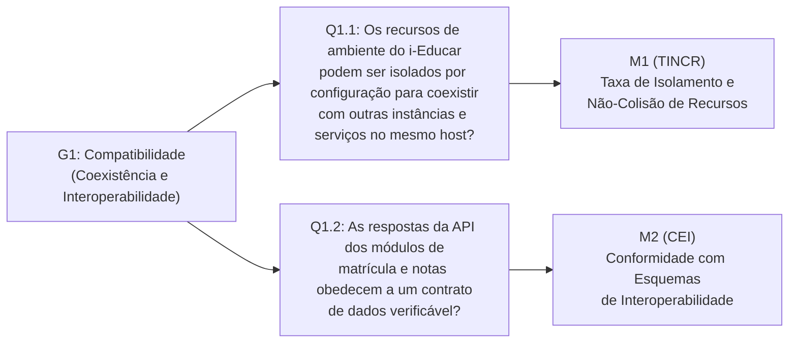
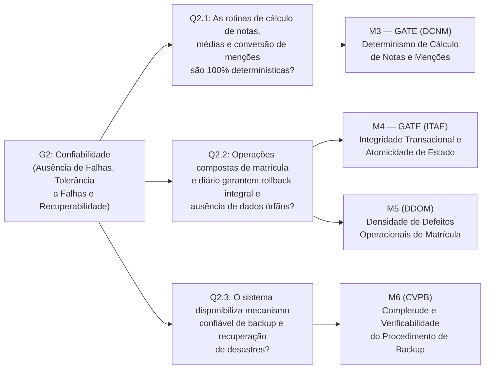
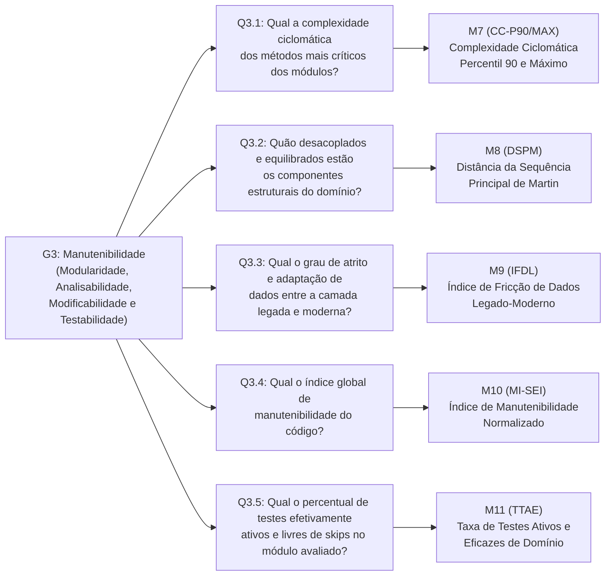
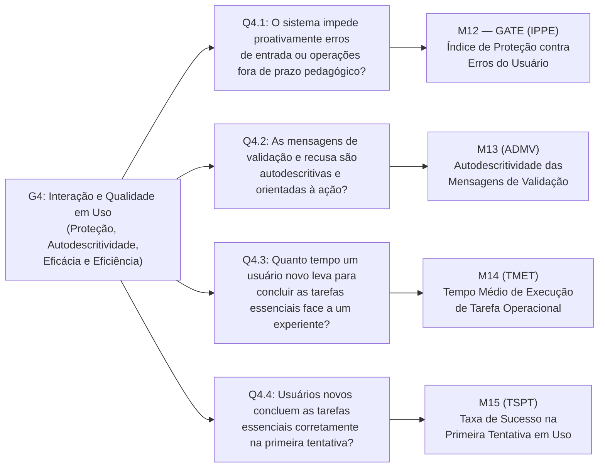

# Framework GQM de Avaliação de Qualidade de Software — Versão 2.0 (Normas 2023/2024)
<!-- Generated by CEH for projeto-qualidade Quality Assurance -->

!!! important "Enquadramento Normativo Internacional Vigente"
    | Norma / Metodologia | Escopo e Papel no Projeto |
    | :--- | :--- |
    | **ISO/IEC 25010:2023** | Modelo de Qualidade de Produto de Software (*SQuaRE — Product quality model*). |
    | **ISO/IEC 25019:2023** | Modelo de Qualidade em Uso (*Quality-in-use model* — Eficácia e Eficiência em contexto real). |
    | **ISO/IEC 25040:2024** | Processo de Avaliação de Qualidade (*Quality evaluation process* — 2ª Edição, 5 atividades). |
    | **ISO/IEC 25002:2024** | Visão Geral e Uso de Modelos de Qualidade (*Quality models overview and usage*). |
    | **ISO/IEC 25023:2016** | Medição de Qualidade de Produto (*Measurement of system and software product quality*). |
    | **GQM (Basili et al.)** | Metodologia *Goal-Question-Metric* desdobrada em 4 objetivos, 13 questões e 15 métricas. |

---

## 1. Atividade 1 (ISO 25040:2024): Requisitos e Objeto da Avaliação

### 1.1 Objeto da Avaliação

O sistema avaliado é o núcleo acadêmico do **i-Educar 2.12** (`projeto-qualidade`), estruturado como um **monólito híbrido** que articula uma camada moderna em Laravel com o núcleo legado da aplicação:

| Dimensão Arquitetural | Especificação Técnica no Objeto Avaliado |
| :--- | :--- |
| **Camada Moderna** | `Laravel 13` · `PHP 8.5` (`composer.json`: `^8.5`) · Modelos Eloquent e Services em `app/Models/` e `app/Services/` |
| **Núcleo Legado** | Subsistema histórico em `ieducar/intranet/` e `ieducar/modules/` (`Avaliacao`, `Api`, `RegraAvaliacao`), acessado pelo `LegacyController` |
| **Persistência Relacional** | `PostgreSQL 18` (imagem `postgres:18-alpine` da stack Docker oficial) dividido nos esquemas `pmieducar`, `modules` e `cadastro` |

A avaliação concentra-se cirurgicamente em **dois módulos funcionais interdependentes** de alta criticidade:

-   **Módulo 1 — Matrícula de Alunos**

    ---

    Gerencia o ingresso, a enturmação e o ciclo de vida acadêmico do estudante na rede escolar.

    - **Vínculo Escolar Formal:** Tabela `pmieducar.matricula` mapeada por `LegacyRegistration` (`app/Models/LegacyRegistration.php`).
    - **Enturmação e Remanejamento:** Tabela `pmieducar.matricula_turma` mapeada por `LegacyEnrollment` (`app/Models/LegacyEnrollment.php`).
    - **Ciclo de Vida Escolar (14 Situações):** Constantes de estado em `RegistrationStatus` (`app/Models/RegistrationStatus.php` — *Cursando, Aprovado, Retido, Transferido, Reclassificado, Abandono*, entre outros).
    - **Serviço de Domínio e Transação:** Regras de negócio e cancelamento atômico em `RegistrationService` (`app/Services/RegistrationService.php`).

-   **Módulo 2 — Lançamento de Notas e Menções**

    ---

    Processa as regras pedagógicas municipais, o diário eletrônico docente e o cálculo de médias e situações.

    - **Regras Pedagógicas:** Tabela `modules.regra_avaliacao` (`app/Models/LegacyEvaluationRule.php`) e tipos de nota em `RegraAvaliacao_Model_Nota_TipoValor` (`1` = Numérica, `2` = Conceitual/Menção, `3` = Mista, `0` = Nenhuma).
    - **Arredondamento e Conversão:** Tabela `modules.tabela_arredondamento_valor` (`app/Models/LegacyValueRoundingTable.php`).
    - **Diário Eletrônico e Motor de Boletim:** Controladores `DiarioController.php` e `DiarioApiController.php` (ambos em `ieducar/modules/Avaliacao/Views/`), serviço `Avaliacao_Service_Boletim` (`ieducar/modules/Avaliacao/Service/Boletim.php`). Detalhamento verificado em [Arquitetura](agents/architecture.md).
    - **Tabelas de Armazenamento:** `modules.nota_aluno`, `modules.nota_componente_curricular` e `modules.nota_componente_curricular_media`.

### 1.2 Características Selecionadas (ISO/IEC 25010:2023 & ISO/IEC 25019:2023)

Em alinhamento estrito com a revisão normativa 2023/2024, foram recortadas quatro características com pesos calibrados para o Índice Global ($\text{IQM}$):

-   **G1 — Compatibilidade** · `Peso: 20%`

    ---

    *Compatibility — ISO/IEC 25010:2023*

    - **Subcaracterísticas:** Coexistência e Interoperabilidade.
    - **Foco Técnico:** Isolamento de recursos de ambiente via configuração (`M1 — TINCR`) e aderência das respostas da API REST ao contrato de dados (`M2 — CEI`).

-   **G2 — Confiabilidade** · `Peso: 30%`

    ---

    *Reliability — ISO/IEC 25010:2023*

    - **Subcaracterísticas:** Ausência de Falhas (*Faultlessness*, antiga *Maturity*), Tolerância a Falhas e Recuperabilidade.
    - **Foco Técnico:** Determinismo de médias (`M3 — Gate`), atomicidade transacional (`M4 — Gate`), densidade de defeitos (`M5`) e restauração de backup (`M6`).

-   **G3 — Manutenibilidade** · `Peso: 30%`

    ---

    *Maintainability — ISO/IEC 25010:2023*

    - **Subcaracterísticas:** Modularidade, Analisabilidade, Modificabilidade e Testabilidade.
    - **Foco Técnico:** Complexidade ciclomática $P_{90}/\max$ (`M7`), acoplamento de Martin (`M8`), atrito legado-moderno (`M9`), índice $\text{MI-SEI}$ (`M10`) e testes ativos sem *skips* (`M11`).

-   **G4 — Interação e Qualidade em Uso** · `Peso: 20%`

    ---

    *Interaction Capability (ISO 25010) & Quality-in-Use (ISO 25019)*

    - **Subcaracterísticas:** Proteção contra Erros, Autodescritividade, Eficiência e Eficácia em Uso.
    - **Foco Técnico:** Bloqueio amigável de entradas inválidas (`M12 — Gate`), clareza de mensagens (`M13`), tempo de tarefa (`M14`) e sucesso na 1ª tentativa (`M15`).

---

## 2. Atividade 2 (ISO 25040:2024): Especificação da Avaliação (Árvore GQM)

Para garantir legibilidade integral na visualização web, a Árvore GQM completa é desdobrada a seguir nas quatro características priorizadas do modelo de qualidade (**G1 a G4**), mantendo a rastreabilidade estrita $\text{Objetivo (Goal)} \rightarrow \text{Questão (Question)} \rightarrow \text{Métrica (Metric)}$.

### 2.1 Árvore GQM — G1: Compatibilidade (ISO/IEC 25010:2023)

### 2.2 Árvore GQM — G2: Confiabilidade (ISO/IEC 25010:2023)

### 2.3 Árvore GQM — G3: Manutenibilidade (ISO/IEC 25010:2023)

### 2.4 Árvore GQM — G4: Capacidade de Interação e Qualidade em Uso (ISO/IEC 25010:2023 e 25019:2023)

---

## 3. Atividade 3 (ISO 25040:2024): Desenho da Avaliação (Definição Formal das Métricas)

### 3.1 Característica 1: Compatibilidade (*Compatibility* — ISO 25010:2023)

!!! info "Objetivo G1 — Compatibilidade (Modelo GQM)"
    - **Objetivo:** Analisar **o ambiente de execução e a API REST dos módulos de Matrícula e de Notas do i-Educar 2.12** com o propósito de **avaliar** com respeito à **coexistência e à interoperabilidade** do ponto de vista de **integradores (equipes de TI municipais)** no contexto de **uma instalação local via Docker, a partir do repositório oficial `portabilis/i-educar`**.
    - **Rastreabilidade:** $\text{G1} \rightarrow \text{Q1.1} \rightarrow \text{M1 (TINCR)}$ · $\text{G1} \rightarrow \text{Q1.2} \rightarrow \text{M2 (CEI)}$.
    - **Fora do escopo de G1:** Exportação de dados para o Educacenso/INEP, distribuída em pacote separado (`i-educar-educacenso-package`), e integrações com sistemas de terceiros que exigiriam credenciais de produção.

#### M1 — Taxa de Isolamento e Não-Colisão de Recursos (TINCR)
- **Subcaracterística**: Coexistência (*Co-existence* — ISO 25010:2023).
- **Questão respondida**: Q1.1.
- **Conceito**: Proporção dos recursos compartilháveis do ambiente de execução do i-Educar que podem ser isolados apenas por configuração, sem alterar código-fonte, permitindo que o sistema funcione no mesmo host que outra instância do i-Educar ou outro serviço sem conflito. São recursos compartilháveis: portas de rede expostas, nomes de containers, nome do banco de dados e usuário do PostgreSQL, prefixo de chaves do Redis e diretórios de armazenamento.
- **Fórmula de Cálculo**:

$$
\text{TINCR} = \dfrac{N_{\text{isoláveis}}}{N_{\text{identificados}}} \times 100\%
$$

- **Variáveis**:
    - $N_{\text{identificados}}$: número de recursos compartilháveis inventariados em `docker-compose.yml`, `.env.example` e `config/`.
    - $N_{\text{isoláveis}}$: número desses recursos cujo valor pode ser alterado por variável de ambiente ou arquivo de configuração e cuja alteração foi confirmada no teste de coexistência.
- **Procedimento de Coleta**:
    1. Inventariar os recursos compartilháveis (por exemplo: `DOCKER_NGINX_PORT`, `DOCKER_POSTGRES_PORT`, `DOCKER_REDIS_PORT`, `DB_DATABASE`, `DB_USERNAME`, `REDIS_PREFIX` e os `container_name` definidos no `docker-compose.yml`).
    2. Classificar cada recurso como parametrizável ou fixo no código/configuração versionada.
    3. Teste de coexistência: subir uma segunda instância do i-Educar no mesmo host, alterando apenas variáveis de ambiente, e registrar cada conflito observado (porta em uso, nome de container duplicado, colisão de chaves no Redis, colisão de banco).
- **Tipo de Escala**: Razão ($[0\%, 100\%]$).
- **Instrumento de Coleta**: Inspeção dos arquivos de configuração e execução do `docker compose`; evidências registradas em log de terminal e capturas de tela.

#### M2 — Conformidade com Esquemas de Interoperabilidade (CEI)
- **Subcaracterística**: Interoperabilidade (*Interoperability* — ISO 25010:2023).
- **Questão respondida**: Q1.2.
- **Conceito**: Percentual de *endpoints* da API REST do núcleo do i-Educar relacionados a matrícula, enturmação e lançamento de notas cujas respostas obedecem ao contrato de referência. Um *endpoint* é conforme somente se todos os seus casos de teste passarem:
    1. requisição válida retorna o código HTTP esperado e `Content-Type: application/json`;
    2. a resposta contém todos os campos obrigatórios do contrato, com os tipos esperados;
    3. requisição inválida (parâmetro ausente ou chave de API incorreta) retorna erro estruturado, sem erro 500 nem página HTML.
- **Contrato de Referência**: documentação oficial da API, quando existir; na sua ausência, contrato derivado pela equipe a partir dos controllers em `ieducar/modules/Api/` e das rotas em `routes/`, registrado em JSON Schema no repositório da equipe **antes** da execução, para evitar viés.
- **Fórmula de Cálculo**:

$$
\text{CEI} = \dfrac{N_{\text{endpoints conformes}}}{N_{\text{endpoints testados}}} \times 100\%
$$

- **Variáveis**:
    - $N_{\text{endpoints testados}}$: *endpoints* da API dos módulos avaliados incluídos na coleção de testes.
    - $N_{\text{endpoints conformes}}$: *endpoints* em que todos os casos 1 a 3 passaram.
- **Tipo de Escala**: Razão ($[0\%, 100\%]$).
- **Instrumento de Coleta**: Coleção de requisições versionada (Postman ou Insomnia) com validação de JSON Schema; relatório de execução exportado.

---

### 3.2 Característica 2: Confiabilidade (*Reliability* — ISO 25010:2023)

!!! info "Objetivo G2 — Confiabilidade (Modelo GQM)"
    - **Objetivo:** Analisar **os serviços de cálculo de notas, transações de matrícula e rotinas de backup do i-Educar 2.12** com o propósito de **avaliar** com respeito à **ausência de falhas (*faultlessness*), tolerância a falhas e recuperabilidade** do ponto de vista da **gestão escolar municipal e engenharia de testes** no contexto de **testes baseados em oráculo formal, injeção de falhas e restauração de banco**.
    - **Rastreabilidade:** $\text{G2} \rightarrow \text{Q2.1} \rightarrow \text{M3 (DCNM — Gate)}$ · $\text{G2} \rightarrow \text{Q2.2} \rightarrow \text{M4 (ITAE — Gate), M5 (DDOM)}$ · $\text{G2} \rightarrow \text{Q2.3} \rightarrow \text{M6 (CVPB)}$.

#### M3 — Determinismo no Cálculo de Notas e Menções (DCNM) — [GATE BINÁRIO]
- **Subcaracterística**: Ausência de Falhas (*Faultlessness* — ISO 25010:2023, item 8.5.2, antiga *Maturity* / ISO 25023 ref: FCr-1-G).
- **Conceito**: Exatidão determinística dos algoritmos de cálculo de médias (aritmética, ponderada), regras de recuperação paralela, aplicação de exames finais e mapeamento para menções conceituais a partir de `modules.tabela_arredondamento_valor`.
- **Fórmula de Cálculo**:

$$
\text{DCNM} = \dfrac{N_{\text{cálculos conformes ao gabarito}}}{N_{\text{oráculos de teste executados}}} \times 100\%
$$

- **Tipo de Escala**: Razão ($[0\%, 100\%]$).
- **Instrumento de Coleta**: Suíte de testes parametrizados com oráculo formal (tabela verdade com todas as permutações de regras de avaliação municipais).

#### M4 — Integridade Transacional e Atomicidade de Estado (ITAE) — [GATE BINÁRIO]
- **Subcaracterística**: Tolerância a Falhas e Integridade de Recuperação (*Fault tolerance & Recoverability* — ISO 25010:2023, itens 8.5.4 e 8.5.5).
- **Conceito**: Percentual de operações compostas de matrícula (ex.: cancelamento com inativação de enturmação e transferência) e de gravação de diário em lote que executam sob transações atômicas estritas (`DB::transaction`). Em caso de exceção intermediária, o rollback deve ser 100% garantido sem deixar registros órfãos ou inconsistentes em `pmieducar` e `modules`.
- **Fórmula de Cálculo**:

$$
\text{ITAE} = \dfrac{N_{\text{operações compostas com rollback verificado}}}{N_{\text{operações compostas analisadas}}} \times 100\%
$$

- **Tipo de Escala**: Razão ($[0\%, 100\%]$).
- **Instrumento de Coleta**: Testes de injeção de falha simulada (Chaos / Mock throw) e inspeção estática de blocos transacionais nos serviços (`app/Services/RegistrationService.php` e `ieducar/modules/Avaliacao/Views/DiarioController.php`).

#### M5 — Densidade de Defeitos Operacionais de Matrícula (DDOM)
- **Subcaracterística**: Ausência de Falhas (*Faultlessness* — ISO 25010:2023, item 8.5.2).
- **Conceito**: Taxa de incidentes/bugs reportados em produção por 1.000 movimentações de alunos (matrícula, enturmação, remanejamento, transferência, abandono).
- **Fórmula de Cálculo**:

$$
\text{DDOM} = \dfrac{N_{\text{incidentes de matrícula}}}{N_{\text{movimentações de matrícula}}} \times 1.000
$$

- **Tipo de Escala**: Razão ($[0, \infty)$).
- **Instrumento de Coleta**: Logs de erro unificados via Honeybadger (`honeybadger-io/honeybadger-laravel`) e registros de chamado de suporte da rede escolar.

#### M6 — Completude e Verificabilidade do Procedimento de Backup (CVPB)
- **Subcaracterística**: Recuperabilidade (*Recoverability* — ISO 25010:2023, item 8.5.5).
- **Conceito**: Avalia se o sistema dispõe de rotina automatizada e verificada de backup dos esquemas críticos (`pmieducar`, `modules`, `cadastro`), validando a integridade do dump e a taxa de restauração com sucesso em ambiente de homologação.
- **Fórmula de Cálculo**:

$$
\text{CVPB} = \dfrac{N_{\text{restaurações bem-sucedidas}}}{N_{\text{restaurações planejadas}}} \times 100\%
$$

- **Tipo de Escala**: Razão ($[0\%, 100\%]$).
- **Instrumento de Coleta**: Testes automatizados do pipeline de backup (`/backup-download` em `routes/web.php` e scripts de infraestrutura em `docker/`).

---

### 3.3 Característica 3: Manutenibilidade (*Maintainability* — ISO 25010:2023)

!!! info "Objetivo G3 — Manutenibilidade (Modelo GQM)"
    - **Objetivo:** Analisar **o código-fonte dos módulos de Matrícula e de Lançamento de Notas/Menções (`app/` e `ieducar/`)** com o propósito de **avaliar** com respeito à **modularidade, analisabilidade, modificabilidade e testabilidade** do ponto de vista dos **mantenedores e engenheiros de software** no contexto da **arquitetura monolítica híbrida (Laravel + Legado)**.
    - **Rastreabilidade:** $\text{G3} \rightarrow \text{Q3.1} \rightarrow \text{M7 (CC)}$ · $\text{G3} \rightarrow \text{Q3.2} \rightarrow \text{M8 (DSPM)}$ · $\text{G3} \rightarrow \text{Q3.3} \rightarrow \text{M9 (IFDL)}$ · $\text{G3} \rightarrow \text{Q3.4} \rightarrow \text{M10 (MI-SEI)}$ · $\text{G3} \rightarrow \text{Q3.5} \rightarrow \text{M11 (TTAE)}$.

#### M7 — Complexidade Ciclomática dos Métodos Críticos (CC-P90/MAX)
- **Subcaracterística**: Modularidade e Analisabilidade (*Modularity & Analysability* — ISO 25010:2023, itens 8.7.2 e 8.7.4 / NIST SP 500-235).
- **Conceito**: Mede a complexidade ciclomática de McCabe ($v(G)$) no percentil 90 ($P_{90}$) e o valor máximo absoluto ($V_{\max}$) nos métodos das classes centrais de matrícula e diário (`DiarioApiController.php`, `DiarioController.php`, `Boletim.php`, `RegistrationService.php`).
- **Fórmula de Cálculo**:

$$
v(G) = E - N + 2P \qquad \Big| \qquad \text{CC}_{P90} = P_{90}\big(v(G)\big), \quad \text{CC}_{\max} = \max\big(v(G)\big)
$$

- **Variáveis**:
    - $E$: número de arestas do grafo de fluxo de controle do método; $N$: número de nós; $P$: número de componentes conexos.
    - Avaliam-se simultaneamente o percentil 90 ($\text{CC}_{P90}$) e o teto absoluto ($\text{CC}_{\max}$).
- **Tipo de Escala**: Razão discreta ($v(G) \ge 1$).
- **Instrumento de Coleta**: Analisador estático de código PHP (`scripts/evaluate-quality.php`).

#### M8 — Distância da Sequência Principal de Martin (DSPM)
- **Subcaracterística**: Modularidade e Modificabilidade (*Modularity & Modifiability* — ISO 25010:2023, itens 8.7.2 e 8.7.5).
- **Conceito**: Mede o equilíbrio arquitetural dos pacotes/módulos de domínio entre abstratividade ($A$) e instabilidade ($I$), verificando se o código não se encontra na "Zona da Dor" (concreto e altamente estável/acoplado) nem na "Zona da Inutilidade" (abstrato e não utilizado).
- **Fórmula de Cálculo**:

$$
I = \dfrac{C_e}{C_a + C_e}, \qquad A = \dfrac{N_a}{N_c}, \qquad D = \left| A + I - 1 \right|
$$

- **Variáveis**:
    - $C_e$: Acoplamento Eferente (classes externas consumidas).
    - $C_a$: Acoplamento Aferente (classes que dependem desta).
    - $N_a$: Número de classes e interfaces abstratas no pacote.
    - $N_c$: Número total de classes no pacote.
    - $D \in [0, 1]$: Distância normalizada da sequência principal ($D=0$ é o equilíbrio perfeito).
- **Tipo de Escala**: Razão contínua ($[0, 1]$).
- **Instrumento de Coleta**: Analisador estático de grafo de classes PHP.

#### M9 — Índice de Fricção de Dados Legado-Moderno (IFDL)
- **Subcaracterística**: Analisabilidade e Modificabilidade (*Analysability & Modifiability* — ISO 25010:2023, itens 8.7.4 e 8.7.5).
- **Conceito**: Mede a densidade de adaptadores de compatibilidade defensiva (traits `HasLegacyDates`, casts manuais de datas `d/m/Y` $\leftrightarrow$ `Y-m-d`, sanitizações de string vazia para `null`) necessários para interoperar o Eloquent moderno com os esquemas legados.
- **Fórmula de Cálculo**:

$$
\text{IFDL} = \dfrac{1}{M_{\text{modelos}}} \sum_{i=1}^{M_{\text{modelos}}} A_{\text{defensivos}, i}
$$

- **Variáveis**:
    - $M_{\text{modelos}}$: total de modelos de domínio avaliados; $A_{\text{defensivos}, i}$: quantidade de adaptadores defensivos no modelo $i$.
- **Tipo de Escala**: Razão contínua ($[0, \infty)$).
- **Instrumento de Coleta**: Inspeção de modelos em `app/Models/Legacy*.php`.

#### M10 — Índice de Manutenibilidade Normalizado (MI-SEI)
- **Subcaracterística**: Modificabilidade (*Modifiability* — ISO 25010:2023, item 8.7.5 / Padrão SEI / Microsoft).
- **Conceito**: Fórmula clássica de Oman-Coleman normalizada para a escala $[0, 100]$.
- **Fórmula de Cálculo**:

$$
\text{MI} = \max\left(0,\; \dfrac{171 - 5{,}2 \ln(\text{HV}) - 0{,}23\, v(G) - 16{,}2 \ln(\text{LOC})}{171} \times 100\right)
$$

- **Variáveis**:
    - $\text{HV}$: Volume de Halstead; $v(G)$: complexidade ciclomática; $\text{LOC}$: linhas de código-fonte lógicas.
- **Tipo de Escala**: Razão normalizada ($[0, 100]$).
- **Instrumento de Coleta**: Analisador de métricas de software (`scripts/evaluate-quality.php`).

#### M11 — Taxa de Testes Ativos e Eficazes de Domínio (TTAE)
- **Subcaracterística**: Testabilidade (*Testability* — ISO 25010:2023, item 8.7.6).
- **Conceito**: Mede o percentual de testes de regras pedagógicas e de matrícula que executam asserções ativas em relação ao total declarado, penalizando testes desativados com `markTestSkipped()` ou sem asserções.
- **Fórmula de Cálculo**:

$$
\text{TTAE} = \dfrac{N_{\text{testes ativos com asserção}}}{N_{\text{testes declarados totais}}} \times 100\%
$$

- **Tipo de Escala**: Razão ($[0\%, 100\%]$).
- **Instrumento de Coleta**: Relatório de execução do Pest/PHPUnit (`vendor/bin/pest` ou parser do `tests/Unit/Modules/Service/`).

---

### 3.4 Característica 4: Capacidade de Interação (ISO 25010) & Qualidade em Uso (ISO 25019)

!!! info "Objetivo G4 — Capacidade de Interação e Qualidade em Uso (Modelo GQM)"
    - **Objetivo:** Analisar **os fluxos de matrícula e de lançamento de notas do i-Educar 2.12** com o propósito de **avaliar** com respeito à **proteção contra erros do usuário, à autodescritividade e à eficácia e eficiência em uso** do ponto de vista de **secretários escolares e professores sem experiência prévia no sistema** no contexto de **sessões de teste supervisionadas em instalação local com dados fictícios**.
    - **Rastreabilidade:** $\text{G4} \rightarrow \text{Q4.1} \rightarrow \text{M12 (IPPE)}$ · $\text{G4} \rightarrow \text{Q4.2} \rightarrow \text{M13 (ADMV)}$ · $\text{G4} \rightarrow \text{Q4.3} \rightarrow \text{M14 (TMET)}$ · $\text{G4} \rightarrow \text{Q4.4} \rightarrow \text{M15 (TSPT)}$.
    - **Separação entre produto e uso:** `M12` e `M13` medem propriedades do **produto** (ISO/IEC 25010:2023) e são coletadas por testes e inspeção, sem participantes. `M14` e `M15` medem a **qualidade em uso** (ISO/IEC 25019:2023) e dependem de sessões com participantes, conforme o protocolo abaixo.

#### M12 — Índice de Proteção contra Erros do Usuário (IPPE) — [GATE BINÁRIO]
- **Subcaracterística**: Proteção contra Erro do Usuário (*User error protection* — ISO 25010:2023).
- **Questão respondida**: Q4.1.
- **Conceito**: Eficácia do sistema em interceptar entradas inválidas antes da persistência, nos seguintes tipos de cenário:
    1. Lançamento de notas fora da faixa permitida na regra (`$regra->nota_maxima_geral` e `$regra->nota_minima_geral`).
    2. Lançamento em ano/etapa encerrada ou bloqueada (`validatesCanChangeDiarioForAno` e `validatesPeriodoLancamentoFaltasNotas`).
    3. Menções conceituais inválidas não constantes em `modules.tabela_arredondamento_valor`.
    4. Matrícula com conflito temporal ou dados inconsistentes.
- **Critério de "bloqueio amigável"**: a entrada não é gravada no banco **e** o sistema exibe mensagem ao usuário, sem erro 500, tela em branco ou perda dos demais dados digitados.
- **Fórmula de Cálculo**:

$$
\text{IPPE} = \dfrac{N_{\text{cenários bloqueados amigavelmente}}}{N_{\text{cenários inválidos submetidos}}} \times 100\%
$$

- **Tipo de Escala**: Razão ($[0\%, 100\%]$).
- **Instrumento de Coleta**: Catálogo de cenários inválidos (no mínimo 3 cenários por tipo), executados pela interface e pela API; a persistência é verificada por consulta ao banco após cada cenário.

#### M13 — Autodescritividade das Mensagens de Validação (ADMV)
- **Subcaracterística**: Autodescritividade e Assistência ao Usuário (*Self-descriptiveness & User assistance* — ISO 25010:2023).
- **Questão respondida**: Q4.2.
- **Conceito**: Proporção das mensagens de erro exibidas nos cenários de M12 que (a) informam a **causa** do bloqueio e (b) indicam a **ação corretiva** esperada do usuário.
- **Fórmula de Cálculo**:

$$
\text{ADMV} = \dfrac{N_{\text{mensagens com causa e ação}}}{N_{\text{mensagens de erro avaliadas}}} \times 100\%
$$

- **Procedimento de Classificação**: dois integrantes classificam cada mensagem de forma independente (atende/não atende a cada critério); divergências são resolvidas por consenso e registradas.
- **Tipo de Escala**: Razão ($[0\%, 100\%]$).
- **Instrumento de Coleta**: Capturas das mensagens obtidas na execução de M12, complementadas pela inspeção do catálogo de mensagens (`src/Support/Exceptions/Error.php` e chamadas `$this->messenger->append()`).

#### Protocolo das sessões de uso (M14 e M15)
- **Participantes**: no mínimo 5 pessoas sem experiência prévia no i-Educar, recrutadas voluntariamente; todas assinam o Termo de Consentimento Livre e Esclarecido (TCLE) e os dados são anonimizados (identificação por código P1 a P5).
- **Tarefas padronizadas** (executadas na mesma ordem, com dados fornecidos em ficha impressa):
    - **T1 — Matrícula:** matricular um aluno já cadastrado em uma turma e realizar a enturmação.
    - **T2 — Diário:** lançar as notas de um componente curricular para uma turma de 10 alunos.
- **Tempo de referência ($T_{\text{ref}}$)**: média de 3 execuções de cada tarefa por um integrante da equipe treinado no sistema.
- **Registro**: gravação de tela com áudio, cronometragem a partir da leitura da tarefa até a confirmação de gravação; o avaliador não auxilia o participante durante a tarefa.

#### M14 — Tempo Médio de Execução de Tarefa Operacional (TMET)
- **Característica ISO 25019:2023**: Qualidade em Uso › Eficiência.
- **Questão respondida**: Q4.3.
- **Conceito**: Tempo médio, em minutos, que os participantes levam para concluir cada tarefa padronizada ($\text{TMET}_{T1}$ e $\text{TMET}_{T2}$). Para o julgamento, o tempo é comparado ao tempo de referência por meio da razão $R_{\text{tempo},T}$.
- **Fórmulas de Cálculo**:

$$
\text{TMET}_T = \dfrac{1}{K} \sum_{k=1}^{K} t_{k,T} \qquad \text{e} \qquad R_{\text{tempo},T} = \dfrac{\text{TMET}_T}{T_{\text{ref},T}}
$$

- **Variáveis**:
    - $t_{k,T}$: tempo do participante $k$ na tarefa $T$; $K$: número de participantes que concluíram a tarefa; $T_{\text{ref},T}$: tempo de referência na tarefa $T$.
- **Tipo de Escala**: Razão contínua (minutos; razão adimensional para o julgamento).
- **Instrumento de Coleta**: Gravações das sessões e planilha de cronometragem.

#### M15 — Taxa de Sucesso na Primeira Tentativa em Uso (TSPT)
- **Característica ISO 25019:2023**: Qualidade em Uso › Eficácia.
- **Questão respondida**: Q4.4.
- **Conceito**: Percentual de execuções de tarefa (T1 e T2) concluídas corretamente na primeira submissão, sem erro de validação, recarga da página, perda de dados digitados ou ajuda do avaliador.
- **Fórmula de Cálculo**:

$$
\text{TSPT} = \dfrac{N_{\text{execuções corretas na 1ª submissão}}}{N_{\text{execuções totais}}} \times 100\%
$$

- **Tipo de Escala**: Razão ($[0\%, 100\%]$).
- **Instrumento de Coleta**: Observação das sessões e gravações; a correção do resultado é conferida por consulta ao banco após cada execução.

---

## 4. Limiares Numéricos e Níveis de Pontuação (Calibração ISO 25040)

### Tabela Unificada de Limiares Numéricos

| ID | Métrica | Subcaracterística (ISO 25010/25019) | Crítico (1) | Regular (2) | Bom (3) | Excelente (4) | Peso ($w_i$) | Tipo de Regra |
|---|---|---|:---:|:---:|:---:|:---:|:---:|:---:|
| **M1** | Isolamento de Recursos ($\text{TINCR}$) | Compatibilidade › Coexistência | $< 70{,}0\%$ | $[70{,}0\%, 85{,}0\%)$ | $[85{,}0\%, 100\%)$ | $100\%$ | 1.0 | Gradual |
| **M2** | Conformidade de Interoperabilidade ($\text{CEI}$) | Compatibilidade › Interoperabilidade | $< 70{,}0\%$ | $[70{,}0\%, 85{,}0\%)$ | $[85{,}0\%, 100\%)$ | $100\%$ | 1.0 | Gradual |
| **M3** | Determinismo de Notas/Menções ($\text{DCNM}$) | Confiabilidade › Ausência de Falhas | $< 100\%$ | — | — | $100\%$ | **2.0** | **GATE BINÁRIO** |
| **M4** | Integridade Transacional ($\text{ITAE}$) | Confiabilidade › Tolerância a Falhas | $< 100\%$ | — | — | $100\%$ | **2.0** | **GATE BINÁRIO** |
| **M5** | Densidade de Defeitos de Matrícula ($\text{DDOM}$) | Confiabilidade › Ausência de Falhas | $> 5{,}0$ | $(2{,}0, 5{,}0]$ | $(0{,}5, 2{,}0]$ | $\le 0{,}5$ | 1.2 | Gradual |
| **M6** | Verificabilidade de Backup ($\text{CVPB}$) | Confiabilidade › Recuperabilidade | $< 90{,}0\%$ | $[90{,}0\%, 95{,}0\%)$ | $[95{,}0\%, 99{,}0\%)$ | $100\%$ | 1.0 | Gradual |
| **M7a**| Complexidade Ciclomática $P_{90}$ ($\text{CC}_{P90}$) | Manutenibilidade › Modularidade | $> 20$ | $(15, 20]$ | $(10, 15]$ | $\le 10$ | 1.0 | Gradual |
| **M7b**| Complexidade Ciclomática Máxima ($\text{CC}_{\max}$) | Manutenibilidade › Analisabilidade | $> 50$ | $(30, 50]$ | $(15, 30]$ | $\le 15$ | 1.2 | Gradual |
| **M8** | Distância Sequência Principal ($\text{DSPM}$) | Manutenibilidade › Modificabilidade | $> 0{,}50$ | $(0{,}35, 0{,}50]$ | $(0{,}20, 0{,}35]$ | $\le 0{,}20$ | 0.8 | Gradual |
| **M9** | Fricção de Dados Legado ($\text{IFDL}$) | Manutenibilidade › Analisabilidade | $> 4{,}0$ | $(2{,}5, 4{,}0]$ | $(1{,}0, 2{,}5]$ | $\le 1{,}0$ | 0.6 | Gradual |
| **M10**| Índice de Manutenibilidade ($\text{MI}$) | Manutenibilidade › Modificabilidade | $< 40$ | $[40, 60)$ | $[60, 80)$ | $\ge 80$ | 1.0 | Gradual |
| **M11**| Testes Ativos de Domínio ($\text{TTAE}$) | Manutenibilidade › Testabilidade | $< 70{,}0\%$ | $[70{,}0\%, 85{,}0\%)$ | $[85{,}0\%, 95{,}0\%)$ | $\ge 95{,}0\%$ | 1.4 | Gradual |
| **M12**| Proteção contra Erros ($\text{IPPE}$) | Interação › Proteção de Erro | $< 100\%$ | — | — | $100\%$ | **2.0** | **GATE BINÁRIO** |
| **M13**| Autodescritividade de Mensagens ($\text{ADMV}$) | Interação › Autodescritividade | $< 80{,}0\%$ | $[80{,}0\%, 90{,}0\%)$ | $[90{,}0\%, 98{,}0\%)$ | $\ge 98{,}0\%$ | 0.8 | Gradual |
| **M14a**| Razão de Tempo: Matrícula ($R_{\text{tempo},T1}$) | Qualidade em Uso › Eficiência | $> 3{,}0$ | $(2{,}0, 3{,}0]$ | $(1{,}5, 2{,}0]$ | $\le 1{,}5$ | 0.8 | Gradual |
| **M14b**| Razão de Tempo: Diário ($R_{\text{tempo},T2}$) | Qualidade em Uso › Eficiência | $> 3{,}0$ | $(2{,}0, 3{,}0]$ | $(1{,}5, 2{,}0]$ | $\le 1{,}5$ | 1.0 | Gradual |
| **M15**| Sucesso na 1ª Tentativa ($\text{TSPT}$) | Qualidade em Uso › Eficácia | $< 50{,}0\%$ | $[50{,}0\%, 70{,}0\%)$ | $[70{,}0\%, 90{,}0\%)$ | $\ge 90{,}0\%$ | 1.0 | Gradual |

---

## 5. Atividade 4 e 5 (ISO 25040:2024): Execução, Julgamento e Decisão

### 5.1 Regras de Julgamento dos Gates Binários (Condições Não-Compensatórias)

Antes de qualquer agregação estatística ou média de índices, o sistema é submetido aos **3 Gates de Integridade**:

-   **1. Gate Pedagógico — M3 ($\text{DCNM}$)**

    ---

    **Critério:** $\text{M3}\ (\text{DCNM}) = 100\%$

    Qualquer divergência de cálculo de notas ou conversão de menções em relação à regra homologada reprova a versão imediatamente.

-   **2. Gate de Consistência — M4 ($\text{ITAE}$)**

    ---

    **Critério:** $\text{M4}\ (\text{ITAE}) = 100\%$

    Todas as operações compostas identificadas devem comprovar rollback transacional integral em caso de falha intermediária.

-   **3. Gate de Proteção de Dados — M12 ($\text{IPPE}$)**

    ---

    **Critério:** $\text{M12}\ (\text{IPPE}) = 100\%$

    Nenhuma entrada fora de limites configurados pode violar a integridade ou ser persistida no banco de dados.

!!! danger "Regra Eliminatória dos Gates Binários"
    **A reprovação em qualquer um dos Gates Binários implica REPROVAÇÃO IMEDIATA (Status: BLOQUEADO)**, independentemente da nota das demais métricas.

### 5.2 Função de Agregação por Característica ($IQC_k$)
Para as métricas contínuas e graduais de cada característica $k$:

$$
\text{IQC}_k = \dfrac{\displaystyle\sum_{i \in k} \left(S_i \times w_i\right)}{\displaystyle\sum_{i \in k} w_i}
$$

Onde $S_i \in \{1, 2, 3, 4\}$ é a pontuação discreta obtida pela métrica $i$ conforme o enquadramento na tabela de limiares e $w_i$ é o seu peso relativo.

### 5.3 Índice Global de Qualidade dos Módulos ($IQM$)

$$
\text{IQM} = 0{,}30 \times \text{IQC}_{\text{Confiabilidade}} + 0{,}30 \times \text{IQC}_{\text{Manutenibilidade}} + 0{,}20 \times \text{IQC}_{\text{Interação/Uso}} + 0{,}20 \times \text{IQC}_{\text{Compatibilidade}}
$$

### 5.4 Critérios de Decisão Final de Release

-   **Classificação A — Aprovado Plenamente**

    ---

    - `100%` de sucesso nos Gates Binários ($\text{M3}, \text{M4}, \text{M12} = 100\%$).
    - $\text{IQM} \ge 3{,}25$ (em escala de 1 a 4).
    - Nenhuma característica individual com $\text{IQC}_k < 3{,}0$.
    - Nenhuma métrica isolada em nível Crítico ($S_i = 1$).

-   **Classificação B — Aprovado com Ressalvas**

    ---

    - `100%` de sucesso nos Gates Binários ($\text{M3}, \text{M4}, \text{M12} = 100\%$).
    - $2{,}75 \le \text{IQM} < 3{,}25$.
    - Nenhuma característica individual com $\text{IQC}_k < 2{,}5$.
    - Exige plano de ação corretivo no backlog para métricas em nível Regular ($S_i = 2$).

-   **Classificação C — Reprovado / Bloqueado**

    ---

    - Falha em qualquer um dos Gates Binários ($\text{M3}, \text{M4}, \text{M12} < 100\%$), **OU**
    - $\text{IQM} < 2{,}75$, **OU**
    - Qualquer característica individual com $\text{IQC}_k < 2{,}5$.

---

## 6. Procedimento Operacional de Coleta Automatizada

O framework disponibiliza uma ferramenta de execução automatizada em `scripts/evaluate-quality.php`, que realiza a extração direta das métricas do repositório, calcula a complexidade ciclomática com $P_{90}$ e máximo, audita transações, contabiliza testes ativos versus skips e gera o relatório consolidado com o veredito GQM.
