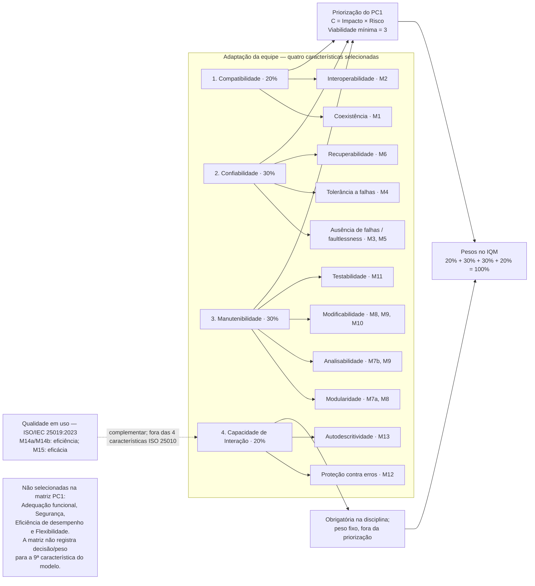
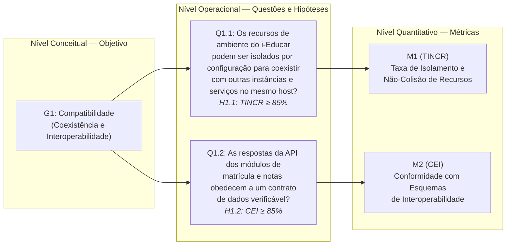
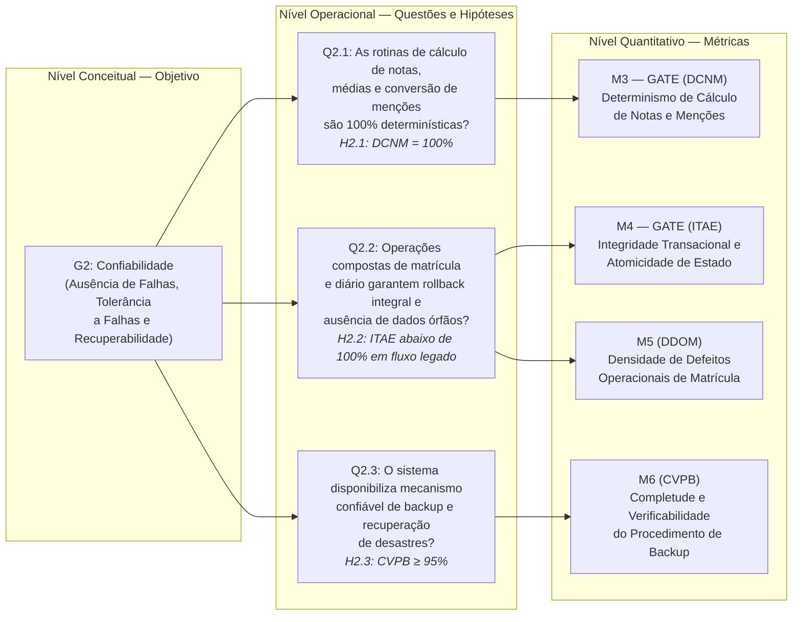
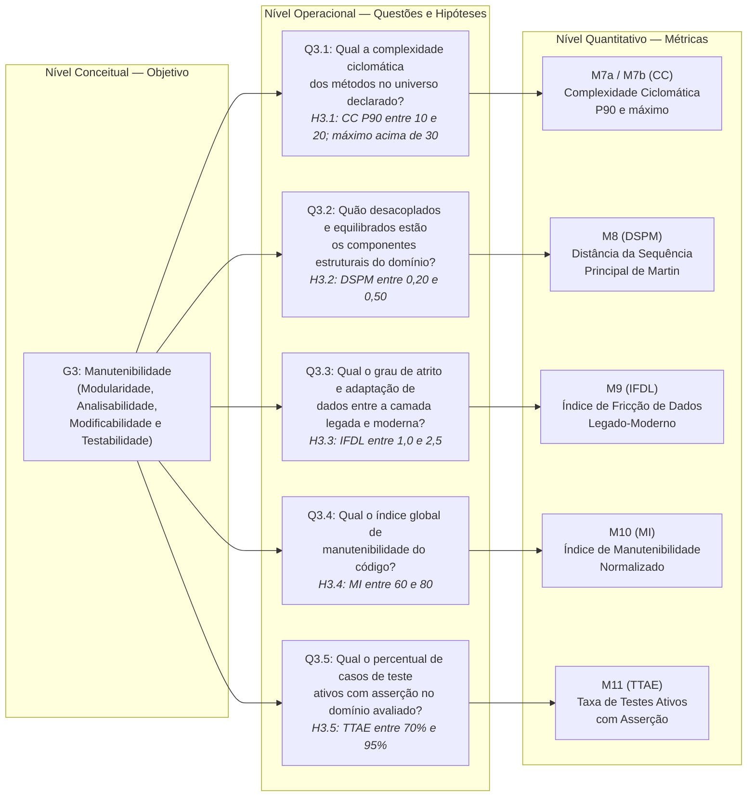
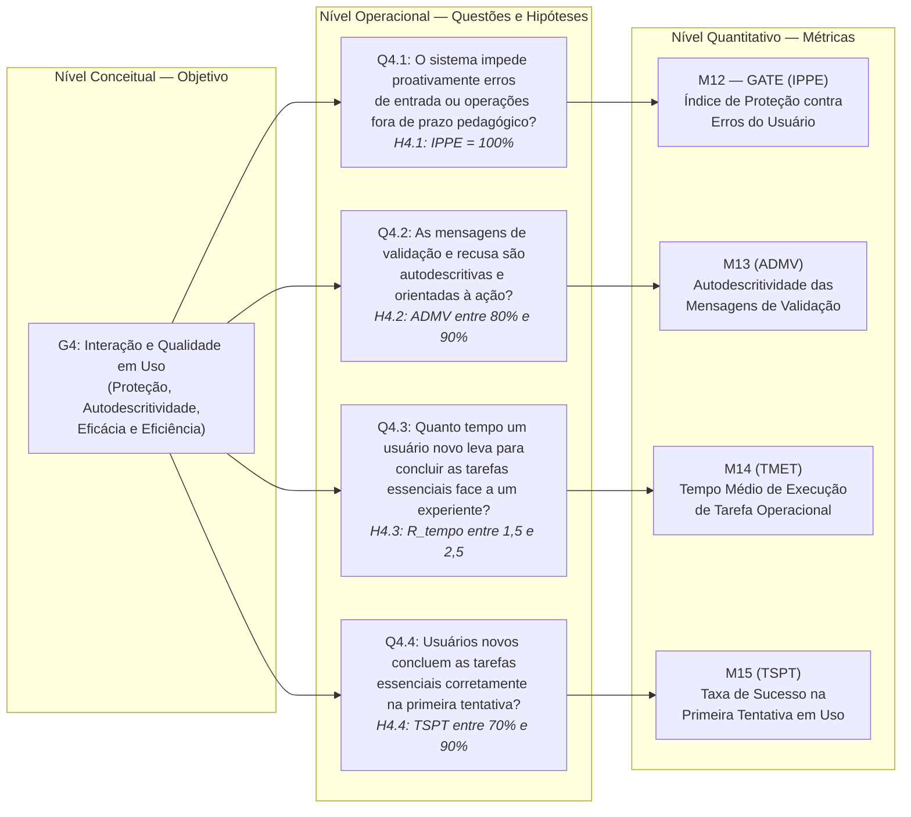
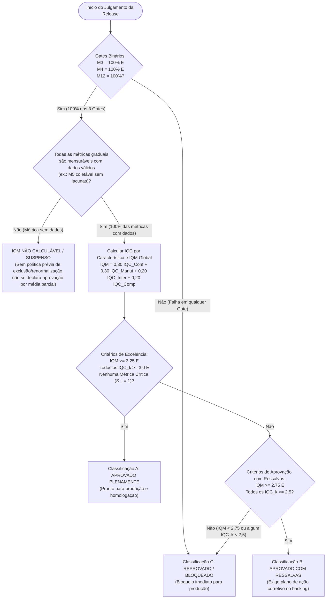

# Framework GQM de Avaliação de Qualidade de Software — Versão 2.0 (Normas 2023/2024)
<!-- Generated by CEH for projeto-qualidade Quality Assurance -->

!!! important "Enquadramento Normativo Internacional Vigente"
    | Norma / Metodologia | Escopo e Papel no Projeto |
    | :--- | :--- |
    | **ISO/IEC 25010:2023** | Modelo de Qualidade de Produto de Software (*SQuaRE — Product quality model*). |
    | **ISO/IEC 25019:2023** | Modelo de Qualidade em Uso (*Quality-in-use model* — Eficácia e Eficiência em contexto real). |
    | **ISO/IEC 25040:2024** | Processo de Avaliação de Qualidade (*Quality evaluation process* — 2ª Edição, 5 atividades). |
    | **ISO/IEC 25002:2024** | Visão Geral e Uso de Modelos de Qualidade (*Quality models overview and usage*). |
    | **ISO/IEC 25023:2016** | Medição de Qualidade de Produto (*Measurement of system and software product quality*). |
    | **GQM (Basili et al.)** | Metodologia *Goal-Question-Metric* desdobrada em 4 objetivos, 14 questões, 15 famílias de métricas e 17 linhas operacionais. |

---

## 1. Atividade 1 (ISO 25040:2024): Requisitos e Objeto da Avaliação

### 1.1 Objeto da Avaliação

O sistema avaliado é o núcleo acadêmico do **i-Educar 2.12** (`projeto-qualidade`), estruturado como um **monólito híbrido** que articula uma camada moderna em Laravel com o núcleo legado da aplicação:

| Dimensão Arquitetural | Especificação Técnica no Objeto Avaliado |
| :--- | :--- |
| **Camada Moderna** | `Laravel 13` · `PHP 8.5` (`composer.json`: `^8.5`) · Modelos Eloquent e Services em `app/Models/` e `app/Services/` |
| **Núcleo Legado** | Subsistema histórico em `ieducar/intranet/` e `ieducar/modules/` (`Avaliacao`, `Api`, `RegraAvaliacao`), acessado pelo `LegacyController` |
| **Persistência Relacional** | `PostgreSQL 18` (imagem `postgres:18-alpine` da stack Docker oficial) dividido nos esquemas `pmieducar`, `modules` e `cadastro` |

A avaliação concentra-se cirurgicamente em **dois módulos funcionais interdependentes** de alta criticidade:

-   **Módulo 1 — Matrícula de Alunos**

    ---

    Gerencia o ingresso, a enturmação e o ciclo de vida acadêmico do estudante na rede escolar.

    - **Vínculo Escolar Formal:** Tabela `pmieducar.matricula` mapeada por `LegacyRegistration` (`app/Models/LegacyRegistration.php`).
    - **Enturmação e Remanejamento:** Tabela `pmieducar.matricula_turma` mapeada por `LegacyEnrollment` (`app/Models/LegacyEnrollment.php`).
    - **Ciclo de Vida Escolar (14 Situações):** Constantes de estado em `RegistrationStatus` (`app/Models/RegistrationStatus.php` — *Cursando, Aprovado, Retido, Transferido, Reclassificado, Abandono*, entre outros).
    - **Serviço de Domínio e Transação:** Regras de negócio e cancelamento atômico em `RegistrationService` (`app/Services/RegistrationService.php`).

-   **Módulo 2 — Lançamento de Notas e Menções**

    ---

    Processa as regras pedagógicas municipais, o diário eletrônico docente e o cálculo de médias e situações.

    - **Regras Pedagógicas:** Tabela `modules.regra_avaliacao` (`app/Models/LegacyEvaluationRule.php`) e tipos de nota em `RegraAvaliacao_Model_Nota_TipoValor` (`1` = Numérica, `2` = Conceitual/Menção, `3` = Mista, `0` = Nenhuma).
    - **Arredondamento e Conversão:** Tabela `modules.tabela_arredondamento_valor` (`app/Models/LegacyValueRoundingTable.php`).
    - **Diário Eletrônico e Motor de Boletim:** Controladores `DiarioController.php` e `DiarioApiController.php` (ambos em `ieducar/modules/Avaliacao/Views/`), serviço `Avaliacao_Service_Boletim` (`ieducar/modules/Avaliacao/Service/Boletim.php`). Detalhamento verificado em [Arquitetura](agents/architecture.md).
    - **Tabelas de Armazenamento:** `modules.nota_aluno`, `modules.nota_componente_curricular` e `modules.nota_componente_curricular_media`.

### 1.2 Características Selecionadas (ISO/IEC 25010:2023 & ISO/IEC 25019:2023)

Em alinhamento estrito com a revisão normativa 2023/2024, foram recortadas quatro características com pesos calibrados para o Índice Global ($\text{IQM}$):

-   **G1 — Compatibilidade** · `Peso: 20%`

    ---

    *Compatibility — ISO/IEC 25010:2023*

    - **Subcaracterísticas:** Coexistência e Interoperabilidade.
    - **Foco Técnico:** Isolamento de recursos de ambiente via configuração (`M1 — TINCR`) e aderência das respostas da API REST ao contrato de dados (`M2 — CEI`).

-   **G2 — Confiabilidade** · `Peso: 30%`

    ---

    *Reliability — ISO/IEC 25010:2023*

    - **Subcaracterísticas:** Ausência de Falhas (*Faultlessness*, antiga *Maturity*), Tolerância a Falhas e Recuperabilidade.
    - **Foco Técnico:** Determinismo de médias (`M3 — Gate`), atomicidade transacional (`M4 — Gate`), densidade de defeitos (`M5`) e restauração de backup (`M6`).

-   **G3 — Manutenibilidade** · `Peso: 30%`

    ---

    *Maintainability — ISO/IEC 25010:2023*

    - **Subcaracterísticas:** Modularidade, Analisabilidade, Modificabilidade e Testabilidade.
    - **Foco Técnico:** Complexidade ciclomática $P_{90}/\max$ (`M7a`/`M7b`), acoplamento de Martin (`M8`), atrito legado-moderno (`M9`), índice local de manutenibilidade (`M10`) e testes ativos com asserção (`M11`).

-   **G4 — Interação e Qualidade em Uso** · `Peso: 20%`

    ---

    *Interaction Capability (ISO 25010) & Quality-in-Use (ISO 25019)*

    - **Subcaracterísticas:** Proteção contra Erros, Autodescritividade, Eficiência e Eficácia em Uso.
    - **Foco Técnico:** Bloqueio amigável de entradas inválidas (`M12 — Gate`), clareza de mensagens (`M13`), tempo de tarefa (`M14`) e sucesso na 1ª tentativa (`M15`).

### Figura 1 — Adaptação da ISO/IEC 25010:2023 ao recorte da avaliação

O diagrama abaixo é uma **adaptação da equipe**, não uma reprodução da figura nem da lista normativa completa. A página pública da ISO informa que a edição de 2023 contém nove características subdivididas em subcaracterísticas, mas não disponibiliza gratuitamente o texto integral. O recorte seleciona quatro características para a avaliação; os pesos refletem a matriz de priorização do relatório PC1. Os nomes das subcaracterísticas e sua vinculação às métricas são os usados pelo projeto e devem ser conferidos na norma integral antes de serem apresentados como citação normativa literal.

**Legenda:** caixas numeradas são as quatro características avaliadas; caixas subordinadas são o recorte de subcaracterísticas e métricas adotado pela equipe; linhas pontilhadas separam a qualidade em uso (ISO/IEC 25019) da qualidade do produto; pesos e regras de priorização são decisões do PC1, não pesos prescritos pela ISO. A lista atual de alternativas da matriz PC1 registra quatro características não selecionadas; como a matriz não identifica nem pontua a nona característica mencionada no resumo público da ISO, essa lacuna permanece explícita e não recebe nome, nota ou peso inventado.

**Fonte e limite:** adaptação da equipe com base na página pública [ISO/IEC 25010:2023](https://www.iso.org/standard/78176.html) (metadados e resumo: modelo de qualidade de produto com nove características e subcaracterísticas), no relatório PC1, seção 2.1.4, e no framework GQM. A página pública não substitui a norma paga. Termos, subcaracterísticas, enumeração completa, numeração de cláusulas e relações normativas não foram validados contra o texto integral. *Interaction Capability* e *Faultlessness* são mantidos como termos do projeto; “Maturity” é tratado apenas como nomenclatura anterior já presente nos documentos, não como equivalência normativa afirmada aqui.

### 1.3 Escopo e justificativa do recorte

O recorte concentra a inspeção e os protocolos nos módulos de **Matrícula** e **Lançamento de Notas/Menções**. A escolha é coerente com as partes interessadas do PC1: secretarias e equipes de TI dependem de registros de matrícula/enturmação; professores e gestores dependem do diário e de cálculos corretos; mantenedores precisam alterar regras municipais no núcleo híbrido. A consequência de um registro inconsistente ou de um cálculo incorreto alcança o histórico escolar e a gestão da rede. A base técnica documentada no objeto da avaliação localiza esses fluxos em `RegistrationService`, `LegacyRegistration`, `LegacyEnrollment`, `DiarioController`, `DiarioApiController`, `Boletim.php` e tabelas dos esquemas `pmieducar` e `modules`; o relatório de arquitetura descreve a transição entre o legado `ieducar/` e Laravel em `app/`. Esse é o fundamento do recorte, não uma afirmação de que todos os módulos ou cenários de produção foram executados nesta tarefa.

| Dentro do escopo | Fora do escopo / limite |
| --- | --- |
| Fluxos e código de matrícula, enturmação, remanejamento e ciclo de vida do vínculo escolar. | Pacotes externos, `vendor/` e exportação Educacenso/INEP em repositório separado. |
| Regras, conversão/arredondamento de notas e menções e gravação do diário. | Integrações que dependem de credenciais ou dados de produção não fornecidos. |
| Configuração de ambiente e API REST do núcleo, operações transacionais e procedimento de backup/restauração em ambiente local ou de homologação. | Teste sob estresse simultâneo de múltiplos municípios; não há infraestrutura representativa da produção disponível para esta avaliação. |
| Análise estática e testes dos caminhos de código associados aos módulos descritos. | Segurança como característica avaliada, desempenho em escala e avaliação dos demais módulos do produto; sua exclusão limita a generalização dos resultados. |
| M5 permanece definido como indicador dependente de registros operacionais; sua mensuração requer dados de produção e não é presumida por esta delimitação. | Resultados empíricos, incidentes ou volumes de produção sem evidência fornecida. |

Este quadro é a delimitação operacional comum para G1–G4. Uma métrica que depende de produção mantém sua definição e fonte necessária, mas deve ser marcada como **não mensurável** quando os registros correspondentes não estiverem disponíveis; ausência de dados não equivale a zero, aprovação ou reprovação.

---

## 2. Atividade 2 (ISO 25040:2024): Especificação da Avaliação (Árvore GQM)

Para garantir legibilidade integral na visualização web, a Árvore GQM completa é desdobrada a seguir nas quatro características priorizadas do modelo de qualidade (**G1 a G4**), mantendo a rastreabilidade estrita $\text{Objetivo (Goal)} \rightarrow \text{Questão (Question)} \rightarrow \text{Métrica (Metric)}$.

### 2.1 Árvore GQM — G1: Compatibilidade (ISO/IEC 25010:2023)

### 2.2 Árvore GQM — G2: Confiabilidade (ISO/IEC 25010:2023)

### 2.3 Árvore GQM — G3: Manutenibilidade (ISO/IEC 25010:2023)

### 2.4 Árvore GQM — G4: Capacidade de Interação e Qualidade em Uso (ISO/IEC 25010:2023 e 25019:2023)

---

## 3. Atividade 3 (ISO 25040:2024): Desenho da Avaliação (Definição Formal das Métricas)

### 3.1 Característica 1: Compatibilidade (*Compatibility* — ISO 25010:2023)

!!! info "Objetivo G1 — Compatibilidade (Modelo GQM)"
    - **Objetivo:** Analisar **o ambiente de execução e a API REST dos módulos de Matrícula e de Notas do i-Educar 2.12** com o propósito de **avaliar** com respeito à **coexistência e à interoperabilidade** do ponto de vista de **integradores (equipes de TI municipais)** no contexto de **uma instalação local via Docker, a partir do repositório oficial `portabilis/i-educar`**.
    - **Rastreabilidade:** $\text{G1} \rightarrow \text{Q1.1} \rightarrow \text{M1 (TINCR)}$ · $\text{G1} \rightarrow \text{Q1.2} \rightarrow \text{M2 (CEI)}$.
    - **Fora do escopo de G1:** Exportação de dados para o Educacenso/INEP, distribuída em pacote separado (`i-educar-educacenso-package`), e integrações com sistemas de terceiros que exigiriam credenciais de produção.

**Tabela H1 — Questões e hipóteses de G1 (Compatibilidade)**

| Questão | Hipótese | Verificação (métrica e critério) |
| :--- | :--- | :--- |
| **Q1.1:** Os recursos de ambiente do i-Educar podem ser isolados por configuração para coexistir com outras instâncias e serviços no mesmo host? | **H1.1:** Pelo menos 85% dos recursos compartilháveis são parametrizáveis via `.env`, mas os nomes fixos de containers (`container_name`) podem exigir ajuste na subida simultânea. | M1: confirmada se $\text{TINCR} \ge 85\%$. |
| **Q1.2:** As respostas da API dos módulos de matrícula e notas obedecem a um contrato de dados verificável? | **H1.2:** Ao menos 85% dos *endpoints* testados seguem o contrato JSON em requisições válidas, podendo ocorrer falhas de padronização de erro em rotas legadas. | M2: confirmada se $\text{CEI} \ge 85\%$. |

*Fonte: Elaborado pelos autores.* A confirmação ou a refutação de uma hipótese não equivale à aprovação ou à reprovação da característica: o julgamento segue os limiares da Seção 4 e as regras da Seção 5.

#### M1 — Taxa de Isolamento e Não-Colisão de Recursos (TINCR)
- **Subcaracterística**: Coexistência (*Co-existence* — ISO 25010:2023).
- **Questão respondida**: Q1.1.
- **Hipótese associada**: H1.1 (Tabela H1).
- **Conceito**: Proporção dos recursos compartilháveis do ambiente de execução do i-Educar que podem ser isolados apenas por configuração, sem alterar código-fonte, permitindo que o sistema funcione no mesmo host que outra instância do i-Educar ou outro serviço sem conflito. São recursos compartilháveis: portas de rede expostas, nomes de containers, nome do banco de dados e usuário do PostgreSQL, prefixo de chaves do Redis e diretórios de armazenamento.
- **Fórmula de Cálculo**:

$$
\text{TINCR} = \dfrac{N_{\text{isoláveis}}}{N_{\text{identificados}}} \times 100\%
$$

- **Variáveis**:
    - $N_{\text{identificados}}$: número de recursos compartilháveis inventariados em `docker-compose.yml`, `.env.example` e `config/`.
    - $N_{\text{isoláveis}}$: número desses recursos cujo valor pode ser alterado por variável de ambiente ou arquivo de configuração e cuja alteração foi confirmada no teste de coexistência.
- **Procedimento de Coleta**:
    1. Inventariar os recursos compartilháveis (por exemplo: `DOCKER_NGINX_PORT`, `DOCKER_POSTGRES_PORT`, `DOCKER_REDIS_PORT`, `DB_DATABASE`, `DB_USERNAME`, `REDIS_PREFIX` e os `container_name` definidos no `docker-compose.yml`).
    2. Classificar cada recurso como parametrizável ou fixo no código/configuração versionada.
    3. Teste de coexistência: subir uma segunda instância do i-Educar no mesmo host, alterando apenas variáveis de ambiente, e registrar cada conflito observado (porta em uso, nome de container duplicado, colisão de chaves no Redis, colisão de banco).
- **Tipo de Escala**: Razão ($[0\%, 100\%]$).
- **Instrumento de Coleta**: Inspeção dos arquivos de configuração e execução do `docker compose`; evidências registradas em log de terminal e capturas de tela.

#### M2 — Conformidade com Esquemas de Interoperabilidade (CEI)
- **Subcaracterística**: Interoperabilidade (*Interoperability* — ISO 25010:2023).
- **Questão respondida**: Q1.2.
- **Hipótese associada**: H1.2 (Tabela H1).
- **Conceito**: Percentual de *endpoints* da API REST do núcleo do i-Educar relacionados a matrícula, enturmação e lançamento de notas cujas respostas obedecem ao contrato de referência. Um *endpoint* é conforme somente se todos os seus casos de teste passarem:
    1. requisição válida retorna o código HTTP esperado e `Content-Type: application/json`;
    2. a resposta contém todos os campos obrigatórios do contrato, com os tipos esperados;
    3. requisição inválida (parâmetro ausente ou chave de API incorreta) retorna erro estruturado, sem erro 500 nem página HTML.
- **Contrato de Referência**: documentação oficial da API, quando existir; na sua ausência, contrato derivado pela equipe a partir dos controllers em `ieducar/modules/Api/` e das rotas em `routes/`, registrado em JSON Schema no repositório da equipe **antes** da execução, para evitar viés.
- **Fórmula de Cálculo**:

$$
\text{CEI} = \dfrac{N_{\text{endpoints conformes}}}{N_{\text{endpoints testados}}} \times 100\%
$$

- **Variáveis**:
    - $N_{\text{endpoints testados}}$: *endpoints* da API dos módulos avaliados incluídos na coleção de testes.
    - $N_{\text{endpoints conformes}}$: *endpoints* em que todos os casos 1 a 3 passaram.
- **Tipo de Escala**: Razão ($[0\%, 100\%]$).
- **Instrumento de Coleta**: Coleção de requisições versionada (Postman ou Insomnia) com validação de JSON Schema; relatório de execução exportado.

---

### 3.2 Característica 2: Confiabilidade (*Reliability* — ISO 25010:2023)

!!! info "Objetivo G2 — Confiabilidade (Modelo GQM)"
    - **Objetivo:** Analisar **os serviços de cálculo de notas, transações de matrícula e rotinas de backup do i-Educar 2.12** com o propósito de **avaliar** com respeito à **ausência de falhas (*faultlessness*), tolerância a falhas e recuperabilidade** do ponto de vista da **gestão escolar municipal e engenharia de testes** no contexto de **testes baseados em oráculo formal, injeção de falhas e restauração de banco**.
    - **Rastreabilidade:** $\text{G2} \rightarrow \text{Q2.1} \rightarrow \text{M3 (DCNM — Gate)}$ · $\text{G2} \rightarrow \text{Q2.2} \rightarrow \text{M4 (ITAE — Gate), M5 (DDOM)}$ · $\text{G2} \rightarrow \text{Q2.3} \rightarrow \text{M6 (CVPB)}$.

**Tabela H2 — Questões e hipóteses de G2 (Confiabilidade)**

| Questão | Hipótese | Verificação (métrica e critério) |
| :--- | :--- | :--- |
| **Q2.1:** As rotinas de cálculo de notas, médias e conversão de menções são 100% determinísticas? | **H2.1:** O motor `Avaliacao_Service_Boletim` calcula médias e menções com 100% de exatidão frente ao oráculo formal quando configurado. | M3: confirmada se $\text{DCNM} = 100\%$. |
| **Q2.2:** Operações compostas de matrícula e diário garantem *rollback* integral e ausência de dados órfãos? | **H2.2:** Os serviços migrados para Laravel (`RegistrationService`) fazem *rollback* via `DB::transaction`, mas ao menos uma operação composta que mescla código legado não faz *rollback* integral. A M5 ficará não mensurável sem logs de produção. | M4: confirmada se $\text{ITAE} < 100\%$, com a falha concentrada em operação que mescla legado. M5: registrada como não mensurável na ausência de dados de produção. |
| **Q2.3:** O sistema disponibiliza mecanismo confiável de backup e recuperação de desastres? | **H2.3:** Ao menos 95% das tentativas planejadas de restauração em banco isolado recuperam os esquemas `pmieducar`, `modules` e `cadastro`, passando todas as verificações previstas. | M6: confirmada se $\text{CVPB} \ge 95\%$. |

*Fonte: Elaborado pelos autores.* A confirmação ou a refutação de uma hipótese não equivale à aprovação ou à reprovação da característica: o julgamento segue os limiares da Seção 4 e as regras da Seção 5.

#### M3 — Determinismo no Cálculo de Notas e Menções (DCNM) — [GATE BINÁRIO]
- **Subcaracterística**: Ausência de Falhas (*Faultlessness*, termo de trabalho do framework; ver limite de fonte da Figura 1).
- **Questão respondida**: Q2.1.
- **Hipótese associada**: H2.1 (Tabela H2).
- **Conceito**: Exatidão determinística dos algoritmos de cálculo de médias (aritmética, ponderada), regras de recuperação paralela, aplicação de exames finais e mapeamento para menções conceituais a partir de `modules.tabela_arredondamento_valor`.
- **População e unidade**: conjunto finito, identificado e versionado de casos de oráculo para as formas de regra de avaliação suportadas e enumeradas pela equipe nos módulos avaliados. Uma unidade é um caso identificado (regra + entradas + resultado esperado). O universo não presume cobrir todas as configurações possíveis de todos os municípios; a lista de formas cobertas e suas exclusões acompanha o manifesto da suíte.
- **Janela e execução**: uma execução integral da suíte contra um commit fixado, banco/fixtures fixados e versão do oráculo registrada. Casos não são multiplicados por reexecuções; uma repetição diagnóstica fica anexada à evidência do mesmo caso.
- **Fórmula de Cálculo**:

$$
\text{DCNM} = \dfrac{N_{\text{casos conformes ao oráculo}}}{N_{\text{casos planejados no manifesto}}} \times 100\%
$$

- **Regra por caso**: conforme somente se o resultado e a conversão para menção coincidirem com o oráculo, respeitando a precisão/arredondamento explicitamente definido na fixture. Divergência, erro inesperado, *skip*, falha de execução ou ausência de evidência contam como não conformidade no denominador planejado.
- **Regra de conjunto vazio**: se o manifesto não contiver casos, DCNM é **não mensurável** e M3 não passa. Não se atribui 100% a `0/0`; o gate fica sem comprovação e bloqueia a decisão de release até haver universo não vazio e pré-declarado.
- **Evidências**: manifesto e versão da suíte; commit do produto; fixtures e oráculos; relatório completo com estado por ID; logs de execução; regra de arredondamento aplicada. Não registrar dados pessoais reais.
- **Tipo de Escala**: Razão ($[0\%, 100\%]$).
- **Instrumento de Coleta**: suíte de testes parametrizados com oráculo formal (Pest/PHPUnit ou instrumento equivalente); tabela de casos versionada antes da execução.

#### M4 — Integridade Transacional e Atomicidade de Estado (ITAE) — [GATE BINÁRIO]
- **Subcaracterística**: Tolerância a Falhas e Recuperabilidade (mapeamento de trabalho do framework; ver limite de fonte da Figura 1).
- **Questão respondida**: Q2.2.
- **Hipótese associada**: H2.2 (Tabela H2).
- **Conceito**: proporção das operações compostas em escopo que, sob uma falha injetada em cada ponto de escrita previsto no plano, fazem rollback integral, sem registros parciais, órfãos ou inconsistentes nos esquemas envolvidos.
- **População e unidade**: inventário congelado antes da execução de todas as operações multi-escrita de matrícula/enturmação e diário em lote identificadas nos caminhos de código avaliados. Uma unidade do denominador é uma operação composta identificada. Cada operação só é conforme se todos os seus cenários de injeção de falha planejados forem executados e passarem; pontos de falha e estados prévios/posteriores são listados no manifesto. O conjunto não representa operações de módulos fora do escopo.
- **Janela e execução**: execução única do manifesto contra commit e banco de teste fixados. Para cada operação, primeiro confirmar que o caminho de sucesso persiste o estado esperado; depois injetar exceção em cada etapa de escrita planejada e conferir o estado integral após rollback. A repetição diagnóstica não cria nova unidade.
- **Fórmula de Cálculo**:

$$
\text{ITAE} = \dfrac{N_{\text{operações compostas com rollback verificado}}}{N_{\text{operações compostas analisadas}}} \times 100\%
$$

- **Regra por operação**: aprovação exige sucesso do caminho normal e rollback de cada ponto injetado até o estado inicial esperado, com integridade referencial conferida. Persistência parcial, estado inconsistente, cenário omitido/*skip*, operação não inventariada após congelamento ou evidência ausente significa operação não conforme.
- **Regra de conjunto vazio**: inventário sem operações compostas não produz `100%`; M4 é **não mensurável**, não passa e bloqueia a decisão de release até que o inventário seja revisto e validado.
- **Evidências**: inventário de operações e pontos de falha; commit e esquema do banco de teste; estados antes/depois; logs das exceções; consultas ou asserts de integridade; relatório por operação/cenário. Usar apenas dados sintéticos ou de homologação.
- **Tipo de Escala**: Razão ($[0\%, 100\%]$).
- **Instrumento de Coleta**: testes de injeção determinística de falha (`Mock throw` ou equivalente) e inspeção estática dos serviços transacionais associados.

#### M5 — Densidade de Defeitos Operacionais de Matrícula (DDOM)
- **Subcaracterística**: Ausência de Falhas (*Faultlessness*, mapeamento de trabalho do framework; ver limite de fonte da Figura 1).
- **Questão respondida**: Q2.2.
- **Hipótese associada**: H2.2 (Tabela H2).
- **Conceito**: taxa de incidentes/bugs confirmados em produção por 1.000 movimentações de alunos (matrícula, enturmação, remanejamento, transferência, abandono). A definição permanece válida mesmo quando a medição não pode ser feita.
- **População e janela**: todas as movimentações concluídas nos fluxos de Matrícula abrangidos, em cada implantação de produção previamente identificada, durante **90 dias consecutivos completos**. O plano de coleta registra deployment(s), municípios cobertos, fuso horário, início/fim e instante de extração antes de consultar os registros. Incluem-se apenas movimentos com ID e data de conclusão; rascunhos, tentativas falhas e duplicatas de eventos transacionais são excluídos. Incidentes devem ter ocorrência dentro da mesma janela e atribuição confirmada a defeito de software nesses fluxos; duplicatas de chamados para o mesmo episódio/causa são consolidadas, enquanto episódios distintos permanecem separados. Excluem-se engano de operação, dado inválido de origem e falha externa sem causa atribuída ao produto; cada classificação fica registrada.
- **Unidades e fontes necessárias**: numerador = episódios únicos de incidente/defeito confirmados; denominador = movimentações concluídas únicas; resultado em incidentes por 1.000 movimentações. Exige logs/telemetria de produção (incluindo Honeybadger, se implantado), chamados de suporte com IDs, datas e triagem de causa, e registro transacional das movimentações com mesma cobertura temporal.
- **Fórmula de Cálculo**:

$$
\text{DDOM} = \dfrac{N_{\text{incidentes de matrícula}}}{N_{\text{movimentações de matrícula}}} \times 1.000
$$

- **Zero e ausência de dados**: se o numerador for zero e houver cobertura completa com denominador maior que zero, o resultado é zero. Se o denominador for zero, houver lacuna na cobertura, falta de acesso aos registros ou ausência de triagem/atribuição, o resultado é **não mensurável**, não zero; não recebe nível nem pontuação no IQC/IQM. Registros de produção e evidências não foram fornecidos nesta execução, portanto M5 está **não mensurável, sem nota atribuída**.
- **Evidências**: consulta exportada com filtros, deployment(s)/período/fuso, dicionário de eventos, totais deduplicados, IDs pseudonimizados, decisões de triagem e prova da cobertura do denominador. Não copiar conteúdo sensível de chamados para o relatório.
- **Tipo de Escala**: Razão ($[0, \infty)$).
- **Instrumento de Coleta**: consultas de telemetria/logs e registros de suporte ligados aos IDs das movimentações, quando fornecidos pelo responsável pela implantação. A disponibilidade/integração do Honeybadger é pressuposto a verificar, não um fato confirmado aqui.

#### M6 — Completude e Verificabilidade do Procedimento de Backup (CVPB)
- **Subcaracterística**: Recuperabilidade (mapeamento de trabalho do framework; ver limite de fonte da Figura 1).
- **Questão respondida**: Q2.3.
- **Hipótese associada**: H2.3 (Tabela H2).
- **Conceito**: proporção de tentativas planejadas de restauração que recuperam o conjunto dos esquemas críticos (`pmieducar`, `modules`, `cadastro`) e passam todas as verificações previamente especificadas em alvo isolado de teste/homologação. M6 avalia execução de restore; a existência de rotina automatizada de backup é registrada à parte como contexto/evidência, não substitui um restore comprovado.
- **População, unidade e janela**: manifesto prévio relaciona cada artefato de backup identificável a um alvo e procedimento de restauração; cada par artefato-alvo planejado é uma unidade do denominador. A janela é o intervalo de validação com início/fim fixados no manifesto, abrangendo artefatos produzidos no período de referência previamente declarado. Tentativas adicionais de depuração não alteram o denominador; artefato ausente, tentativa não iniciada ou *skip* mantém-se como falha da unidade planejada.
- **Critérios de sucesso**: artefato esperado presente e legível; checksum/validação de integridade passa; restauração dos três esquemas termina; objetos e dados de referência definidos pelo plano estão disponíveis; verificações funcionais/de consistência pré-declaradas passam. Falha de qualquer etapa reprova a unidade. Não usar dados pessoais de produção em alvo não autorizado; se o procedimento exigir produção, não executá-lo sem autorização e salvaguardas.
- **Denominador zero**: se nenhuma restauração foi planejada, CVPB é **não mensurável**, não 100%, não recebe nível e não pode sustentar decisão de release. Falta de artefato ou evidência em tentativa planejada é falha, não exclusão posterior.
- **Fórmula de Cálculo**:

$$
\text{CVPB} = \dfrac{N_{\text{restaurações bem-sucedidas}}}{N_{\text{restaurações planejadas}}} \times 100\%
$$

- **Evidências**: manifesto congelado; IDs, datas e checksums dos artefatos; configuração do alvo isolado; logs de backup/restore; resultados das verificações para cada esquema; relatório de sucesso/falha por unidade. Nenhuma tentativa ou resultado empírico é afirmado neste documento.
- **Tipo de Escala**: Razão ($[0\%, 100\%]$).
- **Instrumento de Coleta**: ferramenta/procedimento de backup e restauração configurado pela equipe e logs do PostgreSQL/ambiente de teste; a rota `/backup-download` ou scripts em `docker/` só são fonte se sua participação no procedimento for confirmada na revisão do código.

---

### 3.3 Característica 3: Manutenibilidade (*Maintainability* — ISO 25010:2023)

!!! info "Objetivo G3 — Manutenibilidade (Modelo GQM)"
    - **Objetivo:** Analisar **o código-fonte dos módulos de Matrícula e de Lançamento de Notas/Menções (`app/` e `ieducar/`)** com o propósito de **avaliar** com respeito à **modularidade, analisabilidade, modificabilidade e testabilidade** do ponto de vista dos **mantenedores e engenheiros de software** no contexto da **arquitetura monolítica híbrida (Laravel + Legado)**.
    - **Rastreabilidade:** $\text{G3} \rightarrow \text{Q3.1} \rightarrow \text{M7a/M7b (CC)}$ · $\text{G3} \rightarrow \text{Q3.2} \rightarrow \text{M8 (DSPM)}$ · $\text{G3} \rightarrow \text{Q3.3} \rightarrow \text{M9 (IFDL)}$ · $\text{G3} \rightarrow \text{Q3.4} \rightarrow \text{M10 (MI)}$ · $\text{G3} \rightarrow \text{Q3.5} \rightarrow \text{M11 (TTAE)}$.

**Tabela H3 — Questões e hipóteses de G3 (Manutenibilidade)**

| Questão | Hipótese | Verificação (métrica e critério) |
| :--- | :--- | :--- |
| **Q3.1:** Qual a complexidade ciclomática dos métodos no universo declarado? | **H3.1:** Métodos legados em `Boletim.php` e `DiarioApiController.php` elevarão o percentil 90 para a faixa entre 10 e 20 e o máximo para acima de 30. | M7a e M7b: confirmada se $10 < \text{CC}_{P90} \le 20$ e $\text{CC}_{\max} > 30$. |
| **Q3.2:** Quão desacoplados e equilibrados estão os componentes estruturais do domínio? | **H3.2:** O baixo uso de interfaces ($A \approx 0$) e o acoplamento direto a modelos concretos situarão a distância média da sequência principal entre 0,20 e 0,50. | M8: confirmada se $0{,}20 < \text{DSPM} \le 0{,}50$. |
| **Q3.3:** Qual o grau de atrito e adaptação de dados entre a camada legada e moderna? | **H3.3:** Os modelos `Legacy*` apresentam em média entre 1,0 e 2,5 adaptações defensivas por modelo. | M9: confirmada se $1{,}0 < \text{IFDL} \le 2{,}5$. |
| **Q3.4:** Qual o índice global de manutenibilidade do código? | **H3.4:** A média do índice de manutenibilidade normalizado ficará na faixa Boa, puxada para baixo pelos métodos extensos do legado. | M10: confirmada se $60 \le \text{MI} < 80$. |
| **Q3.5:** Qual o percentual de casos de teste ativos com asserção no domínio avaliado? | **H3.5:** A presença de testes marcados com `markTestSkipped()` na suíte legada reduzirá a taxa de testes ativos com asserção para a faixa entre 70% e 95%. | M11: confirmada se $70\% \le \text{TTAE} < 95\%$. |

*Fonte: Elaborado pelos autores.* A confirmação ou a refutação de uma hipótese não equivale à aprovação ou à reprovação da característica: o julgamento segue os limiares da Seção 4 e as regras da Seção 5.

#### M7a — Percentil 90 da Complexidade Ciclomática (CC-P90)
- **Subcaracterística de trabalho**: Modularidade. O mapeamento é da equipe; a atribuição e numeração de cláusulas ISO não foram verificadas na norma paga.
- **Questão respondida**: Q3.1.
- **Hipótese associada**: H3.1 (Tabela H3).
- **População e unidade**: todos os métodos e funções concretos, contáveis pelo analisador, nos arquivos de produção em escopo previamente listados: `app/Services/RegistrationService.php`, `ieducar/modules/Avaliacao/Views/DiarioApiController.php`, `ieducar/modules/Avaliacao/Views/DiarioController.php` e `ieducar/modules/Avaliacao/Service/Boletim.php`. Uma unidade é uma declaração callable. Excluem-se testes, `vendor/`, código gerado e declarações abstratas/interface; closures só entram se o analisador as reportar como unidade separada, e essa decisão fica registrada. O inventário registra caminho, símbolo e commit; método sem complexidade extraída invalida a cobertura, não é descartado silenciosamente.
- **Janela e estatística**: uma análise estática sobre um commit fixado. Ordenar os $n$ valores inteiros de $v(G)$ em ordem crescente e usar o percentil de posto mais próximo (*nearest rank*): $r=\lceil0{,}90n\rceil$ e $P_{90}=x_{(r)}$, sem interpolação. O universo precisa conter pelo menos um método.
- **Fórmula e unidade**: $v(G)=E-N+2P$, em que $E$ são arestas, $N$ nós e $P$ componentes conexos do grafo de fluxo de controle da unidade. M7a é o inteiro $x_{(\lceil0{,}90n\rceil)}$, em pontos de complexidade ciclomática por método; não é tempo nem percentual.
- **Vazio e cobertura**: se $n=0$, M7a é não mensurável. Se um método elegível não puder ser analisado, a coleta é incompleta e não recebe limiar/pontuação até o problema ser resolvido ou a exclusão justificada antes da execução.
- **Ferramenta/evidência/limitação**: usar analisador PHP que exponha grafo/CC, registrando nome, versão, configuração, commit, inventário e saída por método. O script `scripts/evaluate-quality.php` é o instrumento planejado e estruturado pela equipe para a extração, cuja execução no checkout oficial do produto ocorrerá na Fase 4; portanto nenhuma extração automatizada de dados definitivos é alegada antes dessa execução. PHP parser, closures e construções dinâmicas podem alterar a população/CC; registrar limitações e não comparar resultados de ferramentas/configurações diferentes sem reprocessar.

#### M7b — Máximo da Complexidade Ciclomática (CC-MAX)
- **Subcaracterística de trabalho**: Analisabilidade. O mapeamento é da equipe, não uma citação de cláusula ISO verificada.
- **Questão respondida**: Q3.1.
- **Hipótese associada**: H3.1 (Tabela H3).
- **População, unidade, commit, exclusões e janela**: exatamente o mesmo inventário de métodos e a mesma execução de M7a. É obrigatório publicar $n$ e o inventário para que o máximo não seja calculado sobre subconjunto diferente.
- **Fórmula e unidade**: $\text{CC}_{\max}=\max(v(G))$, inteiro em pontos de complexidade por método. Empate no máximo preserva todos os símbolos empatados na evidência.
- **Vazio e cobertura**: $n=0$ ou extração incompleta resulta em não mensurável, não zero; vale a mesma regra de cobertura de M7a.
- **Ferramenta e limites**: mesma ferramenta, versão, saída e limitações de M7a. O valor máximo é sensível a um único callable e não substitui a distribuição de M7a.

**Atribuição correta do NIST:** o NIST SP 500-235, *Structured Testing: A Testing Methodology Using the Cyclomatic Complexity Metric*, discute complexidade ciclomática e seu uso em planejamento de testes estruturais/caminhos. A inspeção do PDF oficial (`https://nvlpubs.nist.gov/nistpubs/legacy/sp/nistspecialpublication500-235.pdf`) não encontrou recomendação para P90. Assim, o uso de P90, o método *nearest rank* e os limiares de M7a/M7b são decisões operacionais da equipe, não recomendação atribuída ao NIST. O relatório não apresenta essa métrica como exigência ISO.

#### M8 — Distância da Sequência Principal de Martin (DSPM)
- **Subcaracterística de trabalho**: Modularidade e Modificabilidade, conforme mapeamento local; não se atribui cláusula ISO sem conferência do texto integral.
- **Questão respondida**: Q3.2.
- **Hipótese associada**: H3.2 (Tabela H3).
- **Universo e unidade**: componentes/pacotes de domínio de Matrícula e Notas/Menções, delimitados por uma tabela de mapeamento caminho → componente e congelados antes da análise. Uma unidade é um componente com ao menos um tipo PHP (classe ou interface). Classes/interfaces são atribuídas a exatamente um componente; dependência aferente/eferente conta uma vez por par de tipos distintos, não por ocorrência de import.
- **Fórmula de Cálculo**:

$$
I = \dfrac{C_e}{C_a + C_e}, \qquad A = \dfrac{N_a}{N_c}, \qquad D = \left| A + I - 1 \right|
$$

- **Variáveis**:
    - $C_e$: número de classes externas que o componente consome por referência de tipo/uso estrutural direta; $C_a$: número de classes externas que dependem dele.
    - $N_a$: classes abstratas mais interfaces do componente; $N_c$: total de classes e interfaces elegíveis no componente; $A=N_a/N_c$.
    - $D \in [0,1]$: distância do componente à sequência principal; M8 é a média aritmética sem ponderação dos $D$ de todos os componentes elegíveis mapeados, em pontos de distância.
- **Agregação e zeros**: $\text{DSPM}=\sum D_p/P$, em que $P$ é o número de componentes no mapa congelado. Para $C_a+C_e=0$, definir $I=0$ por convenção local (sem dependências contadas). Se $N_c=0$ em componente planejado ou $P=0$, M8 é não mensurável; não excluir componentes vazios depois de ver o resultado. Sem classes abstratas/interfaces, $A=0$ é válido.
- **Ferramenta/evidência/limites**: analisador PHP de AST/grafo com nome e versão registrados; conservar mapa de componentes, nós/dependências, $C_a,C_e,N_a,N_c,D_p$ e relatório final. O script `scripts/evaluate-quality.php` prevê a estrutura de cálculo de DSPM, com execução a ser realizada no checkout oficial na Fase 4. Reflexão, dependência dinâmica e fronteira de pacotes alteram o grafo; o resultado depende do mapa e não prova, sozinho, bom design.
- **Tipo de Escala**: razão contínua ($[0,1]$).

#### M9 — Índice de Fricção de Dados Legado-Moderno (IFDL)
- **Subcaracterística de trabalho**: Analisabilidade e Modificabilidade (mapeamento da equipe; sem cláusula ISO afirmada).
- **Questão respondida**: Q3.3.
- **Hipótese associada**: H3.3 (Tabela H3).
- **Universo e unidade**: modelos de domínio `Legacy*` efetivamente usados pelos fluxos avaliados, listados por caminho/classe num manifesto congelado. Uma unidade é uma classe de modelo. Um adaptador defensivo é um ponto de conversão/normalização em código que transforma representação entre legado e moderno (por exemplo, data, vazio/null); duplicatas de busca/uso no mesmo ponto lógico contam uma vez conforme rubricagem versionada antes da leitura.
- **Fórmula de Cálculo**:

$$
\text{IFDL} = \dfrac{1}{M_{\text{modelos}}} \sum_{i=1}^{M_{\text{modelos}}} A_{\text{defensivos}, i}
$$

- **Variáveis**:
    - $M_{\text{modelos}}$: número de modelos do manifesto; $A_{\text{defensivos},i}$: contagem de pontos lógicos de adaptação no modelo $i$.
- **Agregação, unidade e zeros**: média aritmética não ponderada de adaptadores por modelo ($\text{adaptações}/\text{modelo}$); universo não vazio sem adaptadores tem valor válido zero. $M_{\text{modelos}}=0$ é não mensurável, não zero.
- **Ferramenta/evidência/limites**: inspeção manual guiada por busca e/ou parser PHP, registrando ferramentas/versões, manifesto e arquivo/linha/categoria por ocorrência, com revisão independente de casos ambíguos. O script `scripts/evaluate-quality.php` integra a automação dessa contagem na Fase 4. A classificação depende de rubricagem; contagens de adaptadores são indicador local, não medida validada de custo/tempo de manutenção.
- **Tipo de Escala**: razão contínua ($[0, \infty)$), em adaptações/modelo.

#### M10 — Índice de Manutenibilidade Normalizado (MI)
- **Subcaracterística de trabalho**: Modificabilidade (mapeamento local; não métrica prescrita pela ISO).
- **Questão respondida**: Q3.4.
- **Hipótese associada**: H3.4 (Tabela H3).
- **Universo e unidade**: mesmos callables concretos do manifesto M7a/M7b. Calcular $HV$, $v(G)$ e LOC lógico por callable, e depois média aritmética sem ponderação do MI por callable; registrar cada entrada e score. Excluir testes, código gerado e `vendor/` conforme universo M7.
- **Conceito e atribuição**: variante local de Maintainability Index com coeficientes preservados do framework atual. Não atribuir a Oman-Coleman, SEI ou Microsoft sem uma referência verificável para esta variante e convenção.
- **Fórmula de Cálculo**:

$$
\text{MI}_{m} = \min\left(100,\; \max\left(0,\; \dfrac{171 - 5{,}2 \ln(\text{HV}_{m}) - 0{,}23\, v(G_m) - 16{,}2 \ln(\text{LOC}_{m})}{171} \times 100\right)\right), \qquad \text{MI}=\dfrac{1}{n}\sum_{m=1}^{n}\text{MI}_{m}
$$

- **Variáveis**:
    - $HV_m$: volume de Halstead por callable; $v(G_m)$: CC de M7; $LOC_m$: linhas lógicas do callable; $n$: número de callables analisados.
- **Unidade, agregação e casos-limite**: pontos normalizados $[0,100]$, média simples por callable. $HV\le0$, $LOC\le0$, $n=0$ ou componente não extraído tornam a métrica não mensurável/incompleta, não nota zero; entradas ausentes não podem ser omitidas. O limite superior 100 evita score fora da escala quando entradas mínimas fazem a expressão exceder 100.
- **Ferramenta/evidência/limites**: analisador de Halstead/LOC/CC com nome, versão e regras de tokenização fixados; conservar valores brutos, por callable e média. O cálculo de MI estruturado em `scripts/evaluate-quality.php` será executado no checkout oficial na Fase 4. A fórmula é sensível à linguagem, pré-processamento, definição de LOC e variante de Halstead; MI é proxy, não previsão validada de esforço ou defeitos. A referência bibliográfica e calibração dos coeficientes devem ser verificadas antes de atribuição histórica.
- **Tipo de Escala**: razão normalizada ($[0,100]$).

#### M11 — Taxa de Testes Ativos com Asserção em Domínio (TTAE)
- **Subcaracterística de trabalho**: Testabilidade (mapeamento local; sem cláusula ISO afirmada).
- **Questão respondida**: Q3.5.
- **Hipótese associada**: H3.5 (Tabela H3).
- **População e unidade**: todos os casos de teste declarados e descobertos pelo runner nos diretórios/arquivos de teste que cobrem matrícula, enturmação, regras de notas/menções e diário, conforme manifesto domínio → testes congelado. Uma unidade é um caso identificado pelo runner; helpers não são casos. Testes fora dos domínios são excluídos com justificativa antes da coleta.
- **Definições distintas**: **declarado** = caso listado/disponível no runner; **ativo** = runner entrou e executou o caso, mesmo se falhou; **com asserção** = contador/runtime do runner registra ao menos uma asserção naquele caso; **eficaz** = detecta uma falha controlada (por exemplo, mutação viável no código). A presença de uma chamada/assertion não prova eficácia.
- **Conceito e denominador**: M11 mede apenas atividade com asserção em relação a todos os casos declarados em escopo. *Skipped*, pendente, desabilitado, não descoberto após o manifesto e não executado não entram no numerador, mas permanecem no denominador planejado. Caso ativo que falha ainda pode contar no numerador se o runner registrar asserção executada; resultado funcional da suíte é reportado separadamente.
- **Fórmula de Cálculo**:

$$
\text{TTAE} = \dfrac{N_{\text{testes ativos com ao menos uma asserção}}}{N_{\text{casos declarados no manifesto}}} \times 100\%
$$

- **Eficácia — diagnóstico separado, sem pontuação M11**: para afirmar que a suíte detecta defeitos, executar mutação/injeção controlada no universo de código em escopo e calcular $\text{MS}=N_{\text{mutações viáveis mortas}}/N_{\text{mutações viáveis executadas}}\times100\%$. Uma mutação é morta se pelo menos um teste ativo falha por causa da alteração; mutações equivalentes só podem ser excluídas com justificativa registrada. Mutações planejadas mas não executadas permanecem como cobertura incompleta. Unidade: mutação viável. Se não houver mutações viáveis executadas, MS é não mensurável. Relatar ferramenta/versão, mutações geradas, mortas, sobreviventes, excluídas e vínculo teste-mutação. Sem esse experimento, eficácia é desconhecida; M11 não chama presença de asserção de eficácia.
- **Janela, vazio e evidência**: uma execução completa contra commit, runner, configuração e manifesto fixados; salvar lista descoberta, resultado por caso, skips/pending, contador de asserções e saída do runner. Com zero casos no manifesto, M11 é não mensurável, não 100%; com universo não vazio e zero casos ativos com asserção, vale 0%. Falha de coleta ou descoberta incompleta é não mensurável.
- **Tipo de Escala**: Razão ($[0\%, 100\%]$).
- **Ferramenta/limites**: exigir checkout do commit avaliado, runner Pest/PHPUnit em versão fixada e relatório que associe asserções a cada caso; listagem simples de AST/asserções não prova execução. Mutação requer ferramenta separada e configuração publicada. Nenhum código de produto, runner ou script de coleta está disponível neste repositório de documentação; as ferramentas ainda precisam ser validadas no checkout do i-Educar.

---

### 3.4 Característica 4: Capacidade de Interação (ISO 25010) & Qualidade em Uso (ISO 25019)

!!! info "Objetivo G4 — Capacidade de Interação e Qualidade em Uso (Modelo GQM)"
    - **Objetivo:** Analisar **os fluxos de matrícula e de lançamento de notas do i-Educar 2.12** com o propósito de **avaliar** com respeito à **proteção contra erros do usuário, à autodescritividade e à eficácia e eficiência em uso** do ponto de vista de **secretários escolares e professores sem experiência prévia no sistema** no contexto de **sessões de teste supervisionadas em instalação local com dados fictícios**.
    - **Rastreabilidade:** $\text{G4} \rightarrow \text{Q4.1} \rightarrow \text{M12 (IPPE)}$ · $\text{G4} \rightarrow \text{Q4.2} \rightarrow \text{M13 (ADMV)}$ · $\text{G4} \rightarrow \text{Q4.3} \rightarrow \text{M14 (TMET)}$ · $\text{G4} \rightarrow \text{Q4.4} \rightarrow \text{M15 (TSPT)}$.
    - **Separação entre produto e uso:** `M12` e `M13` medem propriedades do **produto** (ISO/IEC 25010:2023) e são coletadas por testes e inspeção, sem participantes. `M14` e `M15` medem a **qualidade em uso** (ISO/IEC 25019:2023) e dependem de sessões com participantes, conforme o protocolo abaixo.

**Tabela H4 — Questões e hipóteses de G4 (Capacidade de Interação e Qualidade em Uso)**

| Questão | Hipótese | Verificação (métrica e critério) |
| :--- | :--- | :--- |
| **Q4.1:** O sistema impede proativamente erros de entrada ou operações fora de prazo pedagógico? | **H4.1:** O sistema bloqueia 100% dos cenários inválidos previstos sem persistir dados corrompidos nem retornar erro HTTP 500. | M12: confirmada se $\text{IPPE} = 100\%$. |
| **Q4.2:** As mensagens de validação e recusa são autodescritivas e orientadas à ação? | **H4.2:** Entre 80% e 90% das mensagens informam causa e ação corretiva, com mensagens genéricas residuais no núcleo legado. | M13: confirmada se $\text{ADMV} \in [80\%, 90\%)$. |
| **Q4.3:** Quanto tempo um usuário novo leva para concluir as tarefas essenciais, em relação a um usuário experiente? | **H4.3:** Participantes iniciantes levarão entre 1,5 e 2,5 vezes o tempo de referência nas tarefas T1 e T2, devido aos filtros da interface legada. | M14: confirmada se $1{,}5 < R_{\text{tempo},T} \le 2{,}5$ em T1 e em T2. |
| **Q4.4:** Usuários novos concluem as tarefas essenciais corretamente na primeira tentativa? | **H4.4:** Entre 70% e 90% das execuções de T1 e T2 serão concluídas corretamente na primeira submissão. | M15: confirmada se $\text{TSPT} \in [70\%, 90\%)$. |

*Fonte: Elaborado pelos autores.* A confirmação ou a refutação de uma hipótese não equivale à aprovação ou à reprovação da característica: o julgamento segue os limiares da Seção 4 e as regras da Seção 5.

#### M12 — Índice de Proteção contra Erros do Usuário (IPPE) — [GATE BINÁRIO]
- **Subcaracterística**: Proteção contra Erro do Usuário (*User error protection* — ISO 25010:2023).
- **Questão respondida**: Q4.1.
- **Hipótese associada**: H4.1 (Tabela H4).
- **Conceito**: Eficácia do sistema em interceptar entradas inválidas antes da persistência, nos seguintes tipos de cenário:
    1. Lançamento de notas fora da faixa permitida na regra (`$regra->nota_maxima_geral` e `$regra->nota_minima_geral`).
    2. Lançamento em ano/etapa encerrada ou bloqueada (`validatesCanChangeDiarioForAno` e `validatesPeriodoLancamentoFaltasNotas`).
    3. Menções conceituais inválidas não constantes em `modules.tabela_arredondamento_valor`.
    4. Matrícula com conflito temporal ou dados inconsistentes.
- **Critério de "bloqueio amigável"**: a entrada não é gravada no banco **e** o sistema exibe mensagem ao usuário, sem erro 500, tela em branco ou perda dos demais dados digitados.
- **Fórmula de Cálculo**:

$$
\text{IPPE} = \dfrac{N_{\text{cenários bloqueados amigavelmente}}}{N_{\text{cenários inválidos submetidos}}} \times 100\%
$$

- **Tipo de Escala**: Razão ($[0\%, 100\%]$).
- **Instrumento de Coleta**: Catálogo de cenários inválidos (no mínimo 3 cenários por tipo), executados pela interface e pela API; a persistência é verificada por consulta ao banco após cada cenário.

#### M13 — Autodescritividade das Mensagens de Validação (ADMV)
- **Subcaracterística**: Autodescritividade e Assistência ao Usuário (*Self-descriptiveness & User assistance* — ISO 25010:2023).
- **Questão respondida**: Q4.2.
- **Hipótese associada**: H4.2 (Tabela H4).
- **Conceito**: Proporção das mensagens de erro exibidas nos cenários de M12 que (a) informam a **causa** do bloqueio e (b) indicam a **ação corretiva** esperada do usuário.
- **Fórmula de Cálculo**:

$$
\text{ADMV} = \dfrac{N_{\text{mensagens com causa e ação}}}{N_{\text{mensagens de erro avaliadas}}} \times 100\%
$$

- **Procedimento de Classificação**: dois integrantes classificam cada mensagem de forma independente (atende/não atende a cada critério); divergências são resolvidas por consenso e registradas.
- **Tipo de Escala**: Razão ($[0\%, 100\%]$).
- **Instrumento de Coleta**: Capturas das mensagens obtidas na execução de M12, complementadas pela inspeção do catálogo de mensagens (`src/Support/Exceptions/Error.php` e chamadas `$this->messenger->append()`).

#### Protocolo das sessões de uso (M14 e M15)
- **Participantes**: no mínimo 5 pessoas sem experiência prévia no i-Educar, recrutadas voluntariamente; todas assinam o Termo de Consentimento Livre e Esclarecido (TCLE) e os dados são anonimizados (identificação por códigos P01, P02, P03 etc.).
- **Tarefas padronizadas** (executadas na mesma ordem, com dados fornecidos em ficha impressa):
    - **T1 — Matrícula:** matricular um aluno já cadastrado em uma turma e realizar a enturmação.
    - **T2 — Diário:** lançar as notas de um componente curricular para uma turma de 10 alunos.
- **Tempo de referência ($T_{\text{ref}}$)**: média de 3 execuções de cada tarefa por um integrante da equipe treinado no sistema.
- **Registro**: gravação de tela com áudio, cronometragem a partir da leitura da tarefa até a confirmação de gravação; o avaliador não auxilia o participante durante a tarefa.

#### M14 — Tempo Médio de Execução de Tarefa Operacional (TMET)
- **Característica ISO 25019:2023**: Qualidade em Uso › Eficiência.
- **Questão respondida**: Q4.3.
- **Hipótese associada**: H4.3 (Tabela H4).
- **Conceito**: Tempo médio, em minutos, que os participantes levam para concluir cada tarefa padronizada ($\text{TMET}_{T1}$ e $\text{TMET}_{T2}$). Para o julgamento, o tempo é comparado ao tempo de referência por meio da razão $R_{\text{tempo},T}$.
- **Fórmulas de Cálculo**:

$$
\text{TMET}_T = \dfrac{1}{K} \sum_{k=1}^{K} t_{k,T} \qquad \text{e} \qquad R_{\text{tempo},T} = \dfrac{\text{TMET}_T}{T_{\text{ref},T}}
$$

- **Variáveis**:
    - $t_{k,T}$: tempo do participante $k$ na tarefa $T$; $K$: número de participantes que concluíram a tarefa; $T_{\text{ref},T}$: tempo de referência na tarefa $T$.
- **Tipo de Escala**: Razão contínua (minutos; razão adimensional para o julgamento).
- **Instrumento de Coleta**: Gravações das sessões e planilha de cronometragem.

#### M15 — Taxa de Sucesso na Primeira Tentativa em Uso (TSPT)
- **Característica ISO 25019:2023**: Qualidade em Uso › Eficácia.
- **Questão respondida**: Q4.4.
- **Hipótese associada**: H4.4 (Tabela H4).
- **Conceito**: Percentual de execuções de tarefa (T1 e T2) concluídas corretamente na primeira submissão, sem erro de validação, recarga da página, perda de dados digitados ou ajuda do avaliador.
- **Fórmula de Cálculo**:

$$
\text{TSPT} = \dfrac{N_{\text{execuções corretas na 1ª submissão}}}{N_{\text{execuções totais}}} \times 100\%
$$

- **Tipo de Escala**: Razão ($[0\%, 100\%]$).
- **Instrumento de Coleta**: Observação das sessões e gravações; a correção do resultado é conferida por consulta ao banco após cada execução.

---

## 4. Limiares Numéricos e Níveis de Pontuação (Calibração ISO 25040)

### Tabela Unificada de Limiares Numéricos

| ID | Métrica | Subcaracterística (ISO 25010/25019) | Crítico (1) | Regular (2) | Bom (3) | Excelente (4) | Peso ($w_i$) | Tipo de Regra |
|---|---|---|:---:|:---:|:---:|:---:|:---:|:---:|
| **M1** | Isolamento de Recursos ($\text{TINCR}$) | Compatibilidade › Coexistência | $< 70{,}0\%$ | $[70{,}0\%, 85{,}0\%)$ | $[85{,}0\%, 100\%)$ | $100\%$ | 1.0 | Gradual |
| **M2** | Conformidade de Interoperabilidade ($\text{CEI}$) | Compatibilidade › Interoperabilidade | $< 70{,}0\%$ | $[70{,}0\%, 85{,}0\%)$ | $[85{,}0\%, 100\%)$ | $100\%$ | 1.0 | Gradual |
| **M3** | Determinismo de Notas/Menções ($\text{DCNM}$) | Confiabilidade › Ausência de Falhas | $< 100\%$ | — | — | $100\%$ | **2.0** | **GATE BINÁRIO** |
| **M4** | Integridade Transacional ($\text{ITAE}$) | Confiabilidade › Tolerância a Falhas | $< 100\%$ | — | — | $100\%$ | **2.0** | **GATE BINÁRIO** |
| **M5** | Densidade de Defeitos de Matrícula ($\text{DDOM}$) | Confiabilidade › Ausência de Falhas | $> 5{,}0$ | $(2{,}0, 5{,}0]$ | $(0{,}5, 2{,}0]$ | $\le 0{,}5$ | 1.2 | Gradual |
| **M6** | Verificabilidade de Backup ($\text{CVPB}$) | Confiabilidade › Recuperabilidade | $< 90{,}0\%$ | $[90{,}0\%, 95{,}0\%)$ | $[95{,}0\%, 100\%)$ | $100\%$ | 1.0 | Gradual |
| **M7a**| Complexidade Ciclomática $P_{90}$ ($\text{CC}_{P90}$) | Manutenibilidade › Modularidade | $> 20$ | $(15, 20]$ | $(10, 15]$ | $\le 10$ | 1.0 | Gradual |
| **M7b**| Complexidade Ciclomática Máxima ($\text{CC}_{\max}$) | Manutenibilidade › Analisabilidade | $> 50$ | $(30, 50]$ | $(15, 30]$ | $\le 15$ | 1.2 | Gradual |
| **M8** | Distância Sequência Principal ($\text{DSPM}$) | Manutenibilidade › Modularidade e Modificabilidade (mapeamento local) | $> 0{,}50$ | $(0{,}35, 0{,}50]$ | $(0{,}20, 0{,}35]$ | $\le 0{,}20$ | 0.8 | Gradual |
| **M9** | Fricção de Dados Legado ($\text{IFDL}$) | Manutenibilidade › Analisabilidade | $> 4{,}0$ | $(2{,}5, 4{,}0]$ | $(1{,}0, 2{,}5]$ | $\le 1{,}0$ | 0.6 | Gradual |
| **M10**| Índice de Manutenibilidade ($\text{MI}$) | Manutenibilidade › Modificabilidade | $< 40$ | $[40, 60)$ | $[60, 80)$ | $\ge 80$ | 1.0 | Gradual |
| **M11**| Testes Ativos de Domínio ($\text{TTAE}$) | Manutenibilidade › Testabilidade | $< 70{,}0\%$ | $[70{,}0\%, 85{,}0\%)$ | $[85{,}0\%, 95{,}0\%)$ | $\ge 95{,}0\%$ | 1.4 | Gradual |
| **M12**| Proteção contra Erros ($\text{IPPE}$) | Interação › Proteção de Erro | $< 100\%$ | — | — | $100\%$ | **2.0** | **GATE BINÁRIO** |
| **M13**| Autodescritividade de Mensagens ($\text{ADMV}$) | Interação › Autodescritividade | $< 80{,}0\%$ | $[80{,}0\%, 90{,}0\%)$ | $[90{,}0\%, 98{,}0\%)$ | $\ge 98{,}0\%$ | 0.8 | Gradual |
| **M14a**| Razão de Tempo: Matrícula ($R_{\text{tempo},T1}$) | Qualidade em Uso › Eficiência | $> 3{,}0$ | $(2{,}0, 3{,}0]$ | $(1{,}5, 2{,}0]$ | $\le 1{,}5$ | 0.8 | Gradual |
| **M14b**| Razão de Tempo: Diário ($R_{\text{tempo},T2}$) | Qualidade em Uso › Eficiência | $> 3{,}0$ | $(2{,}0, 3{,}0]$ | $(1{,}5, 2{,}0]$ | $\le 1{,}5$ | 1.0 | Gradual |
| **M15**| Sucesso na 1ª Tentativa ($\text{TSPT}$) | Qualidade em Uso › Eficácia | $< 50{,}0\%$ | $[50{,}0\%, 70{,}0\%)$ | $[70{,}0\%, 90{,}0\%)$ | $\ge 90{,}0\%$ | 1.0 | Gradual |

---

## 5. Atividade 4 e 5 (ISO 25040:2024): Execução, Julgamento e Decisão

### 5.1 Regras de Julgamento dos Gates Binários (Condições Não-Compensatórias)

Antes de qualquer agregação estatística ou média de índices, o sistema é submetido aos **3 Gates de Integridade**:

-   **1. Gate Pedagógico — M3 ($\text{DCNM}$)**

    ---

    **Critério:** $\text{M3}\ (\text{DCNM}) = 100\%$

    Qualquer divergência de cálculo de notas ou conversão de menções em relação à regra homologada reprova a versão imediatamente.

-   **2. Gate de Consistência — M4 ($\text{ITAE}$)**

    ---

    **Critério:** $\text{M4}\ (\text{ITAE}) = 100\%$

    Todas as operações compostas identificadas devem comprovar rollback transacional integral em caso de falha intermediária.

-   **3. Gate de Proteção de Dados — M12 ($\text{IPPE}$)**

    ---

    **Critério:** $\text{M12}\ (\text{IPPE}) = 100\%$

    Nenhuma entrada fora de limites configurados pode violar a integridade ou ser persistida no banco de dados.

!!! danger "Regra Eliminatória dos Gates Binários"
    **A reprovação em qualquer um dos Gates Binários implica REPROVAÇÃO IMEDIATA (Status: BLOQUEADO)**, independentemente da nota das demais métricas. Para M3/M4, 100% só é possível com universo pré-declarado e não vazio; universo vazio, evidência ausente ou cobertura incompleta significa **gate não comprovado / BLOQUEADO**, nunca aprovação automática. Casos planejados não executados ou pulados permanecem no denominador e não conformes.

### 5.2 Função de Agregação por Característica ($IQC_k$)
Para as métricas contínuas e graduais de cada característica $k$:

$$
\text{IQC}_k = \dfrac{\displaystyle\sum_{i \in k} \left(S_i \times w_i\right)}{\displaystyle\sum_{i \in k} w_i}
$$

Onde $S_i \in \{1, 2, 3, 4\}$ é a pontuação discreta obtida pela métrica $i$ conforme o enquadramento na tabela de limiares e $w_i$ é o seu peso relativo.

Uma métrica gradual não mensurável não recebe zero nem nota substituta. Sem política de exclusão/renormalização aprovada previamente, a característica correspondente e o IQM ficam **não calculáveis** enquanto houver métrica sem resultado; não se declara aprovação de release com base em média parcial.

### 5.3 Índice Global de Qualidade dos Módulos ($IQM$)

$$
\text{IQM} = 0{,}30 \times \text{IQC}_{\text{Confiabilidade}} + 0{,}30 \times \text{IQC}_{\text{Manutenibilidade}} + 0{,}20 \times \text{IQC}_{\text{Interação/Uso}} + 0{,}20 \times \text{IQC}_{\text{Compatibilidade}}
$$

### 5.4 Critérios de Decisão Final de Release

A Figura 2 ilustra o fluxo de decisão algorítmico aplicado na Atividade 5 da ISO/IEC 25040:2024 para determinar a classificação final da release do software avaliado, articulando as condições eliminatórias dos Gates Binários com a pontuação ponderada multicritério.

### Figura 2 — Fluxograma de Decisão e Julgamento Final de Release (ISO/IEC 25040:2024)

*Fonte: Elaborado pelos autores conforme processo de avaliação da ISO/IEC 25040:2024.*

-   **Classificação A — Aprovado Plenamente**

    ---

    - `100%` de sucesso nos Gates Binários ($\text{M3}, \text{M4}, \text{M12} = 100\%$).
    - $\text{IQM} \ge 3{,}25$ (em escala de 1 a 4).
    - Nenhuma característica individual com $\text{IQC}_k < 3{,}0$.
    - Nenhuma métrica isolada em nível Crítico ($S_i = 1$).

-   **Classificação B — Aprovado com Ressalvas**

    ---

    - `100%` de sucesso nos Gates Binários ($\text{M3}, \text{M4}, \text{M12} = 100\%$).
    - $2{,}75 \le \text{IQM} < 3{,}25$.
    - Nenhuma característica individual com $\text{IQC}_k < 2{,}5$.
    - Exige plano de ação corretivo no backlog para métricas em nível Regular ($S_i = 2$).

-   **Classificação C — Reprovado / Bloqueado**

    ---

    - Falha em qualquer um dos Gates Binários ($\text{M3}, \text{M4}, \text{M12} < 100\%$), **OU**
    - $\text{IQM} < 2{,}75$, **OU**
    - Qualquer característica individual com $\text{IQC}_k < 2{,}5$.

---

## 6. Procedimento Operacional de Coleta Automatizada

O repositório disponibiliza o script próprio `scripts/evaluate-quality.php` como instrumento planejado de medição para a Fase 3. Nenhuma extração automatizada, medição definitiva do produto ou veredito executado é afirmado antes da execução no checkout oficial do i-Educar na Fase 4 (Execução da Avaliação). Para a avaliação final, a equipe executará o instrumento no checkout versionado do i-Educar (`portabilis/i-educar:2.12`), fixando versões, configurações e preservando as saídas brutas. M7a usa P90 definido localmente (*nearest rank*); a atribuição de uma recomendação P90 ao NIST SP 500-235 foi removida. As definições de M8–M11 acima informam universos, instrumentos pretendidos e limitações; resultados reais permanecem pendentes até a execução experimental reproduzível.
