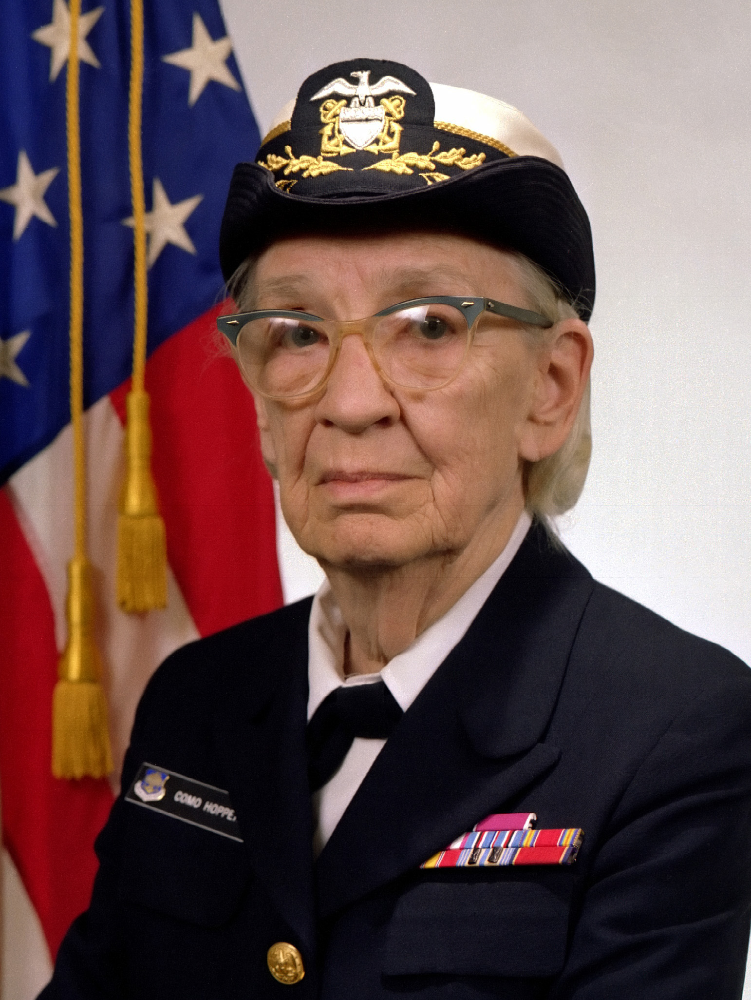

FGA0315 · Qualidade de Software 1 · 2026.2 · Turma 02 · Equipe Grace Hopper

# Avaliação de Qualidade de Software — i-Educar
{ .gh-hero-split__title }

Avaliação sistemática da <strong>Compatibilidade</strong>, <strong>Confiabilidade</strong>, <strong>Manutenibilidade</strong> e <strong>Capacidade de Interação</strong> dos módulos de Matrícula e Lançamento de Notas do <strong>i-Educar 2.12</strong>, fundamentada nas normas ISO/IEC 25010:2023, ISO/IEC 25019:2023, ISO/IEC 25040:2024 e no método GQM.

  <a class="gh-button gh-button--primary" href="fase-1/">Explorar avaliação</a>
  <a class="gh-button gh-button--secondary" href="fase-2/">Framework GQM</a>
  <a class="gh-button gh-button--secondary" href="gestao/">Gestão PSM/CID</a>
  <a class="gh-button gh-button--secondary" href="entregaveis/">Artigo e entregáveis</a>

  Este projeto utilizou ferramentas de Inteligência Artificial generativa como apoio na revisão textual, estruturação documental e automação de scripts da GitPage. Todas as ferramentas, tarefas e validações humanas estão registradas na <a href="sobre/uso-de-ia/">Declaração de uso de IA</a>.

<figure class="gh-retrato">
  
  <figcaption>
    <strong>Grace Hopper (1906–1992)</strong>
    <a href="sobre/grace-hopper/">Pioneira dos compiladores, do COBOL e da verificação de software · Conheça a homenagem</a>
  </figcaption>
</figure>

Avaliação (ISO/IEC 25040)

<a class="gh-item" href="metodologia/"><small>Fluxo SQuaRE · GQM · PSM/CID</small>Metodologia da avaliação</a>
<a class="gh-item" href="fase-1/"><small>E1 · Concluída · ISO/IEC 25010 e ODS 4/16</small>Fase 1: Estabelecer os requisitos</a>
<a class="gh-item" href="fase-2/"><small>E1 · Concluída · 4 Objetivos · 17 Linhas · 3 Gates</small>Fase 2: Especificar a avaliação (GQM)</a>
<a class="gh-item" href="fase-3/"><small>E1 · Concluída · Docker, Scripts e TCLE</small>Fase 3: Projetar a avaliação</a>
<a class="gh-item" href="fase-4/"><small>E2 · Em execução · Coleta M1–M15 e Parecer IQM</small>Fases 4 e 5: Executar e concluir a avaliação</a>

Gestão do Projeto (PSM/CID)

<a class="gh-item" href="gestao/"><small>Ciclo Planejar · Medir · Avaliar e Decidir</small>Visão geral da gestão</a>
<a class="gh-item" href="gestao/planejamento/"><small>Milestones M0 a M6 · Trilhas A–F</small>Planejamento de marcos e sprints</a>
<a class="gh-item" href="gestao/plano-de-medicao/"><small>Fichas do Modelo de Informação (Aula 09)</small>Plano de medição do PSM</a>
<a class="gh-item" href="indicadores_psm/"><small>TCM · ACM · VEC · TRCD automatizados</small>Painel de indicadores PSM/CID</a>
<a class="gh-item" href="gestao/horas-custos/"><small>Critério AG-C5 · 72h · R$ 3.600,00 · 100%</small>Horas, custos e esforço</a>
<a class="gh-item" href="gestao/registro-de-medicoes/"><small>Valores, interpretações e decisões E1 → E2</small>Registro de medições e decisões</a>

Sobre e Entregáveis

<a class="gh-item" href="sobre/grace-hopper/"><small>História e legado na computação</small>Quem foi Grace Hopper</a>
<a class="gh-item" href="sobre/equipe/"><small>6 integrantes · Papéis e contribuições</small>Equipe avaliadora</a>
<a class="gh-item" href="sobre/retrospectiva-1/"><small>Lições aprendidas e plano de ação</small>Retrospectiva da Entrega 1</a>
<a class="gh-item" href="entregaveis/"><small>Artigo IEEE, Apresentação PC1 e Relatórios</small>Central de entregáveis e releases</a>
<a class="gh-item" href="painel_projeto/"><small>Consulta direta à API do GitHub</small>Painel de issues em tempo real</a>
<a class="gh-item" href="https://github.com/FCTE-Qualidade-de-Software-1/2026-2_T02_GRACE_HOPPER" target="_blank" rel="noopener"><small>Código, scripts e evidências</small>Repositório no GitHub</a>

  Projeto acadêmico independente desenvolvido na Universidade de Brasília (UnB/FGA) em homenagem a Grace Brewster Murray Hopper, sem vínculo comercial ou endosso oficial da Portabilis ou da comunidade mantenedora do i-Educar. Fotografia histórica: Marinha dos Estados Unidos (Domínio Público / Wikimedia Commons).

