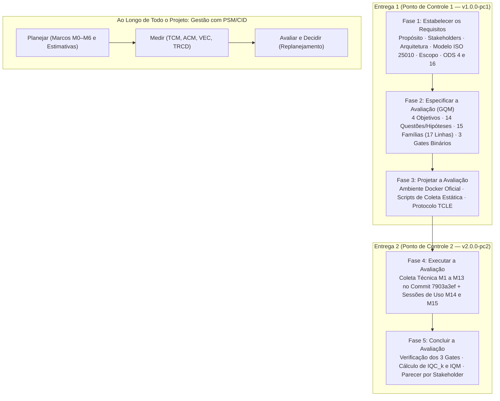

# Metodologia da Avaliação

A metodologia deste projeto articula quatro referenciais complementares da engenharia e qualidade de software: o processo de avaliação da **ISO/IEC 25040:2024**, os modelos de qualidade da família SQuaRE (**ISO/IEC 25010:2023** e **ISO/IEC 25019:2023**), a derivação de métricas via **GQM (*Goal-Question-Metric*)** e o monitoramento do trabalho com **PSM/CID (*Practical Software and Systems Measurement*)**.

---

## 1. Visão Integrada do Fluxo Metodológico

O estudo divide-se em dois fluxos paralelos: o **fluxo técnico sequencial da avaliação** do **i-Educar 2.12** (dividido entre as Entregas 1 e 2) e o **fluxo contínuo de gestão do projeto**.

**Figura 1 — Fluxo metodológico da avaliação de qualidade do i-Educar e da gestão do projeto. Fonte: elaboração própria.**

---

## 2. Normas e Frameworks Adotados

**Tabela 1 — Síntese das normas internacionais e frameworks aplicados**

| Norma / Framework | Papel no Projeto | Aplicação Prática no Estudo de Caso (i-Educar 2.12) |
| :--- | :--- | :--- |
| **ISO/IEC 25040:2024** *Quality Evaluation Process* | Processo de Avaliação | Estrutura o trabalho nas atividades de Requisitos (Fase 1), Especificação (Fase 2), Projeto (Fase 3), Execução (Fase 4) e Conclusão/Julgamento (Fase 5). |
| **ISO/IEC 25010:2023** *Product Quality Model* | Modelo de Qualidade de Produto | Recorte e priorização ($C = I \times R$) de 4 características: **Compatibilidade** (20%), **Confiabilidade** (30%), **Manutenibilidade** (30%) e **Capacidade de Interação** (20%). |
| **ISO/IEC 25019:2023** *Quality-in-Use Model* | Modelo de Qualidade em Uso | Complementa a Capacidade de Interação avaliando **Eficácia** (`M15 — TSPT`) e **Eficiência** (`M14a/b — TMET`) em tarefas reais de matrícula (`T1`) e diário (`T2`). |
| **ISO/IEC 25023:2016** *Measurement of Product Quality* | Referência de Medição | Base conceitual adaptada para a formulação das equações e escalas de medição do código PHP/Laravel e banco PostgreSQL. |
| **GQM (*Goal-Question-Metric*)** Basili, Caldiera e Rombach (1994) | Derivação de Métricas | Desdobra as 4 características em **4 Objetivos (`G1`–`G4`)**, **14 Questões e Hipóteses (`Q1.1`–`Q4.4`)**, **15 Famílias de Métricas (17 linhas operacionais)** e **3 Gates Binários**. |
| **PSM/CID** McGarry et al. (2002) / PSM (2021) | Gestão do Projeto | Monitora a equipe avaliadora nas categorias de *Calendário e Progresso* (`TCM`, `ACM`), *Recursos e Custos* (`VEC`) e *Desempenho dos Processos* (`TRCD`). |

*Fonte: Elaborado pelos autores.*

---

## 3. Estratégia de Julgamento em Duas Etapas

Para evitar que uma média aritmética mascare falhas graves em registros escolares (como erro de arredondamento de notas ou gravação parcial de matrículas), o julgamento na Fase 5 adota um modelo híbrido:

1. **Etapa 1 — Verificação de 3 Gates Binários Eliminatórios (Não-Compensatórios):**
   - **`Gate M3` (`DCNM` — Determinismo no Cálculo de Notas e Menções):** Exige $100\%$ de exatidão frente ao oráculo pedagógico.
   - **`Gate M4` (`ITAE` — Integridade Transacional em Operações de Escrita):** Exige $100\%$ de *rollback* atômico sob injeção de falha.
   - **`Gate M12` (`IPPE` — Índice de Prevenção e Proteção contra Erros do Usuário):** Exige $100\%$ de bloqueio de entradas inválidas sem erro HTTP 500 ou gravação indevida.
   - *Regra de bloqueio:* A reprovação em qualquer Gate classifica automaticamente a release na **Classe C (Rejeitada para Produção)**, independentemente das demais notas.
2. **Etapa 2 — Agregação Multicritério Gradual ($\text{IQC}_k$ e $\text{IQM}$):**
   - As métricas graduais recebem pontuação discreta $S_i \in \{1, 2, 3, 4\}$ (Crítico, Regular, Bom, Excelente) e são agregadas nos Índices por Característica ($\text{IQC}_k$) e no Índice Global ($\text{IQM} = 0{,}20\,\text{IQC}_{\text{Comp}} + 0{,}30\,\text{IQC}_{\text{Conf}} + 0{,}30\,\text{IQC}_{\text{Manut}} + 0{,}20\,\text{IQC}_{\text{Inter/Uso}}$).

---

## 4. Onde Explorar Cada Etapa

- [Fase 1: Estabelecer os requisitos da avaliação](../fase-1/index.md)
- [Fase 2: Especificar a avaliação (GQM)](../fase-2/index.md)
- [Fase 3: Projetar a avaliação e plano de testes](../fase-3/index.md)
- [Fases 4 e 5: Execução e julgamento (Entrega 2)](../fase-4/index.md)
- [Gestão do Projeto (PSM/CID)](../gestao/index.md)
