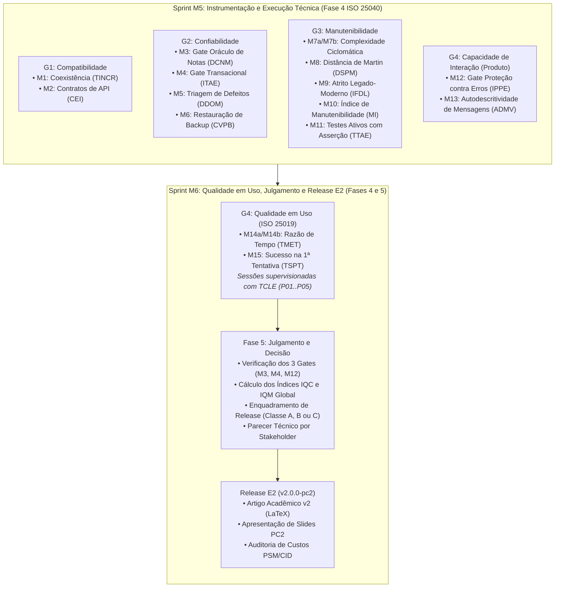

# Plano Operacional de Medição e Testes (Fases 4 e 5 — ISO/IEC 25040:2024)
<!-- Documento de Planejamento e Execução Operacional de Testes e Medições -->

**Disciplina:** Qualidade de Software 1 (FGA0315) — Universidade de Brasília (UnB / FGA)  
**Semestre Letivo:** 2026.2  
**Objeto de Avaliação:** i-Educar 2.12 (`portabilis/i-educar`, commit `7903a3efc7689942ee700007f86ed581023aad27`)  
**Normas de Referência:** ISO/IEC 25010:2023, ISO/IEC 25019:2023, ISO/IEC 25040:2024 e ISO/IEC 25002:2024  
**Frameworks de Apoio:** GQM (*Goal-Question-Metric*) v2.0 e PSM/CID (*Practical Software Measurement / Cost, Income, Duration*)  
**Releases Vinculadas:** Release E1 (`v1.0.0-pc1` — Planejamento) e Release E2 (`v2.0.0-pc2` — Execução e Conclusão)

---

## 1. Visão Geral e Governança da Execução (Fases 4 e 5)

Este documento estabelece o **Plano Operacional de Medição e Testes** para a execução da avaliação de qualidade do **i-Educar 2.12** durante as Fases 4 (Execução da Avaliação) e 5 (Conclusão da Avaliação) da norma **ISO/IEC 25040:2024**.

O plano operacionaliza todas as **15 famílias de métricas (17 linhas operacionais: M1 a M15)** e os **3 Gates Binários eliminatórios (M3, M4 e M12)** definidos no [Framework GQM](gqm_evaluation_framework.md).

### 1.1 Princípios de Reprodutibilidade e Rigor Metodológico
Para assegurar a validade científica das medições e atender às rubricas da disciplina FGA0315, a equipe observa quatro princípios operacionais:
1. **Congelamento Prévio de Manifestos:** Nenhum teste é executado sem que a lista de casos, endpoints, transações ou callables esteja previamente congelada em tabela ou arquivo versionado. A regra de conjunto vazio se aplica estritamente: universo sem casos ou evidência ausente é registrado como **não mensurável / não comprovado**, nunca como 100%.
2. **Fixação Estrita de Versão e Commit:** Todos os testes de código, ambiente conteinerizado e análise estática são executados exclusivamente sobre o commit oficial `7903a3efc7689942ee700007f86ed581023aad27` (branch `2.12` do repositório `portabilis/i-educar`).
3. **Ausência de Dados Fictícios:** Não são arbitrados valores prévios para as métricas. Toda pontuação decorre de medição empírica com logs, scripts executáveis e comandos reais registrados.
4. **Estrutura de Evidências Versionadas:** As evidências brutas de cada coleta são arquivadas na pasta `evidencias/` do repositório, divididas por característica (`g1_compatibilidade/`, `g2_confiabilidade/`, `g3_manutenibilidade/`, `g4_interacao_uso/`).

---

## 2. Roteiro Operacional de Medição por Característica

### 2.1 Característica 1 — Compatibilidade (G1: Coexistência e Interoperabilidade)

A Tabela 1 sintetiza o roteiro de execução operacional para as métricas de Compatibilidade:

**Tabela 1 — Roteiro de medição da Característica Compatibilidade (G1)**

| Métrica | Subcaracterística | Pré-requisito / Manifesto | Procedimento Passo a Passo | Instrumento / Comando | Evidência Gerada | Critério de Aceitação / Limiares |
| :--- | :--- | :--- | :--- | :--- | :--- | :--- |
| **M1 — TINCR** | Coexistência | Inventário de recursos compartilháveis em `docker-compose.yml` e `config/`. | 1. Listar portas expostas (`8080`, `5432`, `6379`), nomes de containers, `DB_DATABASE` e `REDIS_PREFIX`. 2. Classificar cada recurso como parametrizável via `.env` ou fixo. 3. Subir 2ª instância simultânea no mesmo host alterando apenas variáveis de ambiente. 4. Contar recursos isolados sem colisão. | `docker compose up -d` `docker compose config` | Tabela de recursos compartilháveis e log de inicialização simultânea em `evidencias/g1_compatibilidade/m1_tincr.log`. | Excelente: $100\%$ Bom: $[85\%, 100\%)$ Regular: $[70\%, 85\%)$ Crítico: $< 70\%$ |
| **M2 — CEI** | Interoperabilidade | Manifesto congelado de endpoints REST de Matrícula e Notas em `routes/api*.php`. | 1. Congelar JSON Schema de referência para cada endpoint antes do teste. 2. Submeter requisição válida e validar HTTP 200 + `Content-Type: application/json`. 3. Validar aderência de todos os campos obrigatórios ao schema. 4. Submeter requisição inválida e validar erro estruturado sem HTTP 500 ou HTML. | Postman / Insomnia / `curl` com validador de JSON Schema | Relatório de conformidade por endpoint em `evidencias/g1_compatibilidade/m2_cei_report.json`. | Excelente: $100\%$ Bom: $[85\%, 100\%)$ Regular: $[70\%, 85\%)$ Crítico: $< 70\%$ |

*Fonte: Elaborado pelos autores conforme ISO/IEC 25010:2023 e Framework GQM.*

---

### 2.2 Característica 2 — Confiabilidade (G2: Confiabilidade e Gates Binários)

A Tabela 2 apresenta o roteiro operacional para os Gates Binários M3 e M4, a triagem de M5 e o procedimento de backup M6:

**Tabela 2 — Roteiro de medição da Característica Confiabilidade (G2)**

| Métrica | Subcaracterística | Pré-requisito / Manifesto | Procedimento Passo a Passo | Instrumento / Comando | Evidência Gerada | Critério de Aceitação / Limiares |
| :--- | :--- | :--- | :--- | :--- | :--- | :--- |
| **M3 — DCNM** | Ausência de Falhas (*Faultlessness*) | Manifesto congelado de regras de avaliação pedagógica e oráculo formal de notas/médias. | 1. Congelar tabela com regras (média aritmética, ponderada, recuperação paralela, exame final e arredondamento em `LegacyValueRoundingTable`). 2. Executar suíte de testes automatizados sobre `Avaliacao_Service_Boletim`. 3. Inspecionar e reativar testes desativados em `NotaSituacaoCommon.php`. 4. Comparar resultados com o oráculo formal caso a caso. | `vendor/bin/pest` ou `php artisan test` | Log detalhado com resultado por ID em `evidencias/g2_confiabilidade/m3_dcnm_suite.txt`. | **GATE BINÁRIO:** Aprovado: $100\%$ Bloqueado: $< 100\%$ |
| **M4 — ITAE** | Tolerância a Falhas | Inventário congelado de operações multi-escrita de matrícula e diário. | 1. Identificar pontos de escrita em `RegistrationService` e controllers do diário. 2. Validar que o caminho feliz persiste os dados com integridade referencial. 3. Injetar exceção sintética (`throw Exception`) em cada etapa intermediária de persistência. 4. Consultar PostgreSQL e verificar rollback atômico integral sem dados órfãos. | Script de teste / injeção determinística de falha e consultas SQL | Logs de injeção e conferência SQL em `evidencias/g2_confiabilidade/m4_itae_rollback.log`. | **GATE BINÁRIO:** Aprovado: $100\%$ Bloqueado: $< 100\%$ |
| **M5 — DDOM** | Ausência de Falhas | Dados operacionais de produção (Honeybadger / chamados de prefeituras). | 1. Consultar registros de movimentações e incidentes em janela de 90 dias. 2. Confirmar se registros estão disponíveis. 3. Caso indisponíveis, registrar formalmente como **não mensurável** (sem nota atribuída) e aplicar política de renormalização da Seção 3. | Consulta a logs de homologação / telemetria | Relatório de triagem em `evidencias/g2_confiabilidade/m5_ddom_triagem.md`. | Excelente: $\le 0{,}5$ Bom: $(0{,}5, 2{,}0]$ Regular: $(2{,}0, 5{,}0]$ Crítico: $> 5{,}0$ |
| **M6 — CVPB** | Recuperabilidade | Manifesto congelado de alvos e procedimentos de restauração. | 1. Executar dump lógico do banco (`pg_dump -Fc`) contendo `pmieducar`, `modules` e `cadastro`. 2. Registrar checksum SHA-256 do artefato gerado. 3. Restaurar o dump em banco isolado limpo de homologação (`pg_restore`). 4. Executar queries de verificação de integridade e contagem de tuplas. | `pg_dump` `pg_restore` `sha256sum` | Log de backup/restore e relatório de tuplas em `evidencias/g2_confiabilidade/m6_cvpb.log`. | Excelente: $100\%$ Bom: $[95\%, 100\%)$ Regular: $[90\%, 95\%)$ Crítico: $< 90\%$ |

*Fonte: Elaborado pelos autores conforme ISO/IEC 25010:2023 e Framework GQM.*

---

### 2.3 Característica 3 — Manutenibilidade (G3: Complexidade e Estrutura de Código)

A Tabela 3 estabelece o roteiro operacional para a extração das métricas estáticas e de testabilidade:

**Tabela 3 — Roteiro de medição da Característica Manutenibilidade (G3)**

| Métrica | Subcaracterística | Pré-requisito / Manifesto | Procedimento Passo a Passo | Instrumento / Comando | Evidência Gerada | Critério de Aceitação / Limiares |
| :--- | :--- | :--- | :--- | :--- | :--- | :--- |
| **M7a / M7b — CC** | Modularidade / Analisabilidade | Lista congelada dos 4 arquivos de código de produção em escopo. | 1. Executar analisador léxico sobre os 4 arquivos em escopo (`RegistrationService.php`, `DiarioApiController.php`, `DiarioController.php` e `Boletim.php`). 2. Extrair a complexidade $v(G)$ de cada método concreto ($n$). 3. Ordenar valores e calcular $P_{90}$ via *nearest rank* ($r = \lceil 0{,}90n \rceil$) e identificar o máximo $\text{CC}_{\max}$. | `php scripts/evaluate-quality.php --path=/ieducar` | Relatório tabular e JSON em `evidencias/g3_manutenibilidade/m7_complexidade.json`. | M7a (P90): Exc $\le 10$; Bom $(10, 15]$; Reg $(15, 20]$; Crít $> 20$ M7b (Max): Exc $\le 15$; Bom $(15, 30]$; Reg $(30, 50]$; Crít $> 50$ |
| **M8 — DSPM** | Modularidade e Modificabilidade | Mapa congelado de componentes do domínio de Matrícula e Notas. | 1. Mapear classes em componentes atômicos. 2. Computar dependências eferentes ($C_e$) e aferentes ($C_a$) por componente. 3. Contar total de classes ($N_c$) e classes abstratas/interfaces ($N_a$). 4. Calcular $I = C_e / (C_a + C_e)$, $A = N_a / N_c$, $D = \|A + I - 1\|$ e a média $\text{DSPM}$. | `scripts/evaluate-quality.php` / PHPMetrics | Tabela de acoplamento em `evidencias/g3_manutenibilidade/m8_dspm.csv`. | Excelente: $\le 0{,}20$ Bom: $(0{,}20, 0{,}35]$ Regular: $(0{,}35, 0{,}50]$ Crítico: $> 0{,}50$ |
| **M9 — IFDL** | Analisabilidade e Modificabilidade | Manifesto congelado dos modelos `app/Models/Legacy*.php` em escopo. | 1. Inspecionar modelos `Legacy*` utilizados nos fluxos de matrícula e notas. 2. Localizar pontos de adaptação defensiva de dados (conversão de tipos, filtros de null, adaptação de schema legado). 3. Registrar arquivo, linha e tipo de cada adaptador. 4. Calcular a média de adaptações por modelo. | `scripts/evaluate-quality.php` e inspeção de código | Inventário de adaptações em `evidencias/g3_manutenibilidade/m9_ifdl.json`. | Excelente: $\le 1{,}0$ Bom: $(1{,}0, 2{,}5]$ Regular: $(2{,}5, 4{,}0]$ Crítico: $> 4{,}0$ |
| **M10 — MI** | Modificabilidade | Mesmos $n$ métodos concretos do manifesto de M7a/M7b. | 1. Extrair para cada método o Volume de Halstead ($HV_m$), a complexidade ciclomática $v(G_m)$ e as linhas lógicas ($LOC_m$). 2. Aplicar a fórmula local normalizada de $\text{MI}_m$. 3. Calcular a média aritmética dos métodos avaliados. | `php scripts/evaluate-quality.php` | Tabela de MI por método em `evidencias/g3_manutenibilidade/m10_mi.json`. | Excelente: $\ge 80$ Bom: $[60, 80)$ Regular: $[40, 60)$ Crítico: $< 40$ |
| **M11 — TTAE** | Testabilidade | Manifesto congelado dos diretórios/arquivos de testes de matrícula e notas. | 1. Descoberta de casos de teste no runner Pest/PHPUnit. 2. Contar casos declarados no manifesto ($N_{\text{declarados}}$). 3. Executar a suíte e verificar os casos que registraram ao menos uma asserção em runtime. 4. Identificar testes suprimidos com `markTestSkipped()` e calcular a taxa $\text{TTAE}$. | Runner Pest / PHPUnit com relatório de asserções | Log do test runner em `evidencias/g3_manutenibilidade/m11_ttae.txt`. | Excelente: $\ge 95{,}0\%$ Bom: $[85{,}0\%, 95{,}0\%)$ Regular: $[70{,}0\%, 85{,}0\%)$ Crítico: $< 70{,}0\%$ |

*Fonte: Elaborado pelos autores conforme ISO/IEC 25010:2023 e Framework GQM.*

---

### 2.4 Característica 4 — Capacidade de Interação e Qualidade em Uso (G4)

A Tabela 4 sintetiza o roteiro para o Gate M12, a auditoria de mensagens M13 e o protocolo com participantes M14 e M15:

**Tabela 4 — Roteiro de medição de Capacidade de Interação e Qualidade em Uso (G4)**

| Métrica | Subcaracterística | Pré-requisito / Manifesto | Procedimento Passo a Passo | Instrumento / Comando | Evidência Gerada | Critério de Aceitação / Limiares |
| :--- | :--- | :--- | :--- | :--- | :--- | :--- |
| **M12 — IPPE** | Proteção contra Erros (ISO 25010) | Catálogo com no mínimo 12 cenários de entrada inválida (3 por categoria). | 1. Submeter cenários inválidos (notas fora da faixa, períodos encerrados, menções inexistentes e conflito de matrícula). 2. Verificar se o sistema intercepta e exibe bloqueio amigável. 3. Consultar PostgreSQL e confirmar que nenhum dado corrompido foi gravado. 4. Confirmar ausência de exceções HTTP 500 não tratadas. | Testes via interface web e chamadas de API | Planilha de execução e consultas SQL em `evidencias/g4_interacao_uso/m12_ippe.csv`. | **GATE BINÁRIO:** Aprovado: $100\%$ Bloqueado: $< 100\%$ |
| **M13 — ADMV** | Autodescritividade (ISO 25010) | Mensagens capturadas durante a execução de M12. | 1. Capturar texto exato das mensagens de recusa exibidas nos cenários de M12. 2. Dois avaliadores classificam independentemente se a mensagem informa causa e ação corretiva. 3. Resolver divergências por consenso formal registrado. 4. Calcular o percentual de mensagens plenamente autodescritivas. | Formulário de auditoria de mensagens | Tabela de classificação com dupla checagem em `evidencias/g4_interacao_uso/m13_admv.json`. | Excelente: $\ge 98{,}0\%$ Bom: $[90{,}0\%, 98{,}0\%)$ Regular: $[80{,}0\%, 90{,}0\%)$ Crítico: $< 80{,}0\%$ |
| **M14a / M14b — TMET** | Eficiência em Uso (ISO 25019) | Ficha padronizada das tarefas T1 (Matrícula) e T2 (Diário) e TCLE assinado. | 1. Coletar o tempo de referência ($T_{\text{ref}}$) com 3 execuções de integrante treinado. 2. Recrutar 5 participantes iniciantes anonimizados (`P01` a `P05`). 3. Cronometrar início da leitura até submissão bem-sucedida de T1 e T2 sem auxílio do avaliador. 4. Calcular $\text{TMET}$ e razão de tempo $R_{\text{tempo}} = \text{TMET} / T_{\text{ref}}$. | Planilha de cronometragem e gravações | Planilha de tempos anonimizada em `evidencias/g4_interacao_uso/m14_tmet.csv`. | Excelente: $\le 1{,}5$ Bom: $(1{,}5, 2{,}0]$ Regular: $(2{,}0, 3{,}0]$ Crítico: $> 3{,}0$ |
| **M15 — TSPT** | Eficácia em Uso (ISO 25019) | Mesmas sessões supervisionadas das tarefas T1 e T2. | 1. Observar se o participante conclui a tarefa na primeira submissão. 2. Registrar ocorrência de erro de validação, perda de dados ou necessidade de ajuda. 3. Verificar integridade do dado gravado no banco após submissão. 4. Calcular $\text{TSPT} = (N_{\text{sucessos na 1ª tentativa}} / N_{\text{execuções totais}}) \times 100\%$. | Ficha de observação de teste de usabilidade | Relatório de eficácia por participante em `evidencias/g4_interacao_uso/m15_tspt.csv`. | Excelente: $\ge 90{,}0\%$ Bom: $[70{,}0\%, 90{,}0\%)$ Regular: $[50{,}0\%, 70{,}0\%)$ Crítico: $< 50{,}0\%$ |

*Fonte: Elaborado pelos autores conforme ISO/IEC 25010:2023, ISO/IEC 25019:2023 e Framework GQM.*

---

## 3. Tratamento de Pendências Metodológicas Pré-Coleta

Para garantir que a Atividade 5 (Julgamento e Decisão) transcorra sem bloqueios ou ambiguidades, o Plano de Medição formaliza três definições prévias:

### 3.1 Política Prévia de Renormalização para Métrica sem Produção (M5 — DDOM)
A métrica **M5 (DDOM)** depende formalmente de telemetria e registros operacionais de prefeituras por 90 dias consecutivos. Na ausência desses registros em ambiente de laboratório, a hipótese `H2.2` declara que a métrica permanece **não mensurável**.

Para permitir o cálculo estrito do Índice de Qualidade da Confiabilidade ($\text{IQC}_{\text{Confiabilidade}}$) e do Índice Global ($\text{IQM}$) sem atribuir notas substitutas arbitrárias, adota-se a seguinte **política de renormalização pré-declarada**:
- O peso original de M5 ($w_{\text{M5}} = 1{,}2$) é excluído do denominador da característica Confiabilidade.
- O $\text{IQC}_{\text{Confiabilidade}}$ é computado ponderando exclusivamente as métricas de Confiabilidade com dados comprovados: M3 ($w=2{,}0$), M4 ($w=2{,}0$) e M6 ($w=1{,}0$), totalizando soma de pesos igual a $5{,}0$:

$$
\text{IQC}_{\text{Confiabilidade}} = \dfrac{S_{\text{M3}} \times 2{,}0 + S_{\text{M4}} \times 2{,}0 + S_{\text{M6}} \times 1{,}0}{2{,}0 + 2{,}0 + 1{,}0}
$$

### 3.2 Ajuste de Intervalo Contínuo na Métrica de Backup (M6 — CVPB)
Para eliminar a lacuna formal no limiar de M6 entre $99{,}0\%$ e $100\%$, a Tabela 4 do Framework GQM passa a operar com o intervalo semi-aberto contínuo calibrado:
- **Excelente (4):** $\text{CVPB} = 100\%$
- **Bom (3):** $95{,}0\% \le \text{CVPB} < 100\%$
- **Regular (2):** $90{,}0\% \le \text{CVPB} < 95{,}0\%$
- **Crítico (1):** $\text{CVPB} < 90{,}0\%$

### 3.3 Fechamento Lógico dos Critérios de Decisão de Release (Fase 5)
Para assegurar que qualquer combinação possível de $\text{IQM}$ e $\text{IQC}_k$ possua enquadramento conclusivo inequívoco:
- **Classe A (Aprovado Plenamente):** Todos os Gates aprovados ($100\%$), $\text{IQM} \ge 3{,}25$, todos os $\text{IQC}_k \ge 3{,}0$ e nenhuma métrica com $S_i = 1$.
- **Classe B (Aprovado com Ressalvas):** Todos os Gates aprovados ($100\%$) e:
  - $\text{IQM} \ge 2{,}75$ com todos os $\text{IQC}_k \ge 2{,}5$ (abrangendo casos em que $\text{IQM} \ge 3{,}25$ mas alguma característica situa-se no intervalo $[2{,}5, 3{,}0)$ ou possui métrica residual em nível 1).
- **Classe C (Reprovado / Bloqueado):** Falha em qualquer um dos Gates (M3, M4 ou M12 $< 100\%$), **OU** $\text{IQM} < 2{,}75$, **OU** qualquer característica com $\text{IQC}_k < 2{,}5$.

---

## 4. Estrutura das Sprints e Alocação Equilibrada de Esforço (PSM/CID)

Para operacionalizar a execução sem sobrecarregar nenhum membro da equipe e cumprir com rigor o **Critério AG-C5 (Transparência da Contribuição Individual)**, o trabalho foi dividido em **2 Sprints/Milestones** e desdobrado em **12 Issues atômicas** dimensionadas em `6 horas` cada.

### Tabela 5 — Matriz de Trilhas Sugeridas para Distribuição Equilibrada (1/6 por Integrante)

| Trilha de Atuação | Issues Alocadas | Escopo Funcional | Horas Estimadas | % Esforço na Entrega 2 |
| :--- | :---: | :--- | :---: | :---: |
| **Trilha A: Infraestrutura, Coexistência e Backup** | `#38` e `#42` | Subida do Docker com seeds, teste de coexistência (`M1`) e procedimento de backup/restore PostgreSQL (`M6`). | 12h | **16,67%** |
| **Trilha B: Interoperabilidade e Proteção de Interação** | `#39` e `#45` | Contratos JSON Schema REST (`M2`), testes de cenários inválidos (`M12`) e autodescritividade de mensagens (`M13`). | 12h | **16,67%** |
| **Trilha C: Confiabilidade, Oráculo e Transações** | `#40` e `#41` | Testes do oráculo de notas em `Boletim.php` (`M3`), injeções de falha transacional (`M4`) e triagem de `M5`. | 12h | **16,67%** |
| **Trilha D: Análise Estática e Arquitetura** | `#43` e `#44` | Extração de complexidade ciclomática e MI (`M7a`, `M7b`, `M10`), acoplamento de Martin (`M8`), atrito legado (`M9`) e testes ativos (`M11`). | 12h | **16,67%** |
| **Trilha E: Qualidade em Uso e Julgamento** | `#46` e `#47` | Sessões supervisionadas com TCLE (`M14a`, `M14b`, `M15`), cálculo dos índices $\text{IQC}_k$ e $\text{IQM}$, e parecer técnico da Fase 5. | 12h | **16,67%** |
| **Trilha F: Consolidação Científica e Release E2** | `#48` e `#49` | Redação dos resultados no artigo LaTeX v2, apresentação final PC2, auditoria PSM/CID e publicação da release `v2.0.0-pc2`. | 12h | **16,67%** |
| **TOTAIS PLANEJADOS DA EQUIPE** | **12 Issues** | **Fases 4 e 5 da ISO/IEC 25040:2024 e Release E2** | **72h** | **100% (6 de 6 Ativos)** |

*Fonte: Elaborado pelos autores conforme modelo PSM/CID da disciplina FGA0315.*

---

## 5. Como Assumir e Executar uma Issue no GitHub

Cada integrante deve seguir o procedimento abaixo para manter a rastreabilidade e alimentar os indicadores automáticos:
1. Acesse a aba **Issues** do repositório no GitHub.
2. Escolha as issues correspondentes à sua trilha (ou de comum acordo com o grupo).
3. Atribua a issue ao seu usuário (*Assignee*).
4. Edite a issue e preencha a tabela de controle inicial (Nome, Matrícula, Usuário e Papel).
5. Ao concluir o trabalho e abrir o Pull Request:
   - Preencha o campo `Horas Efetivamente Realizadas` na issue.
   - Atualize sua linha na Tabela de Esforço da Entrega 2 em [`docs/gestao_projeto_releases_milestones_issues.md`](gestao_projeto_releases_milestones_issues.md).
   - Anexe os arquivos de evidência na pasta `evidencias/`.

## 7. Resultado da medição M3 — DCNM (issue #40)

A coleta oficial `oficial-001` executou os 30 cenários do oráculo no commit `7903a3efc7689942ee700007f86ed581023aad27`: **30 conformes / 30 planejados × 100% = 100%**, 457 asserções e código de saída zero. **Gate M3 APROVADO; H2.1 confirmada no recorte avaliado.**

O [relatório específico da M3](fase-4/medicao_m3_dcnm.md) apresenta casos, procedimento, rastreabilidade, cálculo e limites. As evidências estão em `evidencias/g2_confiabilidade/m3/oficial-001/`. Os dez testes legados complementares foram reativados e registraram erro de pré-requisito de enturmação; estão classificados separadamente e não integram o denominador do DCNM. A aprovação da M3 não antecipa o julgamento de M4, M12 ou do índice global.
