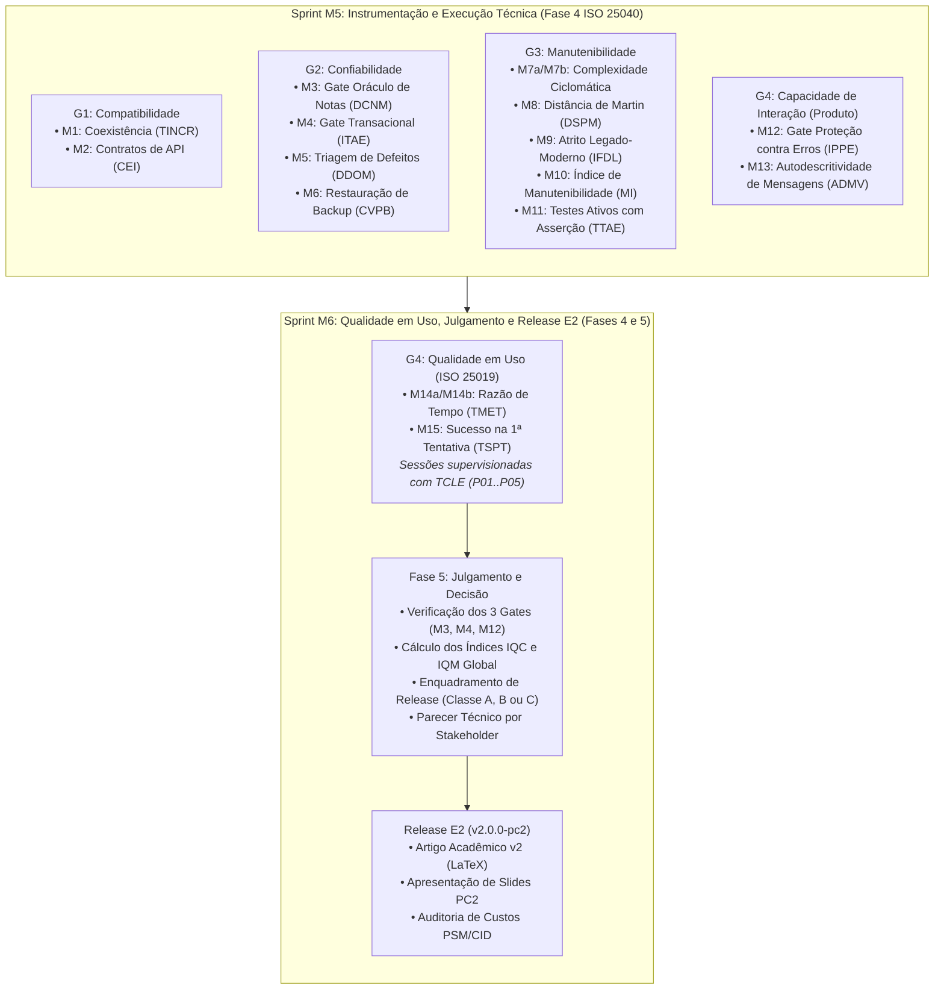
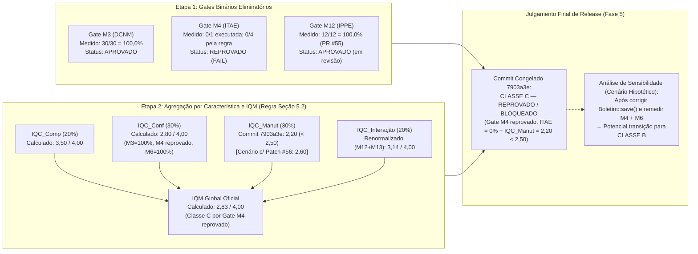

# Plano Operacional de Medição e Testes (Fases 4 e 5 — ISO/IEC 25040:2024)
<!-- Documento de Planejamento e Execução Operacional de Testes e Medições -->

**Disciplina:** Qualidade de Software 1 (FGA0315) — Universidade de Brasília (UnB / FGA)  
**Semestre Letivo:** 2026.2  
**Objeto de Avaliação:** i-Educar 2.12 (`portabilis/i-educar`, commit `7903a3efc7689942ee700007f86ed581023aad27`)  
**Normas de Referência:** ISO/IEC 25010:2023, ISO/IEC 25019:2023, ISO/IEC 25040:2024 e ISO/IEC 25002:2024  
**Frameworks de Apoio:** GQM (*Goal-Question-Metric*) v2.0 e PSM/CID (*Practical Software Measurement / Cost, Income, Duration*)  
**Releases Vinculadas:** Release E1 (`v1.0.0-pc1` — Planejamento) e Release E2 (`v2.0.0-pc2` — Execução e Conclusão)

---

## 1. Visão Geral e Governança da Execução (Fases 4 e 5)

Este documento estabelece o **Plano Operacional de Medição e Testes** para a execução da avaliação de qualidade do **i-Educar 2.12** durante as Fases 4 (Execução da Avaliação) e 5 (Conclusão da Avaliação) da norma **ISO/IEC 25040:2024**.

O plano operacionaliza todas as **15 famílias de métricas (17 linhas operacionais: M1 a M15)** e os **3 Gates Binários eliminatórios (M3, M4 e M12)** definidos no [Framework GQM](gqm_evaluation_framework.md).



### 1.1 Princípios de Reprodutibilidade e Rigor Metodológico
Para assegurar a validade científica das medições e atender às rubricas da disciplina FGA0315, a equipe observa quatro princípios operacionais:
1. **Congelamento Prévio de Manifestos:** Nenhum teste é executado sem que a lista de casos, endpoints, transações ou callables esteja previamente congelada em tabela ou arquivo versionado. A regra de conjunto vazio se aplica estritamente: universo sem casos ou evidência ausente é registrado como **não mensurável / não comprovado**, nunca como 100%.
2. **Fixação Estrita de Versão e Commit:** Todos os testes de código, ambiente conteinerizado e análise estática são executados exclusivamente sobre o commit oficial `7903a3efc7689942ee700007f86ed581023aad27` (branch `2.12` do repositório `portabilis/i-educar`).
3. **Ausência de Dados Fictícios:** Não são arbitrados valores prévios para as métricas. Toda pontuação decorre de medição empírica com logs, scripts executáveis e comandos reais registrados.
4. **Estrutura de Evidências Versionadas:** As evidências brutas de cada coleta são arquivadas na pasta `evidencias/` do repositório, divididas por característica (`g1_compatibilidade/`, `g2_confiabilidade/`, `g3_manutenibilidade/`, `g4_interacao_uso/`).

---

## 2. Roteiro Operacional de Medição por Característica

### 2.1 Característica 1 — Compatibilidade (G1: Coexistência e Interoperabilidade)

A Tabela 1 sintetiza o roteiro de execução operacional para as métricas de Compatibilidade:

**Tabela 1 — Roteiro de medição da Característica Compatibilidade (G1)**

| Métrica | Subcaracterística | Pré-requisito / Manifesto | Procedimento Passo a Passo | Instrumento / Comando | Evidência Gerada | Critério de Aceitação / Limiares |
| :--- | :--- | :--- | :--- | :--- | :--- | :--- |
| **M1 — TINCR** | Coexistência | Inventário de recursos compartilháveis em `docker-compose.yml` e `config/`. | 1. Listar portas expostas (`8080`, `5432`, `6379`), nomes de containers, `DB_DATABASE` e `REDIS_PREFIX`.<br>2. Classificar cada recurso como parametrizável via `.env` ou fixo.<br>3. Subir 2ª instância simultânea no mesmo host alterando apenas variáveis de ambiente.<br>4. Contar recursos isolados sem colisão. | `docker compose up -d`<br>`docker compose config` | Tabela de recursos compartilháveis e log de inicialização simultânea em `evidencias/g1_compatibilidade/m1_tincr.log`. | Excelente: $100\%$<br>Bom: $[85\%, 100\%)$<br>Regular: $[70\%, 85\%)$<br>Crítico: $< 70\%$ |
| **M2 — CEI** | Interoperabilidade | Manifesto congelado de endpoints REST de Matrícula e Notas em `routes/api*.php`. | 1. Congelar JSON Schema de referência para cada endpoint antes do teste.<br>2. Submeter requisição válida e validar HTTP 200 + `Content-Type: application/json`.<br>3. Validar aderência de todos os campos obrigatórios ao schema.<br>4. Submeter requisição inválida e validar erro estruturado sem HTTP 500 ou HTML. | Postman / Insomnia / `curl` com validador de JSON Schema | Relatório de conformidade por endpoint em `evidencias/g1_compatibilidade/m2_cei_report.json`. | Excelente: $100\%$<br>Bom: $[85\%, 100\%)$<br>Regular: $[70\%, 85\%)$<br>Crítico: $< 70\%$ |

*Fonte: Elaborado pelos autores conforme ISO/IEC 25010:2023 e Framework GQM.*

---

### 2.2 Característica 2 — Confiabilidade (G2: Confiabilidade e Gates Binários)

A Tabela 2 apresenta o roteiro operacional para os Gates Binários M3 e M4, a triagem de M5 e o procedimento de backup M6:

**Tabela 2 — Roteiro de medição da Característica Confiabilidade (G2)**

| Métrica | Subcaracterística | Pré-requisito / Manifesto | Procedimento Passo a Passo | Instrumento / Comando | Evidência Gerada | Critério de Aceitação / Limiares |
| :--- | :--- | :--- | :--- | :--- | :--- | :--- |
| **M3 — DCNM** | Ausência de Falhas (*Faultlessness*) | Manifesto congelado de regras de avaliação pedagógica e oráculo formal de notas/médias. | 1. Congelar tabela com regras (média aritmética, ponderada, recuperação paralela, exame final e arredondamento em `LegacyValueRoundingTable`).<br>2. Executar suíte de testes automatizados sobre `Avaliacao_Service_Boletim`.<br>3. Inspecionar e reativar testes desativados em `NotaSituacaoCommon.php`.<br>4. Comparar resultados com o oráculo formal caso a caso. | `vendor/bin/pest`<br>ou `php artisan test` | Log detalhado com resultado por ID em `evidencias/g2_confiabilidade/m3_dcnm_suite.txt`. | **GATE BINÁRIO:**<br>Aprovado: $100\%$<br>Bloqueado: $< 100\%$ |
| **M4 — ITAE** | Tolerância a Falhas | Inventário congelado de operações multi-escrita de matrícula e diário. | 1. Identificar pontos de escrita em `RegistrationService` e controllers do diário.<br>2. Validar que o caminho feliz persiste os dados com integridade referencial.<br>3. Injetar exceção sintética (`throw Exception`) em cada etapa intermediária de persistência.<br>4. Consultar PostgreSQL e verificar rollback atômico integral sem dados órfãos. | Script de teste / injeção determinística de falha e consultas SQL | Logs de injeção e conferência SQL em `evidencias/g2_confiabilidade/m4_itae_rollback.log`. | **GATE BINÁRIO:**<br>Aprovado: $100\%$<br>Bloqueado: $< 100\%$ |
| **M5 — DDOM** | Ausência de Falhas | Dados operacionais de produção (Honeybadger / chamados de prefeituras). | 1. Consultar registros de movimentações e incidentes em janela de 90 dias.<br>2. Confirmar se registros estão disponíveis.<br>3. Caso indisponíveis, registrar formalmente como **não mensurável** (sem nota atribuída) e aplicar política de renormalização da Seção 3. | Consulta a logs de homologação / telemetria | Relatório de triagem em `evidencias/g2_confiabilidade/m5_ddom_triagem.md`. | Excelente: $\le 0{,}5$<br>Bom: $(0{,}5, 2{,}0]$<br>Regular: $(2{,}0, 5{,}0]$<br>Crítico: $> 5{,}0$ |
| **M6 — CVPB** | Recuperabilidade | Manifesto congelado de alvos e procedimentos de restauração. | 1. Executar dump lógico do banco (`pg_dump -Fc`) contendo `pmieducar`, `modules` e `cadastro`.<br>2. Registrar checksum SHA-256 do artefato gerado.<br>3. Restaurar o dump em banco isolado limpo de homologação (`pg_restore`).<br>4. Executar queries de verificação de integridade e contagem de tuplas. | `pg_dump`<br>`pg_restore`<br>`sha256sum` | Log de backup/restore e relatório de tuplas em `evidencias/g2_confiabilidade/m6_cvpb.log`. | Excelente: $100\%$<br>Bom: $[95\%, 100\%)$<br>Regular: $[90\%, 95\%)$<br>Crítico: $< 90\%$ |

*Fonte: Elaborado pelos autores conforme ISO/IEC 25010:2023 e Framework GQM.*

---

### 2.3 Característica 3 — Manutenibilidade (G3: Complexidade e Estrutura de Código)

A Tabela 3 estabelece o roteiro operacional para a extração das métricas estáticas e de testabilidade:

**Tabela 3 — Roteiro de medição da Característica Manutenibilidade (G3)**

| Métrica | Subcaracterística | Pré-requisito / Manifesto | Procedimento Passo a Passo | Instrumento / Comando | Evidência Gerada | Critério de Aceitação / Limiares |
| :--- | :--- | :--- | :--- | :--- | :--- | :--- |
| **M7a / M7b — CC** | Modularidade / Analisabilidade | Lista congelada dos 4 arquivos de código de produção em escopo. | 1. Executar analisador léxico sobre os 4 arquivos em escopo (`RegistrationService.php`, `DiarioApiController.php`, `DiarioController.php` e `Boletim.php`).<br>2. Extrair a complexidade $v(G)$ de cada método concreto ($n$).<br>3. Ordenar valores e calcular $P_{90}$ via *nearest rank* ($r = \lceil 0{,}90n \rceil$) e identificar o máximo $\text{CC}_{\max}$. | `php scripts/evaluate-quality.php --path=/ieducar` | Relatório tabular e JSON em `evidencias/g3_manutenibilidade/m7_complexidade.json`. | M7a (P90): Exc $\le 10$; Bom $(10, 15]$; Reg $(15, 20]$; Crít $> 20$<br>M7b (Max): Exc $\le 15$; Bom $(15, 30]$; Reg $(30, 50]$; Crít $> 50$ |
| **M8 — DSPM** | Modularidade e Modificabilidade | Mapa congelado de componentes do domínio de Matrícula e Notas. | 1. Mapear classes em componentes atômicos.<br>2. Computar dependências eferentes ($C_e$) e aferentes ($C_a$) por componente.<br>3. Contar total de classes ($N_c$) e classes abstratas/interfaces ($N_a$).<br>4. Calcular $I = C_e / (C_a + C_e)$, $A = N_a / N_c$, $D = \|A + I - 1\|$ e a média $\text{DSPM}$. | `scripts/evaluate-quality.php` / PHPMetrics | Tabela de acoplamento em `evidencias/g3_manutenibilidade/m8_dspm.csv`. | Excelente: $\le 0{,}20$<br>Bom: $(0{,}20, 0{,}35]$<br>Regular: $(0{,}35, 0{,}50]$<br>Crítico: $> 0{,}50$ |
| **M9 — IFDL** | Analisabilidade e Modificabilidade | Manifesto congelado dos modelos `app/Models/Legacy*.php` em escopo. | 1. Inspecionar modelos `Legacy*` utilizados nos fluxos de matrícula e notas.<br>2. Localizar pontos de adaptação defensiva de dados (conversão de tipos, filtros de null, adaptação de schema legado).<br>3. Registrar arquivo, linha e tipo de cada adaptador.<br>4. Calcular a média de adaptações por modelo. | `scripts/evaluate-quality.php` e inspeção de código | Inventário de adaptações em `evidencias/g3_manutenibilidade/m9_ifdl.json`. | Excelente: $\le 1{,}0$<br>Bom: $(1{,}0, 2{,}5]$<br>Regular: $(2{,}5, 4{,}0]$<br>Crítico: $> 4{,}0$ |
| **M10 — MI** | Modificabilidade | Mesmos $n$ métodos concretos do manifesto de M7a/M7b. | 1. Extrair para cada método o Volume de Halstead ($HV_m$), a complexidade ciclomática $v(G_m)$ e as linhas lógicas ($LOC_m$).<br>2. Aplicar a fórmula local normalizada de $\text{MI}_m$.<br>3. Calcular a média aritmética dos métodos avaliados. | `php scripts/evaluate-quality.php` | Tabela de MI por método em `evidencias/g3_manutenibilidade/m10_mi.json`. | Excelente: $\ge 80$<br>Bom: $[60, 80)$<br>Regular: $[40, 60)$<br>Crítico: $< 40$ |
| **M11 — TTAE** | Testabilidade | Manifesto congelado dos diretórios/arquivos de testes de matrícula e notas. | 1. Descoberta de casos de teste no runner Pest/PHPUnit.<br>2. Contar casos declarados no manifesto ($N_{\text{declarados}}$).<br>3. Executar a suíte e verificar os casos que registraram ao menos uma asserção em runtime.<br>4. Identificar testes suprimidos com `markTestSkipped()` e calcular a taxa $\text{TTAE}$. | Runner Pest / PHPUnit com relatório de asserções | Log do test runner em `evidencias/g3_manutenibilidade/m11_ttae.txt`. | Excelente: $\ge 95{,}0\%$<br>Bom: $[85{,}0\%, 95{,}0\%)$<br>Regular: $[70{,}0\%, 85{,}0\%)$<br>Crítico: $< 70{,}0\%$ |

*Fonte: Elaborado pelos autores conforme ISO/IEC 25010:2023 e Framework GQM.*

A execução de M7a, M7b e M10 sobre o commit congelado e os resultados por callable estão em [Manutenibilidade (M7a, M7b e M10)](fase-4/manutenibilidade-m7-m10.md). A avaliação de acoplamento de Martin (M8), atrito legado-moderno (M9) e testes ativos (M11) está documentada em [Manutenibilidade (M8, M9 e M11)](fase-4/manutenibilidade-m8-m9-m11.md).

---

### 2.4 Característica 4 — Capacidade de Interação e Qualidade em Uso (G4)

A Tabela 4 sintetiza o roteiro para o Gate M12, a auditoria de mensagens M13 e o protocolo com participantes M14 e M15:

**Tabela 4 — Roteiro de medição de Capacidade de Interação e Qualidade em Uso (G4)**

| Métrica | Subcaracterística | Pré-requisito / Manifesto | Procedimento Passo a Passo | Instrumento / Comando | Evidência Gerada | Critério de Aceitação / Limiares |
| :--- | :--- | :--- | :--- | :--- | :--- | :--- |
| **M12 — IPPE** | Proteção contra Erros (ISO 25010) | Catálogo com no mínimo 12 cenários de entrada inválida (3 por categoria). | 1. Submeter cenários inválidos (notas fora da faixa, períodos encerrados, menções inexistentes e conflito de matrícula).<br>2. Verificar se o sistema intercepta e exibe bloqueio amigável.<br>3. Consultar PostgreSQL e confirmar que nenhum dado corrompido foi gravado.<br>4. Confirmar ausência de exceções HTTP 500 não tratadas. | Testes via interface web e chamadas de API | Planilha de execução e consultas SQL em `evidencias/g4_interacao_uso/m12_ippe.csv`. | **GATE BINÁRIO:**<br>Aprovado: $100\%$<br>Bloqueado: $< 100\%$ |
| **M13 — ADMV** | Autodescritividade (ISO 25010) | Mensagens capturadas durante a execução de M12. | 1. Capturar texto exato das mensagens de recusa exibidas nos cenários de M12.<br>2. Dois avaliadores classificam independentemente se a mensagem informa causa e ação corretiva.<br>3. Resolver divergências por consenso formal registrado.<br>4. Calcular o percentual de mensagens plenamente autodescritivas. | Formulário de auditoria de mensagens | Tabela de classificação com dupla checagem em `evidencias/g4_interacao_uso/m13_admv.json`. | Excelente: $\ge 98{,}0\%$<br>Bom: $[90{,}0\%, 98{,}0\%)$<br>Regular: $[80{,}0\%, 90{,}0\%)$<br>Crítico: $< 80{,}0\%$ |
| **M14a / M14b — TMET** | Eficiência em Uso (ISO 25019) | Ficha padronizada das tarefas T1 (Matrícula) e T2 (Diário) e TCLE assinado. | 1. Coletar o tempo de referência ($T_{\text{ref}}$) com 3 execuções de integrante treinado.<br>2. Recrutar 5 participantes iniciantes anonimizados (`P01` a `P05`).<br>3. Cronometrar início da leitura até submissão bem-sucedida de T1 e T2 sem auxílio do avaliador.<br>4. Calcular $\text{TMET}$ e razão de tempo $R_{\text{tempo}} = \text{TMET} / T_{\text{ref}}$. | Planilha de cronometragem e gravações | Planilha de tempos anonimizada em `evidencias/g4_interacao_uso/m14_tmet.csv`. | Excelente: $\le 1{,}5$<br>Bom: $(1{,}5, 2{,}0]$<br>Regular: $(2{,}0, 3{,}0]$<br>Crítico: $> 3{,}0$ |
| **M15 — TSPT** | Eficácia em Uso (ISO 25019) | Mesmas sessões supervisionadas das tarefas T1 e T2. | 1. Observar se o participante conclui a tarefa na primeira submissão.<br>2. Registrar ocorrência de erro de validação, perda de dados ou necessidade de ajuda.<br>3. Verificar integridade do dado gravado no banco após submissão.<br>4. Calcular $\text{TSPT} = (N_{\text{sucessos na 1ª tentativa}} / N_{\text{execuções totais}}) \times 100\%$. | Ficha de observação de teste de usabilidade | Relatório de eficácia por participante em `evidencias/g4_interacao_uso/m15_tspt.csv`. | Excelente: $\ge 90{,}0\%$<br>Bom: $[70{,}0\%, 90{,}0\%)$<br>Regular: $[50{,}0\%, 70{,}0\%)$<br>Crítico: $< 50{,}0\%$ |

*Fonte: Elaborado pelos autores conforme ISO/IEC 25010:2023, ISO/IEC 25019:2023 e Framework GQM.*

Os resultados da execução do Gate M12 (IPPE) e da auditoria de autodescritividade de mensagens (M13) estão detalhados em [Capacidade de interação (Gate M12 e M13)](fase-4/interacao-m12-m13.md). Na Entrega 2, M14a, M14b e M15 foram declaradas não mensuráveis antes de qualquer coleta (seção 3.4). O protocolo previsto está em [Qualidade em uso (M14a, M14b e M15)](fase-4/qualidade-em-uso-m14-m15.md).

---

## 3. Tratamento de Pendências Metodológicas Pré-Coleta

Para garantir que a Atividade 5 (Julgamento e Decisão) transcorra sem bloqueios ou ambiguidades, o Plano de Medição formaliza três definições prévias:

### 3.1 Política Prévia de Renormalização para Métrica sem Produção (M5 — DDOM)
A métrica **M5 (DDOM)** depende formalmente de telemetria e registros operacionais de prefeituras por 90 dias consecutivos. Na ausência desses registros em ambiente de laboratório, a hipótese `H2.2` declara que a métrica permanece **não mensurável**.

Para permitir o cálculo estrito do Índice de Qualidade da Confiabilidade ($\text{IQC}_{\text{Confiabilidade}}$) e do Índice Global ($\text{IQM}$) sem atribuir notas substitutas arbitrárias, adota-se a seguinte **política de renormalização pré-declarada**:
- O peso original de M5 ($w_{\text{M5}} = 1{,}2$) é excluído do denominador da característica Confiabilidade.
- O $\text{IQC}_{\text{Confiabilidade}}$ é computado ponderando exclusivamente as métricas de Confiabilidade com dados comprovados: M3 ($w=2{,}0$), M4 ($w=2{,}0$) e M6 ($w=1{,}0$), totalizando soma de pesos igual a $5{,}0$:

$$
\text{IQC}_{\text{Confiabilidade}} = \dfrac{S_{\text{M3}} \times 2{,}0 + S_{\text{M4}} \times 2{,}0 + S_{\text{M6}} \times 1{,}0}{2{,}0 + 2{,}0 + 1{,}0}
$$

### 3.2 Ajuste de Intervalo Contínuo na Métrica de Backup (M6 — CVPB)
Para eliminar a lacuna formal no limiar de M6 entre $99{,}0\%$ e $100\%$, a Tabela 4 do Framework GQM passa a operar com o intervalo semi-aberto contínuo calibrado:
- **Excelente (4):** $\text{CVPB} = 100\%$
- **Bom (3):** $95{,}0\% \le \text{CVPB} < 100\%$
- **Regular (2):** $90{,}0\% \le \text{CVPB} < 95{,}0\%$
- **Crítico (1):** $\text{CVPB} < 90{,}0\%$

### 3.3 Fechamento Lógico dos Critérios de Decisão de Release (Fase 5)
Para assegurar que qualquer combinação possível de $\text{IQM}$ e $\text{IQC}_k$ possua enquadramento conclusivo inequívoco:
- **Classe A (Aprovado Plenamente):** Todos os Gates aprovados ($100\%$), $\text{IQM} \ge 3{,}25$, todos os $\text{IQC}_k \ge 3{,}0$ e nenhuma métrica com $S_i = 1$.
- **Classe B (Aprovado com Ressalvas):** Todos os Gates aprovados ($100\%$) e:
  - $\text{IQM} \ge 2{,}75$ com todos os $\text{IQC}_k \ge 2{,}5$ (abrangendo casos em que $\text{IQM} \ge 3{,}25$ mas alguma característica situa-se no intervalo $[2{,}5, 3{,}0)$ ou possui métrica residual em nível 1).
- **Classe C (Reprovado / Bloqueado):** Falha em qualquer um dos Gates (M3, M4 ou M12 $< 100\%$), **OU** $\text{IQM} < 2{,}75$, **OU** qualquer característica com $\text{IQC}_k < 2{,}5$.

### 3.4 Política Prévia para as Métricas de Qualidade em Uso (M14a, M14b e M15)
As métricas **M14a, M14b (TMET)** e **M15 (TSPT)** dependem de sessões supervisionadas com no mínimo 5 participantes iniciantes, TCLE assinado, ambiente Docker com dados fictícios e restauração do banco entre as sessões. Em 12/11/2026, **antes de qualquer coleta**, a equipe decidiu que essas sessões não cabem no cronograma da Entrega 2. As três métricas são declaradas **não mensuráveis**: não recebem nota zero nem nota substituta, e as hipóteses `H4.3` e `H4.4` ficam **não testadas**.

Para permitir o cálculo do $\text{IQC}_{\text{Interação}}$ e do $\text{IQM}$ sem média parcial arbitrária, adota-se a seguinte **política de renormalização pré-declarada**, nos mesmos moldes da política de M5:
- Os pesos de M14a ($w=0{,}8$), M14b ($w=1{,}0$) e M15 ($w=1{,}0$) são excluídos do denominador da característica.
- O $\text{IQC}_{\text{Interação}}$ é computado apenas com as métricas de produto da característica: M12 ($w=2{,}0$) e M13 ($w=0{,}8$), com soma de pesos igual a $2{,}8$:

$$
\text{IQC}_{\text{Interação}} = \dfrac{S_{\text{M12}} \times 2{,}0 + S_{\text{M13}} \times 0{,}8}{2{,}0 + 0{,}8}
$$

- O peso de 20% da característica no $\text{IQM}$ não muda. Com isso, o resultado de G4 passa a refletir apenas a **capacidade de interação do produto** (ISO/IEC 25010:2023); a **qualidade em uso** (ISO/IEC 25019:2023) fica sem resultado nesta avaliação e é registrada como limitação no artigo.
- O protocolo das sessões permanece documentado em [Qualidade em uso (M14a, M14b e M15)](fase-4/qualidade-em-uso-m14-m15.md) para execução em trabalho futuro.

---

## 4. Estrutura das Sprints e Alocação Equilibrada de Esforço (PSM/CID)

Para operacionalizar a execução sem sobrecarregar nenhum membro da equipe e cumprir com rigor o **Critério AG-C5 (Transparência da Contribuição Individual)**, o trabalho foi dividido em **2 Sprints/Milestones** e desdobrado em **12 Issues atômicas** dimensionadas em `6 horas` cada.

### Tabela 5 — Matriz de Trilhas Sugeridas para Distribuição Equilibrada (1/6 por Integrante)

| Trilha de Atuação | Issues Alocadas | Escopo Funcional | Horas Estimadas | % Esforço na Entrega 2 |
| :--- | :---: | :--- | :---: | :---: |
| **Trilha A: Infraestrutura, Coexistência e Backup** | `#38` e `#42` | Subida do Docker com seeds, teste de coexistência (`M1`) e procedimento de backup/restore PostgreSQL (`M6`). | 12h | **16,67%** |
| **Trilha B: Interoperabilidade e Proteção de Interação** | `#39` e `#45` | Contratos JSON Schema REST (`M2`), testes de cenários inválidos (`M12`) e autodescritividade de mensagens (`M13`). | 12h | **16,67%** |
| **Trilha C: Confiabilidade, Oráculo e Transações** | `#40` e `#41` | Testes do oráculo de notas em `Boletim.php` (`M3`), injeções de falha transacional (`M4`) e triagem de `M5`. | 12h | **16,67%** |
| **Trilha D: Análise Estática e Arquitetura** | `#43` e `#44` | Extração de complexidade ciclomática e MI (`M7a`, `M7b`, `M10`), acoplamento de Martin (`M8`), atrito legado (`M9`) e testes ativos (`M11`). | 12h | **16,67%** |
| **Trilha E: Qualidade em Uso e Julgamento** | `#46` e `#47` | Sessões supervisionadas com TCLE (`M14a`, `M14b`, `M15`), cálculo dos índices $\text{IQC}_k$ e $\text{IQM}$, e parecer técnico da Fase 5. | 12h | **16,67%** |
| **Trilha F: Consolidação Científica e Release E2** | `#48` e `#49` | Redação dos resultados no artigo LaTeX v2, apresentação final PC2, auditoria PSM/CID e publicação da release `v2.0.0-pc2`. | 12h | **16,67%** |
| **TOTAIS PLANEJADOS DA EQUIPE** | **12 Issues** | **Fases 4 e 5 da ISO/IEC 25040:2024 e Release E2** | **72h** | **100% (6 de 6 Ativos)** |

*Fonte: Elaborado pelos autores conforme modelo PSM/CID da disciplina FGA0315.*

---

## 5. Como Assumir e Executar uma Issue no GitHub

Cada integrante deve seguir o procedimento abaixo para manter a rastreabilidade e alimentar os indicadores automáticos:
1. Acesse a aba **Issues** do repositório no GitHub.
2. Escolha as issues correspondentes à sua trilha (ou de comum acordo com o grupo).
3. Atribua a issue ao seu usuário (*Assignee*).
4. Edite a issue e preencha a tabela de controle inicial (Nome, Matrícula, Usuário e Papel).
5. Ao concluir o trabalho e abrir o Pull Request:
   - Preencha o campo `Horas Efetivamente Realizadas` na issue.
   - Atualize sua linha na Tabela de Esforço da Entrega 2 em [`docs/gestao_projeto_releases_milestones_issues.md`](gestao_projeto_releases_milestones_issues.md).
   - Anexe os arquivos de evidência na pasta `evidencias/`.


---

## 6. Resultados da Execução da Característica Compatibilidade (G1 — Issues #38 e #39)

Esta seção registra a execução empírica de **M1 (TINCR)** e **M2 (CEI)** sobre o commit congelado `7903a3efc7689942ee700007f86ed581023aad27`. Todos os valores decorrem dos logs e relatórios versionados em `evidencias/g1_compatibilidade/`; nenhum valor foi arbitrado.

### 6.1 Ambiente Docker Provisionado (Issue #38)

O `docker-compose.yml` da raiz passou a construir a imagem PHP a partir de `docker/php` do checkout oficial (variável `IEDUCAR_SRC`) e a parametrizar todos os recursos compartilháveis por variáveis. O código-fonte do i-Educar não foi alterado. As duas instâncias usam os arquivos `config/instancia-a.env` e `config/instancia-b.env`.

```bash
git clone https://github.com/portabilis/i-educar.git ../_work/i-educar
git -C ../_work/i-educar checkout 7903a3efc7689942ee700007f86ed581023aad27
bash scripts/infra/gerar_env_fonte.sh config/instancia-a.env
docker compose --env-file config/instancia-a.env up -d --build
docker compose --env-file config/instancia-a.env exec -e COMPOSER_NO_SECURITY_BLOCKING=1 php composer install
docker compose --env-file config/instancia-a.env exec php php artisan migrate --force
docker compose --env-file config/instancia-a.env exec php php artisan db:seed --force
docker compose --env-file config/instancia-a.env exec php php artisan db:seed --class=DemoSeeder --force
```

Resultado: migrações concluídas (exit 0), seeds padrão e `DemoSeeder` aplicados (210 matrículas no ano de 2026) e `GET /api/version` retornando `{"entity":"i-Educar","version":"2.12.0"}` nas duas instâncias.

**Tabela 6 — Inventário de recursos compartilháveis e resultado do teste de coexistência (M1)**

| Id | Recurso compartilhável | Variável que o isola | Instância A | Instância B | Colisão? | Isolável |
| :-: | :--- | :--- | :--- | :--- | :---: | :---: |
| R1 | Porta HTTP do host | `DOCKER_NGINX_PORT` | `8080` | `8081` | Não | Sim |
| R2 | Porta HTTPS do host | `DOCKER_NGINX_SSL_PORT` | `8443` | `8444` | Não | Sim |
| R3 | Porta PostgreSQL do host | `DOCKER_POSTGRES_PORT` | `5432` | `5433` | Não | Sim |
| R4 | Porta Redis do host | `DOCKER_REDIS_PORT` | `6379` | `6380` | Não | Sim |
| R5 | `container_name` do serviço `php` | `INSTANCE_NAME` | `ieducar-a-php` | `ieducar-b-php` | Não | Sim |
| R6 | `container_name` do serviço `fpm` | `INSTANCE_NAME` | `ieducar-a-fpm` | `ieducar-b-fpm` | Não | Sim |
| R7 | `container_name` do serviço `nginx` | `INSTANCE_NAME` | `ieducar-a-nginx` | `ieducar-b-nginx` | Não | Sim |
| R8 | `container_name` do serviço `postgres` | `INSTANCE_NAME` | `ieducar-a-postgres` | `ieducar-b-postgres` | Não | Sim |
| R9 | `container_name` do serviço `redis` | `INSTANCE_NAME` | `ieducar-a-redis` | `ieducar-b-redis` | Não | Sim |
| R10 | Banco de dados (`DB_DATABASE`) | `DB_DATABASE` | `ieducar` | `ieducar_b` | Não | Sim |
| R11 | Usuário do banco (`DB_USERNAME`) | `DB_USERNAME` | `ieducar` | `ieducar_b` | Não | Sim |
| R12 | Prefixo de chaves no Redis | `REDIS_PREFIX` | `ieducar-a-` | `ieducar-b-` | Não | Sim |
| R13 | Volume nomeado do PostgreSQL | `COMPOSE_PROJECT_NAME` | `ieducar-a_postgres` | `ieducar-b_postgres` | Não | Sim |
| R14 | Rede Docker | `COMPOSE_PROJECT_NAME` | `ieducar-a_default` | `ieducar-b_default` | Não | Sim |
| R15 | Diretório de armazenamento (`storage/`, `.env`) | `IEDUCAR_SRC` | `.../i-educar` | `.../i-educar-b` | Não | Sim |
| R16 | Tag da imagem de aplicação | `INSTANCE_NAME` | `ieducar-a-php:8.5` | `ieducar-b-php:8.5` | Não | Sim |

*Fonte: `evidencias/g1_compatibilidade/m1_tincr.log` (comandos e saídas brutas). Elaborado pelos autores.*

Verificações complementares registradas no log: (i) um marcador gravado no banco `ieducar_b` da instância B não existe no banco da instância A; (ii) a chave de cache gravada pela aplicação aparece como `ieducar-a-ieducarm1_probe` no Redis de A e `ieducar-b-ieducarm1_probe` no Redis de B, confirmando o prefixo por instância; (iii) as duas instâncias responderam simultaneamente nas portas `8080` e `8081`.

### 6.2 Cálculo de M1 (TINCR) e Avaliação da Hipótese H1.1

$$
\text{TINCR} = \dfrac{N_{\text{isoláveis}}}{N_{\text{identificados}}} \times 100\% = \dfrac{16}{16} \times 100\% = 100{,}0\%
$$

- **Nível:** Excelente ($S = 4$). **H1.1 (TINCR $\ge 85\%$): confirmada.**
- **Linha de base do compose oficial sem parametrização** (`evidencias/g1_compatibilidade/m1_baseline_upstream.log`): ao subir uma segunda instância com o `docker-compose.yml` do upstream, a criação falhou com `Conflict. The container name "/ieducar-redis" is already in use`, mesmo alterando as portas por variável. Considerando o compose do upstream como publicado (19 recursos: 4 portas, 7 `container_name`, 3 variáveis de `.env`, 3 volumes, 1 rede e 1 bind mount do código), apenas 11 são isoláveis por variável de ambiente isoladamente, o que resulta em $11/19 = 57{,}9\%$ (nível Crítico). Os 8 restantes (7 `container_name` e o bind mount `./`) exigem editar o arquivo de composição (`docker-compose.override.yml`, previsto no `INSTALL.md` do upstream). Como o critério de M1 admite "variável de ambiente ou arquivo de configuração" e nenhum código-fonte foi alterado, o valor oficial adotado é **100%**, com a ressalva de que a hipótese H1.1 se confirma somente após a substituição dos nomes fixos de container por variáveis.
- **Escopo do inventário:** foram considerados os serviços `php`, `fpm`, `nginx`, `postgres` e `redis`. Os serviços `horizon` e `pest` do upstream não foram instanciados nesta medição.

### 6.3 Achados e Ameaças à Validade do Ambiente (Issue #38)

1. **Bloqueio do Composer por *security advisories*:** o `composer install` do `composer.lock` do commit fixo falha porque 18 pacotes constam em avisos de segurança (PKSA) atuais. Foi usada a variável `COMPOSER_NO_SECURITY_BLOCKING=1`, restrita ao ambiente isolado de laboratório; ao final foram reportados 12 avisos em 8 pacotes (`composer audit`). Não foi alterado nenhum arquivo versionado do i-Educar.
2. **`set-permissions` do `composer new-install`:** o `chmod` falha em bind mount NTFS (`Operation not permitted`); as demais etapas do script (`key:generate`, `storage:link`, `migrate`) foram executadas manualmente.
3. **Configuração lida do `.env` do checkout:** o `php-fpm` lê a configuração do `.env` do checkout, razão pela qual `scripts/infra/gerar_env_fonte.sh` gera esse arquivo por instância a partir do `.env.example` oficial.
4. **Chaves de API definidas no banco:** `API_ACCESS_KEY` e `API_SECRET_KEY` do `.env` são sobrescritas pela tabela `settings` (migração `populate_settings_table`, valores padrão `ieducar-access-key` e `ieducar-secret-key`). Os testes de M2 usam esses valores públicos do upstream.
5. **Limitação:** a medição de M1 foi feita em um único host Windows com Docker Desktop; a ausência de conflito em outros hosts não é inferida.

### 6.4 Contratos e Resultados de M2 (CEI — Issue #39)

**Congelamento prévio.** Os contratos JSON Schema (`contratos_json_schema.json`) e o manifesto de endpoints (`manifesto_endpoints.json`) em `evidencias/g1_compatibilidade/m2_contratos/` foram escritos antes da primeira execução; seus hashes SHA-256 foram registrados em `manifesto.sha256` (carimbo `congelado_em.txt`, `2026-11-11T16:45:08-03:00`) e o executor `scripts/avaliacao/m2_cei.py` aborta se qualquer hash divergir. Não há documentação oficial de contrato para esses endpoints; os esquemas foram derivados de `MatriculaController.php`, `DiarioApiController.php`, `ApiCoreController.php` e dos controllers REST de `routes/api.php`.

**Universo avaliado.** Foram congelados 10 endpoints de leitura dos módulos de Matrícula/Enturmação e Diário/Notas. Endpoints de escrita (`POST` de nota, `DELETE`) ficaram fora do universo para não alterar a base de homologação; a cobertura de M2 refere-se, portanto, a operações de consulta.

**Regras pré-registradas.** C1: HTTP 200 e `Content-Type: application/json`. C2: corpo aderente ao JSON Schema. C3: duas requisições inválidas (P1, parâmetro obrigatório ausente; P2, credencial incorreta) devem retornar status inferior a 500, `application/json` e erro estruturado conforme o esquema de erro do endpoint. Endpoints REST sem parâmetro obrigatório (E09, E10) têm apenas a sonda P2.

**Tabela 7 — Relatório de conformidade por endpoint (M2)**

| Id | Endpoint | Autenticação | C1 | C2 | C3 | Conforme |
| :-: | :--- | :--- | :-: | :-: | :-: | :-: |
| E01 | `GET /module/Api/Matricula` `resource=matricula` | `access_key` | Sim | Sim | Sim | Sim |
| E02 | `GET /module/Api/Matricula` `resource=matriculas` | `access_key` | Sim | Sim | Sim | Sim |
| E03 | `GET /module/Api/Matricula` `resource=matriculas-escola` | `access_key` | Sim | Sim | Sim | Sim |
| E04 | `GET /module/Api/Matricula` `resource=frequencia` | `access_key` | Sim | Sim | Sim | Sim |
| E05 | `GET /module/Api/Matricula` `resource=matricula-search` | `access_key` | Sim | Sim | Sim | Sim |
| E06 | `GET /module/Api/Matricula` `resource=movimentacao-enturmacao` | `access_key` | Sim | Sim | Sim | Sim |
| E07 | `GET /module/Api/Matricula` `resource=matriculas-dependencia` | `access_key` | Sim | Sim | Sim | Sim |
| E08 | `GET /module/Avaliacao/DiarioApi` `resource=matriculas` | sessão | Sim | Sim | **Não** | **Não** |
| E09 | `GET /api/registration` | Bearer (Sanctum) | Sim | Sim | Sim | Sim |
| E10 | `GET /api/situation` | Bearer (Sanctum) | Sim | Sim | Sim | Sim |

*Fonte: `evidencias/g1_compatibilidade/m2_cei_report.json` e `m2_cei_execucao.log`. Elaborado pelos autores.*

$$
\text{CEI} = \dfrac{N_{\text{endpoints conformes}}}{N_{\text{endpoints testados}}} \times 100\% = \dfrac{9}{10} \times 100\% = 90{,}0\%
$$

- **Nível:** Bom ($S = 3$, faixa $[85\%, 100\%)$). **H1.2 (CEI $\ge 85\%$): confirmada.**
- **Falha de E08:** a requisição sem sessão válida retorna `401` com o corpo Laravel `{"message":"Unauthenticated."}`, enquanto as demais respostas de erro do mesmo recurso usam o envelope legado (`msgs` e `any_error_msg`). O contrato congelado previa o envelope legado, portanto o endpoint foi reprovado em C3. O resultado não foi reclassificado após a execução; a coexistência de dois formatos de erro no mesmo endpoint é o achado de interoperabilidade.
- **Observações sem efeito na pontuação:** (i) sem o cabeçalho `Accept: application/json`, a mesma chamada a E08 sem sessão redireciona para a página HTML de login (o executor envia o cabeçalho); (ii) E04 sem o parâmetro `id` devolve em JSON a mensagem bruta de exceção SQL (`SQLSTATE[42883]`) com `APP_DEBUG=true`, o que a torna estruturada porém expõe detalhes internos; (iii) a resposta válida de E08 retornou lista `matriculas` vazia para o recorte do seed, aderente ao esquema, mas sem exercitar os campos internos dos itens.
- **Ameaça à validade:** com 10 endpoints, cada endpoint vale 10 pontos percentuais; um único endpoint não conforme é suficiente para mudar o nível.

### 6.5 Como Reproduzir

```bash
bash scripts/avaliacao/m1_coexistencia.sh > evidencias/g1_compatibilidade/m1_tincr.log
python3 -m venv .venv-m2 && .venv-m2/bin/pip install jsonschema
.venv-m2/bin/python scripts/avaliacao/m2_cei.py --token "$TOKEN_SANCTUM_LAB"
```

---

## 7. Resultado da medição M3 — DCNM (issue #40)

Consulte o [resultado oficial da M3 na Fase 4](fase-4/medicao_m3_dcnm.md#resultado-oficial-issue-40).

A coleta oficial `oficial-001` executou os 30 cenários do oráculo no commit `7903a3efc7689942ee700007f86ed581023aad27`: **30 conformes / 30 planejados × 100% = 100%**, 457 asserções e código de saída zero. **Gate M3 APROVADO; H2.1 confirmada no recorte avaliado.**

O [relatório específico da M3](fase-4/medicao_m3_dcnm.md) apresenta casos, procedimento, rastreabilidade, cálculo e limites. As evidências estão em `evidencias/g2_confiabilidade/m3/oficial-001/`. Os dez testes legados complementares foram reativados e registraram erro de pré-requisito de enturmação; estão classificados separadamente e não integram o denominador do DCNM. A aprovação da M3 não antecipa o julgamento de M4, M12 ou do índice global.

---

## 8. Resultados Consolidados das Medições M4 a M15 e Ação de Melhoria (Fase 4)

Esta seção consolida os resultados empíricos obtidos na Fase 4 da ISO/IEC 25040:2024 para as demais famílias de métricas (`M4` a `M15`) sobre o commit congelado `7903a3efc7689942ee700007f86ed581023aad27`, bem como a verificação de impacto da ação de melhoria corretiva executada na [Issue #56](https://github.com/FCTE-Qualidade-de-Software-1/2026-2_T02_GRACE_HOPPER/issues/56).

### 8.1 Confiabilidade Complementar: M4 (ITAE), M5 (DDOM) e M6 (CVPB) — Issues #41 e #42

1. **M4 (ITAE — Integridade Transacional e Atomicidade de Estado, Gate Binário — Issue #41):** A coleta empírica foi concluída sobre o commit congelado `7903a3e`. Foram identificadas 4 operações multi-escrita (OP-01 `Boletim::save()`, OP-02 `RegistrationService::updateStatus()`, OP-03 `cancelRegistration()`, OP-04 `Boletim::updateMediaComponente/Geral()`). A **OP-01** foi testada com injeção determinística de `RuntimeException` entre `saveNotas()` e `saveFaltas()`, controlada por `M4_FAULT_INJECT_OP01=1`, com patch versionado e revertido. Resultado: **`ITAE = 0/1 = 0,0%`** na operação executada e **`0/4`** pela regra do denominador do framework GQM (casos planejados não executados permanecem no denominador como não conformes) — `nota_aluno` e `nota_componente_curricular` permanecem comitadas sob falha, enquanto `falta_componente_curricular` não é gravada, caracterizando órfão estrutural. **Gate Binário M4 = REPROVADO (FAIL, ITAE = 0% < 100%)**. A parte da hipótese **H2.2** referente à falha transacional (ITAE < 100% em fluxo legado) está **Confirmada** no recorte OP-01. Detalhamento completo, inventário congelado, evidências SQL e limitações do denominador (n = 1; OP-02 bloqueada por `transferencia_tipo`/`situacao_matricula` vazias; OP-03 não executada como referência positiva) em [Medição M4 e M5 na Fase 4](fase-4/medicao_m4_itae_m5_ddom.md).
2. **M5 (DDOM — Densidade de Defeitos Operacionais de Matrícula — Issue #41):** Conforme política pré-declarada na Seção 3.1, por não haver acesso a banco de tickets e logs operacionais de produção de uma Secretaria Municipal de Educação com janela mínima de 90 dias consecutivos, a métrica `M5` foi formalmente registrada como **Não mensurável** em ambiente laboratorial, tendo seu peso local ($w_{\text{M5}} = 1{,}2$) excluído pela política prévia. Isso confirma a cláusula de não-mensurabilidade prevista em **H2.2**. Com a execução de `M4` (§8.1.1), a hipótese **H2.2** passa a **Confirmada** (ITAE < 100% no recorte OP-01 + M5 não mensurável em laboratório). Checklist D1–D5 e aplicação da política §3.1 em [Medição M4 e M5 na Fase 4](fase-4/medicao_m4_itae_m5_ddom.md).
3. **M6 (CVPB — Completude e Verificabilidade do Procedimento de Backup — Issue #42):** A coleta empírica foi concluída com 6 cenários de backup/restore (custom format, plain SQL, directory format, clean/if-exists, schema-only, data-only) sobre o banco completo do i-Educar 2.12. Em **6 de 6 cenários**, o dump SHA-256 foi gravado e a restauração em banco isolado `ieducar_m6_restore` reproduziu as 2.132 tuplas baseline nas 12 tabelas de referência com integridade de FKs (0 órfãos). Resultado: **`CVPB = 6/6 = 100,0%`** → **Excelente ($S_{\text{M6}} = 4$)**. A hipótese **H2.3** ($\text{CVPB} \ge 95\%$) está **Confirmada**. Com M6 medido, o índice $\text{IQC}_{\text{Conf}}$ passa a ser calculável: $\text{IQC}_{\text{Conf}} = (4 \times 2{,}0 + 1 \times 2{,}0 + 4 \times 1{,}0)/5{,}0 = \mathbf{2{,}80}$. Detalhamento completo, escopo ajustado (backup de banco completo), tratamento de triggers em T06 e limitações em [Medição M6 — CVPB](fase-4/medicao_m6_cvpb.md).

### 8.2 Manutenibilidade: M7a, M7b, M8, M9, M10, M11 e Ação de Melhoria — Issues #43, #44 e #56

As medições estáticas de `M7a`, `M7b` e `M10` (Issue `#43`, integrada no PR `#53`) foram executadas sobre o manifesto congelado de **4 arquivos de produção em escopo**: `app/Services/RegistrationService.php` (23 callables, $131$ LOC lógicas), `ieducar/modules/Avaliacao/Views/DiarioApiController.php` (90 callables, $924$ LOC lógicas), `ieducar/modules/Avaliacao/Views/DiarioController.php` (2 callables, $15$ LOC lógicas) e `ieducar/modules/Avaliacao/Service/Boletim.php` (98 callables, $1.317$ LOC lógicas), totalizando **$n = 213$ callables concretos** ($2.387$ LOC lógicas). A Ação de Melhoria sobre `getSituacaoNotas` (Issue `#56`, integrada no PR `#57`) encontra-se detalhada em [Ação de melhoria](fase-4/acao-de-melhoria.md), enquanto as medições de `M8`, `M9` e `M11` (Issue `#44`) foram submetidas no [PR #55](https://github.com/FCTE-Qualidade-de-Software-1/2026-2_T02_GRACE_HOPPER/pull/55) (ainda aberto em revisão com pendências de ajuste antes do merge na `main`).

- **M7a ($\text{CC}_{P90}$ — Complexidade Ciclomática no Percentil 90):** Valor medido = **$8$** (posto $r = \lceil 0{,}90 \times 213 \rceil = 192$), enquadrado como **Excelente ($S_{\text{M7a}} = 4$, $\le 10$)**. Dos 213 callables, 199 ($93{,}4\%$) possuem $v(G) \le 10$ (`docs/evidencias/g3_manutenibilidade/m7_complexidade.json`), mostrando que a complexidade alta está concentrada em poucos métodos do núcleo legado.
- **M7b ($\text{CC}_{\max}$ — Complexidade Ciclomática Máxima):** No commit congelado `7903a3e`, o valor medido foi **$72$** no método `Avaliacao_Service_Boletim::getSituacaoNotas` (linhas `937–1167` de `Boletim.php`, com **231 linhas físicas e 129 linhas lógicas**), enquadrado como **Crítico ($S_{\text{M7b}} = 1$, $> 50$)**, seguido por `getSituacaoFaltas` (linhas `1215–1434`, $v(G) = 30$), `promover` (linhas `2731–2821`, $v(G) = 28$) e `_updateNotaComponenteMedia` (linhas `2928–3113`, $v(G) = 26$). Como a hipótese **H3.1** exigia conjuntamente $10 < \text{CC}_{P90} \le 20$ **e** $\text{CC}_{\max} > 30$, ela foi formalmente **Refutada** pelo P90 ($\text{CC}_{P90} = 8 \le 10$), embora o máximo acima de 30 tenha se confirmado.
- **M8 ($\text{DSPM}$ — Distância da Sequência Principal de Martin, PR #55 em revisão):** Valor medido = **$0{,}3784$** ($\approx 0{,}38$), enquadrado como **Regular ($S_{\text{M8}} = 2$, faixa $(0{,}35, 0{,}50]$)** sobre 5 componentes estruturais (`C1_Matricula_Services` a `C5_Diario_Services`, 47 tipos PHP e 42 dependências entre componentes em `evidencias/g3_manutenibilidade/m8_dspm.json` e `m8_dspm.csv` no PR `#55`). O componente `C3_Dominio_Models` (11 classes concretas) apresentou abstração $A = 0{,}000$ e instabilidade $I = 0{,}000$, resultando em distância máxima $D = 1{,}000$ (*Zona de Dor*). **Hipótese H3.2 ($0{,}20 < \text{DSPM} \le 0{,}50$): Confirmada (no PR #55).**
- **M9 ($\text{IFDL}$ — Índice de Fricção de Dados Legado-Moderno, PR #55 em revisão):** Foram contabilizados **$82$ adaptadores defensivos** distribuídos nos **$18$ modelos `Legacy*`** do manifesto congelado (`evidencias/g3_manutenibilidade/m9_ifdl.json` no PR `#55`), destacando-se `LegacySchoolClass` (18 adaptadores) e `LegacyRegistration` (14 adaptadores). A média simples resultou em $\text{IFDL} = 82 / 18 = \mathbf{4{,}5556}$ ($\approx 4{,}56$ adaptações/modelo), enquadrada como **Crítico ($S_{\text{M9}} = 1$, $> 4{,}0$)**. **Hipótese H3.3 ($1{,}0 < \text{IFDL} \le 2{,}5$): Refutada (no PR #55).**
- **M10 ($\text{MI}$ — Índice de Manutenibilidade Normalizado):** Calculado como a **média aritmética simples (sem ponderação por LOC) dos 213 valores de $\text{MI}_m$ por callable** (`docs/evidencias/g3_manutenibilidade/m10_mi.json`), o valor medido foi **$63{,}82$**, enquadrado como **Bom ($S_{\text{M10}} = 3$, faixa $[60, 80)$)**. Entre os 4 arquivos do manifesto, o serviço migrado para Laravel (`RegistrationService.php`, 23 callables) obteve o maior MI médio ($68{,}77$), seguido por `DiarioController.php` ($65{,}87$), `DiarioApiController.php` ($64{,}20$) e `Boletim.php` ($62{,}27$, onde `getSituacaoNotas` registrou o menor valor individual: $\text{MI}_m = 16{,}9$). Na distribuição por callable, 20 ficaram na faixa Excelente ($\ge 80$), 123 na Boa ($[60, 80)$), 61 na Regular ($[40, 60)$) e 9 na Crítica ($< 40$). **Hipótese H3.4 ($60 \le \text{MI} < 80$): Confirmada.**
- **M11 ($\text{TTAE}$ — Taxa de Testes Ativos com Asserção em Domínio, PR #55 em revisão):** Na execução real do runner (`vendor/bin/pest --colors=never --log-junit` sobre os 30 arquivos de teste do manifesto `manifesto_testes_m11.json`, registrada em `evidencias/g3_manutenibilidade/m11_runner_junit.xml` e `m11_ttae.json` no PR `#55`), o runner descobriu **$185$ casos de teste**, dos quais **$146$ executaram ativamente com pelo menos uma asserção** ($938$ asserções em casos ativos, $0$ falhas) e **$39$ terminaram em `<skipped/>`** (todos os 39 concentrados em `tests/Unit/Modules/Service/`, onde $39/77 = 50{,}65\%$ dos casos foram ignorados por `markTestSkipped()`, enquanto as suítes em `tests/Feature/`, `tests/Unit/Exceptions/`, `tests/Unit/Enum/` e `tests/Api/` tiveram $108/108 = 100\%$ de casos ativos). Isso resulta em $\text{TTAE} = 146 / 185 \times 100\% = \mathbf{78{,}92\%}$, enquadrado como **Regular ($S_{\text{M11}} = 2$, faixa $[70\%, 85\%)$)**. **Hipótese H3.5 ($70\% \le \text{TTAE} < 95\%$): Confirmada (no PR #55).**
- **Ação de Melhoria (Issue #56 — Refatoração de `getSituacaoNotas`, integrada no PR #57):** Conforme documentado em [Ação de melhoria](fase-4/acao-de-melhoria.md), foi elaborado o patch [`docs/evidencias/melhoria/getSituacaoNotas.patch`](evidencias/melhoria/getSituacaoNotas.patch) sobre `ieducar/modules/Avaliacao/Service/Boletim.php`, aplicando *Extract Method* para extrair **8 métodos privados novos** (`_idsDisciplinasNaoReprovativas` [$v(G)=1$], `_situacaoNotasPorMediaGeral` [$3$], `_situacaoPorMediaGeral` [$12$], `_lancamentoNotasIncompleto` [$7$], `_situacaoComponenteProgressaoContinuada` [$4$], `_situacaoComponentePorNota` [$17$], `_reprovadoPelaPrevisaoDeRecuperacao` [$4$] e `_ajustarSituacaoGeralNotas` [$6$]) e remover código sem efeito no resultado (`$qtdComponenteReprovado`, três chamadas a `exibeSituacao()` e `$media = 0`). A preservação do comportamento foi verificada por teste diferencial (`scripts/melhoria/teste_equivalencia.php`) sobre **50.000 cenários gerados de forma pseudoaleatória com semente fixa `2026`** ([`docs/evidencias/melhoria/equivalencia.txt`](evidencias/melhoria/equivalencia.txt)), obtendo **0 divergências** entre a versão original e a refatorada e **779 divergências detectadas** no autoteste com defeito injetado. Com o patch ([`docs/evidencias/melhoria/m7_complexidade.json`](evidencias/melhoria/m7_complexidade.json) e [`docs/evidencias/melhoria/m10_mi.json`](evidencias/melhoria/m10_mi.json)), `getSituacaoNotas` passa de $v(G) = 72$ para **$15$**, de $129$ para **$59$ linhas lógicas** e de $\text{MI}_m = 16{,}9$ para **$34{,}7$**. No universo resultante de **221 callables** ($213 + 8$), `M7a` mantém-se em **$8$** ($S_{\text{M7a}} = 4$), `M10` passa de $63{,}82$ para **$63{,}79$** ($S_{\text{M10}} = 3$) e **`M7b` cai de $72$ (Crítico, $S_{\text{M7b}} = 1$) para $30$ (Bom, $S_{\text{M7b}} = 3$)**, agora em `getSituacaoFaltas`. O produto avaliado na Fase 5 permanece sendo o commit congelado `7903a3e`; os valores pós-patch compõem a análise de sensibilidade de melhoria na Seção 9.3.

### 8.3 Capacidade de Interação e Qualidade em Uso: M12, M13, M14a, M14b e M15 — Issues #45 e #46

1. **M12 ($\text{IPPE}$ — Índice de Proteção contra Erros do Usuário, Gate Binário — Issue #45, PR #55 em revisão):** No [PR #55](https://github.com/FCTE-Qualidade-de-Software-1/2026-2_T02_GRACE_HOPPER/pull/55) (`docs/fase-4/interacao-m12-m13.md`), foram executados os 12 cenários inválidos do catálogo congelado (`C1.1` a `C4.3`) contra a instância Docker do i-Educar 2.12, com capturas HTTP/SQL brutas em `evidencias/g4_interacao_uso/capturas_m12/` (`C1.1.json` a `C4.3.json`), consolidadas em `evidencias/g4_interacao_uso/m12_ippe.csv` e `m12_ippe_execucao.log`. Em **12 de 12 cenários ($\text{IPPE} = 100{,}0\%$)**, o sistema rejeitou a operação sem erro HTTP 500 e sem alteração de registros nas tabelas do PostgreSQL (`delta = 0`). *(Nota: embora `canGetMatriculas()` invoque `validatesCanChangeDiarioForAno()` e `validatesPresenceOfMatriculaIdOrComponenteCurricularId()`, os cenários `C2.1`, `C2.2` e `C3.3` utilizam requisições de consulta `GET resource=matriculas&oper=get`, limitação metodológica na qual `delta = 0` decorre da natureza de leitura do endpoint, devidamente registrada junto com a consolidação da auditoria de `M13` sob avaliador único `@ArthurDevWorks` em [Capacidade de interação](fase-4/interacao-m12-m13.md)).* **Gate M12 APROVADO no escopo do PR #55 ($S_{\text{M12}} = 4$, Excelente); Hipótese H4.1 ($\text{IPPE} = 100\%$): Confirmada (no PR #55).**
2. **M13 ($\text{ADMV}$ — Autodescritividade das Mensagens de Validação — Issue #45, PR #55 em revisão):** Das 12 mensagens de erro capturadas nos cenários `C1.1` a `C4.3` (`evidencias/g4_interacao_uso/m13_admv.json` no PR `#55`), todas as 12 (`100%`) informaram a **causa** do bloqueio, porém apenas **9 de 12 atenderam cumulativamente aos critérios de informar a causa e indicar a ação corretiva**, resultando em $\text{ADMV} = 9 / 12 \times 100\% = \mathbf{75{,}00\%}$, enquadrado como **Crítico ($S_{\text{M13}} = 1$, faixa $< 80{,}0\%$)**. As três mensagens classificadas como apenas parcialmente autodescritivas (Causa: SIM, Ação: NÃO) foram:
   - **`C2.2`** (`GET /module/Avaliacao/diarioApi?resource=matriculas&oper=get` em data bloqueada por `LegacySchoolYearLock`): exibe *"O lançamento de notas nessa instituição está bloqueado nesta data."* — informa o bloqueio, mas omite a janela temporal válida e a orientação de ação;
   - **`C2.3`** (`GET /module/Avaliacao/diarioApi?resource=nota&oper=post` fora do período de lançamento da etapa): exibe *"Não é permitido realizar esta alteração fora do período de lançamento de notas/faltas."* — informa a restrição, mas não indica o período de vigência configurado para a etapa;
   - **`C3.1`** (`POST /api/v2/notas` submetendo menção conceitual `'ÓTIMO'` em campo numérico, validado por `PostNotasRequest`): exibe *"O campo nota deve ser um número. (e mais 1 erro)"* — aponta a restrição de tipo numérico, mas não orienta o uso da escala conceitual/campo apropriado nem detalha o segundo erro no sumário.
   **Hipótese H4.2 ($\text{ADMV} \in [80\%, 90\%)$): Refutada (no PR #55)** ($\text{ADMV} = 75{,}00\% < 80{,}0\%$).
3. **M14a ($R_{\text{tempo},T1}$), M14b ($R_{\text{tempo},T2}$) e M15 ($\text{TSPT}$) — Qualidade em Uso (Issue #46, integrada no PR #53):** Conforme documentado em [Qualidade em Uso — M14a, M14b e M15](fase-4/qualidade-em-uso-m14-m15.md), em 12/11/2026 (antes de qualquer coleta) a equipe declarou `M14a`, `M14b` e `M15` **Não mensuráveis** na Entrega 2 por inviabilidade de agenda para as sessões supervisionadas com participantes externos sob TCLE. Aplicou-se a política pré-declarada da Seção 3.4: seus pesos locais ($w_{\text{M14a}} = 0{,}8$, $w_{\text{M14b}} = 1{,}0$, $w_{\text{M15}} = 1{,}0$) foram excluídos e o $\text{IQC}_{\text{Interação}}$ foi renormalizado com `M12` e `M13`, ficando as hipóteses **H4.3** ($1{,}5 < R_{\text{tempo},T} \le 2{,}5$) e **H4.4** ($\text{TSPT} \in [70\%, 90\%)$) registradas como **Não testadas**.

---

## 9. Conclusão da Avaliação: Agregação Multicritério, Julgamento dos Gates e Parecer Técnico (Fase 5 — ISO/IEC 25040:2024)

Esta seção materializa a **Atividade 5 (Concluir a Avaliação)** da norma **ISO/IEC 25040:2024** (Processos 5.1 *Analisar os resultados da medição*, 5.2 *Concluir o relatório de avaliação*, 5.3 *Revisar a avaliação de qualidade e fornecer feedback à organização* e 5.4 *Tratar os dados e artefatos da avaliação*), aplicando estritamente o fluxograma e as regras de decisão da Seção 5 do [Framework GQM](gqm_evaluation_framework.md) (Issue #47) sobre o **commit oficial congelado `7903a3efc7689942ee700007f86ed581023aad27`**.




### 9.1 Etapa 1: Verificação dos 3 Gates Binários Eliminatórios

De acordo com a Seção 5.1 do [Framework GQM](gqm_evaluation_framework.md), os Gates Binários `M3`, `M4` e `M12` possuem natureza **não-compensatória**: qualquer falha, cobertura incompleta ou ausência de evidência empírica bloqueia imediatamente a aprovação da release (**Classificação C**), independentemente das demais métricas. A Tabela 8 consolida o veredito oficial dos 3 Gates Binários.

**Tabela 8 — Verificação oficial dos 3 Gates Binários eliminatórios (Etapa 1 da Fase 5)**

| Gate | Métrica | Característica | Limiar Exigido | Valor Empírico Medido | Evidência Auditável | Veredito Oficial do Gate |
| :-: | :-: | :--- | :-: | :-: | :--- | :-: |
| **Gate 1** | **M3 (`DCNM`)** | G2 — Confiabilidade (Ausência de Falhas) | $\text{DCNM} = 100\%$ ($N_{\text{casos}} = 30$) | **$30/30 = 100{,}0\%$** ($457$ asserções) | `evidencias/g2_confiabilidade/m3/oficial-001/summary.json` | **APROVADO** |
| **Gate 2** | **M4 (`ITAE`)** | G2 — Confiabilidade (Tolerância a Falhas) | $\text{ITAE} = 100\%$ | **$0/1 = 0{,}0\%$** (`OP-01` não atômica); **$0/4$** pela regra do denominador | `evidencias/g2_confiabilidade/m4/rodada-001/summary.json` | **REPROVADO (FAIL)** |
| **Gate 3** | **M12 (`IPPE`)** | G4 — Capacidade de Interação (Proteção contra Erros) | $\text{IPPE} = 100\%$ ($N_{\text{cenários}} = 12$) | **$12/12 = 100{,}0\%$** (`delta = 0`, zero HTTP 500) | `evidencias/g4_interacao_uso/capturas_m12/` e `m12_ippe.csv` (PR `#55`) | **APROVADO (no PR #55, em revisão)** |

*Fonte: Elaborado pelos autores com base nos relatórios de execução da Fase 4 e nos critérios não-compensatórios da Seção 5.1 do Framework GQM.*

**Análise da Etapa 1:** O Gate Pedagógico (`M3 = 100,0%`, integrado na `main`) e o Gate de Proteção contra Erros (`M12 = 100,0%`, submetido no PR `#55`) atingiram $100\%$ nos cenários executados. Entretanto, o Gate de Integridade Transacional (`M4`) foi **medido e reprovado** (`ITAE = 0/1 = 0,0%`, OP-01 não atômica), o que determina **bloqueio imediato da release** pela regra não-compensatória da Seção 5.1 do Framework GQM (falha em gate binário → Classe C, independentemente do IQM).

### 9.2 Tabela Consolidada das 17 Linhas Operacionais de Métricas e Julgamento das 14 Hipóteses

A Tabela 9 apresenta o quadro sinótico completo das **17 linhas operacionais de métricas (`M1` a `M15`)** no commit congelado `7903a3e` (indicando entre colchetes, apenas para `M7a`, `M7b` e `M10`, os valores medidos no cenário com o patch da Issue `#56`), a pontuação ordinal discreta $S_i \in \{1, 2, 3, 4\}$, o peso original $w_i$, a situação do peso no cálculo de $\text{IQC}_k$ e o julgamento das **14 hipóteses (`H1.1` a `H4.4`)** definidas nas Tabelas H1 a H4 do Framework GQM.

**Tabela 9 — Síntese consolidada das 17 linhas operacionais de métricas (`M1` a `M15`), pontuações $S_i$, pesos e julgamento das 14 hipóteses**

| ID | Sigla | Característica (Objetivo GQM) | Valor Bruto Medido no Commit `7903a3e` [e c/ Patch #56] | Faixa de Julgamento Atingida | Pontuação $S_i$ | Peso Original $w_i$ | Situação no Cálculo de $\text{IQC}_k$ | Hipótese e Critério (Framework GQM) | Status da Hipótese |
| :-: | :-: | :--- | :--- | :--- | :-: | :-: | :-: | :--- | :-: |
| **M1** | `TINCR` | G1 — Compatibilidade (Coexistência) | **$100{,}0\%$** ($16/16$ c/ override; baseline $11/19 = 57{,}9\%$) | Excelente ($= 100\%$) | **$4$** | $1{,}0$ | Ativo ($1{,}0$) | `H1.1`: $\text{TINCR} \ge 85\%$ | **Confirmada** (c/ ressalva de override) |
| **M2** | `CEI` | G1 — Compatibilidade (Interoperabilidade) | **$90{,}0\%$** ($9/10$ endpoints; `E08` falhou em C3) | Bom ($[85\%, 100\%)$) | **$3$** | $1{,}0$ | Ativo ($1{,}0$) | `H1.2`: $\text{CEI} \ge 85\%$ | **Confirmada** |
| **M3** | `DCNM` | G2 — Confiabilidade (Ausência de Falhas — **GATE**) | **$100{,}0\%$** ($30/30$ casos; $457$ asserções) | Excelente ($= 100\%$) | **$4$** | $2{,}0$ | Ativo ($2{,}0$) | `H2.1`: $\text{DCNM} = 100\%$ | **Confirmada** |
| **M4** | `ITAE` | G2 — Confiabilidade (Tolerância a Falhas — **GATE**) | **$0/1 = 0{,}0\%$** (`OP-01` não atômica); **$0/4$** pela regra do denominador | Gate Reprovado (FAIL) | **$1$** | $2{,}0$ | Ativo ($2{,}0$) | `H2.2` (parte M4): $\text{ITAE} < 100\%$ em operação c/ legado | **Confirmada** (ITAE = 0% em OP-01) |
| **M5** | `DDOM` | G2 — Confiabilidade (Ausência de Falhas) | **Não mensurável** (sem logs de produção 90d) | Excluída (Política Seção 3.1) | **—** | $1{,}2$ | Excluído ($0{,}0$) | `H2.2` (parte M5): M5 não mensurável s/ produção | **Confirmada** (cláusula M5 confirmada em laboratório) |
| **M6** | `CVPB` | G2 — Confiabilidade (Recuperabilidade) | **$6/6 = 100{,}0\%$** (custom, plain, directory, clean/if-exists, schema-only, data-only) | Excelente ($= 100\%$) | **$4$** | $1{,}0$ | Ativo ($1{,}0$) | `H2.3`: $\text{CVPB} \ge 95\%$ | **Confirmada** (CVPB = 100%) |
| **M7a** | `CC-P90` | G3 — Manutenibilidade (Modularidade) | **$8$** [$8$ c/ patch #56] ($n = 213$ [$221$] callables) | Excelente ($\le 10$) | **$4$** | $1{,}0$ | Ativo ($1{,}0$) | `H3.1`: $10 < \text{CC}_{P90} \le 20 \land \text{CC}_{\max} > 30$ | **Refutada** ($\text{CC}_{P90} = 8 \le 10$) |
| **M7b** | `CC-MAX` | G3 — Manutenibilidade (Analisabilidade) | **$72$** (`getSituacaoNotas`) [**$30$** c/ patch #56] | Crítico ($> 50$) [**Bom** $(15, 30]$] | **$1$** [**$3$**] | $1{,}2$ | Ativo ($1{,}2$) | `H3.1` (mesma hipótese conjunta de Q3.1) | **Refutada** (na conjunção; pico $> 30$ confirmado) |
| **M8** | `DSPM` | G3 — Manutenibilidade (Modularidade — PR #55) | **$0{,}3784$** ($5$ componentes; `C3` com $D = 1{,}000$) | Regular ($(0{,}35, 0{,}50]$) | **$2$** | $0{,}8$ | Ativo ($0{,}8$) | `H3.2`: $0{,}20 < \text{DSPM} \le 0{,}50$ | **Confirmada** *(PR #55)* |
| **M9** | `IFDL` | G3 — Manutenibilidade (Analisabilidade — PR #55) | **$4{,}5556$** ($82$ adaptações em $18$ models `Legacy*`) | Crítico ($> 4{,}0$) | **$1$** | $0{,}6$ | Ativo ($0{,}6$) | `H3.3`: $1{,}0 < \text{IFDL} \le 2{,}5$ | **Refutada** ($4{,}56 > 2{,}5$, *PR #55*) |
| **M10** | `MI` | G3 — Manutenibilidade (Modificabilidade) | **$63{,}82$** [$63{,}79$ c/ patch #56] (média simples de $213$ [$221$] callables) | Bom ($[60, 80)$) | **$3$** | $1{,}0$ | Ativo ($1{,}0$) | `H3.4`: $60 \le \text{MI} < 80$ | **Confirmada** |
| **M11** | `TTAE` | G3 — Manutenibilidade (Testabilidade — PR #55) | **$78{,}92\%$** ($146$ ativos c/ asserção / $185$ no runner; $39$ skipped) | Regular ($[70\%, 85\%)$) | **$2$** | $1{,}4$ | Ativo ($1{,}4$) | `H3.5`: $70\% \le \text{TTAE} < 95\%$ | **Confirmada** *(PR #55)* |
| **M12** | `IPPE` | G4 — Interação (Proteção contra Erros — **GATE**, PR #55) | **$100{,}0\%$** ($12/12$ cenários bloqueados s/ HTTP 500) | Excelente ($= 100\%$) | **$4$** | $2{,}0$ | Ativo ($2{,}0$) | `H4.1`: $\text{IPPE} = 100\%$ | **Confirmada** *(PR #55)* |
| **M13** | `ADMV` | G4 — Interação (Autodescritividade — PR #55) | **$75{,}00\%$** ($9/12$ mensagens c/ causa e ação corretiva) | Crítico ($< 80{,}0\%$) | **$1$** | $0{,}8$ | Ativo ($0{,}8$) | `H4.2`: $\text{ADMV} \in [80\%, 90\%)$ | **Refutada** ($75{,}0\% < 80\%$, *PR #55*) |
| **M14a** | `TMET-T1` | G4 — Qualidade em Uso (Eficiência em Matrícula) | **Não mensurável** (declarada em 12/11/2026) | Excluída (Política Seção 3.4) | **—** | $0{,}8$ | Excluído ($0{,}0$) | `H4.3`: $1{,}5 < R_{\text{tempo},T} \le 2{,}5$ em T1 e T2 | **Não testada** |
| **M14b** | `TMET-T2` | G4 — Qualidade em Uso (Eficiência em Diário) | **Não mensurável** (declarada em 12/11/2026) | Excluída (Política Seção 3.4) | **—** | $1{,}0$ | Excluído ($0{,}0$) | `H4.3` (mesma hipótese conjunta de Q4.3) | **Não testada** |
| **M15** | `TSPT` | G4 — Qualidade em Uso (Eficácia na 1ª Tentativa) | **Não mensurável** (declarada em 12/11/2026) | Excluída (Política Seção 3.4) | **—** | $1{,}0$ | Excluído ($0{,}0$) | `H4.4`: $\text{TSPT} \in [70\%, 90\%)$ | **Não testada** |

*Fonte: Elaborado pelos autores com base nas evidências em `docs/evidencias/`, `evidencias/` e nos relatórios da Fase 4.*

**Síntese do Julgamento das 14 Hipóteses (`H1.1` a `H4.4`):** O Framework GQM estabelece exatamente **14 hipóteses** (uma para cada questão `Q1.1` a `Q4.4`, sendo `H2.2` associada a `M4`/`M5`, `H3.1` a `M7a`/`M7b` e `H4.3` a `M14a`/`M14b`). Dessas 14 hipóteses:
- **9 foram Confirmadas:** `H1.1` (`M1`), `H1.2` (`M2`), `H2.1` (`M3`), `H3.4` (`M10`), `H3.2` (`M8`), `H3.5` (`M11`), `H4.1` (`M12`), **`H2.2` (`M4`/`M5`)** e **`H2.3` (`M6`)** — `H2.2` confirmada com `ITAE = 0/1 = 0%` (OP-01 não atômica) e não-mensurabilidade de `M5`; `H2.3` confirmada com `CVPB = 100%` (Issue `#42`);
- **3 foram Refutadas:** `H3.1` (`M7a`/`M7b`, pois $\text{CC}_{P90} = 8 \le 10$ refuta a conjunção apesar de $\text{CC}_{\max} = 72 > 30$), `H3.3` (`M9`, pois $\text{IFDL} = 4{,}56 > 2{,}5$ no PR `#55`) e `H4.2` (`M13`, pois $\text{ADMV} = 75{,}00\% < 80{,}0\%$ no PR `#55`);
- **2 permaneceram Não testadas:** `H4.3` (`M14a`/`M14b`) e `H4.4` (`M15`), ambas declaradas não mensuráveis antes da coleta.

### 9.3 Etapa 2: Memória de Cálculo Oficial dos Índices $\text{IQC}_k$ e $\text{IQM}$ e Análise de Sensibilidade

Conforme a Seção 5.2 do [Framework GQM](gqm_evaluation_framework.md), o Índice de Qualidade por Característica ($\text{IQC}_k$) é definido por:

$$
\text{IQC}_k = \frac{\sum_{i \in k} S_i \cdot w_i}{\sum_{i \in k} w_i} \in [1{,}00;\; 4{,}00]
$$

E a regra normativa da Seção 5.2 e do fluxograma da Figura 2 (Seção 5.4) determina expressamente:

> *"Uma métrica gradual não mensurável não recebe zero nem nota substituta. Sem política de exclusão/renormalização aprovada previamente, a característica correspondente e o IQM ficam **não calculáveis** enquanto houver métrica sem resultado; não se declara aprovação de release com base em média parcial."*

#### 1. Cálculo de $\text{IQC}_{\text{Comp}}$ (G1 — Compatibilidade, Peso Global $W_{\text{Comp}} = 0{,}20$)

Ambas as métricas de G1 foram integralmente medidas no commit congelado (`M1`: $S_{\text{M1}} = 4, w_{\text{M1}} = 1{,}0$; `M2`: $S_{\text{M2}} = 3, w_{\text{M2}} = 1{,}0$):

$$
\text{IQC}_{\text{Comp}} = \frac{4 \times 1{,}0 + 3 \times 1{,}0}{1{,}0 + 1{,}0} = \frac{7{,}0}{2{,}0} = \mathbf{3{,}50}
$$

- **Interpretação:** $\text{IQC}_{\text{Comp}} = 3{,}50 \ge 3{,}00$ (atende ao patamar de **Classe A**).

#### 2. Cálculo de $\text{IQC}_{\text{Conf}}$ (G2 — Confiabilidade, Peso Global $W_{\text{Conf}} = 0{,}30$)

Com `M6` medido ($\text{CVPB} = 100\% \Rightarrow S_{\text{M6}} = 4$, Issue `#42`), todas as 3 métricas ativas de G2 têm dados comprovados. Soma de pesos: $w_{\text{M3}} + w_{\text{M4}} + w_{\text{M6}} = 2{,}0 + 2{,}0 + 1{,}0 = \mathbf{5{,}0}$ (M5 excluída pela política §3.1).

$$
\text{IQC}_{\text{Conf}} = \frac{S_{\text{M3}} \times 2{,}0 + S_{\text{M4}} \times 2{,}0 + S_{\text{M6}} \times 1{,}0}{5{,}0} = \frac{4 \times 2{,}0 + 1 \times 2{,}0 + 4 \times 1{,}0}{5{,}0} = \frac{14}{5{,}0} = \mathbf{2{,}80}
$$

**Interpretação:** $\text{IQC}_{\text{Conf}} = 2{,}80 \ge 2{,}50$ (atende ao piso da Classe B), mas o Gate M4 REPROVADO continua determinando Classe C pela regra não-compensatória.

#### 3. Cálculo de $\text{IQC}_{\text{Manut}}$ (G3 — Manutenibilidade, Peso Global $W_{\text{Manut}} = 0{,}30$)

Considerando `M7a`, `M7b` e `M10` (integradas na `main`) e `M8`, `M9` e `M11` (submetidas no PR `#55`), todas as 6 linhas operacionais de G3 têm resultado medido sobre o commit congelado `7903a3e`, com soma de pesos:

$$
\sum_{i \in \text{G3}} w_i = 1{,}0 + 1{,}2 + 0{,}8 + 0{,}6 + 1{,}0 + 1{,}4 = \mathbf{6{,}0}
$$

- **Valor Oficial no Commit Congelado (`7903a3e`):**
  Com $S_{\text{M7a}} = 4$, $S_{\text{M7b}} = 1$ ($\text{CC}_{\max} = 72$), $S_{\text{M8}} = 2$, $S_{\text{M9}} = 1$, $S_{\text{M10}} = 3$ e $S_{\text{M11}} = 2$:

$$
\text{IQC}_{\text{Manut}} = \frac{(4 \times 1{,}0) + (1 \times 1{,}2) + (2 \times 0{,}8) + (1 \times 0{,}6) + (3 \times 1{,}0) + (2 \times 1{,}4)}{6{,}0} = \frac{13{,}2}{6{,}0} = \mathbf{2{,}20}
$$

  **Interpretação:** No commit congelado `7903a3e`, $\text{IQC}_{\text{Manut}} = 2{,}20 < 2{,}50$, o que reprova a característica frente ao piso mínimo da Classe B ($\ge 2{,}50$).

#### 4. Cálculo de $\text{IQC}_{\text{Interação}}$ (G4 — Capacidade de Interação e Qualidade em Uso, Peso Global $W_{\text{Interação}} = 0{,}20$)

Em G4, `M14a` ($0{,}8$), `M14b` ($1{,}0$) e `M15` ($1{,}0$) possuem política pré-declarada de exclusão e renormalização aprovada antes da coleta (Seção 3.4 e [Qualidade em Uso — M14a, M14b e M15](fase-4/qualidade-em-uso-m14-m15.md)). Com os resultados de `M12` ($S_{\text{M12}} = 4, w_{\text{M12}} = 2{,}0$) e `M13` ($S_{\text{M13}} = 1, w_{\text{M13}} = 0{,}8$) do PR `#55` (soma ativa $= 2{,}8$, pesos renormalizados $w'_{\text{M12}} = 71{,}43\%$ e $w'_{\text{M13}} = 28{,}57\%$):

$$
\text{IQC}_{\text{Interação}} = \frac{4 \times 2{,}0 + 1 \times 0{,}8}{2{,}0 + 0{,}8} = \frac{8{,}8}{2{,}8} = \mathbf{3{,}1429} \approx \mathbf{3{,}14}
$$

- **Interpretação:** $\text{IQC}_{\text{Interação}} = 3{,}14 \ge 3{,}00$, mas possui uma métrica em nível Crítico (`M13`: $\text{ADMV} = 75{,}00\% \Rightarrow S_{\text{M13}} = 1$), o que impede o enquadramento na Classe A.

#### 5. Cálculo Oficial do Índice Global ($\text{IQM}$)

Com M6 medido e as 4 características com dados comprovados (M5, M14a/b e M15 excluídas por política), o Índice Global de Qualidade dos Módulos no commit congelado é calculável:

$$
\text{IQM}_{\text{oficial}} = 0{,}20 \times 3{,}50 + 0{,}30 \times 2{,}80 + 0{,}30 \times 2{,}20 + 0{,}20 \times 3{,}14 = 0{,}70 + 0{,}84 + 0{,}66 + 0{,}628 = \mathbf{2{,}83}
$$

**Interpretação:** $\text{IQM} = 2{,}83 \ge 2{,}75$ (piso da Classe B), mas o Gate M4 REPROVADO determina Classe C pela regra não-compensatória.

#### 6. Análise de Sensibilidade e Simulação de Cenários (Pós-Melhoria #56 e Hipóteses sobre M4/M6)

Para apoiar a tomada de decisão sem alterar o julgamento oficial (Classe C pelo Gate `M4`), avaliam-se separadamente três cenários de sensibilidade:

1. **Cenário S1 — Efeito do Patch da Ação de Melhoria ([Issue #56](https://github.com/FCTE-Qualidade-de-Software-1/2026-2_T02_GRACE_HOPPER/issues/56)) sobre $\text{IQC}_{\text{Manut}}$:**
   Caso o patch `docs/evidencias/melhoria/getSituacaoNotas.patch` seja incorporado ao produto, `M7b` passa de $72$ ($S_{\text{M7b}} = 1$) para $30$ ($S_{\text{M7b}} = 3$), acrescentando $2 \times 1{,}2 = +2{,}4$ pontos ponderados ao numerador de G3:

$$
\text{IQC}_{\text{Manut, cenário c/ patch #56}} = \frac{4{,}0 + 3{,}6 + 1{,}6 + 0{,}6 + 3{,}0 + 2{,}8}{6{,}0} = \frac{15{,}6}{6{,}0} = \mathbf{2{,}60}
$$

   Nesse cenário, G3 sobe $+0{,}40$ ponto (de $2{,}20$ para $2{,}60$) e passa a atender o piso $\ge 2{,}50$ da Classe B.

2. **Cenário S2 — $\text{IQM}$ com as 4 características medidas (oficial e com o patch `#56`):**
   Com a `M6` medida, as quatro características têm dados e não é mais necessária a média parcial sobre G1, G3 e G4 usada antes da Issue `#42`:
   - No commit congelado (`7903a3e`): $0{,}30(2{,}80) + 0{,}30(2{,}20) + 0{,}20(3{,}1429) + 0{,}20(3{,}50) = \mathbf{2{,}83}$.
   - Com o patch da Issue `#56` aplicado: $0{,}30(2{,}80) + 0{,}30(2{,}60) + 0{,}20(3{,}1429) + 0{,}20(3{,}50) = \mathbf{2{,}95}$.

3. **Cenário S3 — Simulação do $\text{IQM}$ sob Hipótese de Correção de OP-01 e Remedição de `M4 = 100%` ($S_{\text{M4}} = 4$), com `M6 = 100%` medida:**
   - Se, após corrigir `Boletim::save()` para envolver `saveNotas()` + `saveFaltas()` + `savePareceres()` + `promover()` em `DB::transaction`, a remedição resultar em `M4 = 100%` ($S_{\text{M4}} = 4$), então $\text{IQC}_{\text{Conf, sim}} = (4 \times 2{,}0 + 4 \times 2{,}0 + 4 \times 1{,}0)/5{,}0 = \mathbf{4{,}00}$.
   - Nesse caso, ter-se-ia $\text{IQM}_{\text{sim}} = 0{,}30(4{,}00) + 0{,}30(2{,}20) + 0{,}20(3{,}1429) + 0{,}20(3{,}50) = \mathbf{3{,}19}$ no commit congelado e $\text{IQM}_{\text{sim}} = 0{,}30(4{,}00) + 0{,}30(2{,}60) + 0{,}20(3{,}1429) + 0{,}20(3{,}50) = \mathbf{3{,}31}$ com o patch da `#56`.

**Tabela 10 — Síntese oficial dos Índices $\text{IQC}_k$ e $\text{IQM}$ no commit congelado (`7903a3e`) e cenários de sensibilidade**

| Característica ISO/IEC 25010 / 25019 | Peso Global $W_k$ | Cobertura de Métricas | Valor Oficial (`7903a3e`) | Cenário S1 (c/ Patch `#56`) | Cenário S3 (`M4 = 100%` simulado + Patch `#56`) | Situação frente ao Piso Classe B ($\ge 2{,}50$) |
| :--- | :-: | :--- | :-: | :-: | :-: | :--- |
| **G1 — Compatibilidade** ($\text{IQC}_{\text{Comp}}$) | $20\%$ ($0{,}20$) | `M1`, `M2` ($2/2$ na `main`) | **$3{,}50$** | **$3{,}50$** | **$3{,}50$** | Atende ($\ge 3{,}00$) |
| **G2 — Confiabilidade** ($\text{IQC}_{\text{Conf}}$) | $30\%$ ($0{,}30$) | `M3 = 100%`, `M4 = 0%`, `M5` excluída, `M6 = 100%` | **$2{,}80$** | **$2{,}80$** | *$4{,}00$ (simulado)* | Calculado (Gate M4 reprovado; $\text{IQC}_{\text{Conf}} \ge 2{,}50$) |
| **G3 — Manutenibilidade** ($\text{IQC}_{\text{Manut}}$) | $30\%$ ($0{,}30$) | `M7a`, `M7b`, `M10` na `main`; `M8`, `M9`, `M11` no PR `#55` | **$2{,}20$** | **$2{,}60$** | **$2{,}60$** | **Reprovado na base ($< 2{,}50$)**; atende no cenário c/ patch `#56` |
| **G4 — Interação e Uso** ($\text{IQC}_{\text{Interação}}$) | $20\%$ ($0{,}20$) | `M12`, `M13` no PR `#55`; `M14a/b` e `M15` excluídas | **$3{,}14$** | **$3{,}14$** | **$3{,}14$** | Atende ($\ge 3{,}00$; possui $S_{13}=1$) |
| **Índice Global ($\text{IQM}$)** | **$100\%$ ($1{,}00$)** | **14 medidas / 3 excluídas** | **$2{,}83$** | **$2{,}95$** *(c/ patch #56)* | *$3{,}31$ (simulado; $3{,}19$ s/ patch)* | **Veredito oficial: Classe C (Gate M4 reprovado)** |

*Fonte: Elaborado pelos autores conforme regras das Seções 5.2, 5.3 e 5.4 do Framework GQM.*

### 9.4 Enquadramento Final da Release (Classe A, B ou C)

Confrontando os resultados das Tabelas 8, 9 e 10 com o fluxograma da Figura 2 e os critérios da Seção 5.4 do [Framework GQM](gqm_evaluation_framework.md):

1. **Veredito Oficial para o Produto Avaliado (Commit Congelado `7903a3efc7689942ee700007f86ed581023aad27`):** **CLASSE C — REPROVADO / BLOQUEADO**.
  - **Causa 1 (Gate Binário M4 Reprovado):** O Gate Binário `M4 (ITAE)` foi medido e **REPROVADO** (`ITAE = 0/1 = 0%` na operação executada e `0/4` pela regra do denominador; OP-01 não atômica sob falha intermediária), determinando Classe C pela regra não-compensatória da Seção 5.1. Com a execução de M6 (Issue `#42`, $\text{CVPB} = 100\%$), o $\text{IQM}$ foi calculado em **$2{,}83$** — valor acima do piso de Classe B ($\ge 2{,}75$), mas a classificação permanece C pela falha do Gate M4.
   - **Causa 2 (Piso Eliminatório de Manutenibilidade no Commit Congelado):** O produto avaliado é o commit congelado `7903a3e` (que não contém o patch da Issue `#56`). Nele, o índice de Manutenibilidade é **$\text{IQC}_{\text{Manut}} = 2{,}20 < 2{,}50$**, violando o piso mínimo de $2{,}50$ exigido para todas as características devido a $\text{CC}_{\max} = 72$ (`M7b`, $S = 1$) e $\text{IFDL} = 4{,}56$ (`M9`, $S = 1$).
2. **Cenário Hipotético de Transição para a Classe B (Análise de Sensibilidade):**
   - A transição para a **Classe B (Aprovado com Ressalvas)** não é o estado atual do commit congelado, mas um **cenário de engenharia alcançável** caso três condições sejam cumpridas: (i) incorporação do patch validado na Issue `#56` (`docs/evidencias/melhoria/getSituacaoNotas.patch`) ao código do produto, elevando $\text{IQC}_{\text{Manut}}$ de **$2{,}20$ para $2{,}60 \ge 2{,}50$**; (ii) conclusão dos ajustes de revisão e integração do PR `#55` (`M8`, `M9`, `M11`, `M12` e `M13`); e (iii) correção de `Boletim::save()` (envolver `saveNotas()`, `saveFaltas()`, `savePareceres()` e `promover()` em `DB::transaction`) seguida de remediação de `M4` ($\text{ITAE} = 100\%$) e execução de `M6` ($\text{CVPB}$).
   - Mesmo nesse cenário, o produto ficaria enquadrado na **Classe B** (e não na Classe A) porque $\text{IQC}_{\text{Manut}} = 2{,}60 < 3{,}00$ e subsistem métricas graduais em nível Crítico ($S_i = 1$ em `M9` e `M13`), exigindo o Plano de Ação Corretiva da Tabela 11.

### 9.5 Plano de Ação Corretiva Priorizado (Backlog de Engenharia)

Para viabilizar a remoção dos bloqueios da Classe C e a futura evolução do i-Educar 2.12 para as Classes B e A, a Tabela 11 estrutura o plano de ação corretiva rastreado aos achados empíricos.

**Tabela 11 — Plano de Ação Corretiva priorizado para remoção de bloqueios e evolução de classe de release**

| Prioridade | Métrica Alvo | Achado Empírico / Defeito Identificado | Artefato / Localização no Código | Ação Corretiva Recomendada | Impacto Esperado no Julgamento |
| :-: | :-: | :--- | :--- | :--- | :--- |
| **P0 (Imediata)** | **M7b (`CC-MAX`)** | `getSituacaoNotas` possui $v(G) = 72$ ($S_{\text{M7b}} = 1$), 231 linhas físicas, 129 linhas lógicas e $\text{MI}_m = 16{,}9$, rebaixando $\text{IQC}_{\text{Manut}}$ para $2{,}20$. | `ieducar/modules/Avaliacao/Service/Boletim.php` (linhas `937–1167`) | Incorporar ao repositório upstream o patch validado em [`docs/evidencias/melhoria/getSituacaoNotas.patch`](evidencias/melhoria/getSituacaoNotas.patch) (Issue `#56`) e, na sequência, refatorar `getSituacaoFaltas` ($v(G) = 30$, linhas `1215–1434`), `promover` ($v(G) = 28$, linhas `2731–2821`) e `_updateNotaComponenteMedia` ($v(G) = 26$, linhas `2928–3113`). | Eleva $S_{\text{M7b}}$ de $1 \to 3$ ($\text{CC}_{\max} = 30$), subindo $\text{IQC}_{\text{Manut}}$ de $2{,}20 \to 2{,}60$ ($\ge 2{,}50$). |
| **P0 (Imediata)** | **M4 (`ITAE`)** | `OP-01` (`Boletim::save()`) **não atômica**: exceção entre `saveNotas()` e `saveFaltas()` deixa `nota_aluno` e `nota_componente_curricular` comitadas sem `falta_componente_curricular` (`ITAE = 0/1 = 0%`, $S_{\text{M4}} = 1$). | `ieducar/modules/Avaliacao/Service/Boletim.php:2597` (`save()`); `ieducar/modules/Avaliacao/Views/DiarioApiController.php:1097` (`trySaveServiceBoletim()`) | Envolver `Boletim::save()` em `DB::transaction(...)` (ou adicionar savepoint no `CoreExt_DataMapper`) para reverter `saveNotas()` e `saveFaltas()` em conjunto; remover o `catch (CoreExt_Service_Exception)` vazio em `trySaveServiceBoletim()`. | Eleva $S_{\text{M4}}$ de $1 \to 4$ (`ITAE` de 0% para 100%), removendo a causa principal da Classe C. |
| **P1 (Alta)** | **M13 (`ADMV`)** | $25\%$ das mensagens (`3/12`, $S_{\text{M13}} = 1$) não indicam ação corretiva: `C2.2` (*"O lançamento de notas nessa instituição está bloqueado nesta data."*), `C2.3` (*"Não é permitido realizar esta alteração fora do período de lançamento de notas/faltas."*) e `C3.1` (*"O campo nota deve ser um número. (e mais 1 erro)"*). | `ieducar/modules/Avaliacao/Views/DiarioApiController.php` e `app/Http/Requests/Api/V2/PostNotasRequest.php` | Incluir nas mensagens de bloqueio temporal de `DiarioApiController.php` (`C2.2` e `C2.3`) a janela de datas vigente e a orientação ao professor, e detalhar em `PostNotasRequest` (`C3.1`) a orientação sobre o campo/escala conceitual esperado. | Eleva `ADMV` de $75{,}00\%$ para $100{,}0\%$ ($S_{\text{M13}}: 1 \to 4$) e $\text{IQC}_{\text{Interação}}$ de $3{,}14 \to 4{,}00$. |
| **P1 (Alta)** | **M9 (`IFDL`) e M8 (`DSPM`)** | $82$ adaptações defensivas em 18 models `Legacy*` ($\text{IFDL} = 4{,}56, S_{\text{M9}} = 1$) e `C3_Dominio_Models` (11 classes concretas) na Zona de Dor ($D = 1{,}000, S_{\text{M8}} = 2$). | `app/Models/LegacySchoolClass.php` (18 adaptadores), `LegacyRegistration.php` (14) e demais `app/Models/Legacy*.php` | Extrair interfaces de domínio para elevar a abstração $A$ de `C3_Dominio_Models` e centralizar o mapeamento de colunas legadas em camada de adaptação dedicada. | Reduz `IFDL` para $\le 2{,}5$ ($S_{\text{M9}}: 1 \to 3$) e `DSPM` para $\le 0{,}35$ ($S_{\text{M8}}: 2 \to 3$). |
| **P2 (Média)** | **M11 (`TTAE`)** | $39$ de $185$ casos descobertos pelo runner Pest terminaram em `<skipped/>` ($\text{TTAE} = 78{,}92\%, S_{\text{M11}} = 2$), concentrados em `tests/Unit/Modules/Service/` ($39/77$ skipped), além dos 10 testes de `NotaSituacaoCommon.php` com erro de pré-requisito de enturmação. | `tests/Unit/Modules/Service/*Test.php` e `ieducar/tests/Unit/Modules/Service/NotaSituacaoCommon.php` | Corrigir os mocks e pré-requisitos de enturmação da suíte legada `tests/Unit/Modules/Service/` para eliminar as chamadas a `markTestSkipped()`. | Eleva `TTAE` de $78{,}92\%$ para $\ge 95\%$ ($S_{\text{M11}}: 2 \to 4$), levando $\text{IQC}_{\text{Manut}}$ para $\ge 3{,}00$. |
| **P2 (Média)** | **M1 (`TINCR`) e M2 (`CEI`)** | `docker-compose.yml` oficial possui 7 `container_name` fixos (baseline $57{,}9\%$) e endpoint `E08` (`DiarioApi`) retorna 401 em envelope Laravel em vez do envelope legado `msgs`/`any_error_msg`. | `docker-compose.yml` e `ieducar/modules/Avaliacao/Views/DiarioApiController.php` | Parametrizar `container_name` com `${COMPOSE_PROJECT_NAME:-ieducar}-*` no compose oficial e uniformizar o formato JSON de erro 401 em `DiarioApi`. | Eleva `TINCR` nativo para $100\%$ sem override e `CEI` de $90\%$ para $100\%$ ($S_{\text{M2}}: 3 \to 4$). |

*Fonte: Elaborado pelos autores com base nos achados empíricos das Fases 4 e 5.*

### 9.6 Parecer Técnico Conclusivo por Categoria de Stakeholder (ISO/IEC 25040 — Processo 5.3)

Em atenção às necessidades de informação dos quatro grupos de partes interessadas mapeados na Fase 1 do processo de avaliação (Seção 1.2 do [Framework GQM](gqm_evaluation_framework.md)), emite-se o parecer técnico conclusivo a seguir:

#### 1. Para Secretarias Municipais de Educação (Gestores Públicos Decisores de Adoção)
- **Parecer sobre o Commit Avaliado (`7903a3e`):** No estado atual da avaliação, o commit congelado recebe **Classificação C (Bloqueado para homologação imediata)** porque o Gate de integridade transacional (`M4`) foi **reprovado** (`ITAE = 0/1 = 0%`, OP-01 deixa `nota_aluno` comitada sem `falta_componente_curricular` sob falha intermediária), a restauração de backup (`M6`) ainda não foi verificada (suspendendo o cálculo do $\text{IQM}$) e o índice de manutenibilidade original ficou em $\text{IQC}_{\text{Manut}} = 2{,}20 < 2{,}50$. Em contrapartida, o sistema comprovou **100% de exatidão determinística no cálculo de notas, médias e menções (`Gate M3`, 30/30 cenários e 457 asserções)** e **100% de bloqueio de entradas inválidas sem corrupção de banco nos 12 cenários do `Gate M12`** (PR `#55`).
- **Condicionantes para Homologação (Transição para Classe B):** Para que uma rede municipal homologue a versão com segurança operacional, recomenda-se exigir: (i) a execução prévia dos testes de rollback transacional (`M4`) e de restore dos esquemas `pmieducar`, `modules` e `cadastro` (`M6`) no ambiente de homologação da prefeitura e (ii) a aplicação do patch de refatoração de `getSituacaoNotas` (Issue `#56`), que eleva $\text{IQC}_{\text{Manut}}$ para $2{,}60 \ge 2{,}50$.

#### 2. Para a Portabilis e Comunidade Mantenedora (Engenharia de Software e Evolução Arquitetural)
- **Diagnóstico Arquitetural:** Nos 4 arquivos do manifesto de complexidade (`RegistrationService.php`, `DiarioApiController.php`, `DiarioController.php` e `Boletim.php`, 213 callables), $93{,}4\%$ dos métodos têm $v(G) \le 10$ ($\text{CC}_{P90} = 8$, $\text{MI} = 63{,}82$), mas a dívida técnica concentra-se em métodos extensos de `Boletim.php` — liderados por `getSituacaoNotas` ($v(G) = 72$, 231 linhas físicas, 129 linhas lógicas, $\text{MI}_m = 16{,}9$), `getSituacaoFaltas` ($v(G) = 30$), `promover` ($v(G) = 28$) e `_updateNotaComponenteMedia` ($v(G) = 26$) — e na camada de modelos `Legacy*` ($\text{IFDL} = 4{,}56$ com 82 adaptações em 18 modelos; `C3_Dominio_Models` com distância de Martin $D = 1{,}000$).
- **Recomendação Técnica Imediata:** Incorporar o patch [`docs/evidencias/melhoria/getSituacaoNotas.patch`](evidencias/melhoria/getSituacaoNotas.patch) (Issue `#56`), que extrai 8 métodos privados, reduz $v(G)$ de `getSituacaoNotas` de $72$ para $15$ e $\text{CC}_{\max}$ do universo (221 callables) para $30$ com **0 divergências em 50.000 cenários pseudoaleatórios (semente 2026)**, além de reativar os **39 casos de teste marcados com `markTestSkipped()`** em `tests/Unit/Modules/Service/` (`M11`).

#### 3. Para Equipes de TI Municipais e Integradores de Sistemas (DevOps e Interoperabilidade)
- **Coexistência e Infraestrutura (`M1`):** O i-Educar 2.12 atinge **$100{,}0\%$ de isolamento (`TINCR = 100%`)** quando parametrizado com arquivo de composição/ambiente dedicado, mas o `docker-compose.yml` padrão do upstream falha ao subir uma segunda instância ($11/19 = 57{,}9\%$) devido a 7 `container_name` fixos (`ieducar-redis`, `ieducar-postgres`, etc.) e ao bind mount `./`. Equipes de TI municipais devem substituir os `container_name` fixos por variáveis por instância e observar que o `composer.lock` do commit `7903a3e` aciona bloqueio de *security advisories* no Composer 2.9+.
- **Interoperabilidade de APIs (`M2`):** A conformidade contratual atingiu **$90{,}0\%$ ($9/10$ endpoints)**. Integradores externos devem tratar a inconsistência do endpoint `E08` (`GET /module/Avaliacao/diarioApi`), que retorna HTTP `401` com `{"message":"Unauthenticated."}` (padrão Laravel) quando sem sessão válida, diferindo do envelope legado (`msgs` e `any_error_msg`) usado nas demais respostas de erro do mesmo recurso.

#### 4. Para Professores e Secretários Escolares (Usuários Finais Operacionais)
- **Proteção contra Erros (`M12`):** Nos 12 cenários inválidos testados no PR `#55` (notas acima do máximo ou negativas, lançamentos em ano/data/período bloqueado, menção textual em campo numérico e enturmação sem vagas ou com conflito temporal), o sistema impediu 100% das gravações indevidas (`delta = 0` no banco) e não apresentou erros HTTP 500.
- **Autodescritividade das Mensagens (`M13`):** Enquanto os bloqueios de enturmação (incluindo turma sem vagas em `C4.1`, data anterior ao ano acadêmico em `C4.2` e matrícula já enturmada em `C4.3`) e de limites de nota (`C1.1` a `C1.3`) exibem mensagens completas, **3 mensagens do diário (`25%`, $\text{ADMV} = 75{,}00\%$)** informam apenas a causa sem orientar a ação corretiva: (i) bloqueio institucional na data (`C2.2`: *"O lançamento de notas nessa instituição está bloqueado nesta data."*), (ii) tentativa de alteração fora do período de lançamento (`C2.3`: *"Não é permitido realizar esta alteração fora do período de lançamento de notas/faltas."*) e (iii) envio de texto conceitual em endpoint numérico (`C3.1`: *"O campo nota deve ser um número. (e mais 1 erro)"*). Recomenda-se que o suporte escolar oriente os docentes a consultar o calendário de etapas junto à coordenação pedagógica quando receberem os avisos `C2.2` e `C2.3`.
