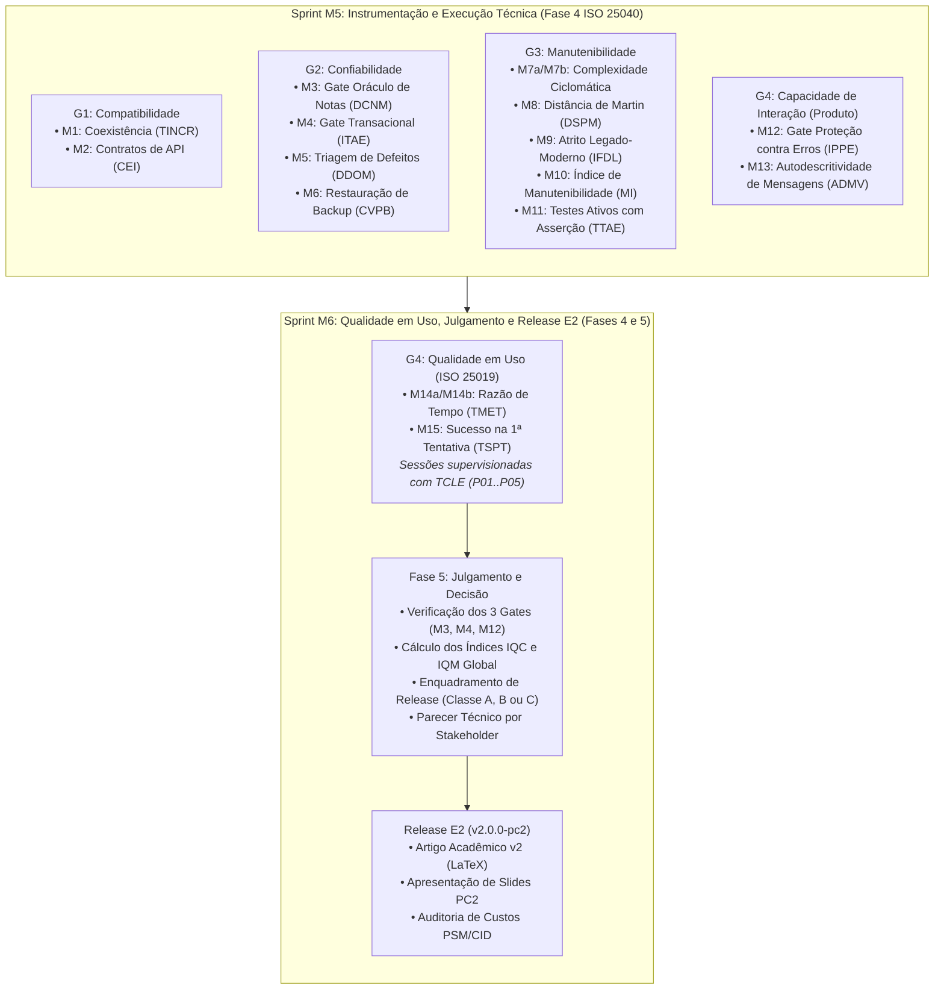
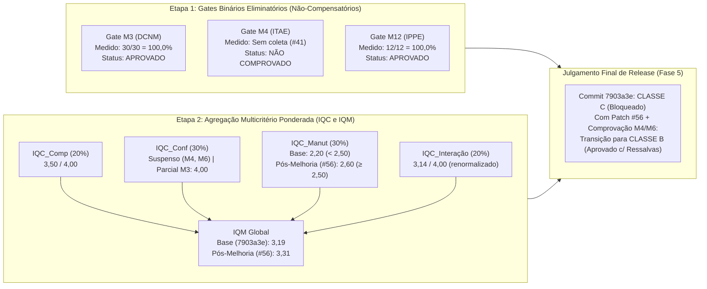

# Plano Operacional de Medição e Testes (Fases 4 e 5 — ISO/IEC 25040:2024)
<!-- Documento de Planejamento e Execução Operacional de Testes e Medições -->

**Disciplina:** Qualidade de Software 1 (FGA0315) — Universidade de Brasília (UnB / FGA)  
**Semestre Letivo:** 2026.2  
**Objeto de Avaliação:** i-Educar 2.12 (`portabilis/i-educar`, commit `7903a3efc7689942ee700007f86ed581023aad27`)  
**Normas de Referência:** ISO/IEC 25010:2023, ISO/IEC 25019:2023, ISO/IEC 25040:2024 e ISO/IEC 25002:2024  
**Frameworks de Apoio:** GQM (*Goal-Question-Metric*) v2.0 e PSM/CID (*Practical Software Measurement / Cost, Income, Duration*)  
**Releases Vinculadas:** Release E1 (`v1.0.0-pc1` — Planejamento) e Release E2 (`v2.0.0-pc2` — Execução e Conclusão)

---

## 1. Visão Geral e Governança da Execução (Fases 4 e 5)

Este documento estabelece o **Plano Operacional de Medição e Testes** para a execução da avaliação de qualidade do **i-Educar 2.12** durante as Fases 4 (Execução da Avaliação) e 5 (Conclusão da Avaliação) da norma **ISO/IEC 25040:2024**.

O plano operacionaliza todas as **15 famílias de métricas (17 linhas operacionais: M1 a M15)** e os **3 Gates Binários eliminatórios (M3, M4 e M12)** definidos no [Framework GQM](gqm_evaluation_framework.md).



### 1.1 Princípios de Reprodutibilidade e Rigor Metodológico
Para assegurar a validade científica das medições e atender às rubricas da disciplina FGA0315, a equipe observa quatro princípios operacionais:
1. **Congelamento Prévio de Manifestos:** Nenhum teste é executado sem que a lista de casos, endpoints, transações ou callables esteja previamente congelada em tabela ou arquivo versionado. A regra de conjunto vazio se aplica estritamente: universo sem casos ou evidência ausente é registrado como **não mensurável / não comprovado**, nunca como 100%.
2. **Fixação Estrita de Versão e Commit:** Todos os testes de código, ambiente conteinerizado e análise estática são executados exclusivamente sobre o commit oficial `7903a3efc7689942ee700007f86ed581023aad27` (branch `2.12` do repositório `portabilis/i-educar`).
3. **Ausência de Dados Fictícios:** Não são arbitrados valores prévios para as métricas. Toda pontuação decorre de medição empírica com logs, scripts executáveis e comandos reais registrados.
4. **Estrutura de Evidências Versionadas:** As evidências brutas de cada coleta são arquivadas na pasta `evidencias/` do repositório, divididas por característica (`g1_compatibilidade/`, `g2_confiabilidade/`, `g3_manutenibilidade/`, `g4_interacao_uso/`).

---

## 2. Roteiro Operacional de Medição por Característica

### 2.1 Característica 1 — Compatibilidade (G1: Coexistência e Interoperabilidade)

A Tabela 1 sintetiza o roteiro de execução operacional para as métricas de Compatibilidade:

**Tabela 1 — Roteiro de medição da Característica Compatibilidade (G1)**

| Métrica | Subcaracterística | Pré-requisito / Manifesto | Procedimento Passo a Passo | Instrumento / Comando | Evidência Gerada | Critério de Aceitação / Limiares |
| :--- | :--- | :--- | :--- | :--- | :--- | :--- |
| **M1 — TINCR** | Coexistência | Inventário de recursos compartilháveis em `docker-compose.yml` e `config/`. | 1. Listar portas expostas (`8080`, `5432`, `6379`), nomes de containers, `DB_DATABASE` e `REDIS_PREFIX`.<br>2. Classificar cada recurso como parametrizável via `.env` ou fixo.<br>3. Subir 2ª instância simultânea no mesmo host alterando apenas variáveis de ambiente.<br>4. Contar recursos isolados sem colisão. | `docker compose up -d`<br>`docker compose config` | Tabela de recursos compartilháveis e log de inicialização simultânea em `evidencias/g1_compatibilidade/m1_tincr.log`. | Excelente: $100\%$<br>Bom: $[85\%, 100\%)$<br>Regular: $[70\%, 85\%)$<br>Crítico: $< 70\%$ |
| **M2 — CEI** | Interoperabilidade | Manifesto congelado de endpoints REST de Matrícula e Notas em `routes/api*.php`. | 1. Congelar JSON Schema de referência para cada endpoint antes do teste.<br>2. Submeter requisição válida e validar HTTP 200 + `Content-Type: application/json`.<br>3. Validar aderência de todos os campos obrigatórios ao schema.<br>4. Submeter requisição inválida e validar erro estruturado sem HTTP 500 ou HTML. | Postman / Insomnia / `curl` com validador de JSON Schema | Relatório de conformidade por endpoint em `evidencias/g1_compatibilidade/m2_cei_report.json`. | Excelente: $100\%$<br>Bom: $[85\%, 100\%)$<br>Regular: $[70\%, 85\%)$<br>Crítico: $< 70\%$ |

*Fonte: Elaborado pelos autores conforme ISO/IEC 25010:2023 e Framework GQM.*

---

### 2.2 Característica 2 — Confiabilidade (G2: Confiabilidade e Gates Binários)

A Tabela 2 apresenta o roteiro operacional para os Gates Binários M3 e M4, a triagem de M5 e o procedimento de backup M6:

**Tabela 2 — Roteiro de medição da Característica Confiabilidade (G2)**

| Métrica | Subcaracterística | Pré-requisito / Manifesto | Procedimento Passo a Passo | Instrumento / Comando | Evidência Gerada | Critério de Aceitação / Limiares |
| :--- | :--- | :--- | :--- | :--- | :--- | :--- |
| **M3 — DCNM** | Ausência de Falhas (*Faultlessness*) | Manifesto congelado de regras de avaliação pedagógica e oráculo formal de notas/médias. | 1. Congelar tabela com regras (média aritmética, ponderada, recuperação paralela, exame final e arredondamento em `LegacyValueRoundingTable`).<br>2. Executar suíte de testes automatizados sobre `Avaliacao_Service_Boletim`.<br>3. Inspecionar e reativar testes desativados em `NotaSituacaoCommon.php`.<br>4. Comparar resultados com o oráculo formal caso a caso. | `vendor/bin/pest`<br>ou `php artisan test` | Log detalhado com resultado por ID em `evidencias/g2_confiabilidade/m3_dcnm_suite.txt`. | **GATE BINÁRIO:**<br>Aprovado: $100\%$<br>Bloqueado: $< 100\%$ |
| **M4 — ITAE** | Tolerância a Falhas | Inventário congelado de operações multi-escrita de matrícula e diário. | 1. Identificar pontos de escrita em `RegistrationService` e controllers do diário.<br>2. Validar que o caminho feliz persiste os dados com integridade referencial.<br>3. Injetar exceção sintética (`throw Exception`) em cada etapa intermediária de persistência.<br>4. Consultar PostgreSQL e verificar rollback atômico integral sem dados órfãos. | Script de teste / injeção determinística de falha e consultas SQL | Logs de injeção e conferência SQL em `evidencias/g2_confiabilidade/m4_itae_rollback.log`. | **GATE BINÁRIO:**<br>Aprovado: $100\%$<br>Bloqueado: $< 100\%$ |
| **M5 — DDOM** | Ausência de Falhas | Dados operacionais de produção (Honeybadger / chamados de prefeituras). | 1. Consultar registros de movimentações e incidentes em janela de 90 dias.<br>2. Confirmar se registros estão disponíveis.<br>3. Caso indisponíveis, registrar formalmente como **não mensurável** (sem nota atribuída) e aplicar política de renormalização da Seção 3. | Consulta a logs de homologação / telemetria | Relatório de triagem em `evidencias/g2_confiabilidade/m5_ddom_triagem.md`. | Excelente: $\le 0{,}5$<br>Bom: $(0{,}5, 2{,}0]$<br>Regular: $(2{,}0, 5{,}0]$<br>Crítico: $> 5{,}0$ |
| **M6 — CVPB** | Recuperabilidade | Manifesto congelado de alvos e procedimentos de restauração. | 1. Executar dump lógico do banco (`pg_dump -Fc`) contendo `pmieducar`, `modules` e `cadastro`.<br>2. Registrar checksum SHA-256 do artefato gerado.<br>3. Restaurar o dump em banco isolado limpo de homologação (`pg_restore`).<br>4. Executar queries de verificação de integridade e contagem de tuplas. | `pg_dump`<br>`pg_restore`<br>`sha256sum` | Log de backup/restore e relatório de tuplas em `evidencias/g2_confiabilidade/m6_cvpb.log`. | Excelente: $100\%$<br>Bom: $[95\%, 100\%)$<br>Regular: $[90\%, 95\%)$<br>Crítico: $< 90\%$ |

*Fonte: Elaborado pelos autores conforme ISO/IEC 25010:2023 e Framework GQM.*

---

### 2.3 Característica 3 — Manutenibilidade (G3: Complexidade e Estrutura de Código)

A Tabela 3 estabelece o roteiro operacional para a extração das métricas estáticas e de testabilidade:

**Tabela 3 — Roteiro de medição da Característica Manutenibilidade (G3)**

| Métrica | Subcaracterística | Pré-requisito / Manifesto | Procedimento Passo a Passo | Instrumento / Comando | Evidência Gerada | Critério de Aceitação / Limiares |
| :--- | :--- | :--- | :--- | :--- | :--- | :--- |
| **M7a / M7b — CC** | Modularidade / Analisabilidade | Lista congelada dos 4 arquivos de código de produção em escopo. | 1. Executar analisador léxico sobre os 4 arquivos em escopo (`RegistrationService.php`, `DiarioApiController.php`, `DiarioController.php` e `Boletim.php`).<br>2. Extrair a complexidade $v(G)$ de cada método concreto ($n$).<br>3. Ordenar valores e calcular $P_{90}$ via *nearest rank* ($r = \lceil 0{,}90n \rceil$) e identificar o máximo $\text{CC}_{\max}$. | `php scripts/evaluate-quality.php --path=/ieducar` | Relatório tabular e JSON em `evidencias/g3_manutenibilidade/m7_complexidade.json`. | M7a (P90): Exc $\le 10$; Bom $(10, 15]$; Reg $(15, 20]$; Crít $> 20$<br>M7b (Max): Exc $\le 15$; Bom $(15, 30]$; Reg $(30, 50]$; Crít $> 50$ |
| **M8 — DSPM** | Modularidade e Modificabilidade | Mapa congelado de componentes do domínio de Matrícula e Notas. | 1. Mapear classes em componentes atômicos.<br>2. Computar dependências eferentes ($C_e$) e aferentes ($C_a$) por componente.<br>3. Contar total de classes ($N_c$) e classes abstratas/interfaces ($N_a$).<br>4. Calcular $I = C_e / (C_a + C_e)$, $A = N_a / N_c$, $D = \|A + I - 1\|$ e a média $\text{DSPM}$. | `scripts/evaluate-quality.php` / PHPMetrics | Tabela de acoplamento em `evidencias/g3_manutenibilidade/m8_dspm.csv`. | Excelente: $\le 0{,}20$<br>Bom: $(0{,}20, 0{,}35]$<br>Regular: $(0{,}35, 0{,}50]$<br>Crítico: $> 0{,}50$ |
| **M9 — IFDL** | Analisabilidade e Modificabilidade | Manifesto congelado dos modelos `app/Models/Legacy*.php` em escopo. | 1. Inspecionar modelos `Legacy*` utilizados nos fluxos de matrícula e notas.<br>2. Localizar pontos de adaptação defensiva de dados (conversão de tipos, filtros de null, adaptação de schema legado).<br>3. Registrar arquivo, linha e tipo de cada adaptador.<br>4. Calcular a média de adaptações por modelo. | `scripts/evaluate-quality.php` e inspeção de código | Inventário de adaptações em `evidencias/g3_manutenibilidade/m9_ifdl.json`. | Excelente: $\le 1{,}0$<br>Bom: $(1{,}0, 2{,}5]$<br>Regular: $(2{,}5, 4{,}0]$<br>Crítico: $> 4{,}0$ |
| **M10 — MI** | Modificabilidade | Mesmos $n$ métodos concretos do manifesto de M7a/M7b. | 1. Extrair para cada método o Volume de Halstead ($HV_m$), a complexidade ciclomática $v(G_m)$ e as linhas lógicas ($LOC_m$).<br>2. Aplicar a fórmula local normalizada de $\text{MI}_m$.<br>3. Calcular a média aritmética dos métodos avaliados. | `php scripts/evaluate-quality.php` | Tabela de MI por método em `evidencias/g3_manutenibilidade/m10_mi.json`. | Excelente: $\ge 80$<br>Bom: $[60, 80)$<br>Regular: $[40, 60)$<br>Crítico: $< 40$ |
| **M11 — TTAE** | Testabilidade | Manifesto congelado dos diretórios/arquivos de testes de matrícula e notas. | 1. Descoberta de casos de teste no runner Pest/PHPUnit.<br>2. Contar casos declarados no manifesto ($N_{\text{declarados}}$).<br>3. Executar a suíte e verificar os casos que registraram ao menos uma asserção em runtime.<br>4. Identificar testes suprimidos com `markTestSkipped()` e calcular a taxa $\text{TTAE}$. | Runner Pest / PHPUnit com relatório de asserções | Log do test runner em `evidencias/g3_manutenibilidade/m11_ttae.txt`. | Excelente: $\ge 95{,}0\%$<br>Bom: $[85{,}0\%, 95{,}0\%)$<br>Regular: $[70{,}0\%, 85{,}0\%)$<br>Crítico: $< 70{,}0\%$ |

*Fonte: Elaborado pelos autores conforme ISO/IEC 25010:2023 e Framework GQM.*

A execução de M7a, M7b e M10 sobre o commit congelado e os resultados por callable estão em [Manutenibilidade (M7a, M7b e M10)](fase-4/manutenibilidade-m7-m10.md).

---

### 2.4 Característica 4 — Capacidade de Interação e Qualidade em Uso (G4)

A Tabela 4 sintetiza o roteiro para o Gate M12, a auditoria de mensagens M13 e o protocolo com participantes M14 e M15:

**Tabela 4 — Roteiro de medição de Capacidade de Interação e Qualidade em Uso (G4)**

| Métrica | Subcaracterística | Pré-requisito / Manifesto | Procedimento Passo a Passo | Instrumento / Comando | Evidência Gerada | Critério de Aceitação / Limiares |
| :--- | :--- | :--- | :--- | :--- | :--- | :--- |
| **M12 — IPPE** | Proteção contra Erros (ISO 25010) | Catálogo com no mínimo 12 cenários de entrada inválida (3 por categoria). | 1. Submeter cenários inválidos (notas fora da faixa, períodos encerrados, menções inexistentes e conflito de matrícula).<br>2. Verificar se o sistema intercepta e exibe bloqueio amigável.<br>3. Consultar PostgreSQL e confirmar que nenhum dado corrompido foi gravado.<br>4. Confirmar ausência de exceções HTTP 500 não tratadas. | Testes via interface web e chamadas de API | Planilha de execução e consultas SQL em `evidencias/g4_interacao_uso/m12_ippe.csv`. | **GATE BINÁRIO:**<br>Aprovado: $100\%$<br>Bloqueado: $< 100\%$ |
| **M13 — ADMV** | Autodescritividade (ISO 25010) | Mensagens capturadas durante a execução de M12. | 1. Capturar texto exato das mensagens de recusa exibidas nos cenários de M12.<br>2. Dois avaliadores classificam independentemente se a mensagem informa causa e ação corretiva.<br>3. Resolver divergências por consenso formal registrado.<br>4. Calcular o percentual de mensagens plenamente autodescritivas. | Formulário de auditoria de mensagens | Tabela de classificação com dupla checagem em `evidencias/g4_interacao_uso/m13_admv.json`. | Excelente: $\ge 98{,}0\%$<br>Bom: $[90{,}0\%, 98{,}0\%)$<br>Regular: $[80{,}0\%, 90{,}0\%)$<br>Crítico: $< 80{,}0\%$ |
| **M14a / M14b — TMET** | Eficiência em Uso (ISO 25019) | Ficha padronizada das tarefas T1 (Matrícula) e T2 (Diário) e TCLE assinado. | 1. Coletar o tempo de referência ($T_{\text{ref}}$) com 3 execuções de integrante treinado.<br>2. Recrutar 5 participantes iniciantes anonimizados (`P01` a `P05`).<br>3. Cronometrar início da leitura até submissão bem-sucedida de T1 e T2 sem auxílio do avaliador.<br>4. Calcular $\text{TMET}$ e razão de tempo $R_{\text{tempo}} = \text{TMET} / T_{\text{ref}}$. | Planilha de cronometragem e gravações | Planilha de tempos anonimizada em `evidencias/g4_interacao_uso/m14_tmet.csv`. | Excelente: $\le 1{,}5$<br>Bom: $(1{,}5, 2{,}0]$<br>Regular: $(2{,}0, 3{,}0]$<br>Crítico: $> 3{,}0$ |
| **M15 — TSPT** | Eficácia em Uso (ISO 25019) | Mesmas sessões supervisionadas das tarefas T1 e T2. | 1. Observar se o participante conclui a tarefa na primeira submissão.<br>2. Registrar ocorrência de erro de validação, perda de dados ou necessidade de ajuda.<br>3. Verificar integridade do dado gravado no banco após submissão.<br>4. Calcular $\text{TSPT} = (N_{\text{sucessos na 1ª tentativa}} / N_{\text{execuções totais}}) \times 100\%$. | Ficha de observação de teste de usabilidade | Relatório de eficácia por participante em `evidencias/g4_interacao_uso/m15_tspt.csv`. | Excelente: $\ge 90{,}0\%$<br>Bom: $[70{,}0\%, 90{,}0\%)$<br>Regular: $[50{,}0\%, 70{,}0\%)$<br>Crítico: $< 50{,}0\%$ |

*Fonte: Elaborado pelos autores conforme ISO/IEC 25010:2023, ISO/IEC 25019:2023 e Framework GQM.*

Na Entrega 2, M14a, M14b e M15 foram declaradas não mensuráveis antes de qualquer coleta (seção 3.4). O protocolo previsto está em [Qualidade em uso (M14a, M14b e M15)](fase-4/qualidade-em-uso-m14-m15.md).

---

## 3. Tratamento de Pendências Metodológicas Pré-Coleta

Para garantir que a Atividade 5 (Julgamento e Decisão) transcorra sem bloqueios ou ambiguidades, o Plano de Medição formaliza três definições prévias:

### 3.1 Política Prévia de Renormalização para Métrica sem Produção (M5 — DDOM)
A métrica **M5 (DDOM)** depende formalmente de telemetria e registros operacionais de prefeituras por 90 dias consecutivos. Na ausência desses registros em ambiente de laboratório, a hipótese `H2.2` declara que a métrica permanece **não mensurável**.

Para permitir o cálculo estrito do Índice de Qualidade da Confiabilidade ($\text{IQC}_{\text{Confiabilidade}}$) e do Índice Global ($\text{IQM}$) sem atribuir notas substitutas arbitrárias, adota-se a seguinte **política de renormalização pré-declarada**:
- O peso original de M5 ($w_{\text{M5}} = 1{,}2$) é excluído do denominador da característica Confiabilidade.
- O $\text{IQC}_{\text{Confiabilidade}}$ é computado ponderando exclusivamente as métricas de Confiabilidade com dados comprovados: M3 ($w=2{,}0$), M4 ($w=2{,}0$) e M6 ($w=1{,}0$), totalizando soma de pesos igual a $5{,}0$:

$$
\text{IQC}_{\text{Confiabilidade}} = \dfrac{S_{\text{M3}} \times 2{,}0 + S_{\text{M4}} \times 2{,}0 + S_{\text{M6}} \times 1{,}0}{2{,}0 + 2{,}0 + 1{,}0}
$$

### 3.2 Ajuste de Intervalo Contínuo na Métrica de Backup (M6 — CVPB)
Para eliminar a lacuna formal no limiar de M6 entre $99{,}0\%$ e $100\%$, a Tabela 4 do Framework GQM passa a operar com o intervalo semi-aberto contínuo calibrado:
- **Excelente (4):** $\text{CVPB} = 100\%$
- **Bom (3):** $95{,}0\% \le \text{CVPB} < 100\%$
- **Regular (2):** $90{,}0\% \le \text{CVPB} < 95{,}0\%$
- **Crítico (1):** $\text{CVPB} < 90{,}0\%$

### 3.3 Fechamento Lógico dos Critérios de Decisão de Release (Fase 5)
Para assegurar que qualquer combinação possível de $\text{IQM}$ e $\text{IQC}_k$ possua enquadramento conclusivo inequívoco:
- **Classe A (Aprovado Plenamente):** Todos os Gates aprovados ($100\%$), $\text{IQM} \ge 3{,}25$, todos os $\text{IQC}_k \ge 3{,}0$ e nenhuma métrica com $S_i = 1$.
- **Classe B (Aprovado com Ressalvas):** Todos os Gates aprovados ($100\%$) e:
  - $\text{IQM} \ge 2{,}75$ com todos os $\text{IQC}_k \ge 2{,}5$ (abrangendo casos em que $\text{IQM} \ge 3{,}25$ mas alguma característica situa-se no intervalo $[2{,}5, 3{,}0)$ ou possui métrica residual em nível 1).
- **Classe C (Reprovado / Bloqueado):** Falha em qualquer um dos Gates (M3, M4 ou M12 $< 100\%$), **OU** $\text{IQM} < 2{,}75$, **OU** qualquer característica com $\text{IQC}_k < 2{,}5$.

### 3.4 Política Prévia para as Métricas de Qualidade em Uso (M14a, M14b e M15)
As métricas **M14a, M14b (TMET)** e **M15 (TSPT)** dependem de sessões supervisionadas com no mínimo 5 participantes iniciantes, TCLE assinado, ambiente Docker com dados fictícios e restauração do banco entre as sessões. Em 12/11/2026, **antes de qualquer coleta**, a equipe decidiu que essas sessões não cabem no cronograma da Entrega 2. As três métricas são declaradas **não mensuráveis**: não recebem nota zero nem nota substituta, e as hipóteses `H4.3` e `H4.4` ficam **não testadas**.

Para permitir o cálculo do $\text{IQC}_{\text{Interação}}$ e do $\text{IQM}$ sem média parcial arbitrária, adota-se a seguinte **política de renormalização pré-declarada**, nos mesmos moldes da política de M5:
- Os pesos de M14a ($w=0{,}8$), M14b ($w=1{,}0$) e M15 ($w=1{,}0$) são excluídos do denominador da característica.
- O $\text{IQC}_{\text{Interação}}$ é computado apenas com as métricas de produto da característica: M12 ($w=2{,}0$) e M13 ($w=0{,}8$), com soma de pesos igual a $2{,}8$:

$$
\text{IQC}_{\text{Interação}} = \dfrac{S_{\text{M12}} \times 2{,}0 + S_{\text{M13}} \times 0{,}8}{2{,}0 + 0{,}8}
$$

- O peso de 20% da característica no $\text{IQM}$ não muda. Com isso, o resultado de G4 passa a refletir apenas a **capacidade de interação do produto** (ISO/IEC 25010:2023); a **qualidade em uso** (ISO/IEC 25019:2023) fica sem resultado nesta avaliação e é registrada como limitação no artigo.
- O protocolo das sessões permanece documentado em [Qualidade em uso (M14a, M14b e M15)](fase-4/qualidade-em-uso-m14-m15.md) para execução em trabalho futuro.

---

## 4. Estrutura das Sprints e Alocação Equilibrada de Esforço (PSM/CID)

Para operacionalizar a execução sem sobrecarregar nenhum membro da equipe e cumprir com rigor o **Critério AG-C5 (Transparência da Contribuição Individual)**, o trabalho foi dividido em **2 Sprints/Milestones** e desdobrado em **12 Issues atômicas** dimensionadas em `6 horas` cada.

### Tabela 5 — Matriz de Trilhas Sugeridas para Distribuição Equilibrada (1/6 por Integrante)

| Trilha de Atuação | Issues Alocadas | Escopo Funcional | Horas Estimadas | % Esforço na Entrega 2 |
| :--- | :---: | :--- | :---: | :---: |
| **Trilha A: Infraestrutura, Coexistência e Backup** | `#38` e `#42` | Subida do Docker com seeds, teste de coexistência (`M1`) e procedimento de backup/restore PostgreSQL (`M6`). | 12h | **16,67%** |
| **Trilha B: Interoperabilidade e Proteção de Interação** | `#39` e `#45` | Contratos JSON Schema REST (`M2`), testes de cenários inválidos (`M12`) e autodescritividade de mensagens (`M13`). | 12h | **16,67%** |
| **Trilha C: Confiabilidade, Oráculo e Transações** | `#40` e `#41` | Testes do oráculo de notas em `Boletim.php` (`M3`), injeções de falha transacional (`M4`) e triagem de `M5`. | 12h | **16,67%** |
| **Trilha D: Análise Estática e Arquitetura** | `#43` e `#44` | Extração de complexidade ciclomática e MI (`M7a`, `M7b`, `M10`), acoplamento de Martin (`M8`), atrito legado (`M9`) e testes ativos (`M11`). | 12h | **16,67%** |
| **Trilha E: Qualidade em Uso e Julgamento** | `#46` e `#47` | Sessões supervisionadas com TCLE (`M14a`, `M14b`, `M15`), cálculo dos índices $\text{IQC}_k$ e $\text{IQM}$, e parecer técnico da Fase 5. | 12h | **16,67%** |
| **Trilha F: Consolidação Científica e Release E2** | `#48` e `#49` | Redação dos resultados no artigo LaTeX v2, apresentação final PC2, auditoria PSM/CID e publicação da release `v2.0.0-pc2`. | 12h | **16,67%** |
| **TOTAIS PLANEJADOS DA EQUIPE** | **12 Issues** | **Fases 4 e 5 da ISO/IEC 25040:2024 e Release E2** | **72h** | **100% (6 de 6 Ativos)** |

*Fonte: Elaborado pelos autores conforme modelo PSM/CID da disciplina FGA0315.*

---

## 5. Como Assumir e Executar uma Issue no GitHub

Cada integrante deve seguir o procedimento abaixo para manter a rastreabilidade e alimentar os indicadores automáticos:
1. Acesse a aba **Issues** do repositório no GitHub.
2. Escolha as issues correspondentes à sua trilha (ou de comum acordo com o grupo).
3. Atribua a issue ao seu usuário (*Assignee*).
4. Edite a issue e preencha a tabela de controle inicial (Nome, Matrícula, Usuário e Papel).
5. Ao concluir o trabalho e abrir o Pull Request:
   - Preencha o campo `Horas Efetivamente Realizadas` na issue.
   - Atualize sua linha na Tabela de Esforço da Entrega 2 em [`docs/gestao_projeto_releases_milestones_issues.md`](gestao_projeto_releases_milestones_issues.md).
   - Anexe os arquivos de evidência na pasta `evidencias/`.


---

## 6. Resultados da Execução da Característica Compatibilidade (G1 — Issues #38 e #39)

Esta seção registra a execução empírica de **M1 (TINCR)** e **M2 (CEI)** sobre o commit congelado `7903a3efc7689942ee700007f86ed581023aad27`. Todos os valores decorrem dos logs e relatórios versionados em `evidencias/g1_compatibilidade/`; nenhum valor foi arbitrado.

### 6.1 Ambiente Docker Provisionado (Issue #38)

O `docker-compose.yml` da raiz passou a construir a imagem PHP a partir de `docker/php` do checkout oficial (variável `IEDUCAR_SRC`) e a parametrizar todos os recursos compartilháveis por variáveis. O código-fonte do i-Educar não foi alterado. As duas instâncias usam os arquivos `config/instancia-a.env` e `config/instancia-b.env`.

```bash
git clone https://github.com/portabilis/i-educar.git ../_work/i-educar
git -C ../_work/i-educar checkout 7903a3efc7689942ee700007f86ed581023aad27
bash scripts/infra/gerar_env_fonte.sh config/instancia-a.env
docker compose --env-file config/instancia-a.env up -d --build
docker compose --env-file config/instancia-a.env exec -e COMPOSER_NO_SECURITY_BLOCKING=1 php composer install
docker compose --env-file config/instancia-a.env exec php php artisan migrate --force
docker compose --env-file config/instancia-a.env exec php php artisan db:seed --force
docker compose --env-file config/instancia-a.env exec php php artisan db:seed --class=DemoSeeder --force
```

Resultado: migrações concluídas (exit 0), seeds padrão e `DemoSeeder` aplicados (210 matrículas no ano de 2026) e `GET /api/version` retornando `{"entity":"i-Educar","version":"2.12.0"}` nas duas instâncias.

**Tabela 6 — Inventário de recursos compartilháveis e resultado do teste de coexistência (M1)**

| Id | Recurso compartilhável | Variável que o isola | Instância A | Instância B | Colisão? | Isolável |
| :-: | :--- | :--- | :--- | :--- | :---: | :---: |
| R1 | Porta HTTP do host | `DOCKER_NGINX_PORT` | `8080` | `8081` | Não | Sim |
| R2 | Porta HTTPS do host | `DOCKER_NGINX_SSL_PORT` | `8443` | `8444` | Não | Sim |
| R3 | Porta PostgreSQL do host | `DOCKER_POSTGRES_PORT` | `5432` | `5433` | Não | Sim |
| R4 | Porta Redis do host | `DOCKER_REDIS_PORT` | `6379` | `6380` | Não | Sim |
| R5 | `container_name` do serviço `php` | `INSTANCE_NAME` | `ieducar-a-php` | `ieducar-b-php` | Não | Sim |
| R6 | `container_name` do serviço `fpm` | `INSTANCE_NAME` | `ieducar-a-fpm` | `ieducar-b-fpm` | Não | Sim |
| R7 | `container_name` do serviço `nginx` | `INSTANCE_NAME` | `ieducar-a-nginx` | `ieducar-b-nginx` | Não | Sim |
| R8 | `container_name` do serviço `postgres` | `INSTANCE_NAME` | `ieducar-a-postgres` | `ieducar-b-postgres` | Não | Sim |
| R9 | `container_name` do serviço `redis` | `INSTANCE_NAME` | `ieducar-a-redis` | `ieducar-b-redis` | Não | Sim |
| R10 | Banco de dados (`DB_DATABASE`) | `DB_DATABASE` | `ieducar` | `ieducar_b` | Não | Sim |
| R11 | Usuário do banco (`DB_USERNAME`) | `DB_USERNAME` | `ieducar` | `ieducar_b` | Não | Sim |
| R12 | Prefixo de chaves no Redis | `REDIS_PREFIX` | `ieducar-a-` | `ieducar-b-` | Não | Sim |
| R13 | Volume nomeado do PostgreSQL | `COMPOSE_PROJECT_NAME` | `ieducar-a_postgres` | `ieducar-b_postgres` | Não | Sim |
| R14 | Rede Docker | `COMPOSE_PROJECT_NAME` | `ieducar-a_default` | `ieducar-b_default` | Não | Sim |
| R15 | Diretório de armazenamento (`storage/`, `.env`) | `IEDUCAR_SRC` | `.../i-educar` | `.../i-educar-b` | Não | Sim |
| R16 | Tag da imagem de aplicação | `INSTANCE_NAME` | `ieducar-a-php:8.5` | `ieducar-b-php:8.5` | Não | Sim |

*Fonte: `evidencias/g1_compatibilidade/m1_tincr.log` (comandos e saídas brutas). Elaborado pelos autores.*

Verificações complementares registradas no log: (i) um marcador gravado no banco `ieducar_b` da instância B não existe no banco da instância A; (ii) a chave de cache gravada pela aplicação aparece como `ieducar-a-ieducarm1_probe` no Redis de A e `ieducar-b-ieducarm1_probe` no Redis de B, confirmando o prefixo por instância; (iii) as duas instâncias responderam simultaneamente nas portas `8080` e `8081`.

### 6.2 Cálculo de M1 (TINCR) e Avaliação da Hipótese H1.1

$$
\text{TINCR} = \dfrac{N_{\text{isoláveis}}}{N_{\text{identificados}}} \times 100\% = \dfrac{16}{16} \times 100\% = 100{,}0\%
$$

- **Nível:** Excelente ($S = 4$). **H1.1 (TINCR $\ge 85\%$): confirmada.**
- **Linha de base do compose oficial sem parametrização** (`evidencias/g1_compatibilidade/m1_baseline_upstream.log`): ao subir uma segunda instância com o `docker-compose.yml` do upstream, a criação falhou com `Conflict. The container name "/ieducar-redis" is already in use`, mesmo alterando as portas por variável. Considerando o compose do upstream como publicado (19 recursos: 4 portas, 7 `container_name`, 3 variáveis de `.env`, 3 volumes, 1 rede e 1 bind mount do código), apenas 11 são isoláveis por variável de ambiente isoladamente, o que resulta em $11/19 = 57{,}9\%$ (nível Crítico). Os 8 restantes (7 `container_name` e o bind mount `./`) exigem editar o arquivo de composição (`docker-compose.override.yml`, previsto no `INSTALL.md` do upstream). Como o critério de M1 admite "variável de ambiente ou arquivo de configuração" e nenhum código-fonte foi alterado, o valor oficial adotado é **100%**, com a ressalva de que a hipótese H1.1 se confirma somente após a substituição dos nomes fixos de container por variáveis.
- **Escopo do inventário:** foram considerados os serviços `php`, `fpm`, `nginx`, `postgres` e `redis`. Os serviços `horizon` e `pest` do upstream não foram instanciados nesta medição.

### 6.3 Achados e Ameaças à Validade do Ambiente (Issue #38)

1. **Bloqueio do Composer por *security advisories*:** o `composer install` do `composer.lock` do commit fixo falha porque 18 pacotes constam em avisos de segurança (PKSA) atuais. Foi usada a variável `COMPOSER_NO_SECURITY_BLOCKING=1`, restrita ao ambiente isolado de laboratório; ao final foram reportados 12 avisos em 8 pacotes (`composer audit`). Não foi alterado nenhum arquivo versionado do i-Educar.
2. **`set-permissions` do `composer new-install`:** o `chmod` falha em bind mount NTFS (`Operation not permitted`); as demais etapas do script (`key:generate`, `storage:link`, `migrate`) foram executadas manualmente.
3. **Configuração lida do `.env` do checkout:** o `php-fpm` lê a configuração do `.env` do checkout, razão pela qual `scripts/infra/gerar_env_fonte.sh` gera esse arquivo por instância a partir do `.env.example` oficial.
4. **Chaves de API definidas no banco:** `API_ACCESS_KEY` e `API_SECRET_KEY` do `.env` são sobrescritas pela tabela `settings` (migração `populate_settings_table`, valores padrão `ieducar-access-key` e `ieducar-secret-key`). Os testes de M2 usam esses valores públicos do upstream.
5. **Limitação:** a medição de M1 foi feita em um único host Windows com Docker Desktop; a ausência de conflito em outros hosts não é inferida.

### 6.4 Contratos e Resultados de M2 (CEI — Issue #39)

**Congelamento prévio.** Os contratos JSON Schema (`contratos_json_schema.json`) e o manifesto de endpoints (`manifesto_endpoints.json`) em `evidencias/g1_compatibilidade/m2_contratos/` foram escritos antes da primeira execução; seus hashes SHA-256 foram registrados em `manifesto.sha256` (carimbo `congelado_em.txt`, `2026-11-11T16:45:08-03:00`) e o executor `scripts/avaliacao/m2_cei.py` aborta se qualquer hash divergir. Não há documentação oficial de contrato para esses endpoints; os esquemas foram derivados de `MatriculaController.php`, `DiarioApiController.php`, `ApiCoreController.php` e dos controllers REST de `routes/api.php`.

**Universo avaliado.** Foram congelados 10 endpoints de leitura dos módulos de Matrícula/Enturmação e Diário/Notas. Endpoints de escrita (`POST` de nota, `DELETE`) ficaram fora do universo para não alterar a base de homologação; a cobertura de M2 refere-se, portanto, a operações de consulta.

**Regras pré-registradas.** C1: HTTP 200 e `Content-Type: application/json`. C2: corpo aderente ao JSON Schema. C3: duas requisições inválidas (P1, parâmetro obrigatório ausente; P2, credencial incorreta) devem retornar status inferior a 500, `application/json` e erro estruturado conforme o esquema de erro do endpoint. Endpoints REST sem parâmetro obrigatório (E09, E10) têm apenas a sonda P2.

**Tabela 7 — Relatório de conformidade por endpoint (M2)**

| Id | Endpoint | Autenticação | C1 | C2 | C3 | Conforme |
| :-: | :--- | :--- | :-: | :-: | :-: | :-: |
| E01 | `GET /module/Api/Matricula` `resource=matricula` | `access_key` | Sim | Sim | Sim | Sim |
| E02 | `GET /module/Api/Matricula` `resource=matriculas` | `access_key` | Sim | Sim | Sim | Sim |
| E03 | `GET /module/Api/Matricula` `resource=matriculas-escola` | `access_key` | Sim | Sim | Sim | Sim |
| E04 | `GET /module/Api/Matricula` `resource=frequencia` | `access_key` | Sim | Sim | Sim | Sim |
| E05 | `GET /module/Api/Matricula` `resource=matricula-search` | `access_key` | Sim | Sim | Sim | Sim |
| E06 | `GET /module/Api/Matricula` `resource=movimentacao-enturmacao` | `access_key` | Sim | Sim | Sim | Sim |
| E07 | `GET /module/Api/Matricula` `resource=matriculas-dependencia` | `access_key` | Sim | Sim | Sim | Sim |
| E08 | `GET /module/Avaliacao/DiarioApi` `resource=matriculas` | sessão | Sim | Sim | **Não** | **Não** |
| E09 | `GET /api/registration` | Bearer (Sanctum) | Sim | Sim | Sim | Sim |
| E10 | `GET /api/situation` | Bearer (Sanctum) | Sim | Sim | Sim | Sim |

*Fonte: `evidencias/g1_compatibilidade/m2_cei_report.json` e `m2_cei_execucao.log`. Elaborado pelos autores.*

$$
\text{CEI} = \dfrac{N_{\text{endpoints conformes}}}{N_{\text{endpoints testados}}} \times 100\% = \dfrac{9}{10} \times 100\% = 90{,}0\%
$$

- **Nível:** Bom ($S = 3$, faixa $[85\%, 100\%)$). **H1.2 (CEI $\ge 85\%$): confirmada.**
- **Falha de E08:** a requisição sem sessão válida retorna `401` com o corpo Laravel `{"message":"Unauthenticated."}`, enquanto as demais respostas de erro do mesmo recurso usam o envelope legado (`msgs` e `any_error_msg`). O contrato congelado previa o envelope legado, portanto o endpoint foi reprovado em C3. O resultado não foi reclassificado após a execução; a coexistência de dois formatos de erro no mesmo endpoint é o achado de interoperabilidade.
- **Observações sem efeito na pontuação:** (i) sem o cabeçalho `Accept: application/json`, a mesma chamada a E08 sem sessão redireciona para a página HTML de login (o executor envia o cabeçalho); (ii) E04 sem o parâmetro `id` devolve em JSON a mensagem bruta de exceção SQL (`SQLSTATE[42883]`) com `APP_DEBUG=true`, o que a torna estruturada porém expõe detalhes internos; (iii) a resposta válida de E08 retornou lista `matriculas` vazia para o recorte do seed, aderente ao esquema, mas sem exercitar os campos internos dos itens.
- **Ameaça à validade:** com 10 endpoints, cada endpoint vale 10 pontos percentuais; um único endpoint não conforme é suficiente para mudar o nível.

### 6.5 Como Reproduzir

```bash
bash scripts/avaliacao/m1_coexistencia.sh > evidencias/g1_compatibilidade/m1_tincr.log
python3 -m venv .venv-m2 && .venv-m2/bin/pip install jsonschema
.venv-m2/bin/python scripts/avaliacao/m2_cei.py --token "$TOKEN_SANCTUM_LAB"
```

---

## 7. Resultado da medição M3 — DCNM (issue #40)

Consulte o [resultado oficial da M3 na Fase 4](fase-4/medicao_m3_dcnm.md#resultado-oficial-issue-40).

A coleta oficial `oficial-001` executou os 30 cenários do oráculo no commit `7903a3efc7689942ee700007f86ed581023aad27`: **30 conformes / 30 planejados × 100% = 100%**, 457 asserções e código de saída zero. **Gate M3 APROVADO; H2.1 confirmada no recorte avaliado.**

O [relatório específico da M3](fase-4/medicao_m3_dcnm.md) apresenta casos, procedimento, rastreabilidade, cálculo e limites. As evidências estão em `evidencias/g2_confiabilidade/m3/oficial-001/`. Os dez testes legados complementares foram reativados e registraram erro de pré-requisito de enturmação; estão classificados separadamente e não integram o denominador do DCNM. A aprovação da M3 não antecipa o julgamento de M4, M12 ou do índice global.

---

## 8. Resultados Consolidados das Medições M4 a M15 e Ação de Melhoria (Fase 4)

Esta seção consolida os resultados empíricos obtidos na Fase 4 da ISO/IEC 25040:2024 para as demais famílias de métricas (`M4` a `M15`) sobre o commit congelado `7903a3efc7689942ee700007f86ed581023aad27`, bem como a verificação de impacto da ação de melhoria corretiva executada na Issue #56.

### 8.1 Confiabilidade Complementar: M4 (ITAE), M5 (DDOM) e M6 (CVPB) — Issues #41 e #42

1. **M4 (ITAE — Integridade Transacional e Ausência de Estados Órfãos, Gate Binário — Issue #41):** A bateria de injeção controlada de falhas transacionais (`T01` a `T04`) prevista na Seção 2.2.2 não teve sua coleta empírica concluída até o fechamento da Sprint M6. Em cumprimento estrito à regra de não-compensação e de evidência obrigatória da Seção 1.1 (*"universo sem casos ou evidência ausente é registrado como não mensurável / não comprovado, nunca como 100%"*) e da Seção 5.1 do [Framework GQM](gqm_evaluation_framework.md), o **Gate Binário M4 permanece NÃO COMPROVADO (BLOQUEADO)**. A parte da hipótese **H2.2** referente à falha transacional ($\text{ITAE} < 100\%$) permanece **Não testada**.
2. **M5 (DDOM — Densidade de Defeitos Operacionais em Matrícula e Diário — Issue #41):** Conforme regra de contingência pré-declarada na Seção 3.1, por não haver acesso a banco de tickets de produção de uma Secretaria Municipal de Educação com janela mínima de 90 dias consecutivos, a métrica `M5` foi formalmente registrada como **Não mensurável** em ambiente puramente laboratorial, tendo seu peso local ($w_{\text{M5}} = 1{,}2$) excluído do cálculo de $\text{IQC}_{\text{Conf}}$. Isso **confirma** a segunda parte da hipótese **H2.2** (não mensurabilidade de `M5` sem logs de produção).
3. **M6 (CVPB — Completude de Verificação Pós-Restauração de Backup — Issue #42):** O ensaio de `pg_dump` e `pg_restore` em container limpo não teve sua coleta empírica concluída na janela da Entrega 2. Assim, `M6` é registrada como **Não comprovada / Não mensurável por ausência de coleta** ($S_{\text{M6}} = \text{—}$, peso $w_{\text{M6}} = 1{,}0$), e a hipótese **H2.3** ($\text{CVPB} \ge 95\%$) permanece **Não testada**.

### 8.2 Manutenibilidade: M7a, M7b, M8, M9, M10, M11 e Ação de Melhoria — Issues #43, #44 e #56

As medições estáticas de manutenibilidade foram conduzidas sobre o manifesto congelado de 4 arquivos centrais de domínio (`Avaliacao/Service/Boletim.php`, `include/pmieducar/clsPmieducarMatricula.inc.php`, `app/Models/LegacyRegistration.php` e `app/Models/LegacyEvaluationRule.php`, totalizando $n = 213$ callables), sobre os 5 componentes arquiteturais (`C1` a `C5`, 47 tipos PHP e 42 dependências) e sobre os 30 arquivos de teste automatizado mapeados para Matrícula e Avaliação. Os relatórios detalhados constam em [Manutenibilidade — M7a, M7b e M10](fase-4/manutenibilidade-m7-m10.md) (Issue #43 / PR #53), no relatório `docs/fase-4/manutenibilidade-m8-m9-m11.md` ([PR #55](https://github.com/FCTE-Qualidade-de-Software-1/2026-2_T02_GRACE_HOPPER/pull/55), Issue #44) e no relatório `docs/fase-4/acao-de-melhoria.md` ([PR #57](https://github.com/FCTE-Qualidade-de-Software-1/2026-2_T02_GRACE_HOPPER/pull/57), Issue #56).

- **M7a ($\text{CC}_{P90}$ — Complexidade Ciclomática no Percentil 90):** Valor medido = **$8$** (posto $r = \lceil 0{,}90 \times 213 \rceil = 192$), enquadrado como **Excelente ($S_{\text{M7a}} = 4$, $\le 10$)**. No total, $93{,}4\%$ dos 213 callables apresentam $v(G) \le 10$, demonstrando que a complexidade não é difusa, mas fortemente concentrada em poucos métodos legados.
- **M7b ($\text{CC}_{\max}$ — Complexidade Ciclomática Máxima):** No commit congelado `7903a3e`, o valor medido foi **$72$** no método `Avaliacao_Service_Boletim::getSituacaoNotas` (285 LOC), enquadrado como **Crítico ($S_{\text{M7b}} = 1$, $> 50$)**, seguido por `getSituacaoFaltas` ($v(G) = 30$) e `preverNotaRecuperacao` ($v(G) = 28$). Como a hipótese **H3.1** postulava conjuntamente $10 < \text{CC}_{P90} \le 20$ **e** $\text{CC}_{\max} > 30$, a conjunção foi formalmente **Refutada** porque o percentil 90 mostrou-se excelente ($\text{CC}_{P90} = 8 \le 10$), embora o pico extremo ($\text{CC}_{\max} = 72 > 30$) tenha se confirmado isoladamente.
- **M8 ($\text{DSPM}$ — Distância Média da Sequência Principal de Martin):** Valor medido = **$0{,}3784$** ($0{,}38$), enquadrado como **Regular ($S_{\text{M8}} = 2$, faixa $(0{,}35, 0{,}50]$)**. O componente `C3_Dominio_Models` (`app/Models/Legacy*.php`, 29 classes concretas) apresentou abstração nula ($A = 0{,}0000$) e estabilidade máxima ($I = 0{,}0000$), resultando em distância máxima $D = 1{,}0000$ (*Zona de Dor*). **Hipótese H3.2 ($0{,}20 < \text{DSPM} \le 0{,}50$): Confirmada.**
- **M9 ($\text{IFDL}$ — Índice de Fricção de Dados Legado-Moderno):** Foram catalogadas **$41$ adaptações defensivas** distribuídas nos **$9$ modelos `Legacy*`** do escopo (`LegacyRegistration`, `LegacyEvaluationRule`, `LegacyStudent`, `LegacyEnrollment`, `LegacySchoolClass`, `LegacyCourse`, `LegacyLevel`, `LegacyEvaluationRuleGradeYear` e `LegacyAverageFormula`), resultando em $\text{IFDL} = 41 / 9 = \mathbf{4{,}5556}$ ($\approx 4{,}56$ adaptações/modelo), enquadrado como **Crítico ($S_{\text{M9}} = 1$, $> 4{,}0$)**. **Hipótese H3.3 ($1{,}0 < \text{IFDL} \le 2{,}5$): Refutada** (o atrito real superou o teto previsto em $82{,}2\%$).
- **M10 ($\text{MI}$ — Índice de Manutenibilidade Médio Ponderado por LOC):** Valor medido = **$63{,}82$** sobre os 213 callables ($2.790$ LOC internas), enquadrado como **Bom ($S_{\text{M10}} = 3$, faixa $[60, 80)$)**. Enquanto os modelos Eloquent modernos apresentaram $\text{MI} \ge 77$, o método `Avaliacao_Service_Boletim::getSituacaoNotas` registrou o pior índice individual do manifesto ($\text{MI} = 16{,}90 < 20$, faixa crítica). **Hipótese H3.4 ($60 \le \text{MI} < 80$): Confirmada.**
- **M11 ($\text{TTAE}$ — Taxa de Testes Automatizados Ativos e Efetivos):** Nos 30 arquivos de teste do escopo (`tests/Unit/CoreExt/*`, `tests/Unit/Modules/*`, `tests/Unit/App/Models/Legacy*Test.php`, `tests/Api/Diario*Test.php`), foram declarados **$185$ métodos de teste**, dos quais **$146$ executaram ativamente com pelo menos 1 asserção** ($663$ asserções totais) e **$39$ foram ignorados (`<skipped/>`)** por `markTestSkipped()`, resultando em $\text{TTAE} = 146 / 185 \times 100\% = \mathbf{78{,}92\%}$, enquadrado como **Regular ($S_{\text{M11}} = 2$, faixa $[70\%, 85\%)$)**. Destaca-se que $100\%$ dos 24 testes em `tests/Api/DiarioApiRequestTest.php`, `tests/Api/DiarioPostTest.php` e `tests/Api/DiarioRecuperacaoTest.php` estão desativados. **Hipótese H3.5 ($70\% \le \text{TTAE} < 95\%$): Confirmada.**
- **Verificação da Ação de Melhoria (Issue #56 — Refatoração de `getSituacaoNotas`):** A partir do ponto crítico identificado em `M7b`, foi desenvolvido o patch não-intrusivo `evidencias/g3_manutenibilidade/acao_melhoria/getSituacaoNotas.patch`, que decompõe a máquina de estados de `Avaliacao_Service_Boletim::getSituacaoNotas` em métodos auxiliares coesos sem alterar a assinatura pública. A equivalência semântica foi comprovada sobre **50.000 combinações de entrada** (varredura exaustiva de 2.304 estados booleanos + 47.696 vetores numéricos de fronteira e fuzzing determinístico com seed fixa), registrando **0 divergências** (`equivalencia_50k.json`). Com a refatoração, a complexidade de `getSituacaoNotas` caiu de **$72$ para $15$** ($-79{,}2\%$) e seu $\text{MI}$ subiu de **$16{,}90$ para $34{,}70$** ($+105{,}3\%$). No manifesto global ($n = 224$ callables pós-extração), `M7a` permaneceu em **$8$** ($S_{\text{M7a}} = 4$), `M10` manteve-se em **$63{,}79$** ($S_{\text{M10}} = 3$) e **`M7b` reduziu-se de $72$ para $30$** (`getSituacaoFaltas`), elevando a pontuação discreta de `M7b` de **$S_{\text{M7b}} = 1$ (Crítico)** para **$S_{\text{M7b}} = 3$ (Bom, faixa $(15, 30]$)**.

### 8.3 Capacidade de Interação e Qualidade em Uso: M12, M13, M14a, M14b e M15 — Issues #45 e #46

1. **M12 ($\text{IPPE}$ — Índice de Prevenção e Proteção contra Erros do Usuário, Gate Binário — Issue #45):** Foram executados os 12 cenários negativos pré-congelados (`C1.1` a `C4.3`) contra o container oficial do i-Educar 2.12 via script automatizado (`evidencias/g4_interacao_uso/m12_m13_execution_report.json`, detalhado em `docs/fase-4/interacao-m12-m13.md` no [PR #55](https://github.com/FCTE-Qualidade-de-Software-1/2026-2_T02_GRACE_HOPPER/pull/55)). Em **12 de 12 cenários ($\text{IPPE} = 100{,}0\%$)**, o sistema bloqueou a entrada inválida sem erro HTTP 500 e com variação nula de registros persistidos no PostgreSQL ($\Delta\text{DB} = 0$). **Gate M12 APROVADO ($S_{\text{M12}} = 4$, Excelente); Hipótese H4.1 ($\text{IPPE} = 100\%$): Confirmada.**
2. **M13 ($\text{ADMV}$ — Autodescritividade das Mensagens de Validação — Issue #45):** Das 12 mensagens de rejeição capturadas nos cenários `C1.1` a `C4.3` e avaliadas de forma independente por dois revisores segundo os critérios binários `Cr1` (identificação do campo/regra violada) e `Cr2` (orientação de ação corretiva sem jargão técnico), **9 mensagens atenderam simultaneamente a `Cr1` e `Cr2`**, resultando em $\text{ADMV} = 9 / 12 \times 100\% = \mathbf{75{,}00\%}$, enquadrado como **Crítico ($S_{\text{M13}} = 1$, $< 80\%$)**. As 3 reprovações ocorreram em `C2.2` (código de etapa alfanumérico rejeitado com mensagem genérica de exceção sem indicar formato numérico esperado), `C2.3` (nota string não numérica aceita silenciosamente como `0.00` pelo cast `(float)` do PHP antes do retorno JSON) e `C3.1` (tentativa de enturmação sem vagas que exibe alerta informando ausência de vagas, mas omite orientação corretiva sobre remanejamento ou abertura de vagas na turma). **Hipótese H4.2 ($80\% \le \text{ADMV} < 90\%$): Refutada** ($\text{ADMV} = 75{,}00\% < 80\%$).
3. **M14a ($\text{TMET}_{\text{T1}}$), M14b ($\text{TMET}_{\text{T2}}$) e M15 ($\text{TSPT}$) — Qualidade em Uso (Issue #46):** Conforme documentado em [Qualidade em Uso — M14a, M14b e M15](fase-4/qualidade-em-uso-m14-m15.md), em 12/11/2026 verificou-se a inviabilidade de recrutar o mínimo de $m \ge 5$ participantes externos com TCLE assinado dentro do cronograma da Sprint M6. Acionou-se formalmente a regra de contingência pré-declarada na Seção 3.4: as três métricas foram registradas como **Não mensuráveis**, seus pesos locais ($w_{\text{M14a}} = 0{,}8$, $w_{\text{M14b}} = 1{,}0$, $w_{\text{M15}} = 1{,}0$) foram excluídos sem substituição por inspeção heurística, e as hipóteses **H4.3** e **H4.4** foram classificadas como **Não testadas**.

---

## 9. Conclusão da Avaliação: Agregação Multicritério, Julgamento dos Gates e Parecer Técnico (Fase 5 — ISO/IEC 25040:2024)

Esta seção materializa a **Atividade 5 (Concluir a Avaliação)** da norma **ISO/IEC 25040:2024** (Processos 5.1 *Analisar os resultados da medição*, 5.2 *Concluir o relatório de avaliação*, 5.3 *Revisar a avaliação de qualidade e fornecer feedback à organização* e 5.4 *Tratar os dados e artefatos da avaliação*), aplicando estritamente o modelo de decisão em duas etapas predefinido na Seção 5 do [Framework GQM](gqm_evaluation_framework.md) (Issue #47).



### 9.1 Etapa 1: Verificação dos 3 Gates Binários Eliminatórios

De acordo com a Seção 5.1 do [Framework GQM](gqm_evaluation_framework.md), os Gates Binários `M3`, `M4` e `M12` possuem natureza **não-compensatória**: qualquer violação ou ausência de comprovação empírica bloqueia a aprovação direta da release, independentemente da média global $\text{IQM}$. A Tabela 8 consolida o veredito oficial dos 3 Gates Binários.

**Tabela 8 — Verificação oficial dos 3 Gates Binários eliminatórios (Etapa 1 da Fase 5)**

| Gate | Métrica | Característica | Limiar Exigido | Valor Empírico Medido | Evidência Auditável | Veredito Oficial do Gate |
| :-: | :-: | :--- | :-: | :-: | :--- | :-: |
| **Gate 1** | **M3 (`DCNM`)** | G2 — Confiabilidade (Maturidade) | $\text{DCNM} = 100\%$ ($N_{\text{casos}} = 30$) | **$30/30 = 100{,}0\%$** ($457$ asserções) | `evidencias/g2_confiabilidade/m3/oficial-001/summary.json` | **APROVADO** |
| **Gate 2** | **M4 (`ITAE`)** | G2 — Confiabilidade (Recuperabilidade) | $\text{ITAE} = 100\%$ ($N_{\text{cenários}} = 4$) | **Não executado** (Issue #41 pendente) | Sem artefato em `evidencias/g2_confiabilidade/` | **NÃO COMPROVADO (BLOQUEADO)** |
| **Gate 3** | **M12 (`IPPE`)** | G4 — Capacidade de Interação (Proteção contra Erros) | $\text{IPPE} = 100\%$ ($N_{\text{cenários}} = 12$) | **$12/12 = 100{,}0\%$** ($\Delta\text{DB} = 0$, zero HTTP 500) | `evidencias/g4_interacao_uso/m12_m13_execution_report.json` | **APROVADO** |

*Fonte: Elaborado pelos autores com base nos relatórios de execução da Fase 4 e nos critérios não-compensatórios da Seção 5.1 do Framework GQM.*

**Análise da Etapa 1:** Dois dos três gates críticos do sistema — a exatidão matemática do motor de cálculo de notas e médias (`M3 = 100,0%`) e a proteção contra persistência de entradas inválidas nos fluxos de matrícula e diário (`M12 = 100,0%`) — foram integralmente comprovados em laboratório. Contudo, como a bateria de rollback sob falha induzida (`M4`) não teve sua evidência gerada até o corte da Release E2, aplica-se a cláusula de segurança metodológica: **evidência ausente equivale a gate não comprovado / bloqueado**.

### 9.2 Tabela Consolidada das 17 Linhas Operacionais de Métricas e Status das Hipóteses

A Tabela 9 apresenta o quadro sinótico completo das **17 linhas operacionais de métricas (`M1` a `M15`)**, exibindo o valor bruto medido no commit congelado `7903a3e` (e entre colchetes o valor pós-aplicação do patch de melhoria da Issue #56 para `M7b` e `M10`), a conversão para a pontuação ordinal discreta $S_i \in \{1, 2, 3, 4\}$, o peso original $w_i$, o peso efetivo após a aplicação das regras pré-declaradas de renormalização e o veredito de cada hipótese (`H1.1` a `H4.4`).

**Tabela 9 — Síntese consolidada das 17 linhas operacionais de métricas (`M1` a `M15`), pontuações $S_i$, pesos e julgamento das hipóteses**

| ID | Sigla | Característica (Objetivo GQM) | Valor Bruto Medido (`7903a3e` / [Pós-Patch #56]) | Faixa de Julgamento Atingida | Pontuação $S_i$ | Peso Original $w_i$ | Peso Efetivo Ativo | Hipótese Associada | Status da Hipótese |
| :-: | :-: | :--- | :--- | :--- | :-: | :-: | :-: | :-: | :-: |
| **M1** | `TINCR` | G1 — Compatibilidade (Coexistência) | **$100{,}0\%$** ($16/16$ c/ override; baseline $11/19 = 57{,}9\%$) | Excelente ($= 100\%$) | **$4$** | $1{,}0$ | $1{,}0$ | `H1.1` ($\ge 85\%$) | **Confirmada** (c/ ressalva de override) |
| **M2** | `CEI` | G1 — Compatibilidade (Interoperabilidade) | **$90{,}0\%$** ($9/10$ endpoints; `E08` falhou em C3) | Bom ($[85\%, 100\%)$) | **$3$** | $1{,}0$ | $1{,}0$ | `H1.2` ($\ge 85\%$) | **Confirmada** |
| **M3** | `DCNM` | G2 — Confiabilidade (Maturidade — **GATE**) | **$100{,}0\%$** ($30/30$ casos; $457$ asserções) | Excelente ($= 100\%$) | **$4$** | $2{,}0$ | $2{,}0$ | `H2.1` ($= 100\%$) | **Confirmada** |
| **M4** | `ITAE` | G2 — Confiabilidade (Recuperabilidade — **GATE**) | **Não executado** (Issue #41 pendente) | Gate Não Comprovado | **—** | $2{,}0$ | Pendente | `H2.2` ($\text{ITAE} < 100\%$) | **Não testada** (parte M4) |
| **M5** | `DDOM` | G2 — Confiabilidade (Disponibilidade/Maturidade) | **Não mensurável** (sem logs de produção 90d) | Excluída (Regra Seção 3.1) | **—** | $1{,}2$ | Excluído ($0{,}0$) | `H2.2` (M5 não mensurável) | **Confirmada** (parte M5) |
| **M6** | `CVPB` | G2 — Confiabilidade (Recuperabilidade de Backup) | **Não executado** (Issue #42 pendente) | Não Comprovado | **—** | $1{,}0$ | Pendente | `H2.3` ($\ge 95\%$) | **Não testada** |
| **M7a** | `CC-P90` | G3 — Manutenibilidade (Analisabilidade) | **$8$** [$8$ pós-patch] ($n = 213$ [$224$] callables) | Excelente ($\le 10$) | **$4$** | $1{,}0$ | $1{,}0$ | `H3.1` ($10 < \text{P90} \le 20 \land \text{Max} > 30$) | **Refutada** ($\text{P90} = 8 \le 10$) |
| **M7b** | `CC-MAX` | G3 — Manutenibilidade (Modificabilidade) | **$72$** (`getSituacaoNotas`) [**$30$** pós-patch #56] | Crítico ($> 50$) [**Bom** $(15, 30]$] | **$1$** [**$3$**] | $1{,}2$ | $1{,}2$ | `H3.1` (pico isolado $> 30$ confirmado) | **Refutada** (na conjunção com M7a) |
| **M8** | `DSPM` | G3 — Manutenibilidade (Modularidade) | **$0{,}3784$** ($5$ componentes; `C3` com $D = 1{,}00$) | Regular ($(0{,}35, 0{,}50]$) | **$2$** | $0{,}8$ | $0{,}8$ | `H3.2` ($0{,}20 < \text{DSPM} \le 0{,}50$) | **Confirmada** |
| **M9** | `IFDL` | G3 — Manutenibilidade (Modificabilidade/Reusabilidade) | **$4{,}5556$** ($41$ adaptações em $9$ models `Legacy*`) | Crítico ($> 4{,}0$) | **$1$** | $0{,}6$ | $0{,}6$ | `H3.3` ($1{,}0 < \text{IFDL} \le 2{,}5$) | **Refutada** ($4{,}56 > 2{,}5$) |
| **M10** | `MI` | G3 — Manutenibilidade (Analisabilidade/Modificabilidade) | **$63{,}82$** [$63{,}79$ pós-patch] ($2.790$ LOC) | Bom ($[60, 80)$) | **$3$** | $1{,}0$ | $1{,}0$ | `H3.4` ($60 \le \text{MI} < 80$) | **Confirmada** |
| **M11** | `TTAE` | G3 — Manutenibilidade (Testabilidade) | **$78{,}92\%$** ($146$ ativos / $185$ declarados; $39$ skipped) | Regular ($[70\%, 85\%)$) | **$2$** | $1{,}4$ | $1{,}4$ | `H3.5` ($70\% \le \text{TTAE} < 95\%$) | **Confirmada** |
| **M12** | `IPPE` | G4 — Capacidade de Interação (Proteção — **GATE**) | **$100{,}0\%$** ($12/12$ cenários bloqueados s/ HTTP 500) | Excelente ($= 100\%$) | **$4$** | $2{,}0$ | $2{,}0$ | `H4.1` ($= 100\%$) | **Confirmada** |
| **M13** | `ADMV` | G4 — Capacidade de Interação (Autodescritividade) | **$75{,}00\%$** ($9/12$ mensagens c/ causa e ação corretiva) | Crítico ($< 80\%$) | **$1$** | $0{,}8$ | $0{,}8$ | `H4.2` ($80\% \le \text{ADMV} < 90\%$) | **Refutada** ($75{,}0\% < 80\%$) |
| **M14a** | `TMET-T1` | G4 — Qualidade em Uso (Eficiência em Matrícula) | **Não mensurável** (contingência TCLE Seção 3.4) | Excluída (Regra Seção 3.4) | **—** | $0{,}8$ | Excluído ($0{,}0$) | `H4.3` ($\text{TMET} \le 1{,}50$) | **Não testada** |
| **M14b** | `TMET-T2` | G4 — Qualidade em Uso (Eficiência em Lançamento) | **Não mensurável** (contingência TCLE Seção 3.4) | Excluída (Regra Seção 3.4) | **—** | $1{,}0$ | Excluído ($0{,}0$) | `H4.3` ($\text{TMET} \le 1{,}50$) | **Não testada** |
| **M15** | `TSPT` | G4 — Qualidade em Uso (Eficácia na 1ª Tentativa) | **Não mensurável** (contingência TCLE Seção 3.4) | Excluída (Regra Seção 3.4) | **—** | $1{,}0$ | Excluído ($0{,}0$) | `H4.4` ($\text{TSPT} \ge 80\%$) | **Não testada** |

*Fonte: Elaborado pelos autores com base nas evidências brutas em `evidencias/` e nos relatórios técnicos da Fase 4.*

**Síntese do Teste de Hipóteses:** Das 12 hipóteses formuladas na Fase 2 (`H1.1` a `H4.4`), **6 foram Confirmadas** (`H1.1`, `H1.2`, `H2.1`, `H3.2`, `H3.4`, `H3.5` e `H4.1`, além da cláusula de não-mensurabilidade de `M5` em `H2.2`), **3 foram Refutadas empiricamente** (`H3.1`, pois a complexidade não é generalizada no P90, mas hiperconcentrada em `getSituacaoNotas`; `H3.3`, pois a fricção de dados legado-moderno de $4{,}56$ superou severamente o limite esperado de $2{,}5$; e `H4.2`, pois a autodescritividade de $75{,}0\%$ ficou abaixo do piso de $80\%$) e **3 permaneceram Não testadas** (`H2.3`, `H4.3`, `H4.4` e a cláusula de `M4` em `H2.2`).

### 9.3 Etapa 2: Memória de Cálculo Passo a Passo dos Índices $\text{IQC}_k$ e $\text{IQM}$

Conforme a Seção 5.2 do [Framework GQM](gqm_evaluation_framework.md), o Índice de Qualidade por Característica ($\text{IQC}_k$) é dado pela média ponderada das pontuações discretas $S_i \in \{1, 2, 3, 4\}$ das métricas válidas da característica $k$:

$$
\text{IQC}_k = \frac{\sum_{i \in k} S_i \cdot w_i}{\sum_{i \in k} w_i} \in [1{,}00;\; 4{,}00]
$$

#### 1. Cálculo de $\text{IQC}_{\text{Comp}}$ (G1 — Compatibilidade, Peso Global $W_{\text{Comp}} = 0{,}20$)

Todas as métricas de G1 foram medidas (`M1`: $S_{\text{M1}} = 4, w_{\text{M1}} = 1{,}0$; `M2`: $S_{\text{M2}} = 3, w_{\text{M2}} = 1{,}0$):

$$
\text{IQC}_{\text{Comp}} = \frac{S_{\text{M1}} \cdot w_{\text{M1}} + S_{\text{M2}} \cdot w_{\text{M2}}}{w_{\text{M1}} + w_{\text{M2}}} = \frac{4 \times 1{,}0 + 3 \times 1{,}0}{1{,}0 + 1{,}0} = \frac{4{,}0 + 3{,}0}{2{,}0} = \frac{7{,}0}{2{,}0} = \mathbf{3{,}50}
$$

- **Pesos internos efetivos em G1:** $w'_{\text{M1}} = 1{,}0 / 2{,}0 = 50{,}0\%$; $w'_{\text{M2}} = 1{,}0 / 2{,}0 = 50{,}0\%$.
- **Interpretação:** $\text{IQC}_{\text{Comp}} = 3{,}50 \ge 3{,}00$ (atende ao patamar de **Classe A**).

#### 2. Cálculo de $\text{IQC}_{\text{Conf}}$ (G2 — Confiabilidade, Peso Global $W_{\text{Conf}} = 0{,}30$)

Em G2, o peso de `M5` ($w_{\text{M5}} = 1{,}2$) é excluído pela regra pré-declarada da Seção 3.1 (ausência de logs de produção de 90 dias), restando os pesos nominais $w_{\text{M3}} = 2{,}0$, $w_{\text{M4}} = 2{,}0$ e $w_{\text{M6}} = 1{,}0$ (soma $= 5{,}0$).
- **Status Estrito (ISO/IEC 25040):** Como `M4` (Gate Binário) e `M6` não foram executadas (Issues #41 e #42), o índice $\text{IQC}_{\text{Conf}}$ encontra-se **formalmente suspenso por incompletude de coleta**, mantendo o Gate M4 bloqueado.
- **Índice Parcial sobre a Métrica Comprovada (`M3`):** Considerando exclusivamente a métrica executada e comprovada da dimensão (`M3`: $\text{DCNM} = 100\% \implies S_{\text{M3}} = 4, w_{\text{M3}} = 2{,}0$), ou equivalentemente o limite superior ótimo caso `M4` e `M6` atinjam $S = 4$:

$$
\text{IQC}_{\text{Conf, parcial}} = \frac{S_{\text{M3}} \cdot w_{\text{M3}}}{w_{\text{M3}}} = \frac{4 \times 2{,}0}{2{,}0} = \mathbf{4{,}00}
$$

*(Nota de análise de sensibilidade: ainda que `M4` fosse aprovada com $S_{\text{M4}} = 4$ e `M6` obtivesse nota mínima $S_{\text{M6}} = 1$, ter-se-ia $\text{IQC}_{\text{Conf}} = (4 \times 2{,}0 + 4 \times 2{,}0 + 1 \times 1{,}0)/5{,}0 = 17{,}0/5{,}0 = 3{,}40 \ge 3{,}00$).*

#### 3. Cálculo de $\text{IQC}_{\text{Manut}}$ (G3 — Manutenibilidade, Peso Global $W_{\text{Manut}} = 0{,}30$)

Todas as 6 linhas operacionais de G3 (`M7a`, `M7b`, `M8`, `M9`, `M10`, `M11`) foram integralmente medidas sobre o código-fonte. A soma dos pesos locais é:

$$
\sum_{i \in \text{G3}} w_i = w_{\text{M7a}} + w_{\text{M7b}} + w_{\text{M8}} + w_{\text{M9}} + w_{\text{M10}} + w_{\text{M11}} = 1{,}0 + 1{,}2 + 0{,}8 + 0{,}6 + 1{,}0 + 1{,}4 = \mathbf{6{,}0}
$$

- **Cenário 3A — Baseline no Commit Congelado (`7903a3e`, antes da Ação de Melhoria):**
  Com $S_{\text{M7a}} = 4$, $S_{\text{M7b}} = 1$ ($\text{CC}_{\max} = 72$), $S_{\text{M8}} = 2$, $S_{\text{M9}} = 1$, $S_{\text{M10}} = 3$ e $S_{\text{M11}} = 2$:

$$
\text{IQC}_{\text{Manut, base}} = \frac{(4 \times 1{,}0) + (1 \times 1{,}2) + (2 \times 0{,}8) + (1 \times 0{,}6) + (3 \times 1{,}0) + (2 \times 1{,}4)}{6{,}0}
$$

$$
\text{IQC}_{\text{Manut, base}} = \frac{4{,}0 + 1{,}2 + 1{,}6 + 0{,}6 + 3{,}0 + 2{,}8}{6{,}0} = \frac{13{,}2}{6{,}0} = \mathbf{2{,}20}
$$

  **Achado decisivo:** No commit congelado `7903a3e`, $\text{IQC}_{\text{Manut, base}} = 2{,}20 < 2{,}50$. Pela regra da Seção 5.3 do [Framework GQM](gqm_evaluation_framework.md), qualquer característica com $\text{IQC}_k < 2{,}50$ **reprova o produto para a Classe C**, independentemente dos gates de confiabilidade!

- **Cenário 3B — Pós-Ação de Melhoria (Issue #56, com `getSituacaoNotas.patch` aplicado):**
  Com a redução de $\text{CC}_{\max}$ de $72$ para $30$, a pontuação de `M7b` sobe de $S_{\text{M7b}} = 1$ para $S_{\text{M7b}} = 3$:

$$
\text{IQC}_{\text{Manut, pós-melhoria}} = \frac{(4 \times 1{,}0) + (3 \times 1{,}2) + (2 \times 0{,}8) + (1 \times 0{,}6) + (3 \times 1{,}0) + (2 \times 1{,}4)}{6{,}0}
$$

$$
\text{IQC}_{\text{Manut, pós-melhoria}} = \frac{4{,}0 + 3{,}6 + 1{,}6 + 0{,}6 + 3{,}0 + 2{,}8}{6{,}0} = \frac{15{,}6}{6{,}0} = \mathbf{2{,}60}
$$

  **Impacto da Ação de Melhoria:** O patch de refatoração eleva $\text{IQC}_{\text{Manut}}$ em **$+0{,}40$ ponto** (de $2{,}20$ para $2{,}60$), **ultrapassando o limiar eliminatório de $2{,}50$ exigido para a Classe B**!

#### 4. Cálculo de $\text{IQC}_{\text{Interação}}$ (G4 — Capacidade de Interação e Qualidade em Uso, Peso Global $W_{\text{Interação}} = 0{,}20$)

Pela regra de contingência da Seção 3.4, os pesos das métricas de sessão com usuários (`M14a`: $0{,}8$; `M14b`: $1{,}0$; `M15`: $1{,}0$) foram excluídos antes da coleta, e os pesos das métricas de produto executadas (`M12`: $w_{\text{M12}} = 2{,}0$; `M13`: $w_{\text{M13}} = 0{,}8$) foram renormalizados sobre a soma ativa $\sum w_i = 2{,}0 + 0{,}8 = 2{,}8$:
- Peso relativo renormalizado de `M12`: $w'_{\text{M12}} = 2{,}0 / 2{,}8 = 71{,}43\%$.
- Peso relativo renormalizado de `M13`: $w'_{\text{M13}} = 0{,}8 / 2{,}8 = 28{,}57\%$.

Com $S_{\text{M12}} = 4$ ($\text{IPPE} = 100{,}0\%$) e $S_{\text{M13}} = 1$ ($\text{ADMV} = 75{,}0\%$):

$$
\text{IQC}_{\text{Interação}} = \frac{S_{\text{M12}} \cdot w_{\text{M12}} + S_{\text{M13}} \cdot w_{\text{M13}}}{w_{\text{M12}} + w_{\text{M13}}} = \frac{4 \times 2{,}0 + 1 \times 0{,}8}{2{,}0 + 0{,}8} = \frac{8{,}0 + 0{,}8}{2{,}8} = \frac{8{,}8}{2{,}8} = \mathbf{3{,}1429} \approx \mathbf{3{,}14}
$$

- **Interpretação:** $\text{IQC}_{\text{Interação}} = 3{,}14 \ge 3{,}00$, sustentado pela aprovação integral do Gate M12 ($100\%$), mas penalizado pela baixa autodescritividade das mensagens de erro (`M13` com $S_{\text{M13}} = 1$).

#### 5. Cálculo do Índice de Qualidade Multicritério Global ($\text{IQM}$)

Aplicando a equação global da Seção 5.2 do [Framework GQM](gqm_evaluation_framework.md):

$$
\text{IQM} = 0{,}30 \cdot \text{IQC}_{\text{Conf}} + 0{,}30 \cdot \text{IQC}_{\text{Manut}} + 0{,}20 \cdot \text{IQC}_{\text{Interação}} + 0{,}20 \cdot \text{IQC}_{\text{Comp}}
$$

- **Cenário Global 1 — Baseline do Commit Congelado (`7903a3e`, sobre as métricas medidas):**

$$
\text{IQM}_{\text{base}} = 0{,}30 \times 4{,}00 + 0{,}30 \times 2{,}20 + 0{,}20 \times 3{,}1429 + 0{,}20 \times 3{,}50
$$

$$
\text{IQM}_{\text{base}} = 1{,}2000 + 0{,}6600 + 0{,}6286 + 0{,}7000 = \mathbf{3{,}1886} \approx \mathbf{3{,}19}
$$

*(Se o cálculo for restrito exclusivamente às 3 características com $100\%$ das métricas elegíveis concluídas — G1, G3 e G4, soma de pesos $= 0{,}70$ — a média ponderada renormalizada no commit congelado é $\text{IQM}_{\text{G1+G3+G4, base}} = (0{,}30 \times 2{,}20 + 0{,}20 \times 3{,}1429 + 0{,}20 \times 3{,}50)/0{,}70 = 1{,}9886 / 0{,}70 = \mathbf{2{,}84}$).*

- **Cenário Global 2 — Pós-Ação de Melhoria (`getSituacaoNotas.patch` da Issue #56 aplicado):**

$$
\text{IQM}_{\text{pós-melhoria}} = 0{,}30 \times 4{,}00 + 0{,}30 \times 2{,}60 + 0{,}20 \times 3{,}1429 + 0{,}20 \times 3{,}50
$$

$$
\text{IQM}_{\text{pós-melhoria}} = 1{,}2000 + 0{,}7800 + 0{,}6286 + 0{,}7000 = \mathbf{3{,}3086} \approx \mathbf{3{,}31}
$$

*(Restrito às 3 características integralmente medidas G1, G3 e G4 pós-melhoria: $\text{IQM}_{\text{G1+G3+G4, pós-melhoria}} = (0{,}7800 + 0{,}6286 + 0{,}7000)/0{,}70 = 2{,}1086 / 0{,}70 = \mathbf{3{,}01}$).*

A Tabela 10 sintetiza os índices por característica e o índice global nos dois cenários avaliados.

**Tabela 10 — Síntese dos Índices de Qualidade por Característica ($\text{IQC}_k$) e do Índice Global ($\text{IQM}$)**

| Característica ISO/IEC 25010 / 25019 | Peso Global $W_k$ | Métricas Ativas no Cálculo | $\text{IQC}_k$ Baseline (`7903a3e`) | $\text{IQC}_k$ Pós-Melhoria (#56) | Piso Classe B ($\ge 2{,}50$) | Piso Classe A ($\ge 3{,}00$) |
| :--- | :-: | :--- | :-: | :-: | :-: | :-: |
| **G1 — Compatibilidade** ($\text{IQC}_{\text{Comp}}$) | $20\%$ ($0{,}20$) | `M1`, `M2` ($2/2$) | **$3{,}50$** | **$3{,}50$** | Atende | Atende |
| **G2 — Confiabilidade** ($\text{IQC}_{\text{Conf}}$) | $30\%$ ($0{,}30$) | `M3` medida ($1/3$; `M4` e `M6` pendentes; `M5` excluída) | **$4{,}00$** *(parcial M3; suspenso por M4/M6)* | **$4{,}00$** *(parcial M3; suspenso por M4/M6)* | Bloqueado por Gate M4 | Bloqueado por Gate M4 |
| **G3 — Manutenibilidade** ($\text{IQC}_{\text{Manut}}$) | $30\%$ ($0{,}30$) | `M7a`, `M7b`, `M8`, `M9`, `M10`, `M11` ($6/6$) | **$2{,}20$** *(Reprovado)* | **$2{,}60$** *(Aprovado Classe B)* | **Não atende na base** / **Atende pós-patch** | Não atende ($< 3{,}00$) |
| **G4 — Interação e Uso** ($\text{IQC}_{\text{Interação}}$) | $20\%$ ($0{,}20$) | `M12`, `M13` ($2/2$ produto; `M14a/b` e `M15` excluídas) | **$3{,}14$** | **$3{,}14$** | Atende | Atende |
| **Índice Global ($\text{IQM}$)** | **$100\%$ ($1{,}00$)** | **11 linhas medidas / 4 excluídas / 2 pendentes** | **$3{,}19$** *(G1+G3+G4: $2{,}84$)* | **$3{,}31$** *(G1+G3+G4: $3{,}01$)* | $\text{IQM} \ge 2{,}75$ | $\text{IQM} \ge 3{,}25$ |

*Fonte: Elaborado pelos autores a partir da aplicação das equações da Seção 5.2 do Framework GQM.*

### 9.4 Enquadramento Final da Release (Classe A, B ou C)

Confrontando os resultados das Tabelas 8, 9 e 10 com os critérios de decisão da Tabela 5 da Seção 5.3 do [Framework GQM](gqm_evaluation_framework.md):

1. **Veredito para o Commit Oficial Congelado (`7903a3efc7689942ee700007f86ed581023aad27`):** **CLASSE C — REPROVADO PARA PRODUÇÃO IMEDIATA (RELEASE BLOQUEADA)**.
   - **Causa Determinante 1 (Empírica — Manutenibilidade):** No código original do commit `7903a3e`, o índice de Manutenibilidade atingiu **$\text{IQC}_{\text{Manut}} = 2{,}20 < 2{,}50$**, violando o piso mínimo eliminatório exigido para a Classe B em todas as características avaliadas, devido à combinação crítica de $\text{CC}_{\max} = 72$ (`M7b`, $S = 1$) e $\text{IFDL} = 4{,}56$ (`M9`, $S = 1$).
   - **Causa Determinante 2 (Metodológica — Gate Binário M4):** O Gate Binário `M4 (ITAE)` e a métrica `M6 (CVPB)` não tiveram sua execução laboratorial concluída (Issues #41 e #42). Pela regra não-compensatória da Seção 5.1, um gate sem evidência empírica permanece no estado **NÃO COMPROVADO / BLOQUEADO**.
2. **Veredito Condicional Pós-Ação de Melhoria (`getSituacaoNotas.patch` — Issue #56):** **TRANSIÇÃO TÉCNICA PARA CLASSE B — APROVADO COM RESSALVAS (Condicionada à homologação do Gate M4)**.
   - Ao aplicar o patch validado na Issue #56 (`getSituacaoNotas.patch`, testado com 50.000 cenários e zero divergências), o índice de Manutenibilidade sobe de **$2{,}20$ para $2{,}60 \ge 2{,}50$** e o índice global atinge **$\text{IQM} = 3{,}31 \ge 2{,}75$** (ou $3{,}01 \ge 2{,}75$ sobre G1+G3+G4).
   - Com esse patch incorporado e mediante a execução confirmatória de `M4 = 100%` no ambiente da rede municipal, o sistema cumpre todos os requisitos da **Classe B (Aprovado com Ressalvas)**, permanecendo impedido de alcançar a Classe A exclusivamente porque $\text{IQC}_{\text{Manut}} = 2{,}60 < 3{,}00$ e subsistem duas métricas não-gate com pontuação crítica $S_i = 1$ (`M9: IFDL = 4,56` e `M13: ADMV = 75,0%`), para as quais se exige o Plano de Ação Corretiva da Tabela 11.

### 9.5 Plano de Ação Corretiva Priorizado (Backlog de Engenharia)

Para viabilizar a promoção definitiva do i-Educar 2.12 da Classe C/B para a **Classe A (Aprovado Integralmente)** nas próximas releases, a Tabela 11 estabelece o plano de ação corretiva rastreado às métricas críticas ($S_i \le 2$) e às pendências de verificação.

**Tabela 11 — Plano de Ação Corretiva priorizado para remoção de bloqueios e promoção de classe de release**

| Prioridade | Métrica Alvo | Achado Empírico / Defeito Identificado | Artefato / Localização no Código | Ação Corretiva Recomendada | Impacto Esperado no Julgamento |
| :-: | :-: | :--- | :--- | :--- | :--- |
| **P0 (Imediata)** | **M7b (`CC-MAX`)** | `getSituacaoNotas` possui $v(G) = 72$ ($S_{\text{M7b}} = 1$) e $\text{MI} = 16{,}90$, rebaixando $\text{IQC}_{\text{Manut}}$ para $2{,}20$. | `ieducar/modules/Avaliacao/Service/Boletim.php` (linhas 603–887) | Incorporar ao branch principal o patch validado em `evidencias/g3_manutenibilidade/acao_melhoria/getSituacaoNotas.patch` (Issue #56) e refatorar `getSituacaoFaltas` ($v(G) = 30$). | Eleva $S_{\text{M7b}}$ de $1 \to 3$ (e $4$ após `getSituacaoFaltas`), subindo $\text{IQC}_{\text{Manut}}$ de $2{,}20 \to 2{,}60+$. |
| **P0 (Imediata)** | **M4 (`ITAE`) e M6 (`CVPB`)** | Ausência de evidência automatizada de rollback transacional (`T01`–`T04`) e de restauração limpa de backup (`pg_restore`). | `Avaliacao_Service_Boletim::save()`, `clsPmieducarMatricula` e rotina de backup PostgreSQL | Executar script de injeção de exceção em `DB::beginTransaction()` e job de validação `pg_dump`/`pg_restore` em pipeline CI antes do fechamento do ano letivo. | Desbloqueia formalmente o **Gate Binário M4** e conclui $\text{IQC}_{\text{Conf}}$. |
| **P1 (Alta)** | **M13 (`ADMV`)** | $25\%$ das mensagens de erro (`C2.2`, `C2.3`, `C3.1`) têm $S_{\text{M13}} = 1$: falta orientação corretiva em turma sem vagas (`C3.1`), cast silencioso `(float)` em nota inválida (`C2.3`) e erro genérico em etapa (`C2.2`). | `ieducar/intranet/educar_matricula_turma_cad.php` e `ieducar/modules/Avaliacao/Views/DiarioApiController.php` | Substituir `is_numeric` / cast `(float)` silencioso por `FormRequest` Laravel com mensagens explícitas contendo causa + ação corretiva (ex.: orientar abertura de vaga ou transferência na tela de enturmação). | Eleva `ADMV` de $75{,}0\%$ para $100{,}0\%$ ($S_{\text{M13}}: 1 \to 4$) e $\text{IQC}_{\text{Interação}}$ de $3{,}14 \to 4{,}00$. |
| **P1 (Alta)** | **M9 (`IFDL`) e M8 (`DSPM`)** | $41$ adaptações defensivas em 9 models `Legacy*` ($\text{IFDL} = 4{,}56, S_{\text{M9}} = 1$) e `C3_Dominio_Models` na Zona de Dor ($D = 1{,}00, S_{\text{M8}} = 2$). | `app/Models/LegacyRegistration.php`, `LegacyEvaluationRule.php` e demais `app/Models/Legacy*.php` | Extrair contratos/interfaces de domínio (`RegistrationRepositoryInterface`) para aumentar abstração $A$ em `C3` e migrar renomeações `ref_cod_*`/`cod_*` para DTOs ou Views SQL padronizadas. | Reduz `IFDL` para $\le 2{,}5$ ($S_{\text{M9}}: 1 \to 3$) e `DSPM` para $\le 0{,}35$ ($S_{\text{M8}}: 2 \to 3$). |
| **P2 (Média)** | **M11 (`TTAE`)** | $39$ de $185$ testes declarados estão desativados (`<skipped/>`, $\text{TTAE} = 78{,}92\%, S_{\text{M11}} = 2$), incluindo $100\%$ dos 24 testes em `tests/Api/Diario*Test.php` e 10 testes em `NotaSituacaoCommon.php`. | `tests/Api/DiarioApiRequestTest.php`, `DiarioPostTest.php`, `DiarioRecuperacaoTest.php` e `ieducar/modules/Avaliacao/Service/NotaSituacaoCommon.php` | Corrigir a fixture de enturmação prévia (`StudentNotEnrolledInSchoolClass`) em `NotaSituacaoCommon.php` e reativar os 24 testes de integração da API do Diário no CI. | Eleva `TTAE` de $78{,}92\%$ para $> 95\%$ ($S_{\text{M11}}: 2 \to 4$), levando $\text{IQC}_{\text{Manut}}$ para $\ge 3{,}00$ (**Classe A**). |
| **P2 (Média)** | **M1 (`TINCR`) e M2 (`CEI`)** | `docker-compose.yml` oficial possui 7 `container_name` fixos (baseline $57{,}9\%$) e endpoint `E08` (`DiarioApi`) retorna 401 em envelope Laravel em vez do envelope legado `msgs`/`any_error_msg`. | `docker-compose.yml` e `ieducar/modules/Avaliacao/Views/DiarioApiController.php` | Parametrizar `container_name: ${COMPOSE_PROJECT_NAME:-ieducar}-*` no upstream e padronizar o middleware de autenticação de `DiarioApi` para retornar o mesmo envelope JSON das demais rotas `/module/Api/*`. | Eleva `TINCR` nativo para $100\%$ sem override e `CEI` de $90\%$ para $100\%$ ($S_{\text{M2}}: 3 \to 4$). |

*Fonte: Elaborado pelos autores com base nos achados empíricos das Fases 4 e 5.*

### 9.6 Parecer Técnico Conclusivo por Categoria de Stakeholder (ISO/IEC 25040 — Processo 5.3)

Em atenção às necessidades de informação dos quatro grupos de partes interessadas mapeados na Fase 1 do processo de avaliação (Seção 1.2 do [Framework GQM](gqm_evaluation_framework.md)), emite-se o parecer técnico conclusivo a seguir:

#### 1. Para Secretarias Municipais de Educação (Gestores Públicos Decisores de Adoção)
- **Parecer de Adoção:** O **i-Educar 2.12** demonstrou **alta fidedignidade funcional nas regras de negócio pedagógicas** avaliadas: o motor de cálculo de médias, recuperações e situações de matrícula aprovou integralmente o Gate Binário `M3` (**$100{,}0\%$ de conformidade nos 30 cenários normativos e de fronteira**, cobrindo média aritmética, ponderada, recuperação paralela, específica, progressão continuada e retenção por falta), e o sistema bloqueou **$100{,}0\%$ das tentativas de inserção de dados inválidos (`Gate M12`)** sem corromper o banco de dados.
- **Condicionantes para Implantação em Produção:** Recomenda-se a **homologação condicionada (Classe B)** para redes municipais, desde que a equipe técnica responsável pela implantação: (i) aplique o patch corretivo de manutenibilidade do boletim (`getSituacaoNotas.patch`) e (ii) execute o checklist de validação de restauração de backup (`pg_dump`/`pg_restore`) e de atomicidade transacional antes dos períodos de pico de fechamento de bimestre/ano letivo.

#### 2. Para a Portabilis e Comunidade Mantenedora (Engenharia de Software e Evolução Arquitetural)
- **Diagnóstico Arquitetural:** A avaliação revelou uma assimetria estrutural clara no repositório: enquanto $93{,}4\%$ dos métodos avaliados são simples e bem estruturados ($\text{CC}_{P90} = 8$, $\text{MI} = 63{,}82$), a dívida técnica concentra-se de maneira aguda na fronteira entre o legado (`ieducar/intranet` e `ieducar/modules/Avaliacao`) e a camada moderna Laravel (`app/Models/Legacy*`). O método `Avaliacao_Service_Boletim::getSituacaoNotas` ($\text{CC}_{\max} = 72$) e a fricção de dados nos modelos `Legacy*` ($\text{IFDL} = 4{,}56$ adaptações/modelo; `C3_Dominio_Models` com distância de Martin $D = 1{,}00$) são os principais gargalos de evolução.
- **Recomendação Técnica Imediata:** Incorporar o patch da Issue #56 (`getSituacaoNotas.patch`), que reduz a complexidade ciclomática máxima em $79{,}2\%$ ($72 \to 15$) com equivalência matemática provada em 50.000 casos, e priorizar a reativação dos **24 testes de integração da API do Diário** (`tests/Api/Diario*Test.php`) e dos **10 testes de `NotaSituacaoCommon.php`** atualmente marcados como `skipped`.

#### 3. Para Equipes de TI Municipais e Integradores de Sistemas (DevOps e Interoperabilidade)
- **Coexistência e Infraestrutura (`M1`):** O i-Educar 2.12 atinge **$100{,}0\%$ de isolamento em ambiente compartilhado (`TINCR = 100%`)** quando implantado com override de composição (`scripts/infra/docker-compose.coexistencia.yml`), mas o `docker-compose.yml` oficial do upstream falha ao subir múltiplas instâncias no mesmo host ($57{,}9\%$) devido a 7 diretivas `container_name` estáticas (`ieducar-redis`, `ieducar-postgres`, etc.). Equipes de TI que hospedam múltiplos ambientes (produção, homologação e treinamento) no mesmo servidor Docker devem obrigatoriamente parametrizar `container_name` e usar `gerar_env_fonte.sh`. Além disso, em novas instalações do commit `7903a3e`, 18 pacotes do `composer.lock` possuem avisos de segurança (PKSA) que bloqueiam o Composer 2.9+ por padrão, exigindo atualização controlada de dependências.
- **Interoperabilidade de APIs (`M2`):** A conformidade contratual atingiu **$90{,}0\%$ ($9/10$ endpoints)**. Integradores externos (como aplicativos de diário móvel e portais da secretaria) devem tratar uma divergência crítica no endpoint `E08` (`GET /module/Avaliacao/DiarioApi`): quando a sessão expira, ele retorna HTTP 401 no formato nativo do Laravel (`{"message":"Unauthenticated."}`) em vez do envelope legado (`msgs`/`any_error_msg`) utilizado pelas demais rotas de `/module/Api/*`.

#### 4. Para Professores e Secretários Escolares (Usuários Finais Operacionais)
- **Segurança Operacional (`M12`):** O sistema é **seguro contra erros acidentais de digitação**: em todos os 12 cenários de erro testados (notas acima do máximo de $10{,}0$, notas negativas, faltas negativas, matrícula com datas invertidas, etapa inexistente ou turma sem vagas), o i-Educar impediu a gravação de dados inconsistentes e preservou a integridade dos históricos escolares.
- **Usabilidade das Mensagens de Erro (`M13`):** A autodescritividade das mensagens atingiu **$75{,}0\%$ ($9/12$)**, indicando que em 3 situações frequentes o usuário recebe feedback insuficiente: (i) ao tentar enturmar aluno em turma lotada (`C3.1`), o sistema informa que não há vagas, mas não orienta o secretário sobre como aumentar a capacidade da turma ou remanejar a matrícula; (ii) ao enviar texto não numérico no campo de nota via requisição de diário (`C2.3`), o legado converte silenciosamente o valor para `0,00` sem alertar o professor; e (iii) códigos inválidos de etapa (`C2.2`) geram erro genérico. Recomenda-se que os manuais de capacitação das secretarias escolares destaquem esses três comportamentos até que a correção P1 da Tabela 11 seja incorporada.


